# YannicKilcher【中英⚡AI经典论文领读(全203篇)(下)｜Papers Explained】 p31 P131 为什么人工智能比我们想象中更难（机器学习研究论文解读） [BV1j8x5zJEvx_p31]

Hello there。 Welcome back。 Today。 We're going to look at why AI is harder than we think by Meie Mitchell of the Santa Fe Institute。

 This paper argues that the cycles of AI spring and AI winter come about by people making two overconfident of predictions and then everything breaks down and Mitchell here goes into why people make these overconfident predictions。

 She outlines four fallacies that researchers make and details them and gives some suggestions of what can be done better so。

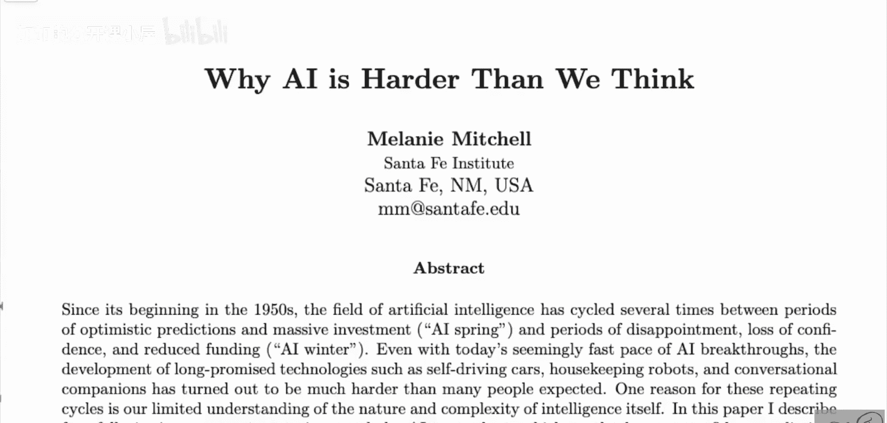

It's a bit of a different paper than we usually look at。

 but I'd still be interested in your opinions。 Let me know in the comments what you think。

 Share this video and of course， subscribe if you're interested in machine learning content。

All right。 Why AI is harder than we think in the abstract here。

 Mitchell makes the case that since the 1950s， when AI was sort of。

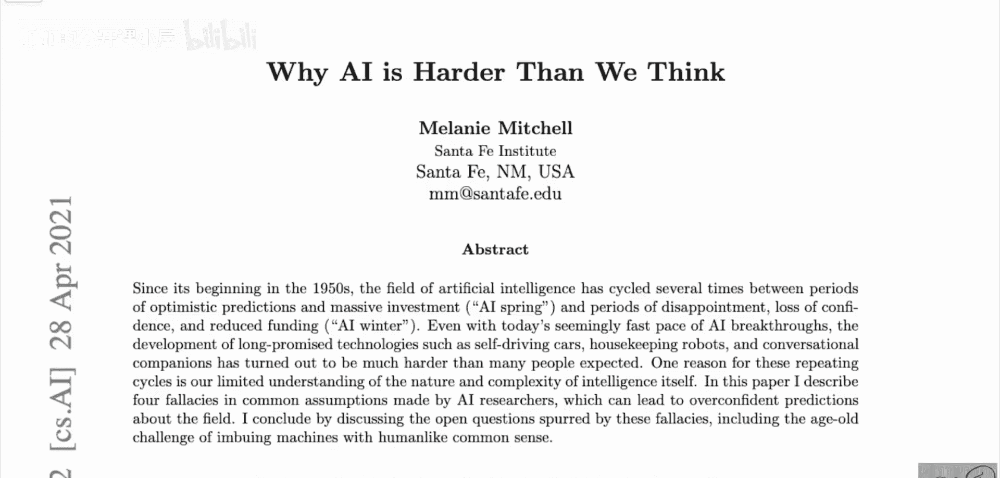

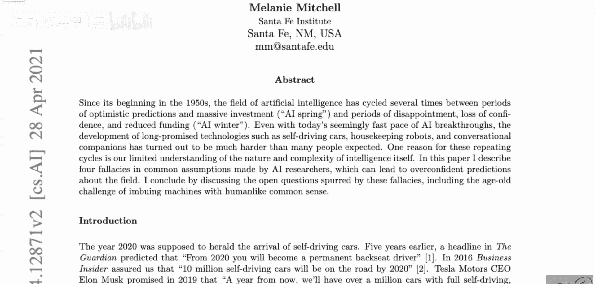

Beginning to develop， there were repeating periods of what are called AI springs。

 which are periods of optimistic predictions and massive investment。 and on the other hand。

 periods of disappointment， loss of confidence and reduced funding， which are called AI winters。

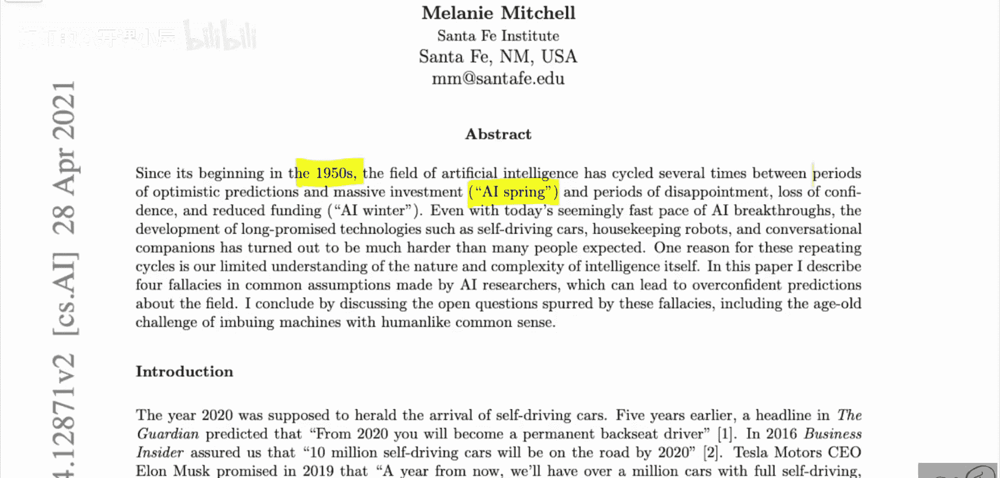

And she says even today where AI has a number of breakthroughs。

 the development of longpro technologies such as self drivingr cars。

 housekeeping robots and conversational companions has turned out to be much harder than many people expected。

 and she says one reason of this is our limited understanding， she says。

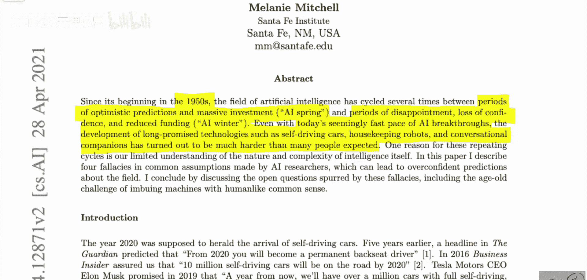

Of the nature and complexity of intelligence itself。

 And there are four fallacies she describes in common assumptions。

 which can lead to these overconfident predictions。

 So if you know anything a little bit about the history of AI， you are aware that this。

 there is this cycle of these springs and winters。 And this has been。

 the case from the very beginning， and she outlines very clearly here that you know， when。

 for example， the the perceptron was invented， people thought， oh。

 we're going to do all of this extremely cool things here， Claude Shannon， right。

 said I confidently expect that within a matter of 10 to 15 years。

 something will emerge from the laboratory， which is not too far from the robot of science fiction fame。

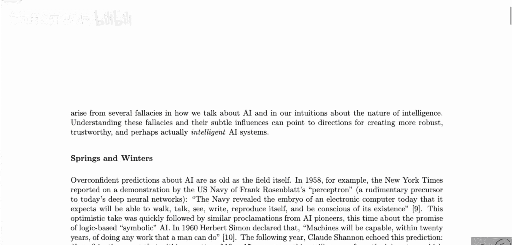

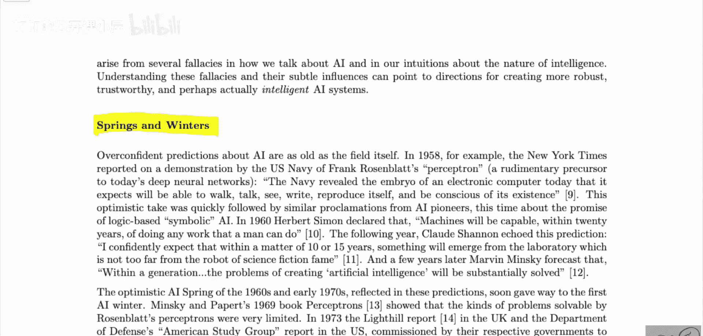

Right， and Marvin Minsky forecast that within a generation。

 the problems of creating artificial intelligence will be substantially solved， so。

This is due to the fact they saw real good progress in a very short amount of time。

 and they just extrapolated that progress。 and that did not turn out to be the case。 And then。

 of course， there was a winter， a downturn in enthusiasm after all these promises didn't materialize。

 Then again， in the 1980s， their。We more， more AI systems coming up。

 There was a upswing again and a disappointment again。 And then in the 1990s and 200s。 Finally。

 machine learning was introduced， by the way， the the 1980s， the time of like expert systems。

 So people first people developed the， yeah， the perceptron and thought that was。

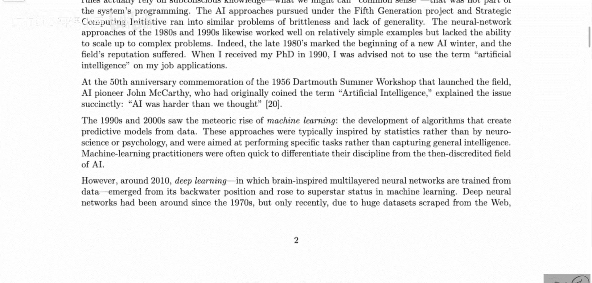

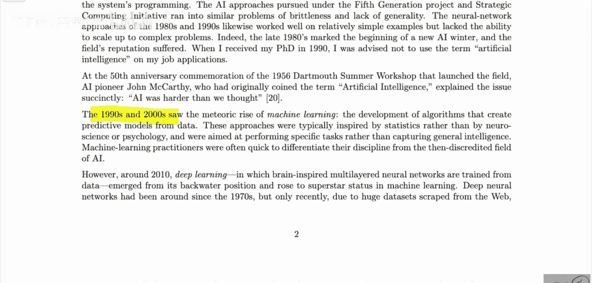

That that was the the the the best。 And then expert systems。

 people thought if we just kind of develop these rules and have these rule solvers and and sort of these rule searching algorithms。

 then we can build AI that did not turn out。 And now in the current paradigm we are in the machine learning paradigm where people develop machine learning algorithms and they think。

 okay， that's the way to go。So。She makes the case here that also this time we might be in a period of overconfidence。

 She says， however， around 2000 deep learning。

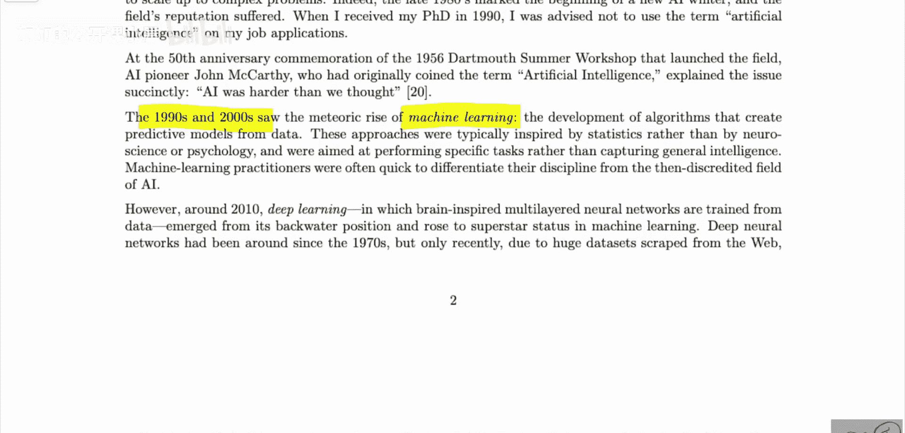

In which brain inspiredpir multilayer neural networks are trained from data emerged from this backwater from its backwater position and row to superstar status in machine learning has been around since the 1970s。

 but recently with big data sets and big compute you know we can we can scale up to a large number of of unsolved challenges and solve them。

 So we can do speech recognition， machine translation， chatbot， image recognition。

 gameplay protein folding and many more things And people， let's say call this AI right In essence。

 this is machine learning and machine learning and AI are almost synonymous nowadays。

 but we shouldn't forget that AI is a different thing than machine learning。

 It's just that many people today believe that you can use machine learning in order to achieve AI。

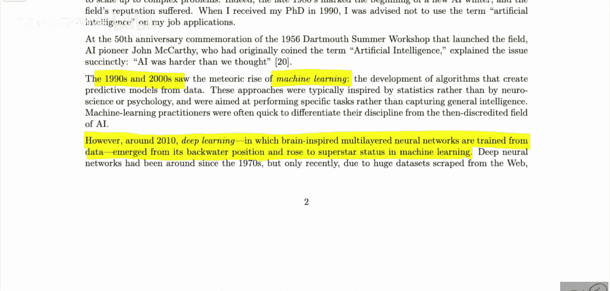

And there was all at once a new round of optimism about the prospects of what has been variously called general。

 true or human level AI。And she goes through a little bit of what tech CEOs say like。

Cofounder of Google Deep Min predicted that in 2008。

 that human level A will be passed in the mid 2020s。 I guess that's soon。

Mark Zuckerberg declared that one of his Facebook goals for the next five to 10 years is to basically get better than human level at all the primary human senses。

 vision， hearing， language and general cognition。Also， that would be， yeah， very soon。

 these 10 years come to an end。So she says， in spite of all this optimism。

 it didn't take long for cracks to appear， sorry。In Deep learnings facade of intelligence。

 So already shes， she's calling it a a facade of intelligence and not intelligence itself。

Turns out like all AI systems of the past deep learning can exhibit brittleness。

 unpredictable errors when facing situations that differ from the training data。

She says these things are susceptible to shortcut learning。I've done a video on shortcut learning。

 If you're interested in that， it's a criticism of neural networks that is is well summarized here by saying learning statistical associations in the training data that allow the machine to produce correct answers。

 but sometimes for the wrong reasons。 one should add。The correct answers in the test dataset set。

 And this stems a lot from the fact of how these dataset sets are generated。

 So maybe there was this famous paper that where they tried to detect criminality from a face portrait。

 And they just happened to， you know， they assembled their data set。

 They took all the criminal ones from like their mug shots。

 but they took all the noncriminal ones from like LinkedIn。

 and the model could just learn who is dressed well and who smiles and and nothing to do with。

 with actual criminality。 And， this short learning is essentially where you say， look， you know。

 the way you construct the data set。 you might， there might be something in there。

Where the model learns to give you the correct answer on your test set because that's constructed equally。

 however， it doesn't really learn the true thing you want it to learn。RightThat is certainly。

 certainly exists。 However， that is， I feel that is like a data set problem， not。

 not a problem with deep learning itself。 Now， humans have that， right， So by the way。

 in other words， these mechanisms don't learn the concepts we are trying to teach them。

 but rather they learn shortcuts to correct answers on the training set and such shortcuts will not lead to good generalizations so。

If you think of humans， humans do that as well， like if， you know。

 with branding and all like if you ever bought a pair of Nike shoes and you didn't exactly check their quality or evaluate them and so like maybe some of you do but others are just like。

 oh， it's this brand that， you know tells me something about it's it's made like about the quality of the shoes or something like this。

 like you know they're not the cheapest and you know theyre you know not the cheapest manufacturer。

 even though that might not be true。But you attach all of this to the brand symbol。 So essentially。

 humans perform short cut learning all the time。But， you know， point taken。

 these networks are brittle。 They sometimes learn the wrong attack。 They're， of course。

 they're vulnerable to adversarial perturbations。 though I don't think that's like a， that's like a。

An exact criticism。 It just means that the networks they see the world in a little bit a different way than we do。

 right， And you can exploit that little difference in order to make them do weird things。 But。

 you know， you need to really target that。 It's not like that happens by itself。The。

 I think the big challenge here is what。