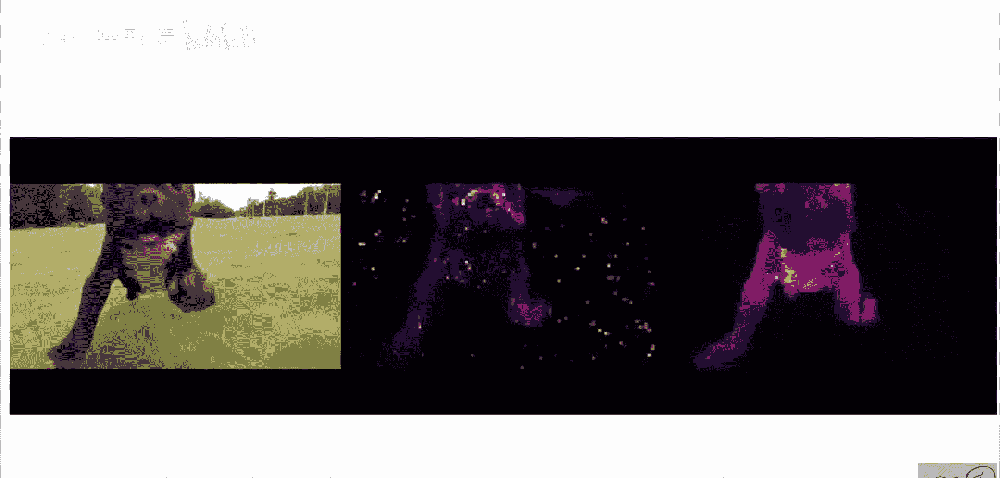
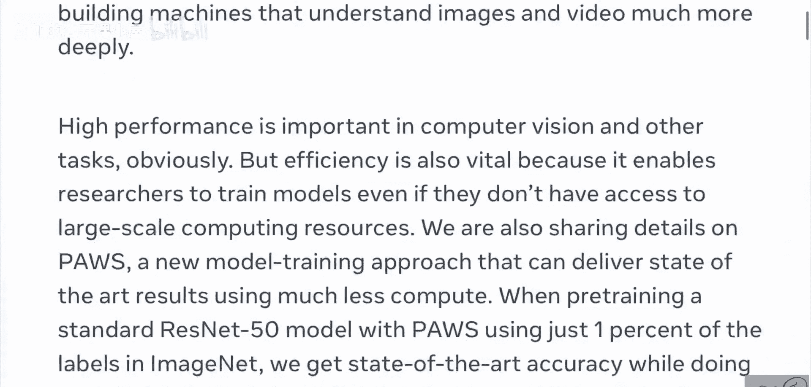
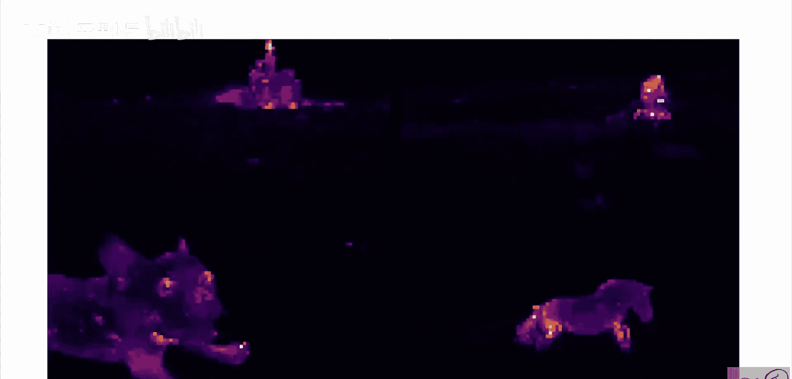
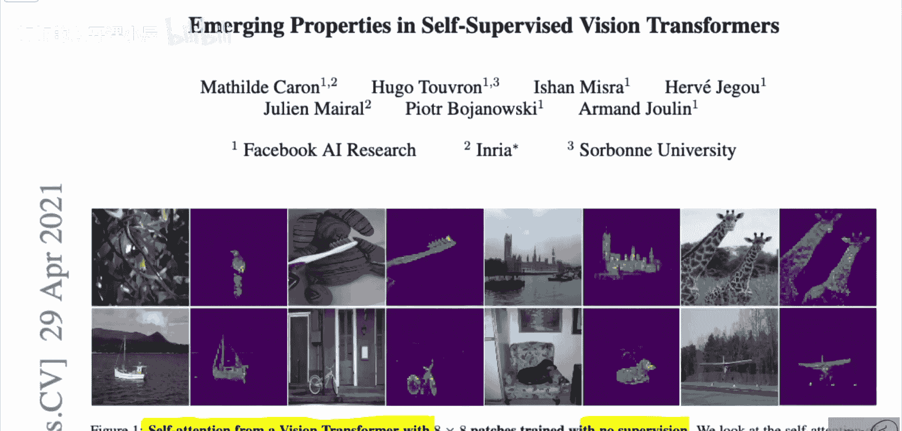
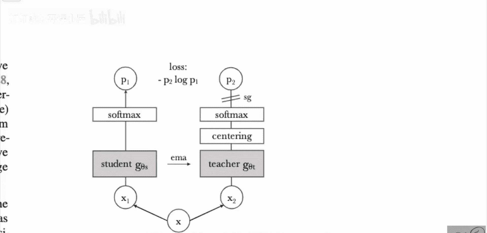

# YannicKilcher【中英⚡AI经典论文领读(全203篇)(下)｜Papers Explained】 p32 P132 DINO：自监督视觉Transformer中的新兴特性（Facebook AI研究解析） [BV1j8x5zJEvx_p32]

Hello there。 I hope you have all seen this。 This is a new system by Facebook AI。

 And what you're seeing here is a visualization of the attention maps of that neural network。

 in the middle is a supervised baseline。 And on the right is this new system called Dno。

 It's not as much a system as it is a methodology for unsupervised pretraining of visual transformers。

 And you can see that this system has neither been trained。

 to learn what a dog is nor has it been trained to do any sort of segmentation。 Yet。

 if you look at the attention maps， it clearly can track objects。

 it knows what to pay attention to in the images。 And it can do much more than that。

 So here you can see that it can sort of track objects behind occlusions。

 So the ship goes behind the waves。 the horse。

Those behind the grass。 And you can see in the attention map that these， this is well reflected。

嗯。You can do more than that， though， even。 So if you use this feature representation that this model gives you for imagenet。

 then as the model gets trained。And you represent imagenet in its feature space。

 It will cluster the same the images of the same class。 It will cluster them together。

 which is already pretty cool because it it has no labels at training time。

 but also it will cluster similar classes with each other which， you know， speaks to the。

 it kind of speaks to the fact that this might be the next step in unsupervised representation learning for images。

 And specifically it appears that the features that come out of a network that is trained with Dno are extremely valuable for the kinds of things we。

 you know， we are interested in when working with natural images。 So this is image retrieval。

And classification。 So this system， let's just switch over through the paper right here。

 The paper is called emerging properties in self supervised vision transformers。

 it presents a system called Dino。 It's by Matil Carro， Hugo Tvo Ian Mira Hevejego。

 Julia Maral Potoboinovsky and Amoulula of Facebook Air Research， Ina and Sobon University。😊。

You can see a bit more here in， in these， in these pictures where again， this is the self attention。

 So the， the attention map from a vision transformer that was trained with Dno and no supervision。

Okay， and you can clearly see that in all the cases。

 the attention falls on what you would consider as a human， the the relevant things in the image。

 Now， I have my hypotheses。 Why this is the case， like completely without labels and we。

 we'll see about that。 But the representations that come out of the systems。 are really useful。

 for example， you can fine tune linear classifiers on top of these representations and get that gives you really good image classifiers。

 they do that with image net。 you can use these for image retrieval because similar images are cluster together。

 you can。Use even do zero short classification， simply by doing a K nearest neighbor classifier in that feature space。

 And yeah， here， you can also do some sort of proto image segmentation by looking at the attention maps。

 You don't even have to do something special to visualize this like you have to do in CNN Ns。

 The attention map directly gives you the the sort of segmentation map or。

 or something pretty close to it。

As an overview， this system Dno is simply a， they push the self supervised learning。

And they specifically make the case that self supervised and visual transformer。

 they go together really well。 And they， as I said。

 the dino is called self distillation with no labels。 So that is die。 no and yeah， they。

 they push various kind of metrics in in in the self supervised systems or， you know。

 then linear classifier trained on top of them。For example， 80。

1% top1 on INe in linear evaluation with a visual transformer base。

And a quick overview over the system is right here。

 so two things they say are important next to all the other self-supervised systems first of all。

 they do they have a kind of student teacher that's the self- distillation part the teacher is a momentum teacher and it does this centering and it also does sharpening in the softmax right here and then there is no contrastive learning。

 there's no negative samples that the sharpening and the centering sort of take care of keeping the model from mode collapse or from collapsing Also there's no batch norm So if those things don't don't mean anything to you。

 maybe we stay tuned we'll discuss them in a bit more detail as we go through the paper。

If you like paper summaries like this and other content， for example， our cooking video。

 feel free to share this out and tell your friends about it。 By the way。

 the cooking video did terribly。 I don't know why。 I guess。

 I guess my YouTubeber skills are just not， not on par。 but yeah， I don't know。Yeah。

 if anyone has any ideas。 Alright， let's dive in， so。Vision transformers are a new thing， right。

 Vision transformers。 I've also made a video about vision transformers。 They are。The easy。

 the simple application of the transformer architecture， which was。

Prevalent in natural language processing with the introduction of attention is all you need。

 and follow up papers， Bt and so on。 And applying this to images。 And the concept is very simple。

 You have an image， and you divide this into patches。 So you divide the image into patches。

And then you simply unroll that array sort of。 So you unroll that array。 So you have patch， patch。

 patch， patch， and so on。And then you simply consider this as a sequence， like a sentence like hello。

 my name is and so on。You simply consider the sequence of patches as word embeddings。

 So there is like one， I think there is one fully connected layer to actually get the word embedding。

Or the token embedding。 And then you put a transformer， as you would in N LP。

 So there is a transformer。Here。And you do whatever you do with a transformer。 So usually。

If you don't know， people prepen a special token。 That special token is usually called something where I'm draw this。

 That special token is usually called C LS token。 and that is also passed through the transformer and the transformer in its base configuration。

 It of keeps it keeps the length of the sequence the same。 It's actually not necessary to do this。

 but that's just how we do things。So for every input token。

 you'll get a corresponding output token or output embedding or output signal。

 whatever you want to call it。And。Such that none of the input tokens is， you know。

 kind of preferred because every input token sort of refers to some little patch here in the image。

If you want to say something about the entire image， you don't want to prefer any one of them。

 So what you do is you have this special token， the C Ls token。

 which is associated with no location in the image。

 And that's ultimately what you use to classify the image or also here to do representation learning。

 So the representation we're looking to get out is the。Final layer embedding of the C L S token。

 And that through the transformer architecture had aggregated all the information。

 or we hope so from all the visual tokens in the image。So that's a visual transformer。 Now。

 what do we do with it in this dino architecture。 I've already shown you this picture。

 Let's go a little bit deeper into that self supervised learning naturally means you have no labels。

 And in this case， you don't even have a negative sample mechanism or a contrastive learning mechanism。

 So what you want to do is you want to train a model that sort of gives you。

Gives you sensible representations， and that is easier said than done if you have no labels。

