# YannicKilcher【中英⚡AI经典论文领读(全203篇)(下)｜Papers Explained】 p33 P133 内卷：颠覆卷积的固有特性，在视觉识别中的应用（研究论文解读） [BV1j8x5zJEvx_p33]

Hello there。 Today we're looking at involution， inverting the inherentance of convolution for visual recognition by number of researchers of the Hong Kong University of Science and Technology Btedance AI lab and Peking university in this paper on a high level。

 the researchers try to replace the good old convolution operator in CNNs by this new thing called an involution In its essence。

 Involution is about halfway between a convolution and a selfatten kind of operation and turns out that with some clever way sharinging scheme。

 you can achieve very good performance compared to CNNs and self-attention networks while keeping the number of parameters and the computational cost relatively low this I think。

 is very much worth trying for any。

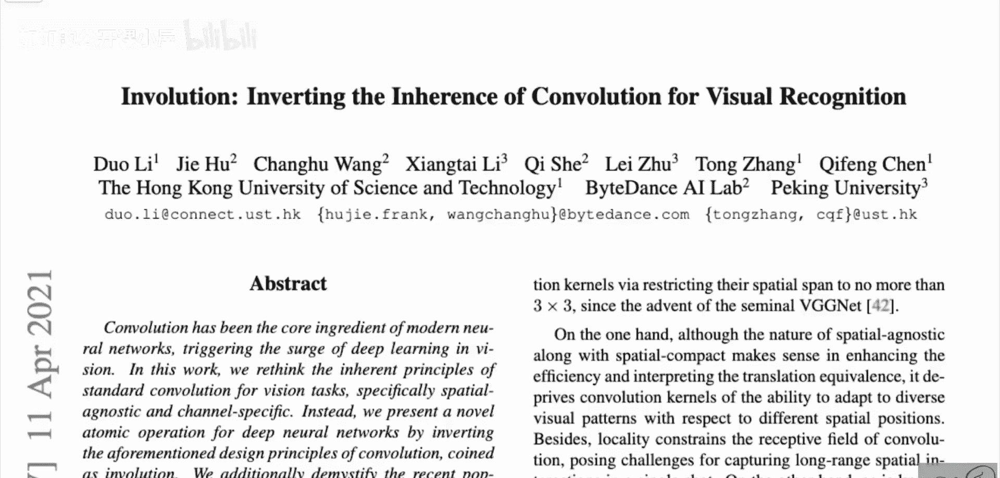

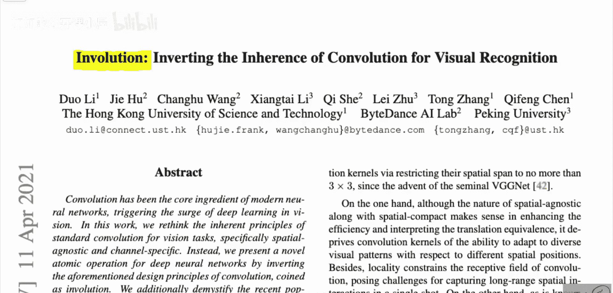

Anyone who does not operate on extremely large scale problems。

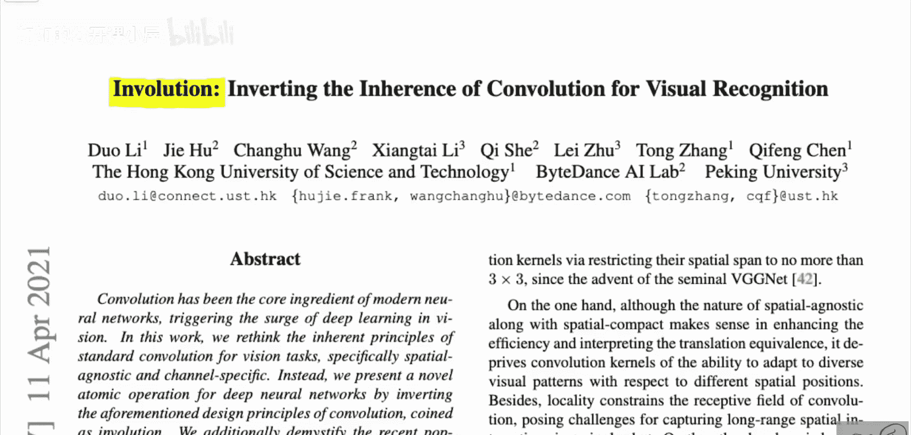

We'll get into that a bit more when we go into the experiments。 But for now。

 let's go through the paper through what invol is， what it does， how it's different。 And yeah， so。

If you like this， you know， don't hesitate to share it out。 it would help a lot。

 We're on the road to 100 k subscribers and with every subscriber， I get a subscriber。

 I stole that joke。So they say here in the abstract。

 convolution has been the core ingredient of modern neural networks。

 triggering the surge of deep learning in vision， which， you know， correct Alexnet， Resnets。

 etc cetera， convolution， even though transformers are slowly taking over computer vision。

 convolutions are still very， very much used and if you're not on a super large scale problem。

 a convolutional neural network is still very probably the best way to go if you have a computer vision problem。

They say we rethink the inherent principles of standard convolution for vision tasks。

 specifically spatial， agnostic and channel specific。 Instead。

 we present a novel atomic operation for deep neural networks by inverting the aforementioned design principles of convolution coined an involution。

 Okay， and they say we additionally demystify the recent popular self attention operator and subsume it into our involution family as an overcomp instantiation。

 So the。A lot of statements in this paper are let's say are true， especially further down。

 A lot of the experiments are really cool， but it is a bit of an overstatement。

 what they say right here。 So their claim is that in if you have a convolution， what you do。

 you do something that's spatial， agnostic and channel specific。

 which means that in a in a convolutional neural network， when you have an image， let's say。

With a bunch of pixels， these are now true pixels， not patches。

And you run a convolutional layer over it， you run a convolutional kernel over it。

 you put the center of the kernel at some pixel then so the kernel will be something like a three by three kernel。

 you put that on the center here。 So it overlaps here， you multiply element wise。

 and then you aggregate， and you can do that in multiple channels。

 but essentially you do that and then after you've done that， you move， you move the kernel one。

 let's say to the right， you shift it。So the center is here。 You do the same thing again。

 and you shift it。 you do the same thing again。 So it's spatial agnostic because it repeats the same computation over and over and over across the image and it doesn't care where the computation is right does the same computation。

 and that is the selling point of convolutional neural networks。 They are translation invariant。

 This is it's a form of weight sharing， right， you share the weights across the locations。

 and therefore you don't really care where stuff is in the image that the CNN will be able to recognize it just as well。

 and you don't need to learn over and over and over the same principle just because it's in different parts of the image。

So this is spatial agnostic。 What does channel specific mean that for that。

 we have to go into the multiple channels realm。 So if， if your image。Has multiple channels。

 Let's say I'm going to draw a new image right here。

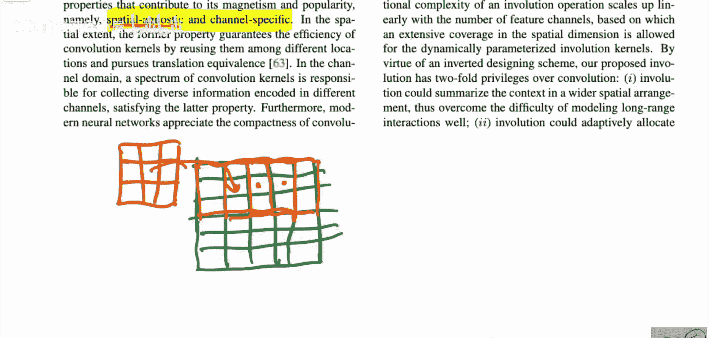

With a bunch of pixels。And it has multiple channels。

 That means you can imagine it sort of as a as a 3D tensor here。

 where each pixel is a column and every column is a vector of certain dimensionality。 I mean。

 so the original image has， of course， three channels， which is red， green and blue。

But if you have intermediate representations， these channels can grow to sizes of hundreds of channels and the point of the channels is every entry here is a number。

And every number can sort of capture one aspect of what's described in that particular pixel。 right。

 So maybe the first channel is。Is there a corner？ The second one is， iss there an edge。

 The third one is there， is it， Was it originally a blue pixel。

 The fourth one is there probably a cat here and so on。

 So that these are like the different features in， in the channels。

 And a convolution operator is channel specific。 That means if you have the kernel。

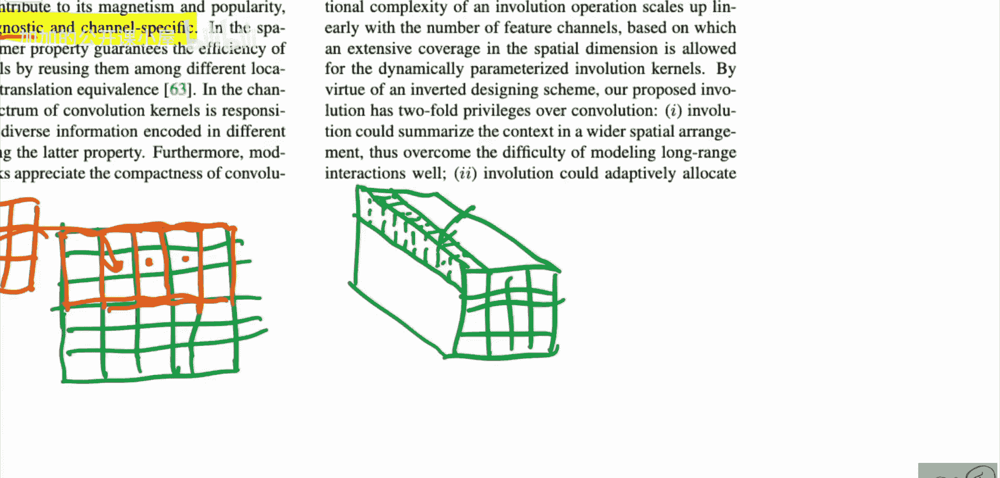

Now， convolutional kernels aren't as easy as I drewew them。 They， in fact， four dimensional tensors。

 So that is。They are four dimensional tensor， which makes it a little bit。Complicated for me to draw。

 honestly， however， if you， you can imagine that you have one kernel。Like so。Okay。

 that has the same amount of channels as your image。 Okay。

 so now you can still do the same operation， right， You can overlay your kernel。

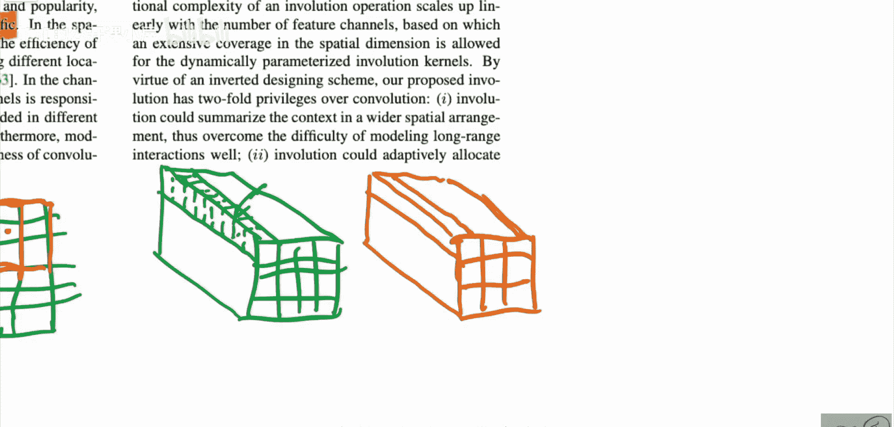

On a part of the image。Can overlay it like so。And oh， that's in the back。

And then you can do element wise multiplication。 and then you do an sum。 you sum it all up， right。

 After you do this operation， you do a big sum over all the elements of whatever your kernel multiplied with your image。

 And that gives you。

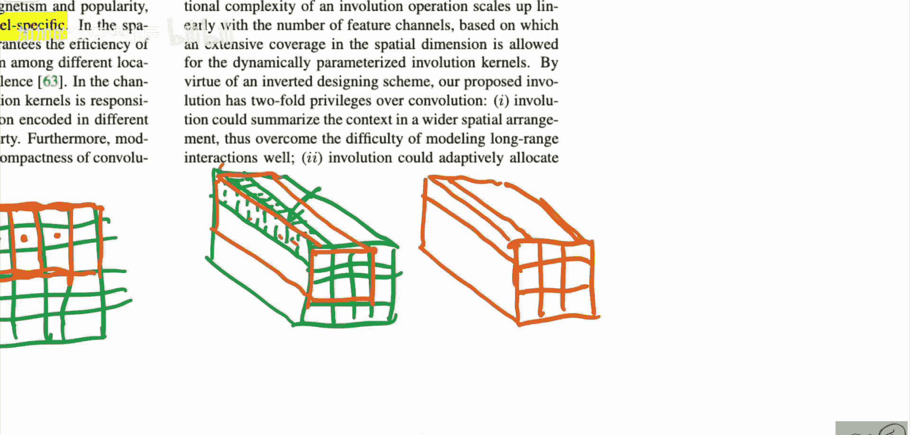

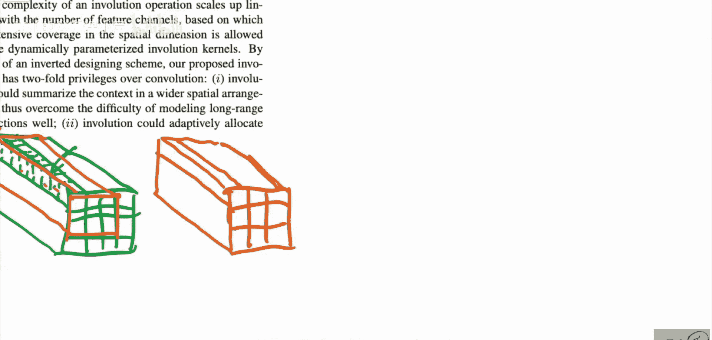

Wen。Number， you' doing all reduce。 One number gives you one number， and。

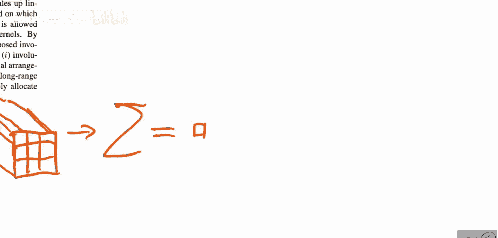

So you do this， so this is one kernel， but you have another one right here。嗯。

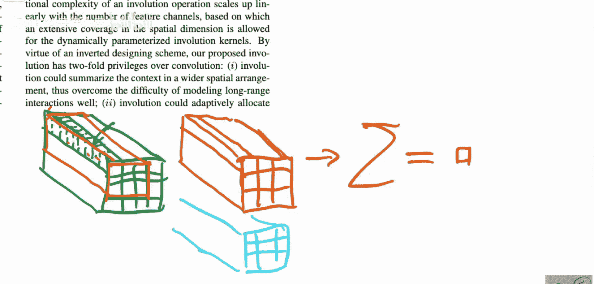

Yeah， like this。 And you do the same thing。 And that gives you。

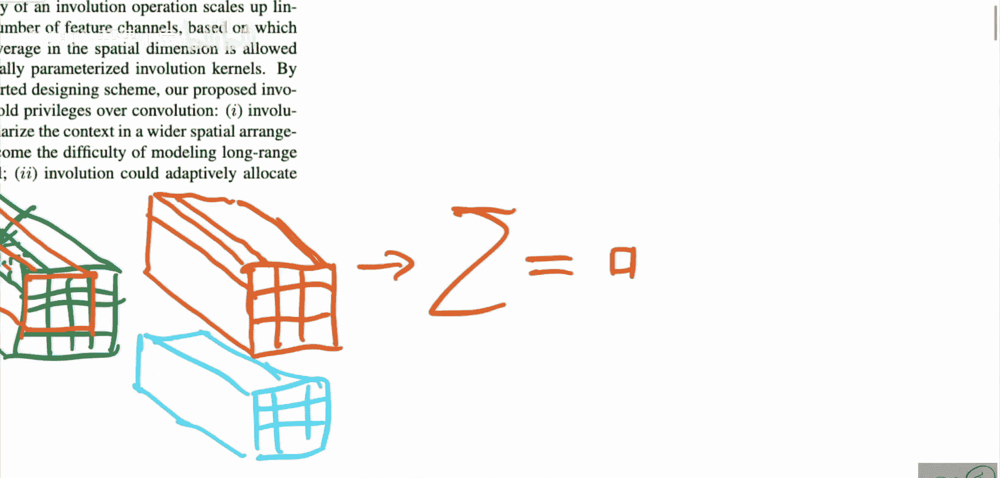

Also， one number。 and you have another kernel。 I think you， you get the idea。

 You have another kernel here。 So you have many of those kernels per layer when you actually。

 if you've never looked at， you know， how the weights look when you instantiate these layers in a deep learning framework。

 encourage you to do so， right a， a convolutional layer will have weights that are of the size。

 kernel size by kernel size by input channels by output channels。 So it's a 4D tensor and。

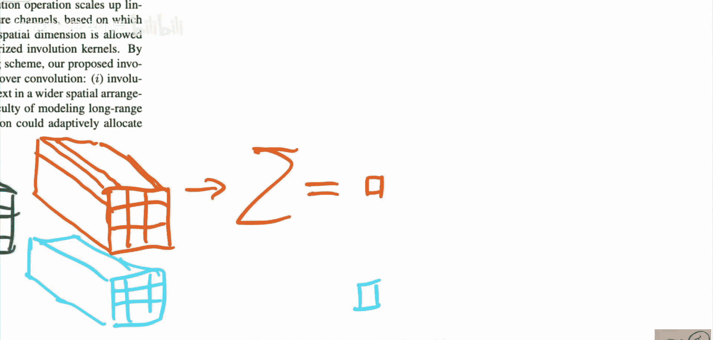

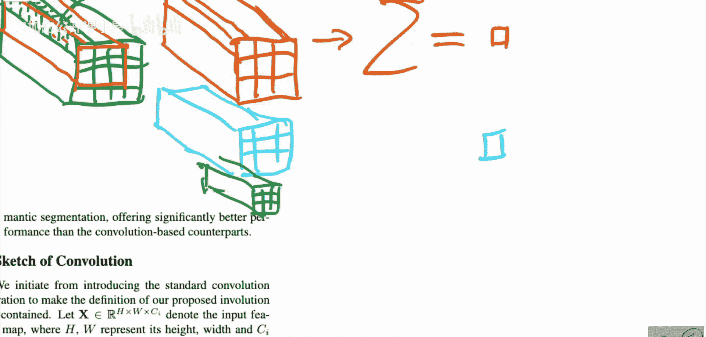

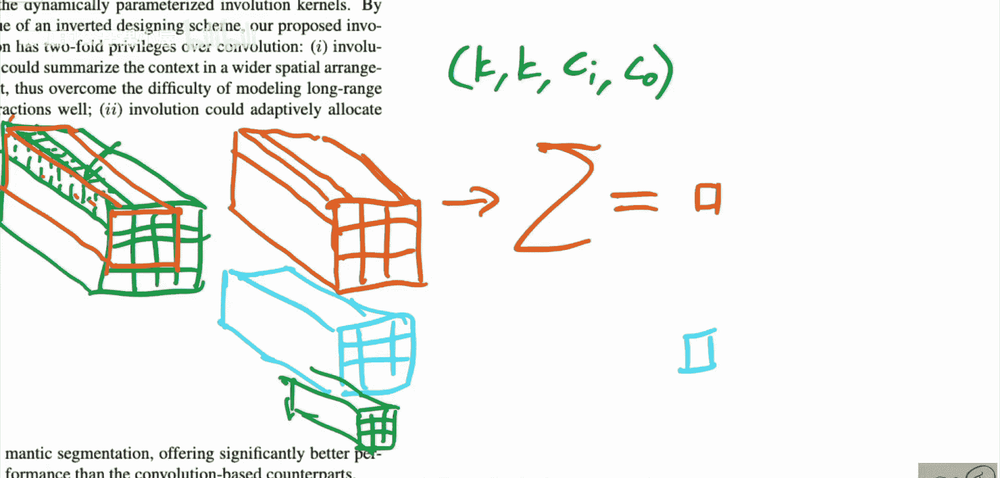

This， the orange part here。Is just one of those subtensors。 In fact， you have。

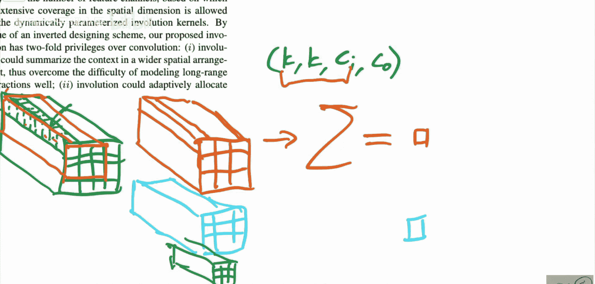

As many。As you have output channels， and that gives you。

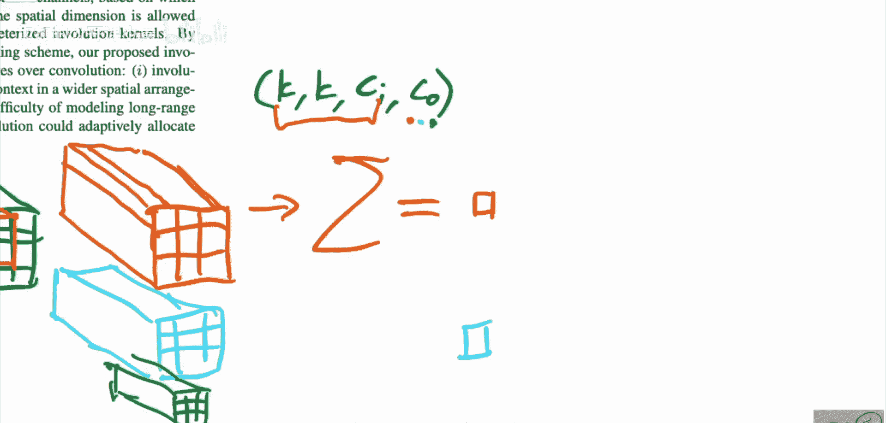

Of course， when you then go over all of these。

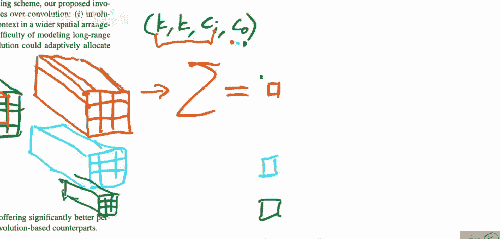

That gives you the next layer。 So that becomes in the next layer。嗯。那那。

So this is the next layer representation， right， at the point where you。Overlaid the， the。

 the colonel， in the last thing。That will become。This column， right here。Okay， so you have。

The orange thing in the first， the blue thing in the second channel。

 the green thing in the third channel and so on。 Oh， this is relatively clear。 So you have， in fact。

 one convolutional kernel per output channel。 Okay， so if， if you call the orange thing here。

 a convolutional kernel。 Then you have one kernel per output channel。

 And that means its channel specific。

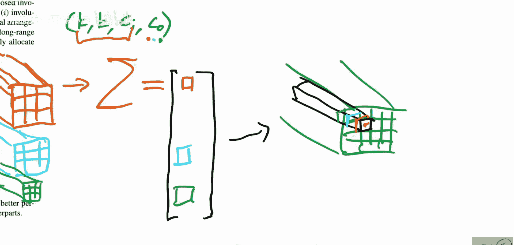

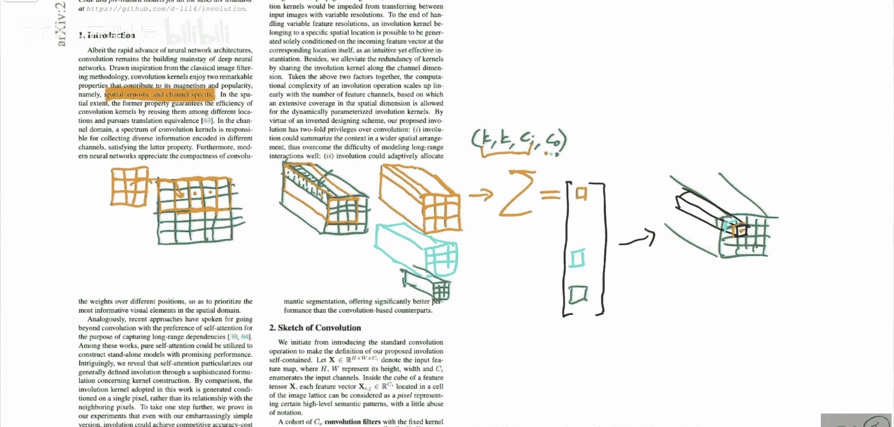

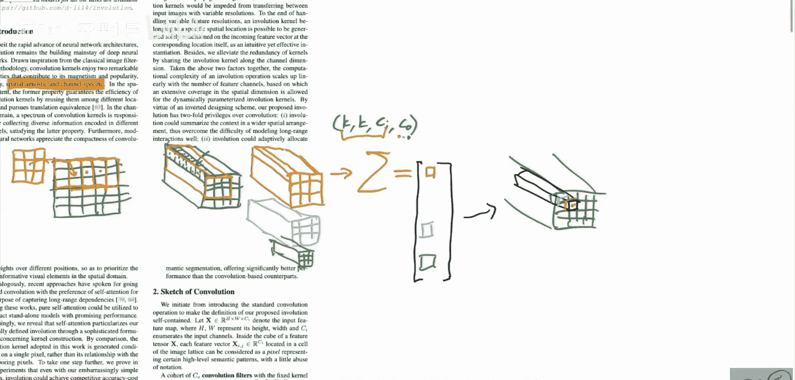

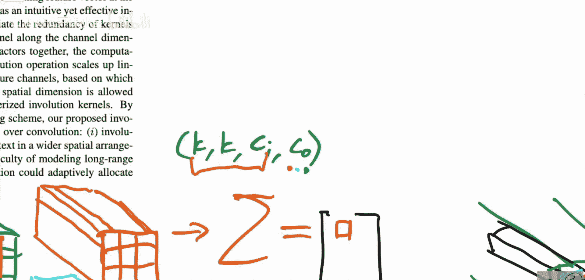

So。This this is a conscious choice， and it makes sense when you think about it because the each output channel means something different。

 right if I want， if my output channel means is there a cat at this particular location。

 then I might want to aggregate the last layers representation differently， then if。

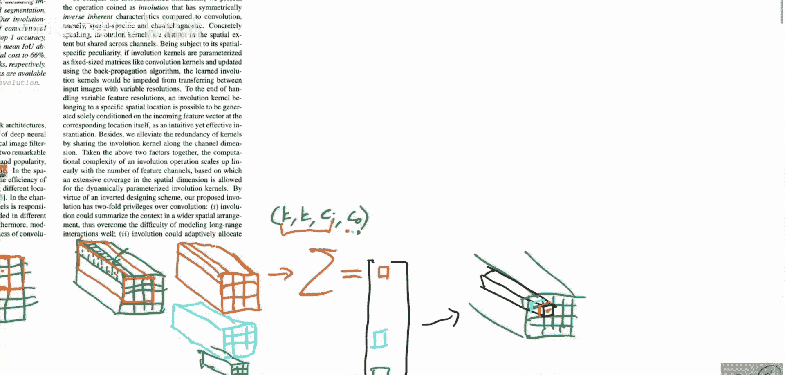

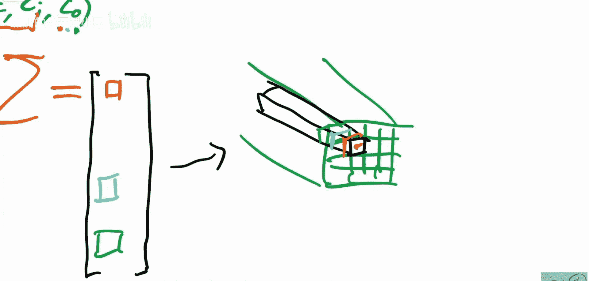

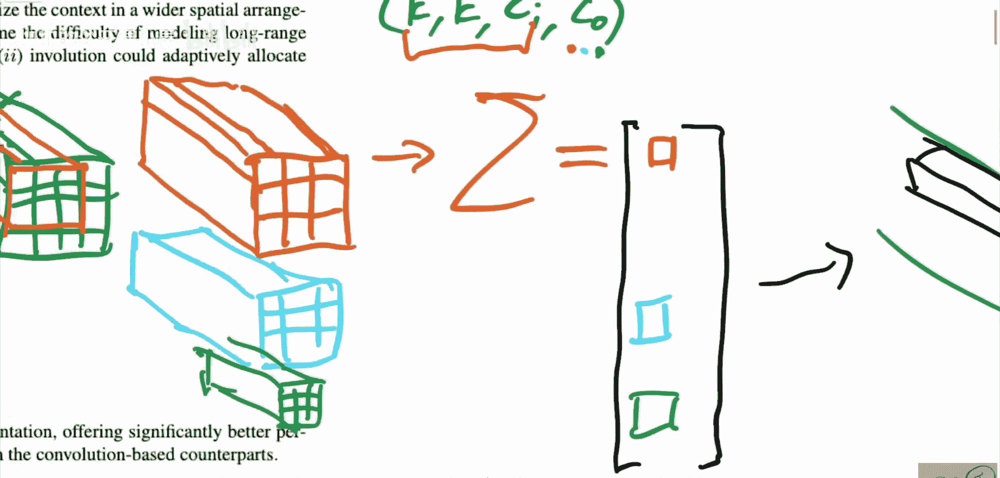