# YannicKilcher【中英⚡AI经典论文领读(全203篇)(下)｜Papers Explained】 p34 P134 DDPM - 扩散模型在图像合成领域击败生成对抗网络（机器学习研究论文详解） [BV1j8x5zJEvx_p34]

Hello， these are generated images from a new model， actually， a new class of model。

 It's been around for a while。 but for the first time。

 this new class of model has been pushed to the point where the images they produce or not only look really nice and look like something you we've come to expect from the latest and greatest G models。

 but also they are better in the standard metrics we use to evaluate G specifically here in the FID。

 the the fresher inception distance so。😊，The paper we're going to talk about today is called diffusion modelss Bea Gs on image synthesis。

 It's by Pero Darriwall and Alex Nicole of Open AI。 And I mean， already in the title。

 they're pulling no punches。 Just be like this beats Gs， okay。

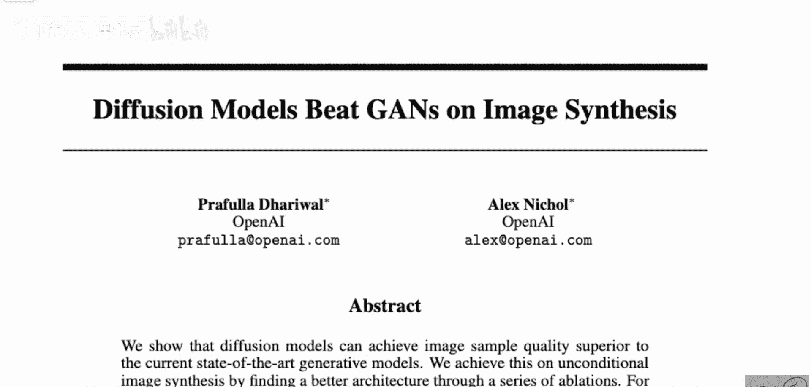

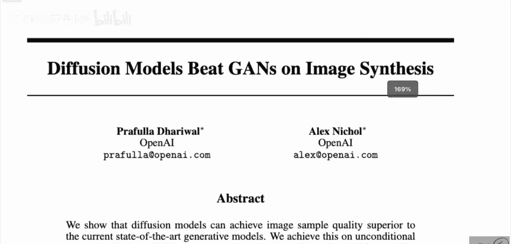

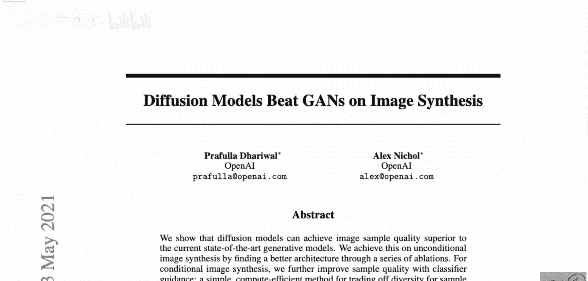

嗯。So in this paper， they're mainly talking about improvements to this new class of models。

 which they call diffusion models。 Now， I would like to dive a bit more into what diffusion models are instead of just telling you what the improvements of this paper are because I think most people haven't come in contact with these types of models yet。

 So they thoroughly reference another paper， which is called improved dennoizing diffusion probabilistic models by themselves。

 And in this paper， they go， they more develop these new models than in the other paper。

 this the paper here， as you can see it's just like three months younger than the other paper。

 So this is really close， I think this paper is more insightful into what these models are。

 that being said， you know， by the name， improved right here， you can also see。

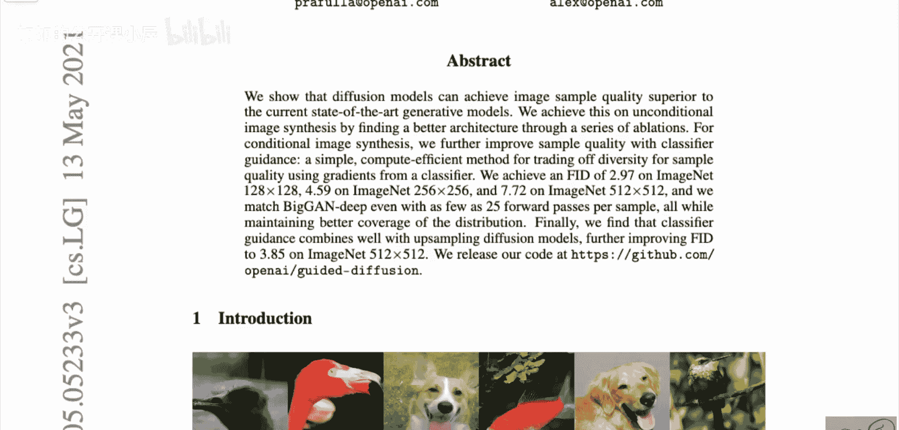

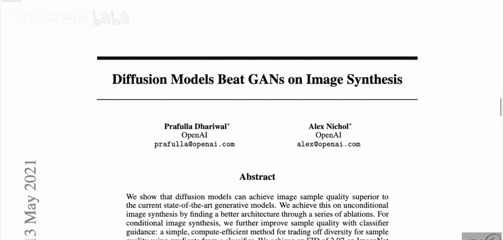

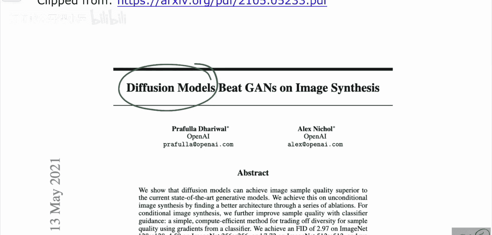

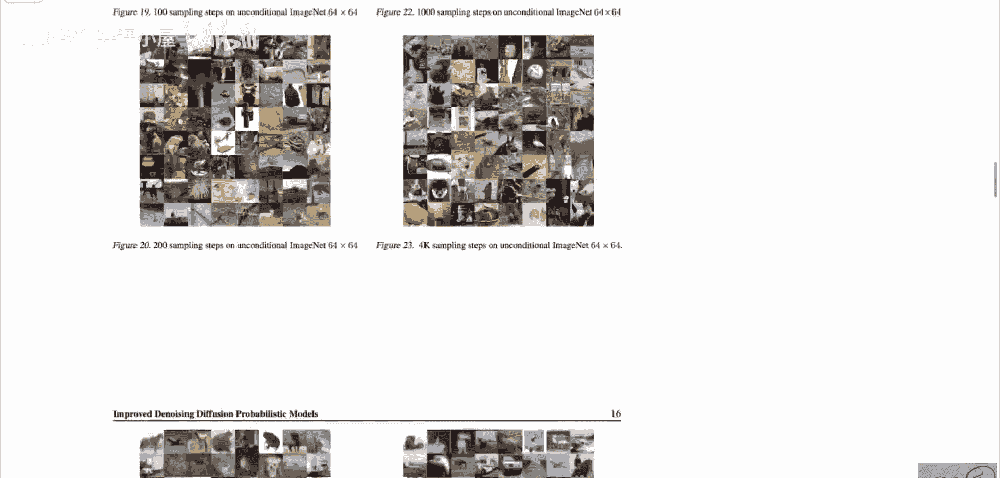

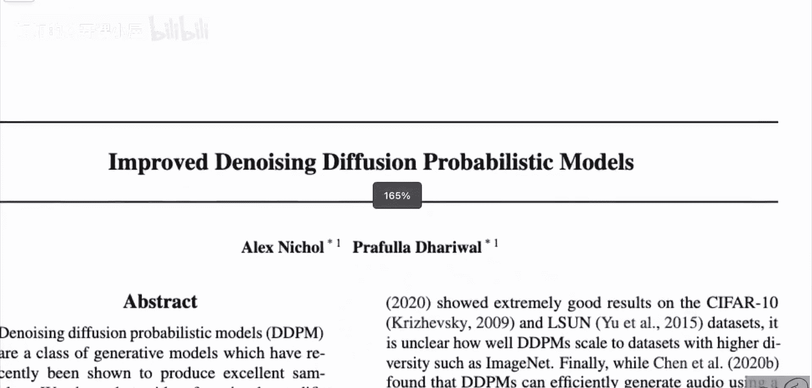

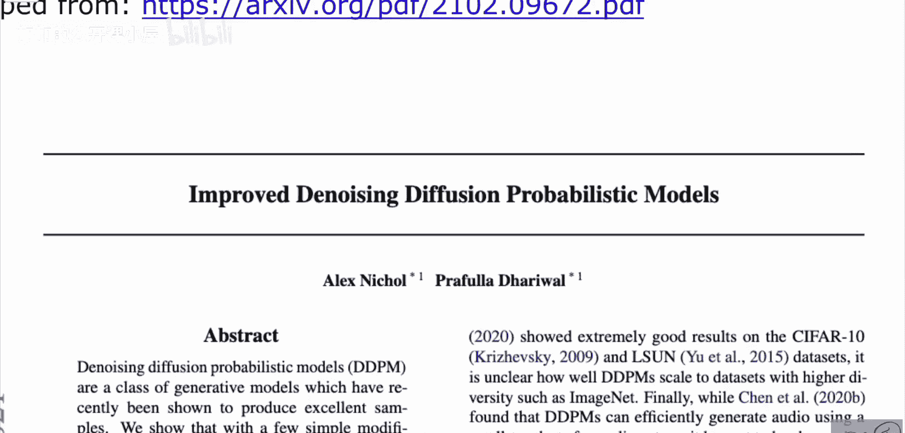

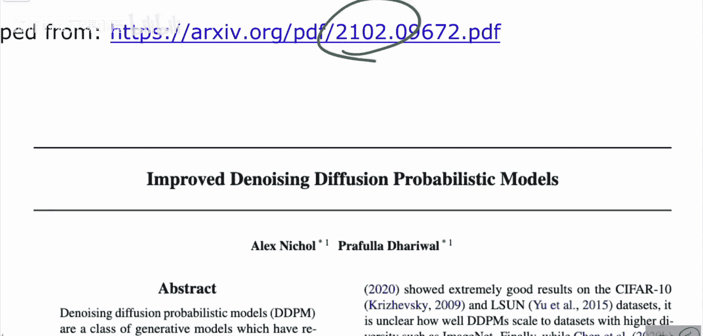

That this is not kind of the seminal paper of these types of models。 So if you're interested in that。

 you have to go back even further。

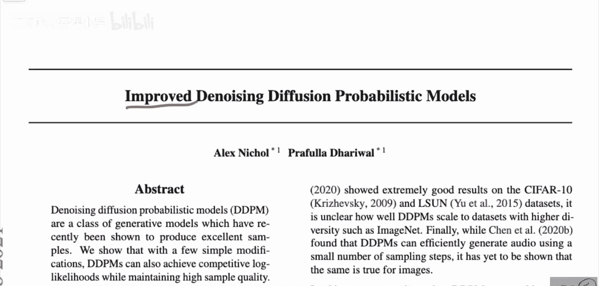

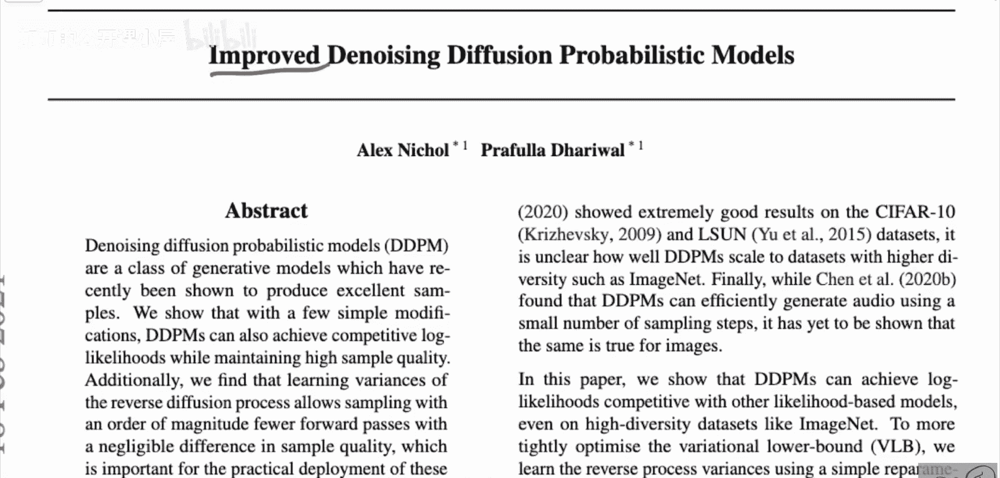

However， we're going to look at this and we're going to look at the new paper and see what are all the things that lead to this new class of models being better than Gs。

 specifically， we're going to talk about D DPMs， denoing diffusion probabilistic models and they're a bit。

 they're a bit like a variational autoencoder， like a little bit。

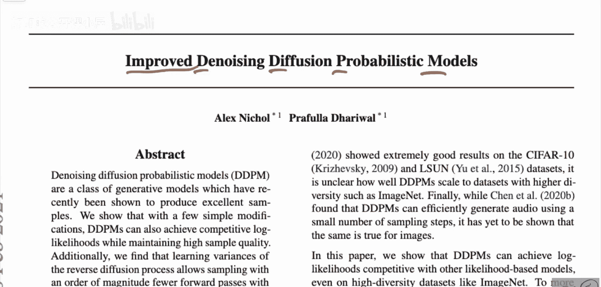

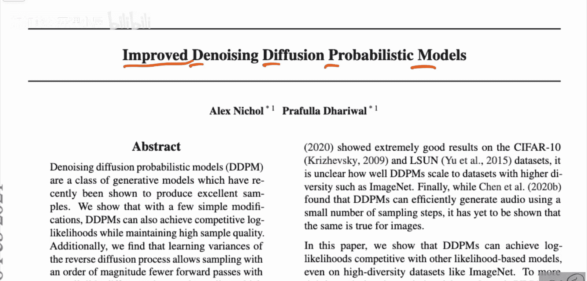

Yeah， but we'll go through that。Alright， so if， if you feel that this was helpful。

 please do share it out。 It's been， it's been a pleasure bringing this to a lot of people。

 And if you do， it will just be more people。 We'll have more fun。😊。

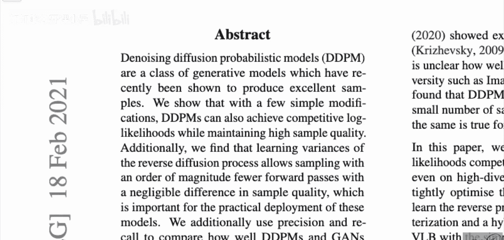

Right， so they say that denoing diffusion probabilistic models。

 DDPMs are a class of generative models， which have recently been shown to produce excellent samples。

 Okay， And we show that with a few simple modifications。

 DPms can also achieve competitive log likelihoods while maintaining high sample quality。

 So in this paper， they take these models， these DPM models。 And they say， look。

 we can push those models。 to。To push their their log likelihood。

 So there are a number of metrics that generative models track。

 It's not as easy as kind of the validation set accuracy in a classifier。

 Lo likelihood is one of the metrics that these models track。 and here they say， well。

 we can get competitive log likelihood while maintaining high sample quality。

 which is a nice way of saying we don't beat Gs yet， right？ in the next paper， then， you know。

 the 1 I showed you before， they actually do beatgans on the standard metrics and also the samples look quite quite impressive。

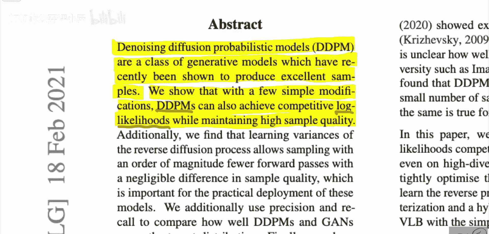

So DDPMs have been around before， but they go into a quick overview right here。

 which is what I think is quite appropriate for us to dive in so。

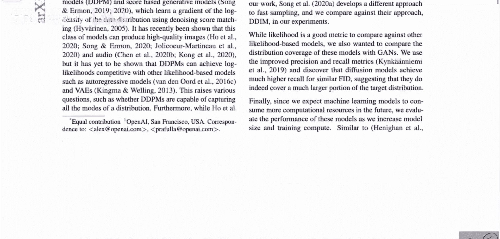

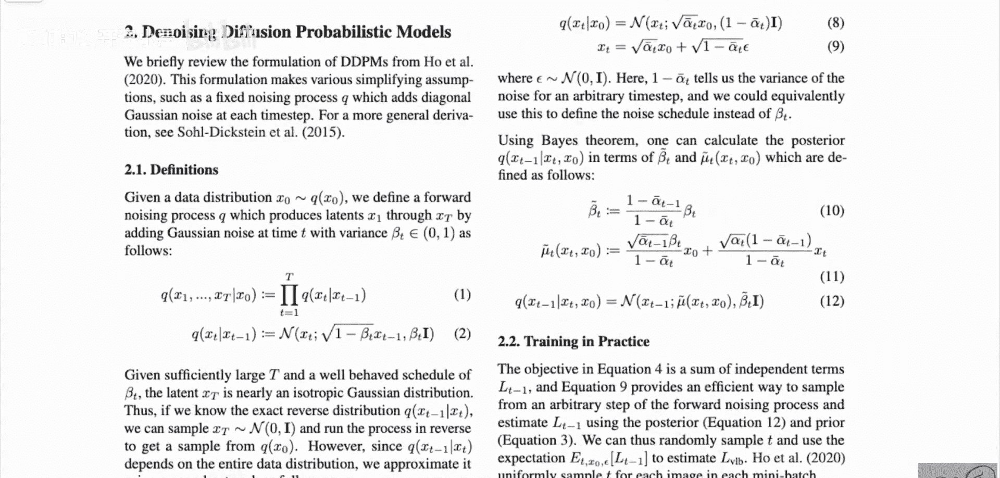

The， the， the philosophy here or the whole the whole purpose behind， behind this is they say。

 let's imagine I have an image， right？ I have an image。

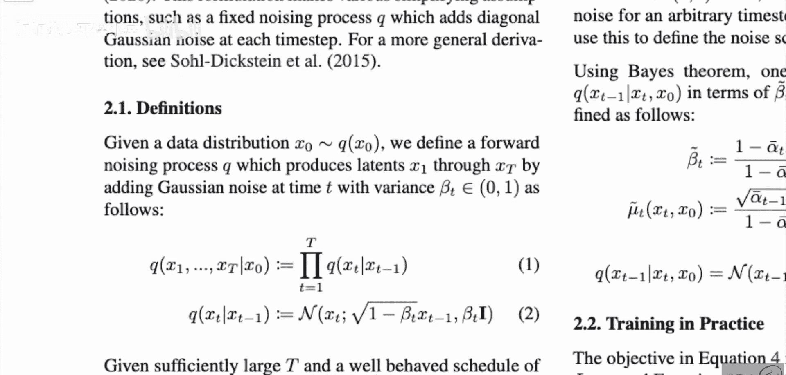

Of， I don't know， my house right here。 I have an image of a house。

 And I define a process what they call a forward noing process。

 And this forward noing process takes the image。 and it just adds a little bit of noise to it like epsilon noise that's sampled from some standard distribution like a Gaussian。

 Okay， so you just sample a bit of noise。 and you just add it to that image。

 So you have the same house。 but there's there'll be a bit of noise on it。 Okay。

 and then you do it again。 Okay， so you sample another bit of noise。 And sorry。

 this comes from this distribution。 and you do it again。And as you do this over many steps。

 And here they， they actually， they notice that the previous authors were using 1000 steps。

 And if they just increased that to 4000 steps like the log likelihoods go better。 In any case。

 you do this for many steps， thousands of steps。 in this first instance。You do this。

What are you gonna end up with。Well， the argument here is that if you do this for so many times for so long。

 over so many steps， you're going to end up with random noise itself， right？ So this is ish， ish。

 according to。Some kind of normal distribution。 Okay， you， you just assume， right。

 And you can actually prove this that if you do enough step。

 like if you do infinitely many steps and it goes actually towards just noise。

 So whenever you're done with this， there is。Like no more information about the original image than actually sampling from this distribution right here。

 So you have successfully defined a process that takes you from the image space。 right。

 This here is from the data space。 that takes you from the data space to a known distribution。

 which is the normal distribution。Now。Here is the， the kind of the logic。 If we could invert this。

 like， if we just somehow could invert this mapping， right。

 if we could have a process that knows if I give you an image with some noise。

 can you tell me what image that came from。

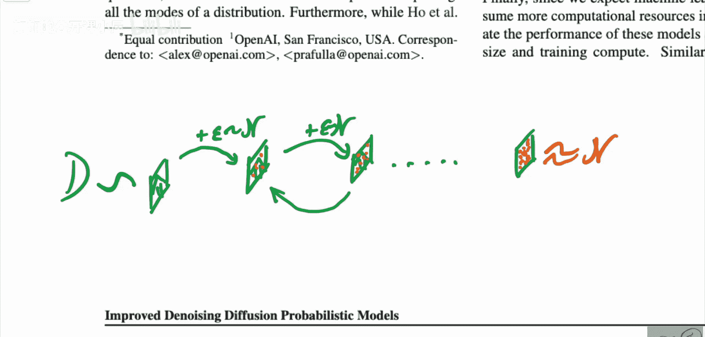

嗯。I， is that doable， right， And it's not， it's not， it's， it's thinkable， right。

 If I give you like this image with some specks of noise on it and I ask you。

 could you please give me like， I tell you， I pro like I， I'm the oracle。 I tell you， look。

 I've taken some image。Right， that already had a bit of noise on it。 But， but I've added more。 like。

 I've taken an image。 I've added some noise。 What was the original image that I。

 I don't tell you what the noise is， right， I just tell you the noise comes from whatever a normal distribution I've added it。

 What was the original image。 Now， you looking at this image。 You'll see you know。

 this could be a house。 so。

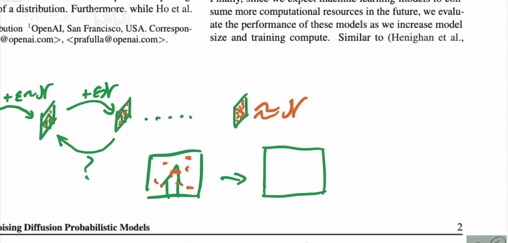

Not quite sure， but， you know， this might be something like this might be the original image。

 And this here， I'm not really sure about if this is noise。 So you。

 you're gonna sort of revert that process a little bit， right。

 Know that this is how the image came to be， you， as a human， If I told you you could。

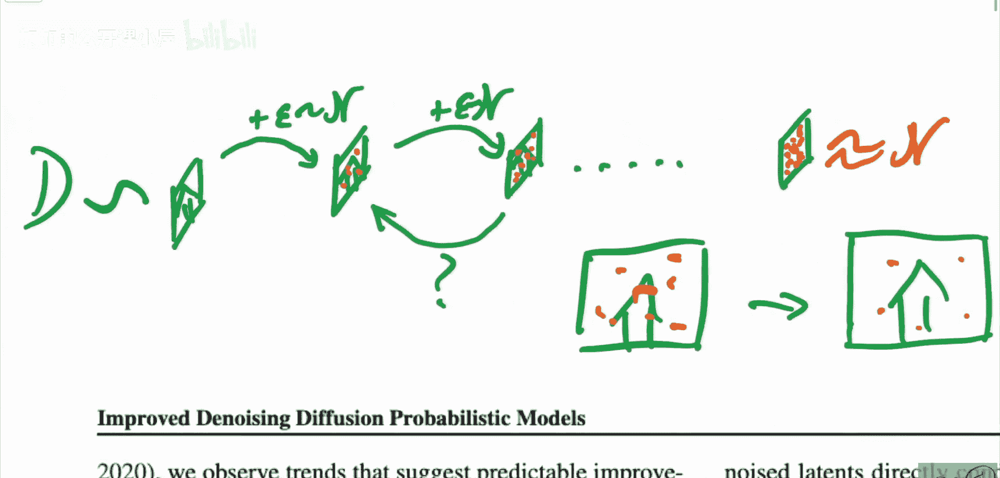

Appoximately， reverse that process That， of course。

 requires you to know something about these images。 right。

 like it requires you to know what a house looks like。 And when you see something like this。

 that well， you know， probably， because I don't tell you which ones are the noise and which ones aren't。

 So that's the trick， right， If I just told you， well， all the orange stuff is noise。 right， But you。

 you just see， you just see this all in monocolour。 but you know， kind of okay。

 So this here looks like it's from the image itself。 But then this here is just kind of a speck。

 And that just kind of， you might just be noise， maybe not， right， but then this here。

 I'm pretty sure it's just noise， and not part of the original image。

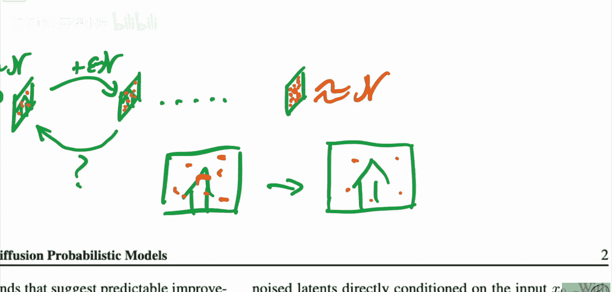

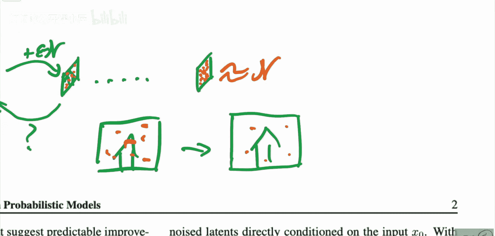

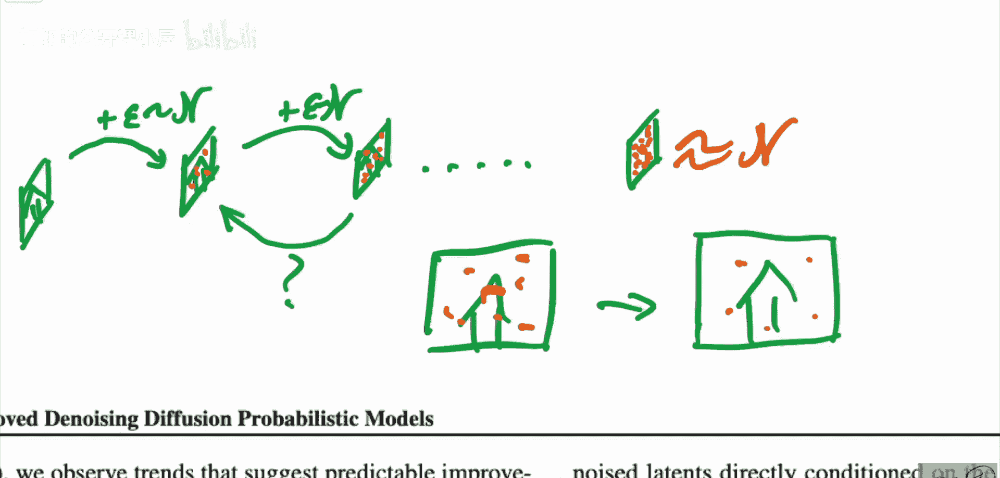

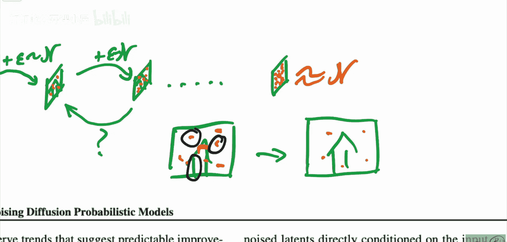

So you could do that。 And the question is， can we learn a function that does this reverse process。

 if we can do so， right， if we can learn a function function， of course。

 that's going to be some kind of neural network is thing。

 If we can learn a function where I give you an image with noise。 And I tell you， by the way。

 So this is maybe time step 0。

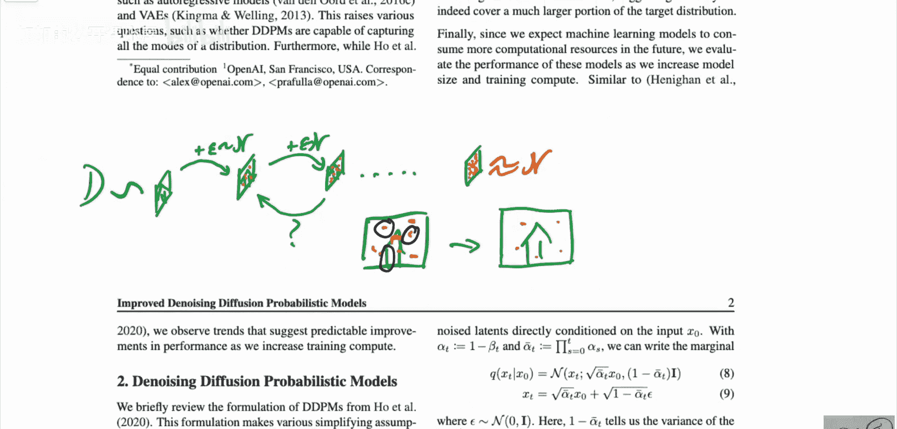

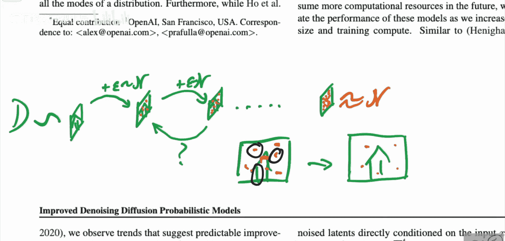

This is t equals 0， t equals 1， t equals 2， and so on。 you can't see that。

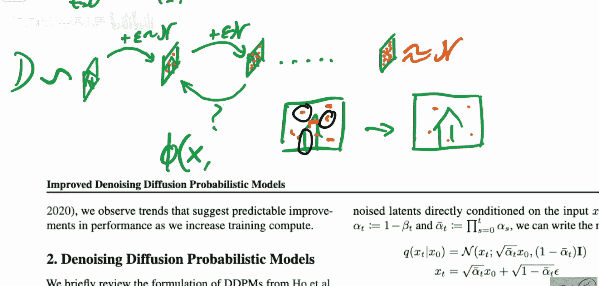

If I tell you， okay， the here is an image。 this happened at T equals 50。

 Can you give me the T equals 49 image that that this came from。Alright。

 and this is the whole principle。 We're going to， we。

 we can generate training data for this neural network very easily because we just take data and we run them through the noise process forward。

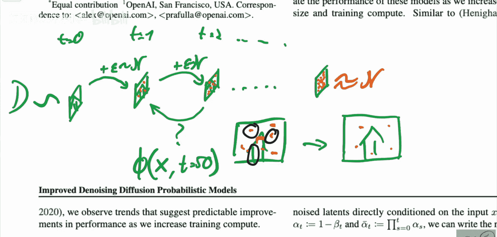

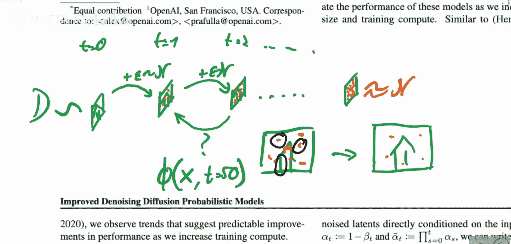

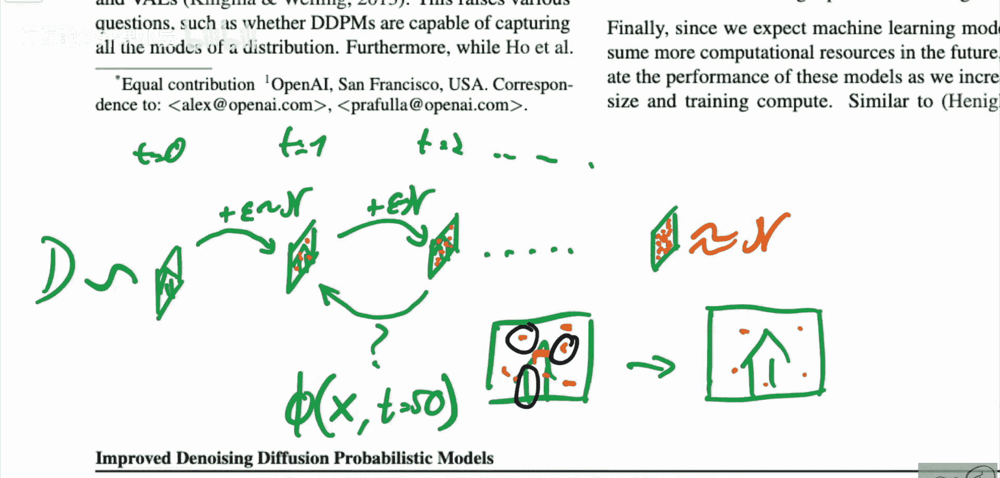