# YannicKilcher【中英⚡AI经典论文领读(全203篇)(下)｜Papers Explained】 p35 P135 《过期跨度：记忆并非生而平等——通过过期机制学习遗忘》（论文解读） [BV1j8x5zJEvx_p35]

Hello there。 Today， we're going to look at not all memories are created equal。

 learning to forget by expiring and the system also known as Expre span。 It's by Sun byar Sibata。

 Daju， Spencer Poff， Stean Roller， Arthur Slam， Jason Westton and Angela fun of Facebook AI research and Laurier。

 in this paper on a high level， the authors propose a modification to the transformer attention mechanism that allows these systems potentially to include much longer context spans。

 The way they do it is that they don't want to attend to all of the context But in an autoregressive way in each time step they want to decide is this particular time step worth remembering or not。

 And if so， then for how long。 So after a while， these memories of the past expire。

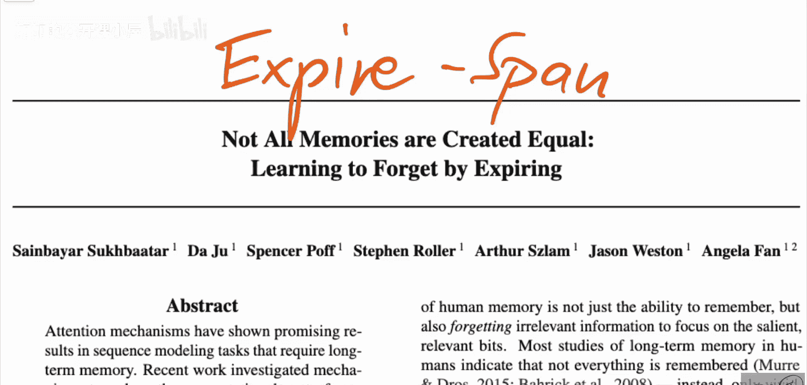

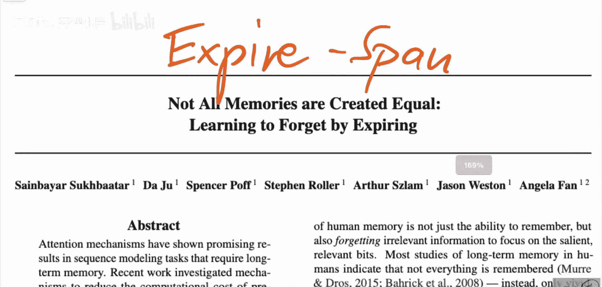

And then they are dropped and the system can learn itself which things are important to remember for the future and which ones aren't so it has some good things。

 it has some limitations， it's very strong in tasks where you explicitly have to remember individual things for a long period of time。

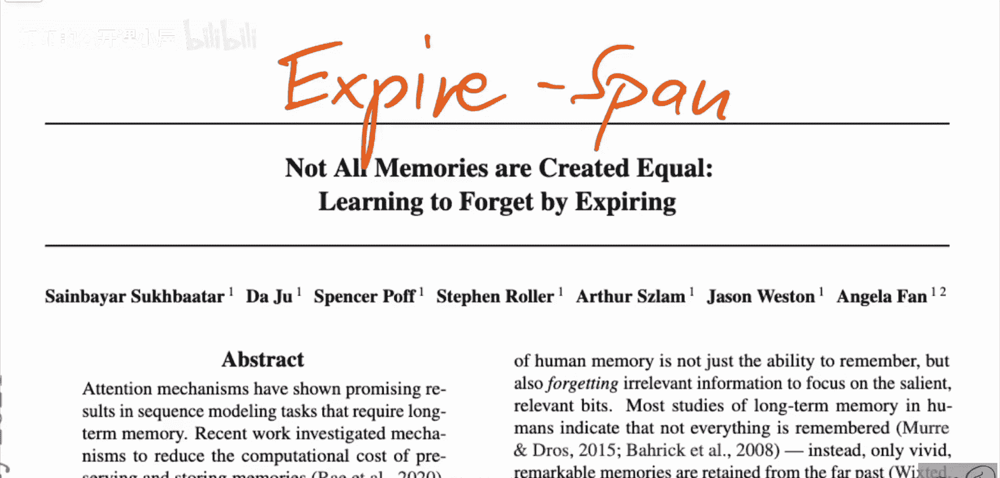

So we'll dive into the system right here， it's a pretty simple idea， I think。

 and it appears to work on the tasks that they produce。So， yeah， as always， if you like this。

 don't hesitate to share this out and tell all your friends about it。 I'm sure they are very。

 very interested。

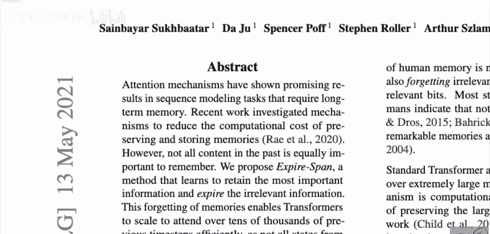

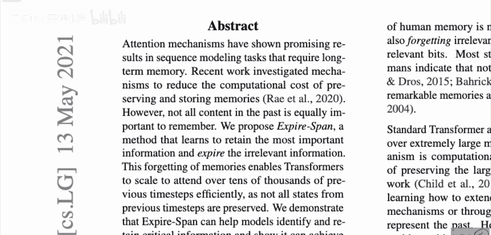

So， they say。The attention mechanisms have shown promising results in sequence modeling tasks that require long term memory。

 so the。They say， however， not all content in the past is equally important to remember。

 we propose Expre span， a method that learns to retain the most important information and expire the irrelevant information。

They say these forgetting of memories enables transformers to scale to attend over tens of thousands of previous time steps efficiently。

 as not all states from the previous time steps are preserved。So again。

 this is the core idea right here。 If you have a sequence model like a transformer and in this case particular we consider sort of autoregressive decoder only sequence model。

 which means that for the next token to predict like this one right here。

 we only care about the past and not the future。 So this is a unidirectional sort of autoregressive style decoder。

 So every token can attend to its past。Now， if you want to predict the fourth token right here in an attention mechanism。

 you have to pay attention。 So I say to three things in the past， right。

 If you want to predict the next token， the fifth token right here。

 you have to attend to this previous one， but also all the other previous ones。 So to4 in the past。

 if you want to predict， you see what's coming， right， if you。The more the longer your sequence gets。

 the more things you need to attend to in the past。

 which gives us this traditional O of n squared computation and memory requirements that attention mechanisms have。

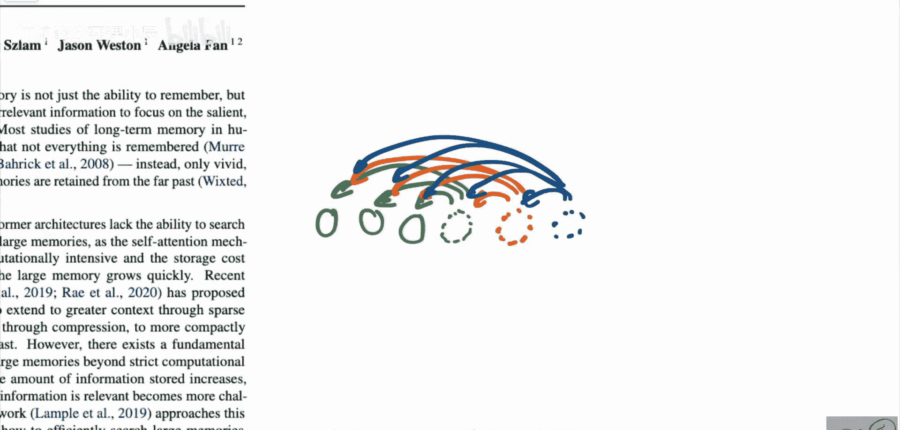

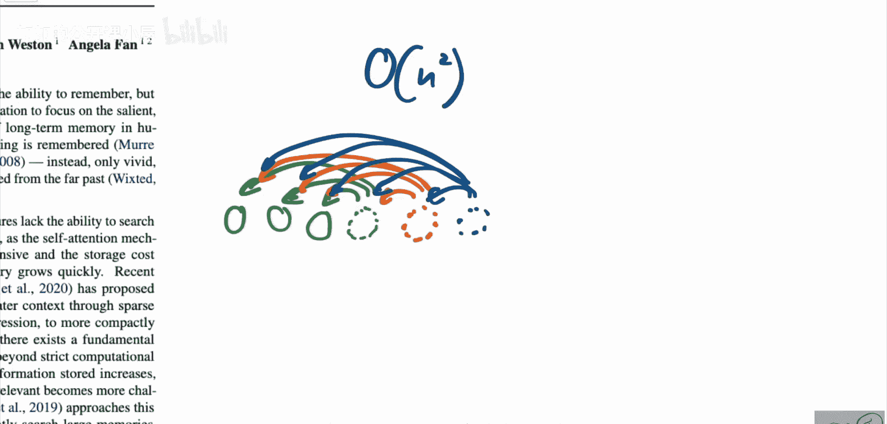

So if you get to very， very long sequences， this can become a problem because you always need to attend to everything in the past。

 So imagine this is whatever a sentence。 The cat SAT on。The mat。Now。Not。

 not all words they say right here， are equally important。So， for example。

 it would be easy if you wanted to predict this word right here， mat。It will be pretty easy to do so。

 even if you don't remember that the word the is in front of here， right， the word。

 the word SAT here SAT on seems pretty important because， you know。

 to sit on something is a good indication that there is maybe a mat there or a chair or something like this。

 right， So these seem to be worth remembering。 Well， the word the is maybe not as important。

 The word cat might be semi important。

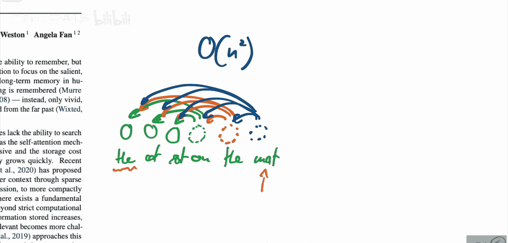

And we would like a system that learns to sort of forget and remember the correct words right here。

If we only remember the more important pieces of information and we discard here in this case。

 this word the， then we we also have one less thing to attend to。 And the goal is。

 if we can get the number of important things down， then it won't be n squared。

 but it will be something like O of n times M， where M is the size of the memory that we have。

 This work here doesn't have an explicitly sized memory rather。

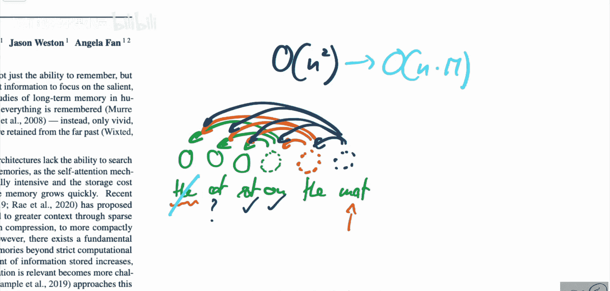

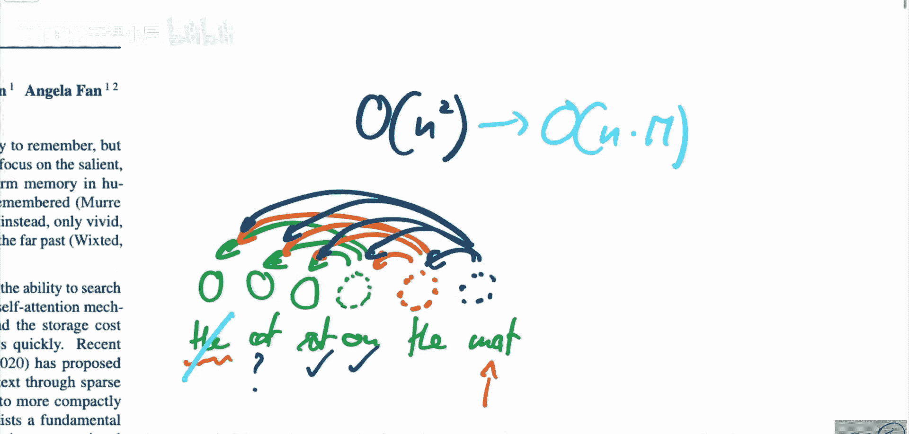

It does the following。 It goes over every element in the sequence。

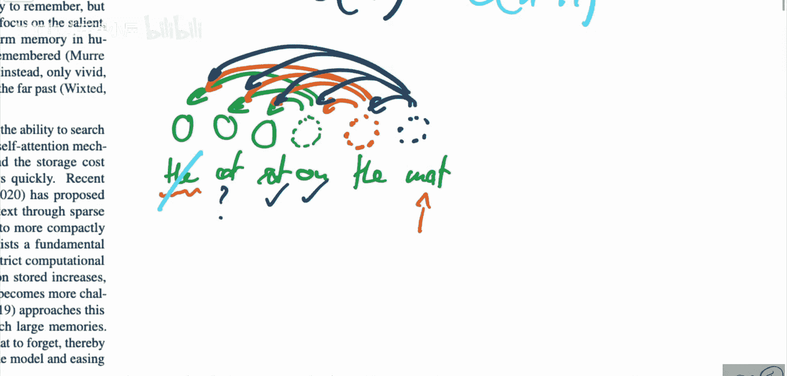

And every element in the sequence， of course， gives you sort of goes through a bunch of layers。

 gives you a prediction， right， So here is a prediction。 I misplaced this。

 Let's go down a bit further here。So every element in the sequence gives you， first of all。

 a hidden state， right， H here。

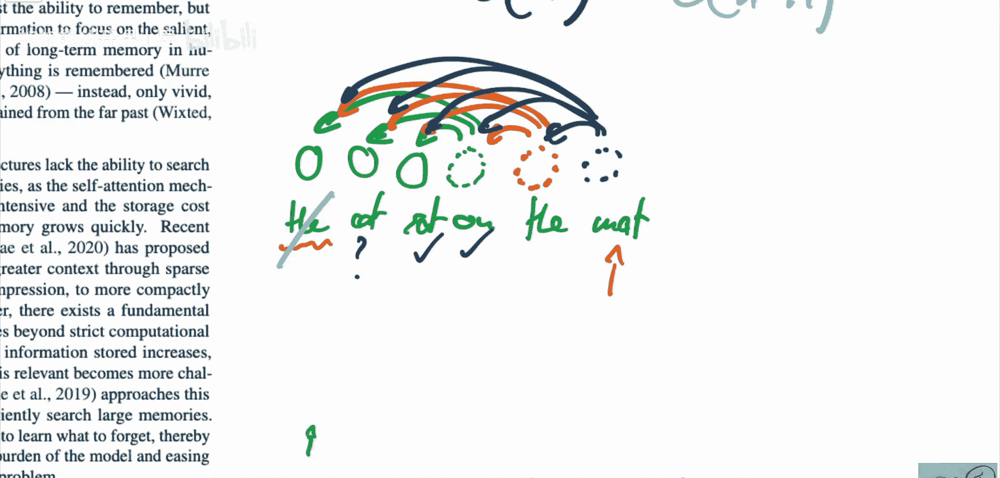

And it gives you a prediction like Y。 Okay， So this is H1 and y 1。

 And then you go to the next element。 and that with consideration， right。

 attending this layer attends to the last layer gives you H2。 And from that。

 it predicts y 2 and so on。um。Let's do one more。 So in this layer， So in each layer。

 the the sort of so in each layer， the future attends to the past。

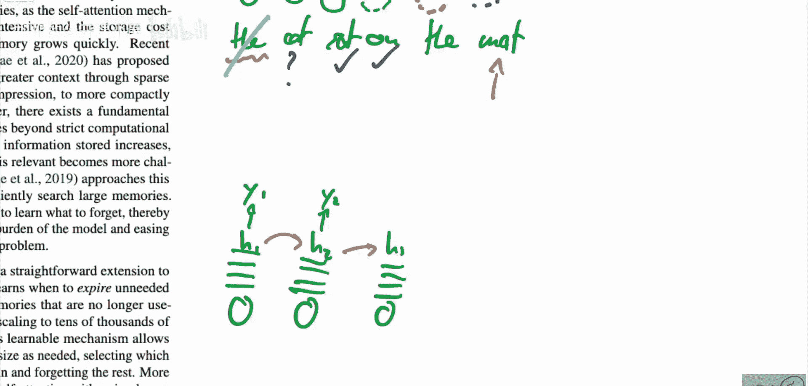

And that gives you a prediction。

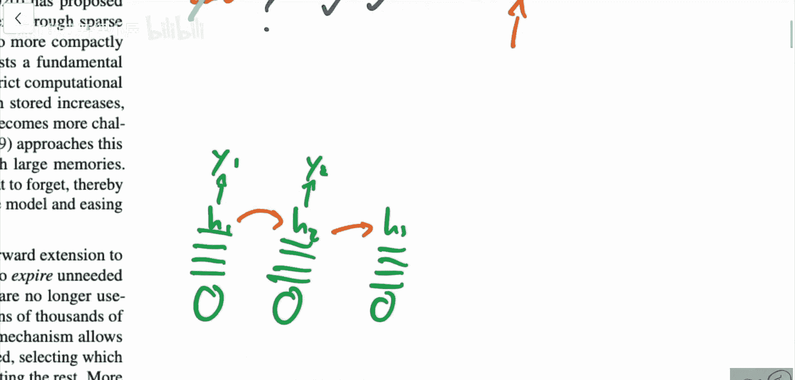

And the attention is over these H right here， over these hidden state。 Now。

 what this model does is it adds one component in each time step。 It doesn't only predict the。

 the output of this particular time step。 If there even is an output， right， It also predicts。

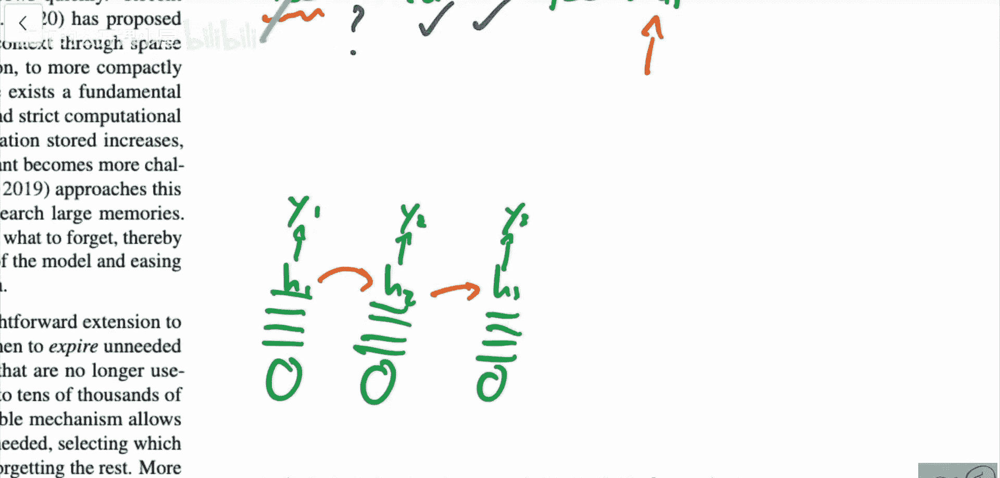

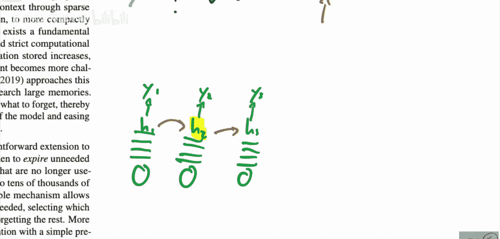

This number they call E， and E is the expiration duration of that particular memory。

 So E is produced every time from H。And E tells you how long you should remember that particular H。

Here， for example， H3 also attends to H1。 I forgot to draw this in right here， right。Now。

 let's say that E1 here is 2， Okay， saying that this particular memory should be valid for two time steps。

 I'm not going to need it longer than two time steps。 Now， let's say。

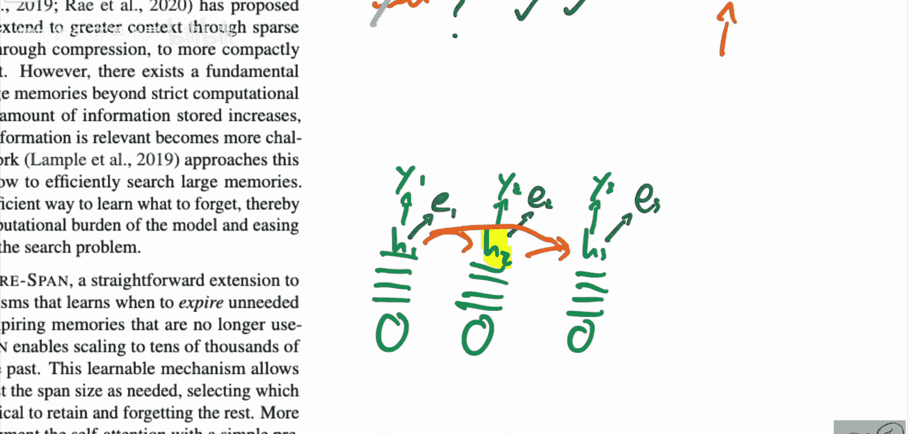

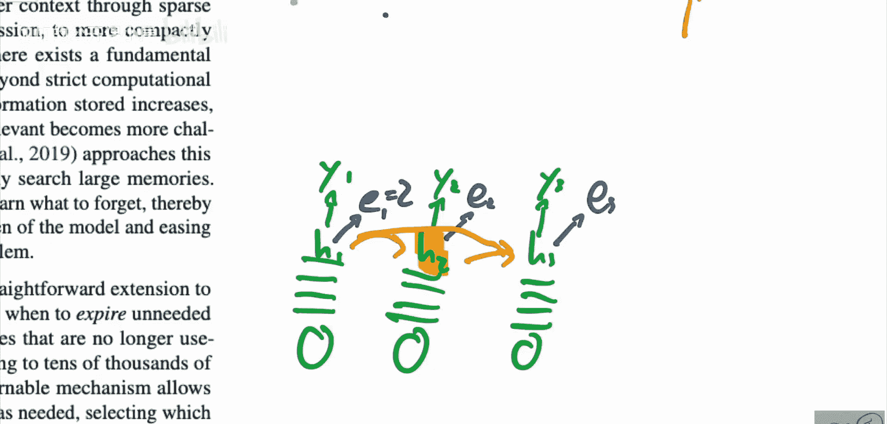

The the fourth。So the next sequence tokens comes in H4。And H 4 is produced， of course。

 by attending to the past。 But now you wanna attend to H3。To H2。

 And because you want to attend to all of the past， you want to attend to H1。 But because。

This H1 is already expired。 you can't。 so the the system would it would drop H1。

 you no longer can attend to H1。

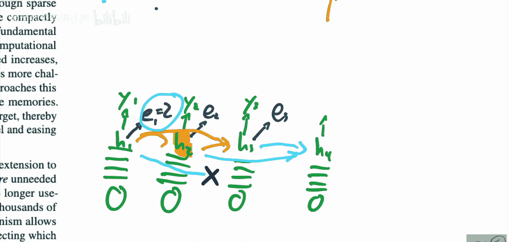

So this is different from just a fixed window， right If you have a sequence。

 what people previously did was something like local attention。

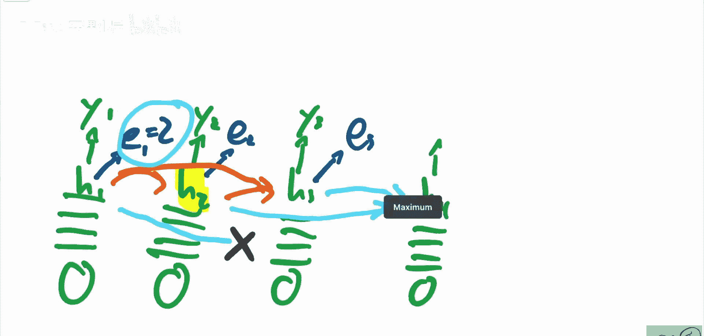

Where you say， okay， I have a window of like size L， which is4。 And if I predict this。

 this token right here， I can attend to the past four things。 if I then predict this one。

 I can attend to the past four things。 if I predict this one， I can attend to these past four things。

 So this here is different in the sense that if you have a fixed window， again。

 everything is the same importance。 but you just limit how far you can look back。

 This works to an extent， but if there is something really important right here， you will forget it。

 no matter what， however， in expire span， this thing right here can say， well。

 I have an expiration date， of 1 million billion right，1 million billion。

 So for 1 million billion future time steps， things will be able to attend to that。

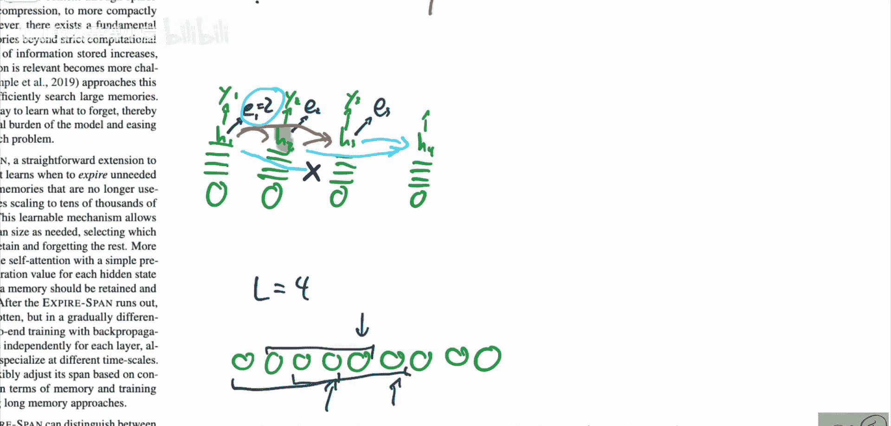

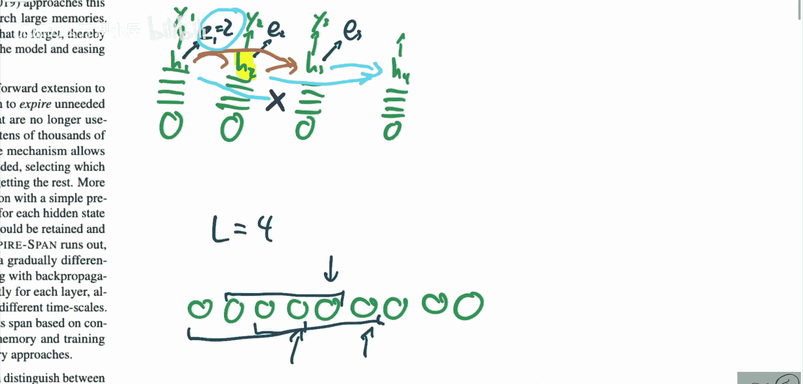

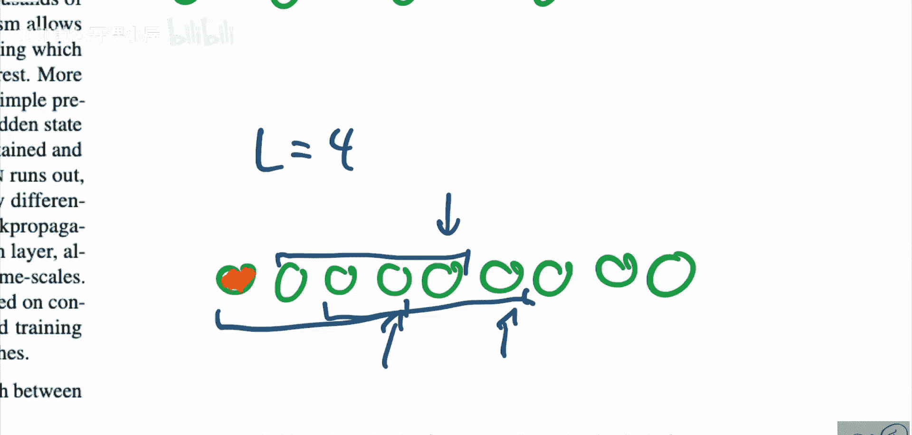

Important piece of information， however。You can say for the next thing。 Well。

 I only I I expire immediately。 This is not worth remembering for the future。 Okay。

 so I hope you got the principle right here。 They also have a drawing here where you can see these hidden states are。

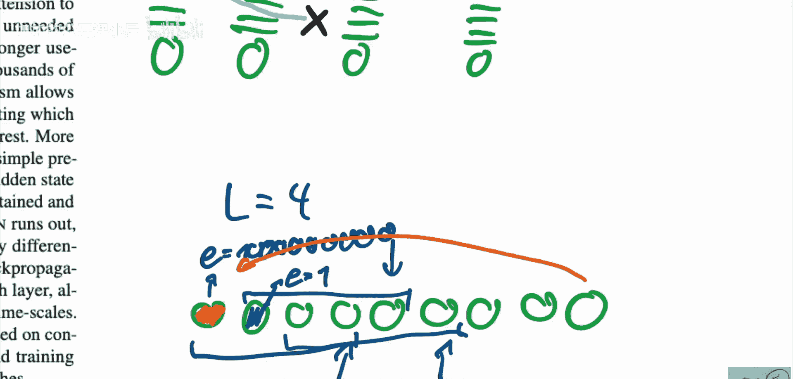

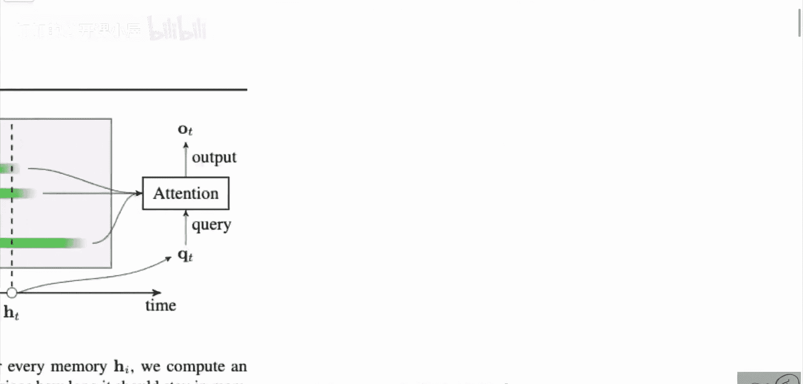