# YannicKilcher【中英⚡AI经典论文领读(全203篇)(下)｜Papers Explained】 p36 P136 循环独立机制的快速与慢速学习（机器学习论文解读） [BV1j8x5zJEvx_p36]

Hi there。 Today， we're looking at fast and slow learning of recurrent independent mechanisms by Kani Kamaan。

 Rosemary Nkeir Goel， Bernard Skov and Yosha Benjo。

 So this paper on a high level proposes an update to a previous paper。

 which was about recurrent independent mechanisms， and the update it proposes is to learn the individual parameters of the different subsystems that comprise recurrent independent mechanisms at different timescales。

 the idea behind recurrent independent mechanisms， is that you have sub modules in a reinforcement learning agent that specialize on different subt that the agent has to do。

 and then you have sort of higher level modules， which are attention based modules that select those submods and decide how they。

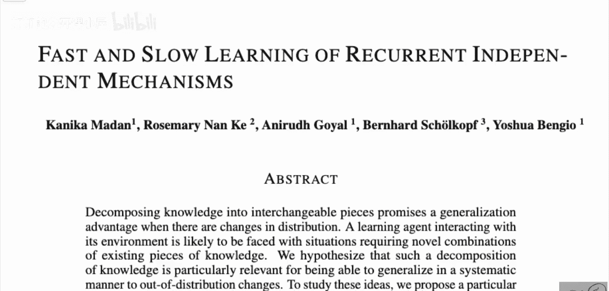

Communicate with each other， as I said， this paper here builds on that and proposes to learn these higher level parameters at different time scales than the lower level parameters。

 such that the higher level units can generalize to multiple tasks and this helps you in environments where you have to do multiple tasks so。

We're going to over this paper and we're mostly also going to go over what recurrent independent mechanisms are and as I already said。

 this papert doesn't introduce recurrent independent mechanisms that's a previous paper by it has some overlap in authors。

So。Keep this in mind as we go through it， if you're specifically interested in recurrent independent mechanisms。

 I invite you to go read the previous paper will go over both REM or IMs and the update to it。

In the end， this paper demonstrates that by decoupling the learning。

 you get benefits in environments where this structure of， know multitask， multi objective is given。

 I can generalize to unseen tasks pretty well， and on the other hand。

 I think for what this paper does right here， for the fact that it simply proposes this this update。

 I don't。I don't think it does enough to demonstrate。

 really that this is something worthwhile or it doesn't analyze it enough。 I feel。

 And they also call this what they're doing meta learning， which I I。

I don't really agree to call this meta learning， but you'll see for yourself we'll go over the paper and yeah。

 bear with me。

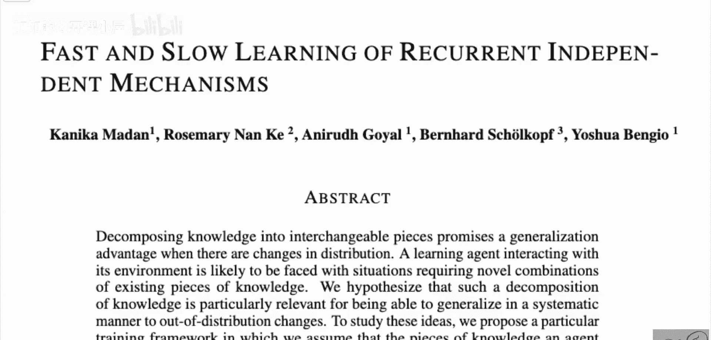

So， as always， if you like content like this， don't hesitate to share it out and tell all your friends about it and tell me what you think in the comments。

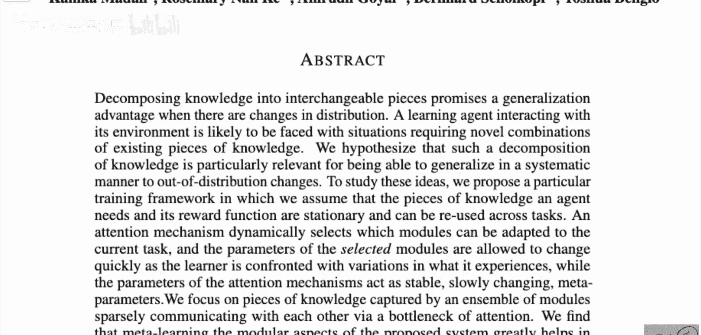

They say in the abstract right here， decomposing knowledge into interchangeable pieces promises a generalization advantage when there are changes in distribution。

 a learning agent interacting with its environment is likely to be faced with situations requiring novel combinations of existing pieces of knowledge。

 So the hypothesis here is that if you are in an environment that has sort of different task inside of it that that where the the environment itself changes。

 So your objective changes as well。 then it might be helpful to recombine old knowledge and the situation you have to have in mind with this paper is one of their core environment here is sort of a grid world environment。

 and the grid world environment is simply have this grid and the agent occupies one cell right here。

 maybe the agent is here。

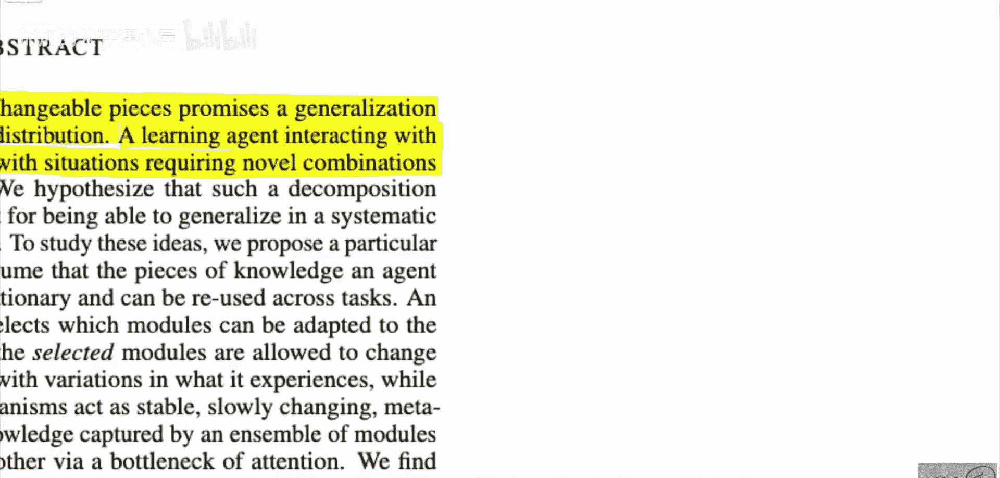

And the agent can sort of move around here and do different actions。

 And there there's going to be different things in this environment。

 So maybe there's like a key right here。 This is a key， and maybe there's like a door over here。

And the agent will get an instruction。 Now， the instruction in this environment might be get the key。

And go to， then go to the door， then go to the door。So this might be the instruction anyway。

 it might actually always be the same instruction in this particular environment。

 but if you change the key and you change the door where they are。

 that's already like different tasks or it's not is's not the same environment all the time you can also vary the size of these environments pretty easily。

 So all these tasks， these different tasks， they share some underlying structure。

 which is there is always kind of this world and there' is a key and there is a door and there might be a wall right here。

So。They all all share this structure。 however， what exactly you have to do differs from episode to episode。

 You can also imagine that there is， maybe， I don't know。 Maybe there's like an orange here。

 So there is an orange right here。 and then the text instruction will say get or or go。

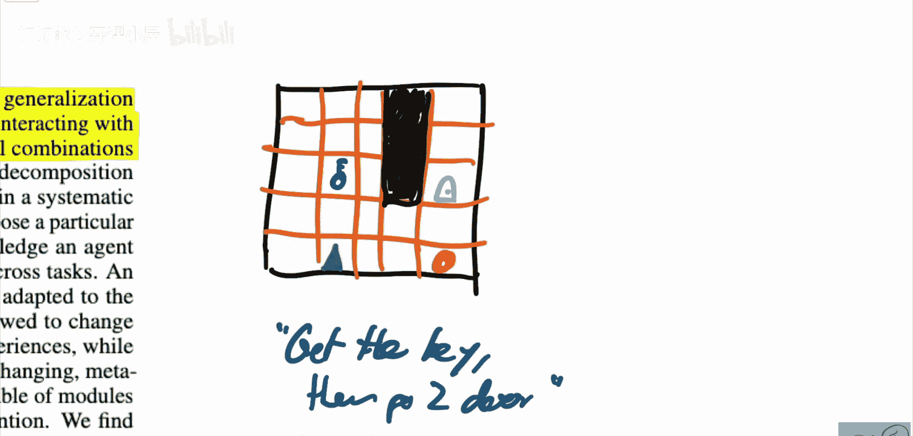

Go eat the orange。So now the agent has to ignore the key and the door and go to the orange， right？

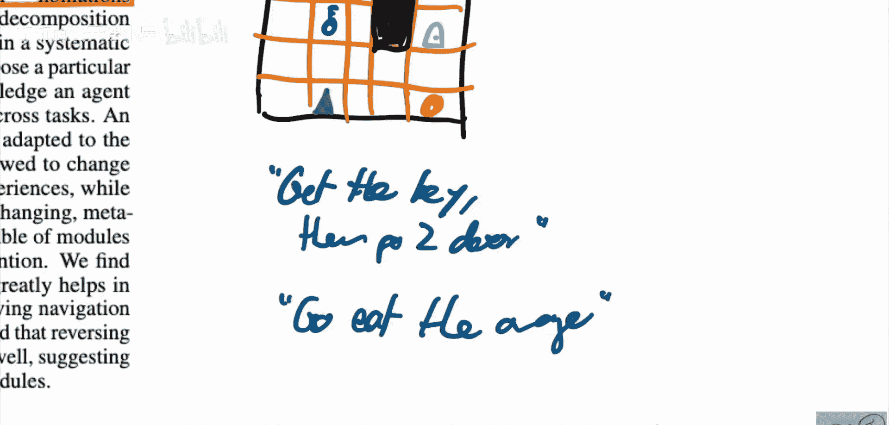

And additionally， so you can modulate this a lot。 Additionally， you can say， okay。

 the agent maybe only sees it surrounding， maybe like this。

 so the agent only sees whatever is in front of it and a little bit to the side so it needs to sort of turn around and explore。

 there' is lots of variations。 The important thing is that theres an environment that has some kind of over over structure。

 overarching structure and there is different tasks and each episode is sort of a new task that the agent needs to solve。

Now， what happens if the agent here is implemented in as in classic reinforcement or deep reinforcement learning as one big box like one neural network。

 and then you perform your episodes and you update the neural network。

 the parameters of the neural network according to your reward？

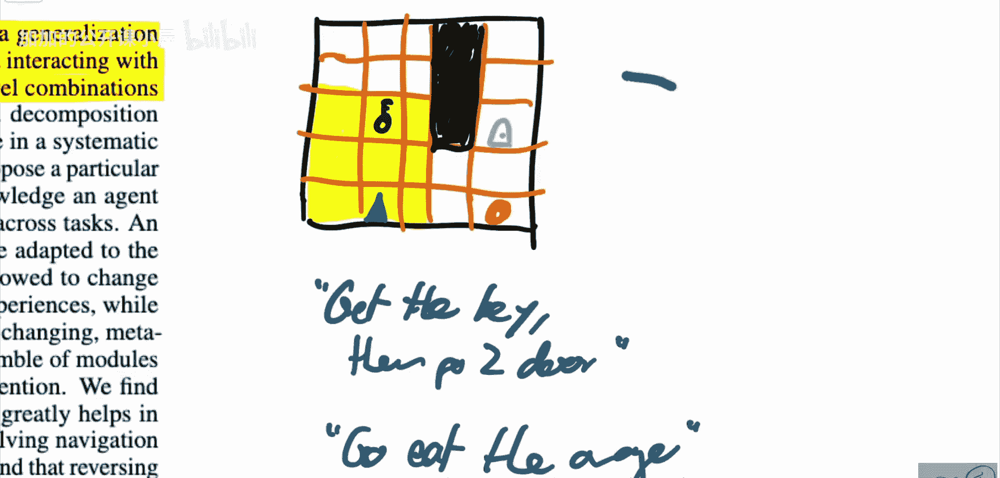

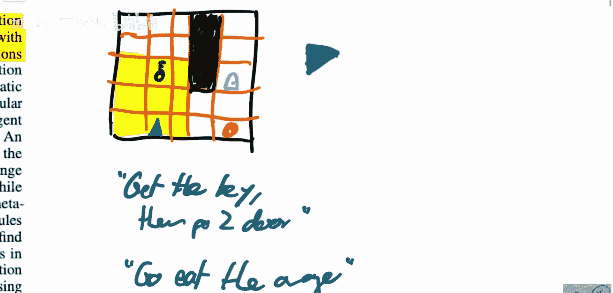

If you solve one task your you will update according to that task right so if you solve the key the key door task。

 let's call it that then your neural network all the parameters will be updated with respect to that task right the way you train a neural network is you change the parameters such that your loss decreases。

 So youll train your neural network to solve that task as well as possible but now the task changes right。

 and all of a sudden it's get the orange。 Now all of a sudden。

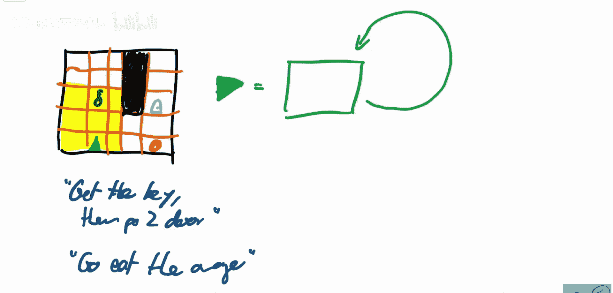

This doesn't give you reward anymore， right？ And now the orange gives you reward so。

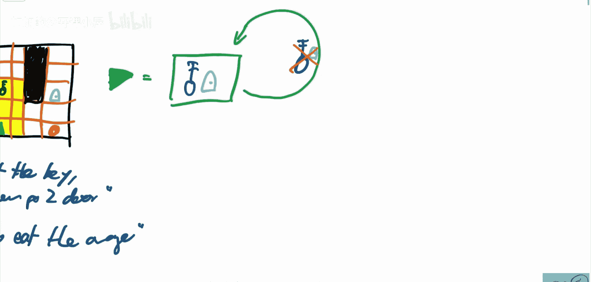

All the parameters you're going to change in order to serve this new task， you know。

 finding the orange。By the this is supposed to be like a little light spec， I'm terrible at this。

I'm absolutely terrible at this。 it's like an orange donut。But you， you get what I， I mean。

 this in general， in the fields of like lifelong learning and and multitask learning and so on。

 this is known as catastrophic forgetting。Caastrophic forgetting。

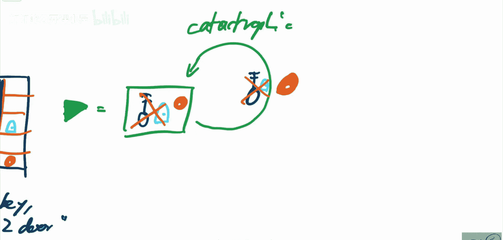

I don't even know why I bother to write， like no one can read anyway。

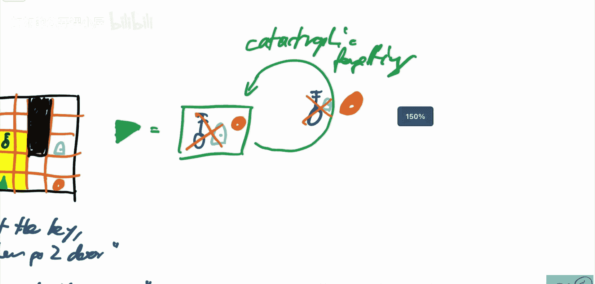

So。There is lots of work in preventing catastrophic for getting in these types of situations。

 and the way that this or the previous paper， the recurrent independent mechanisms propose to do that is let's not implement our agent as one big box rather。

 let's implement it as a collection of like little sub modules and these little sub modules。

 they focus on individual subt。 Okay， so a subtask might be find go to somewhere。 Okay。

 with the somewhere being a parameter that's then taken from the instructions。

 or maybe one one parameter specifically for recognizing the orange。

 so now and the other one is for recognizing the key， Now if， if the instructions， say go to the key。

 the module that is recognizing the key might become active。 and the module that is。

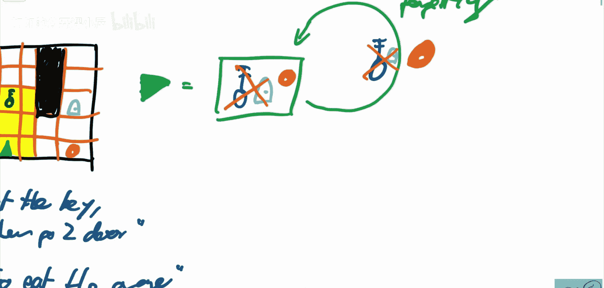

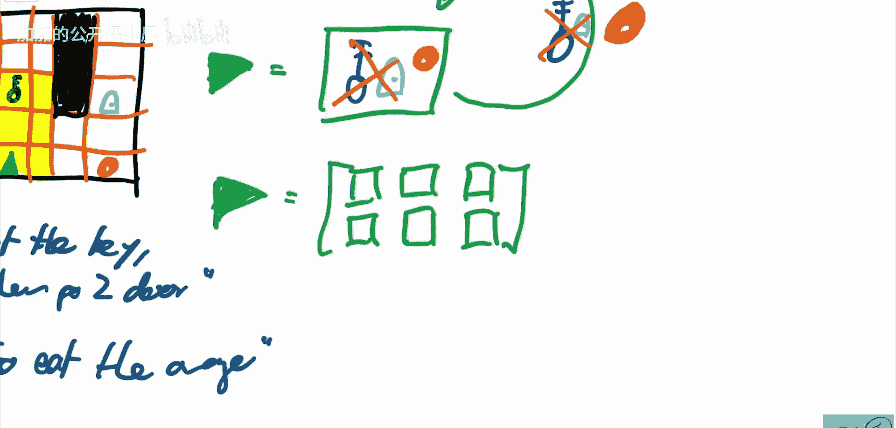

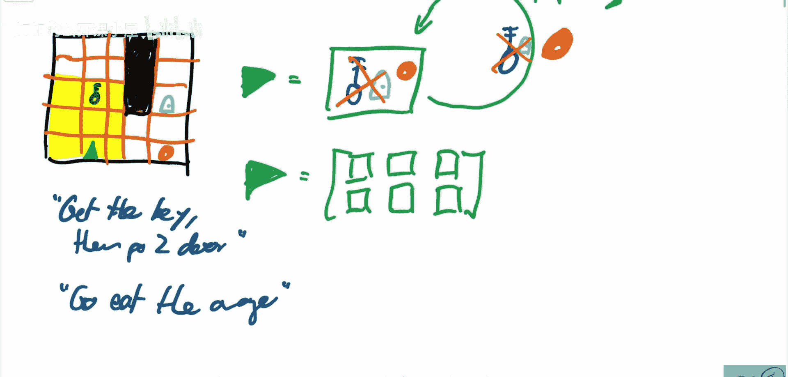

That is for going somewhere might become active， and the combination of the two might then get you to the key。

 So in each time step， the idea is， let's only activate a subpart of these modules。

 not all of them at the same time and。

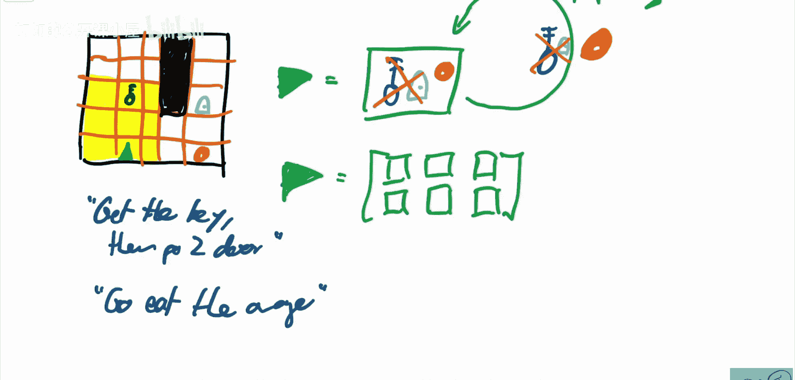

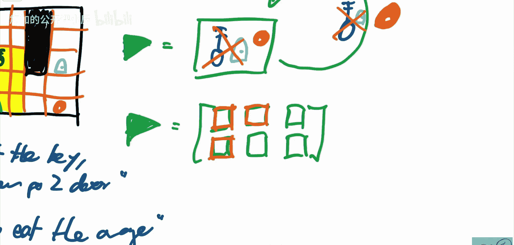

Now， only these modules will be active because they are relevant for the current tasks。

 and then only these modules will receive a learning signal and not the other modules。 Okay。

 the other modules will stay fixed for that particular。

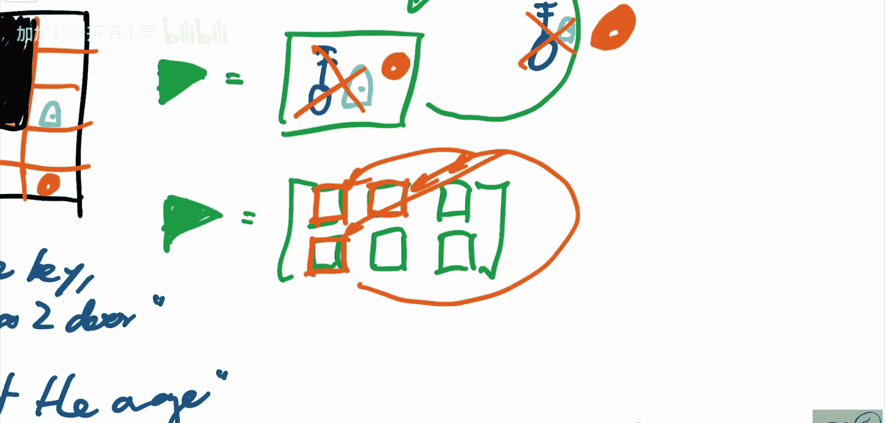

For that particular。

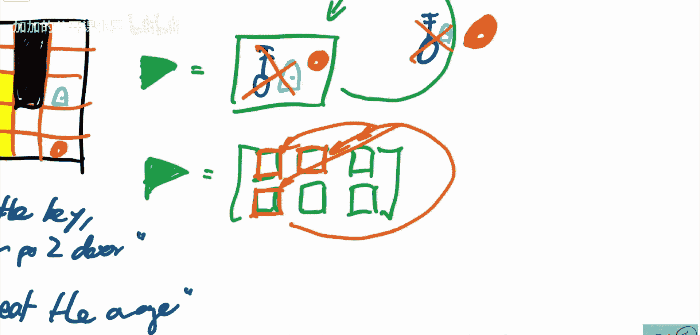

Step on in time。 And this makes sense if you， if you think about it， right。

 if your module isn't relevant for the task， then it shouldn't receive a learning update。

 And that's how you。

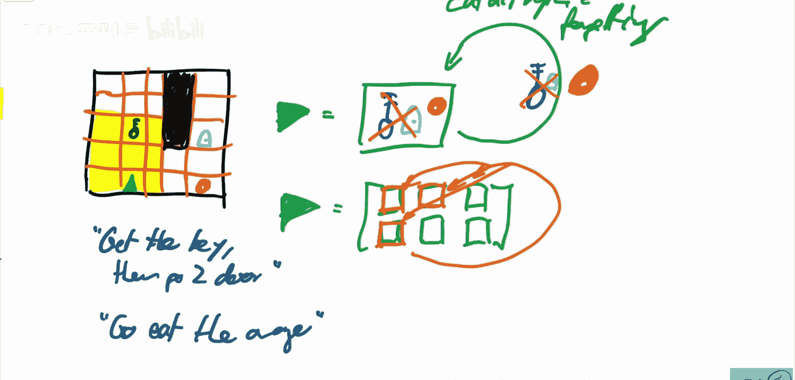