# YannicKilcher【中英⚡AI经典论文领读(全203篇)(下)｜Papers Explained】 p37 P137 奖励就够了（机器学习研究论文详解） [BV1j8x5zJEvx_p37]

From the makers of is all you need。 And do we really need。 And is it even useful now comes enough。

So today， we're going to look at reward is enough by David Silver， Saer Singh。

 Dona Prekub and Richard S。 Sutton。 This paper is a more philosophical paper， I feel。

 though it presents itself as having practical advice in it。 and the core hypothesis in this paper。

 and they stated as a hypothesis， is that。Maximizing reward in an sufficiently complex environment is a sufficient condition for intelligence to arise implicitly in service of maximizing that reward。

 So the the example they give is like a squirrel who wants to get as many nuts as possible。

 has to learn to do all kinds of things in the environment in order to do that。

 It needs to know how to perceive how to motor act in the world。

 It needs to understand maybe the cycles of the year。

 It needs to be able to communicate and fend away other squirrels and so on。 so。

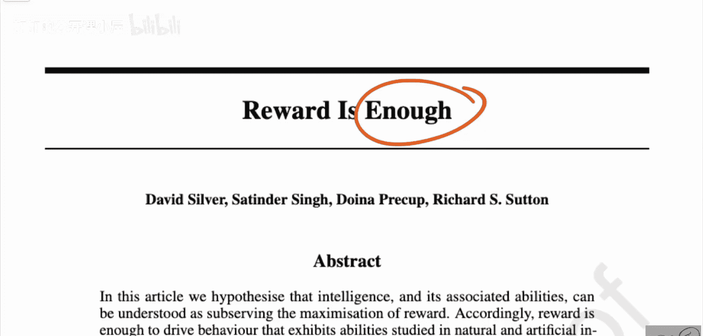

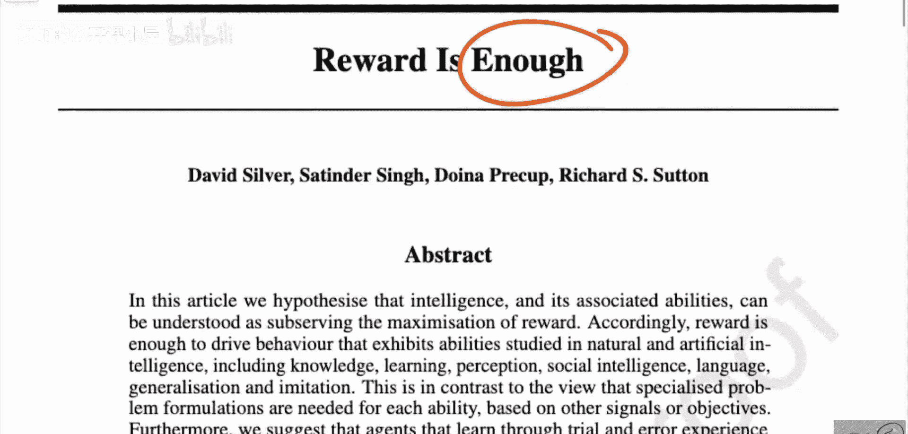

A lot of these abilities naturally arise from something that just wants to maximize a reward in a complex environment。

 I do have my troubles with this hypothesis right here， especially how they present it。

 but we'll go through the paper look at the hypothesis at the reasoning。 and as always。

 tell me what you think about this work。 the conclusion of the work is that if this is correct。

 this sort of gives a straight path to general intelligence， namely。

 let's just maximize reward in a sufficiently complex environment。Yeah。And as always。

 if you do like it， share it out。 subscribe if you haven't and we'll dive into the paper。

 So the abstract says in this article， we hypothesize that intelligence and its associated abilities can be understood as subserving the maximization of a reward。

 Accordingly， reward is enough to drive behavior that exhibits ability studied in natural and artificial intelligence。

 including knowledge， learning， perception， social intelligence， language。

 generalization and imitation。

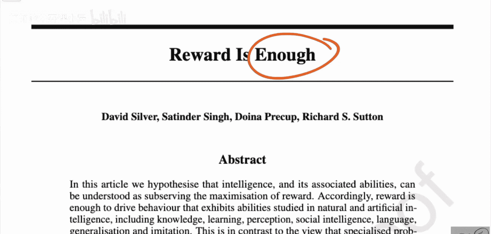

This is in contrast to the view that specialized problem formulations are needed for each ability based on other signals or objectives。

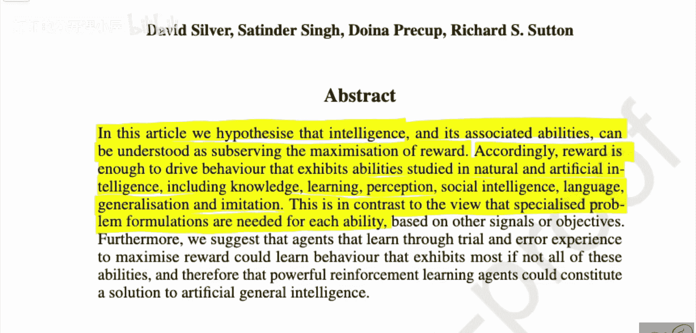

Furthermore， we suggest that agents learn through trial and error experience to maximize reward could learn behavior that exhibits most if not all of these abilities。

 so it's agents that learn through trial and error。And therefore。

 that powerful reinforcement learning agents could constitute a solution to artificial general intelligence。

 Now， this has sort of， this is kind of the deep mind ethos， right in a nutshell。 It is。

 let's just build in not like the most powerful reward maximization agents。

 specifically through reinforcement learning that we can。

 And that will sort of get us to general intelligence， because。

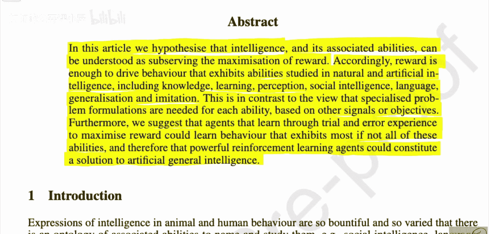

In order to achieve anything in the world， you need to be intelligent if you want to achieve it to a very。

 very high degree。 Now， if that tickles you a bit in the wrong spot。 So it does the same to me， but。

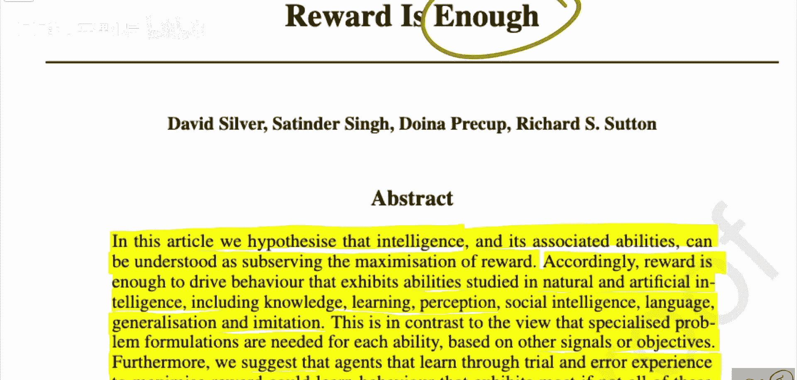

So they， they contrast this here。 They ask， how does intelligent intelligence arise。

 How does it arise， and how is it so bountiful and so varied。

 and has very different subsystems and how does this come about。

 They say one possible answer is that each ability arises from the pursuit of a goal that is designed specifically to elicit that ability。

 So， for example， the ability of social intelligence has often been framed as the na equilibrium of a multiagent system。

 and and they go through others in this paper， they say we consider an alternative hypothesis。

 that the generic objective of maximizing reward is enough to drive behavior that exhibits most。

 if not all abilities that are studied in natural and artificial intelligence。

 So they give an example。

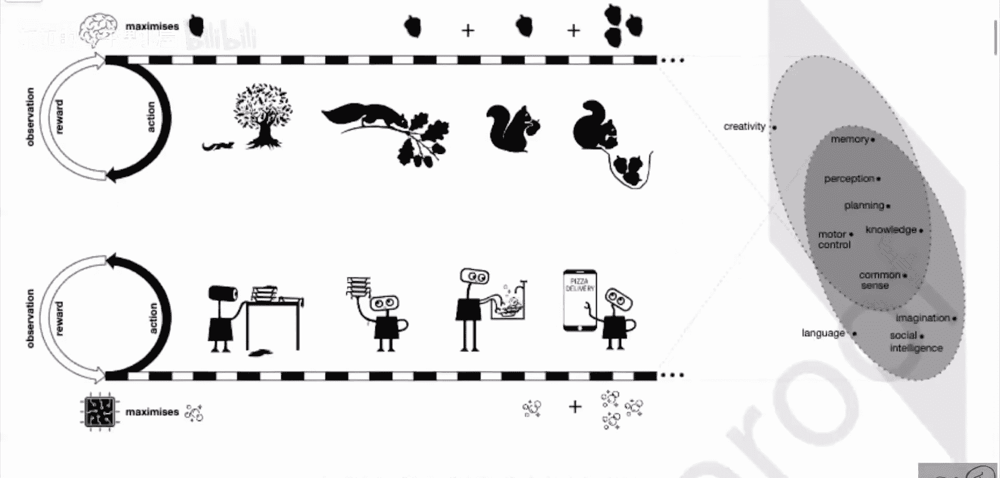

Right here with the with the squirrel。 And so one example is a squirrel in sort of the natural world。

 and the other example is a kitchen robot or a household robot。 Also in the natural world。 Now。

 the one of the core points of this paper is that the environment needs to be， let's say。

 complex enough。 And I feel like。😊。

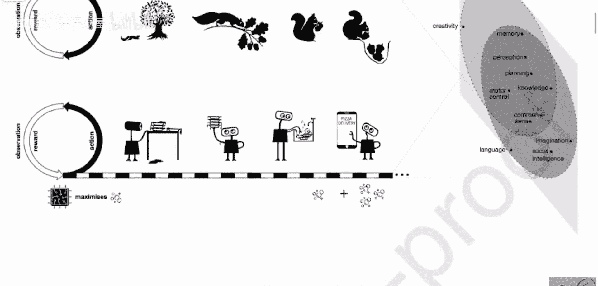

They're only going to be satisfied with a particular environment。 And that is the real world， so。

If if they say a complex environment， just think of the real world。

 like be that you know agents on the real internet in the real world or be that squirrels in the actual physical world。

 they think of environments that are sufficiently complex and that's sort of how this hypothesis draws their power so the description of this figure says the reward is enough hypothesis posts that intelligent yada yada yada。

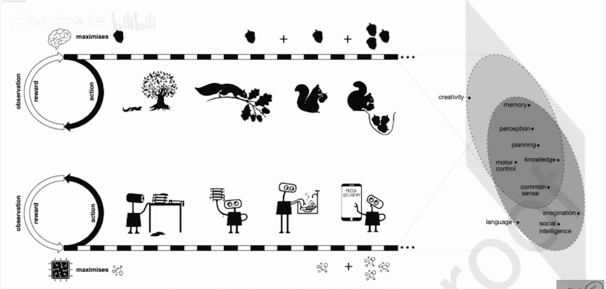

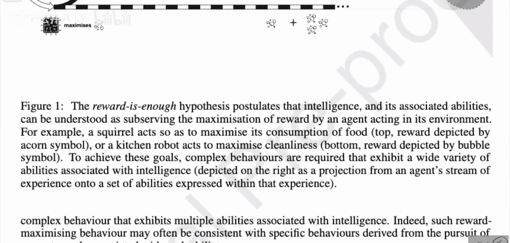

For example， a squirrel acts as to maximize its consumption of food that's at the top right here。

Which is the reward depicted by the an， the acorn symbol。

 or a kitchen robot acts as to maximize cleanliness。To achieve these goals。

 complex behaviors are required that exhibit a wide variety of abilities associated with intelligence。

 Okay， so the the squirrel must learn to perceive。 It must learn to climb。

 It must learn to assess the knots。 It must learn to bury them。

 It must learn to remember where they are and so on。 and the。

 the cleanliness robot must learn also to perceive， to use its sort of movements。

 It must learn to wash。

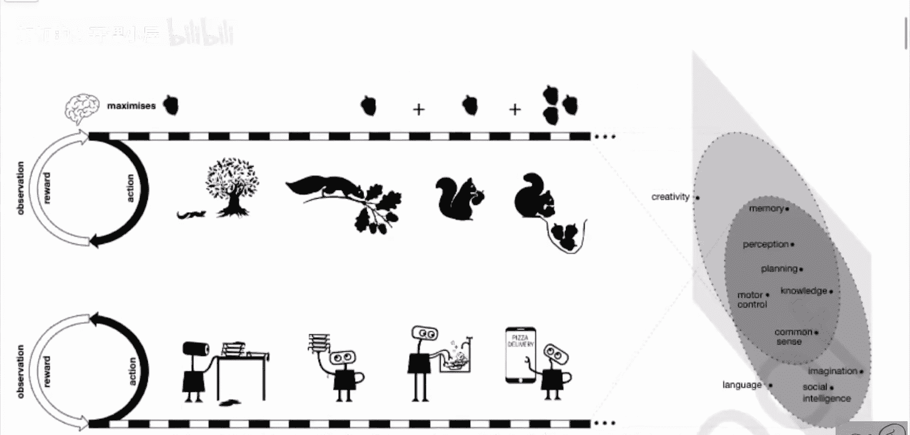

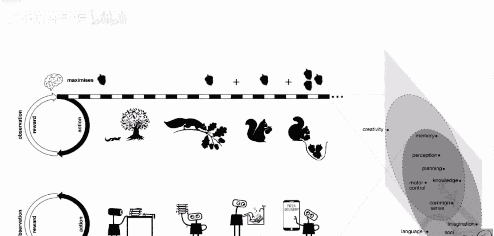

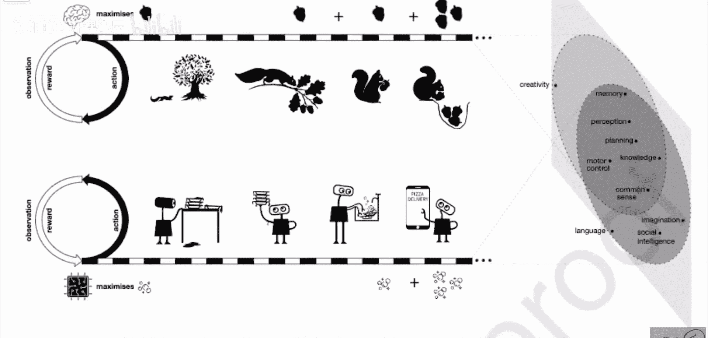

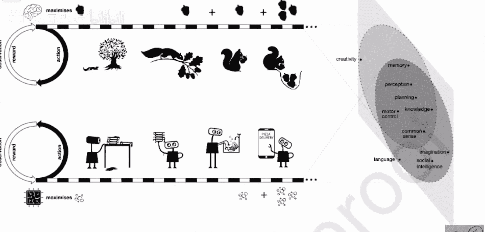

And it might even decide， let's get pizza delivered instead of instead of cooking。

 because that will be just cleaner， arguable。 But yeah， so in in this framework。

 you can see on the right here， they see all of these different abilities such as memory， perception。

 planning and so on。 just arising from these things， because they say， well。

 in order for the squirrel to maxim nuts， it needs to be able to do all of these things。 Otherwise。

 the squirrel will just sort of die。 it can't， it can't like without perceiving the nuts。

 it can't go get the nuts。 And also the cleanliness robot。

 if it is actually good at maximizing its reward， it needs to develop all these abilities， including。

 right， like the social abilities in order to get a pizza delivered or in order to work together with the human。

 maybe even to manipulate the human to make less dirt。😊。

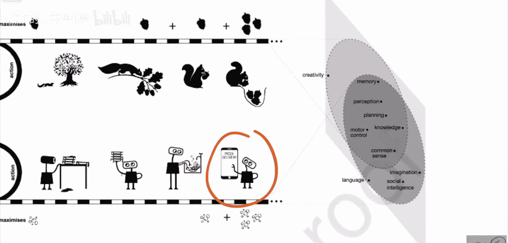

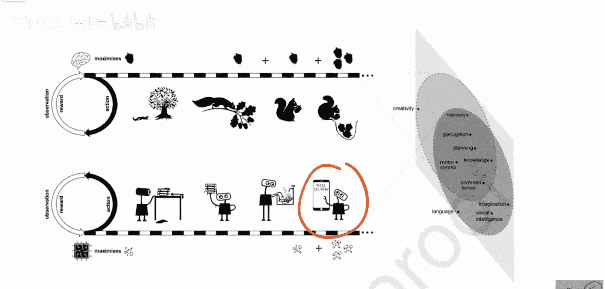

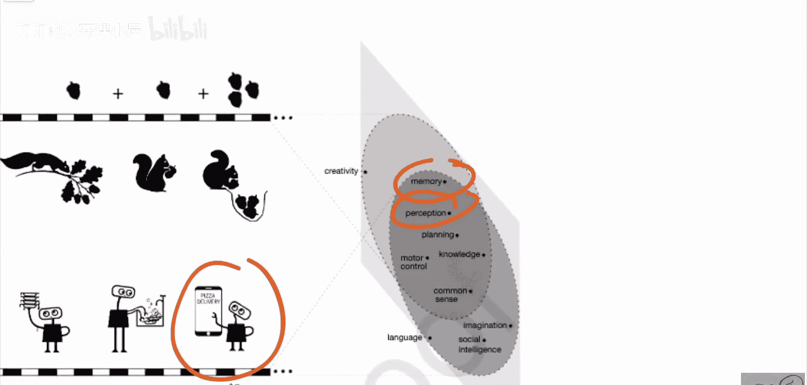

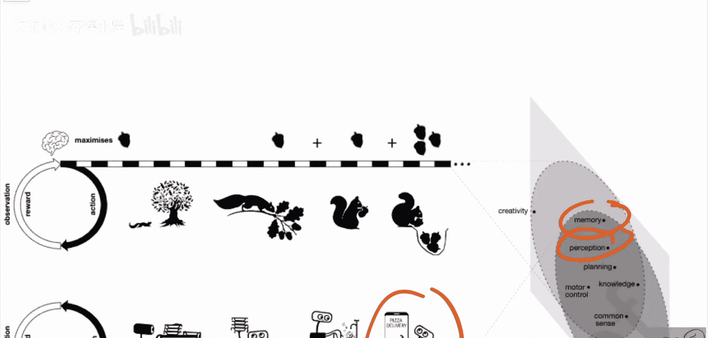

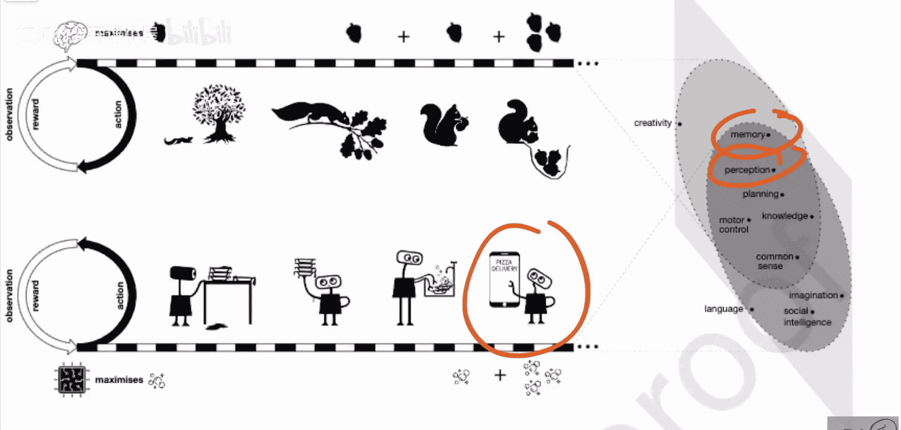

So that that's essentially the hypothesis right here。 They do give some example。So。They， I mean。

 this first part， the introduction， I mean， you can read it for yourself， but they they say。

They give these examples here， they say。U。Watching this through the lens of reward maximization may in fact provide a deeper understanding since it explain why such ability arises。

 for example， avoidance of crocodiles because you don't want to be eaten in contrast when each ability is understood as the solution to its own specialized goals。

 the why question is sidestep in order to focus upon the what the ability does。

 singular goal may provide a broader understanding and it might even lead to new sort of new forms of intelligence。

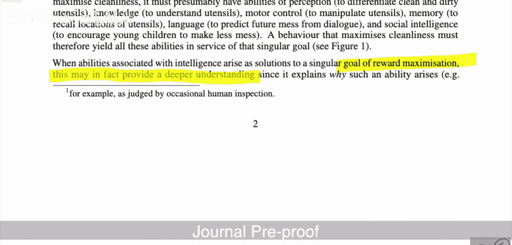

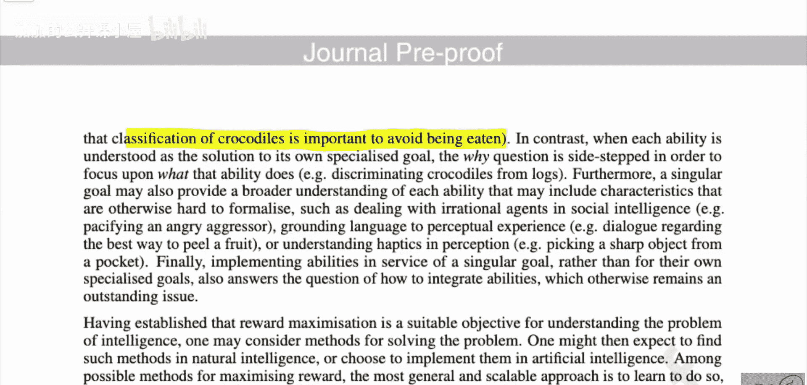

They give examples， of course， here the games of go and chess where just maximizing the reward Alpha0 was able to come up with very new very new tactics。

 very new openings and games and so on and we didn't teach it to do openings。

 We didn't teach it to do board control and whatnot or whatever they call in the things in go we just asked it to maximize reward and it came up with all of these sort of sub abilitiesilities by itself right。

Now they formalize this here， the reinforcement learning problem。

 they formalize it as an agent interacting with the environment。

 so here the agent is just the decision- making process。

 so in the squirrel actually only the squirrel brain would be the agent and the squirrel body is already part of the environment also if you're in a sort of multi-agent system。

 all the other agents are part of the environment in this framework。

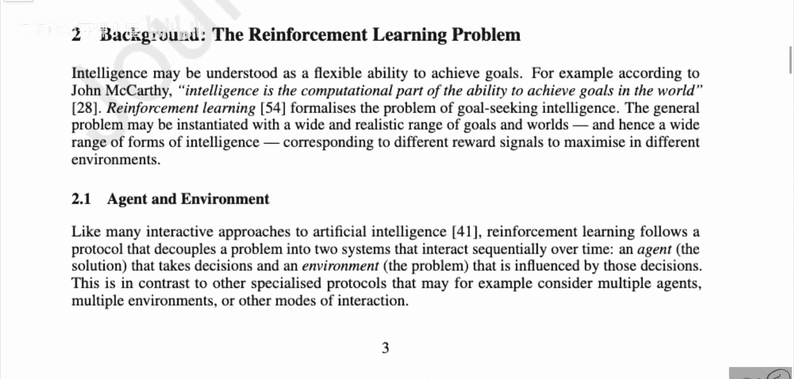

And the environment， you interact with it and you get a reward signal， reward signal and then。

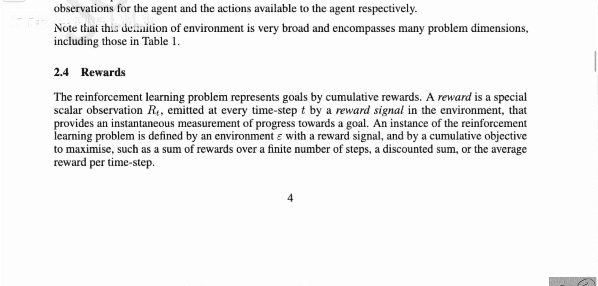