# YannicKilcher【中英⚡AI经典论文领读(全203篇)(下)｜Papers Explained】 p38 P138 决策Transformer：通过序列建模进行强化学习（研究论文详解） [BV1j8x5zJEvx_p38]

Hello there。 Today， we're going to look at decision transformer reinforcement learning via sequence modeling by Lily Chen。

 Kevin Lu and others of UC Berkeley， Facebook AI research and Google brainin on the high level this paper ditches pretty much anything and everything of reinforcement learning in an offline Rl setting and substitutes it for simple sequence modeling using transformers。

 of course， and through that they're able to achieve some pretty compelling results in the things they test。

 at least they're able to keep up and be on par with the current best frameworks for doing offline reinforcement learning So we're going to look at this paper and at what it does in terms of sequence modeling and how this looks the key ingredient here besides the transformer is going to be the fact that we are instead of。

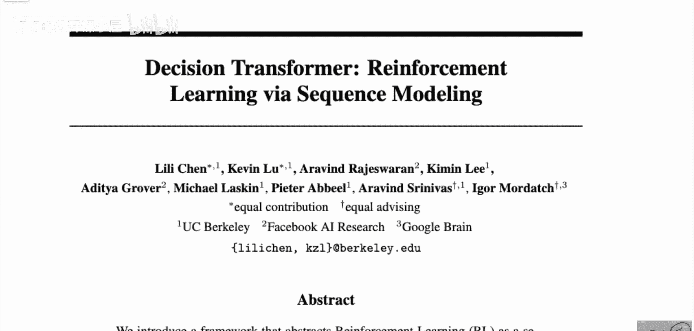

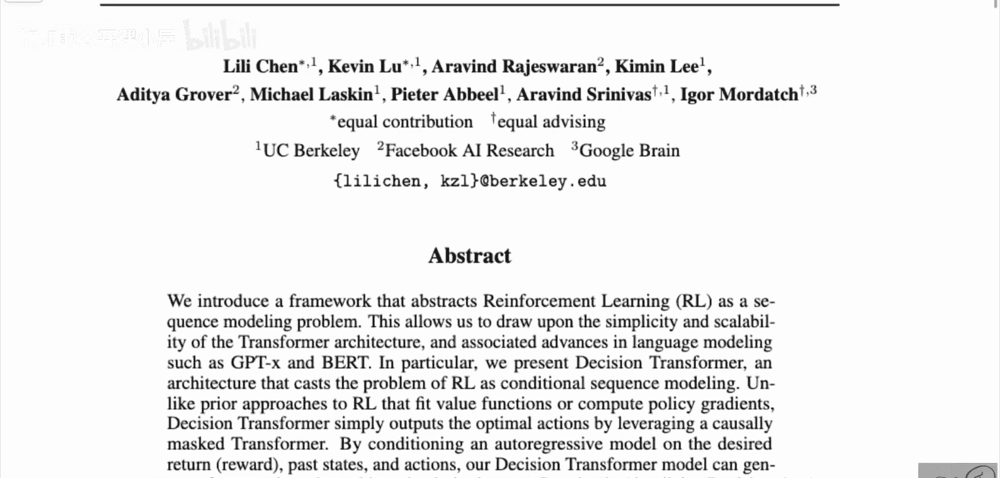

maximizing the reward， we're going to condition on the desired reward and through that we can sort of influence what the model is going to do in the future。

 this allows more effective offline reinforcement learning and makes the offline Rl problem pretty straightforward into a sequence modeling problem。

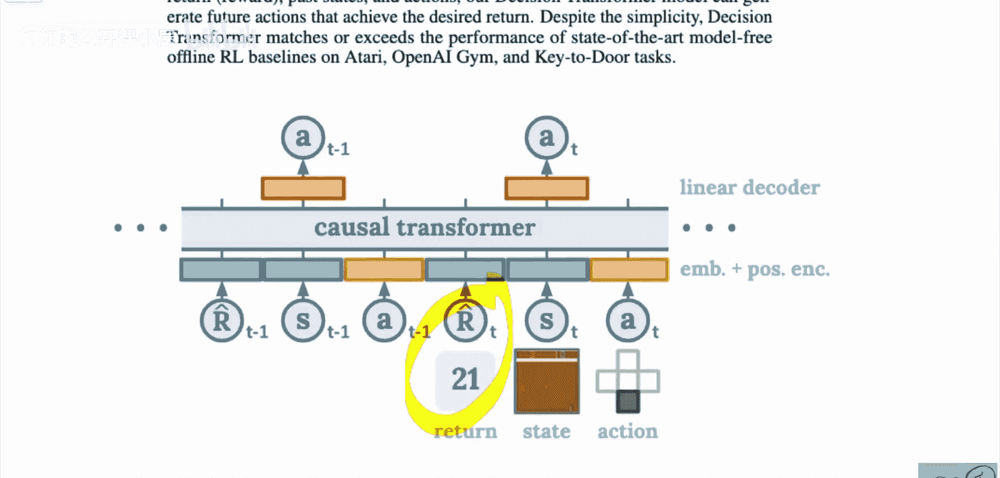

I do have a little bit of troubles with the paper in various aspects， but I'm sure well come to that。

 but I'm just warning you this might be a bit of a rant mixed with explaining the paper。

 though the paper is is pretty cool， so don't get me wrong on that。 That being said。

 there is concurrent work also out of Berkeley as I understand it。

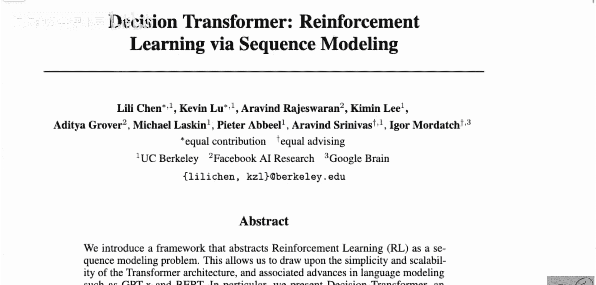

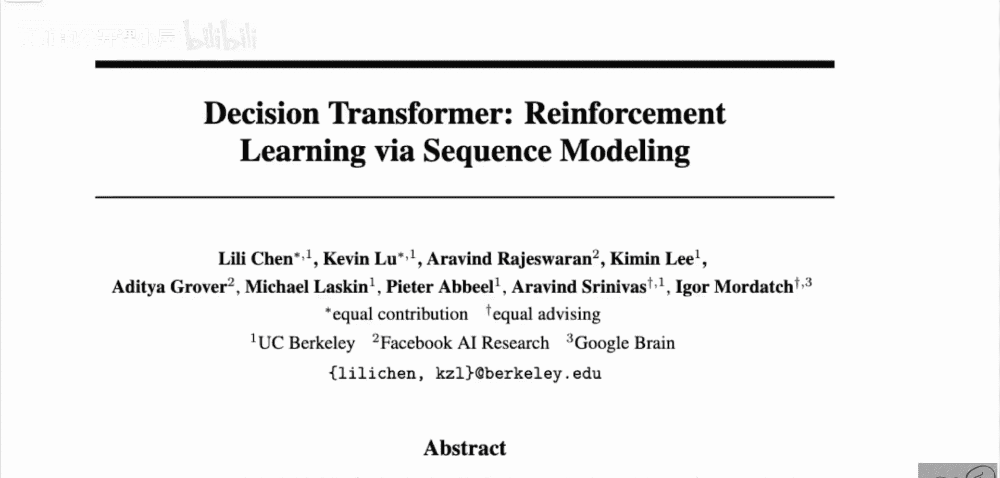

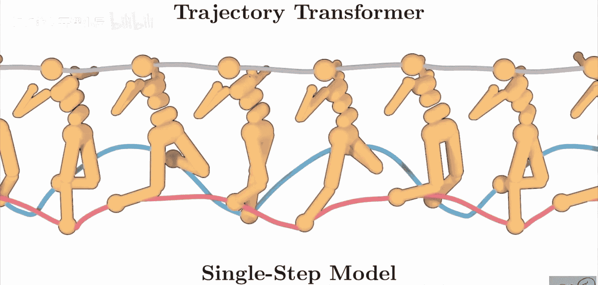

Where it this is called the trajectory transformformer reinforcement learning as one big sequence modeling problem that uses the sequence modeling in a bit of a different way。

 So what they do is they use it as sort of a world model and then they use beam search in order to in order to find good trajectories in that。

 So it's a little bit of a different approach and I just from skimming this paper right here。

 I think this one might be a bit more of a of an approach that I would subscribe to but I guess we'll see what happens going forward。

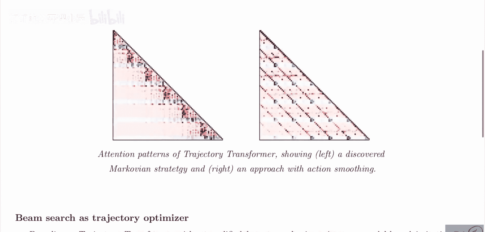

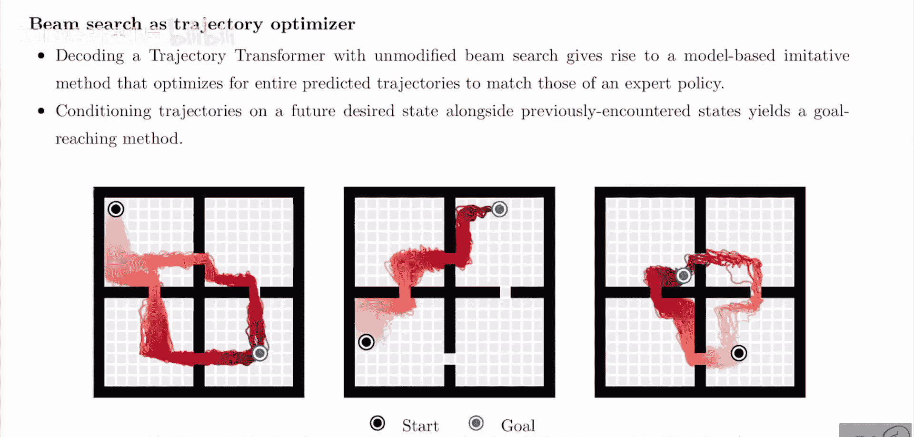

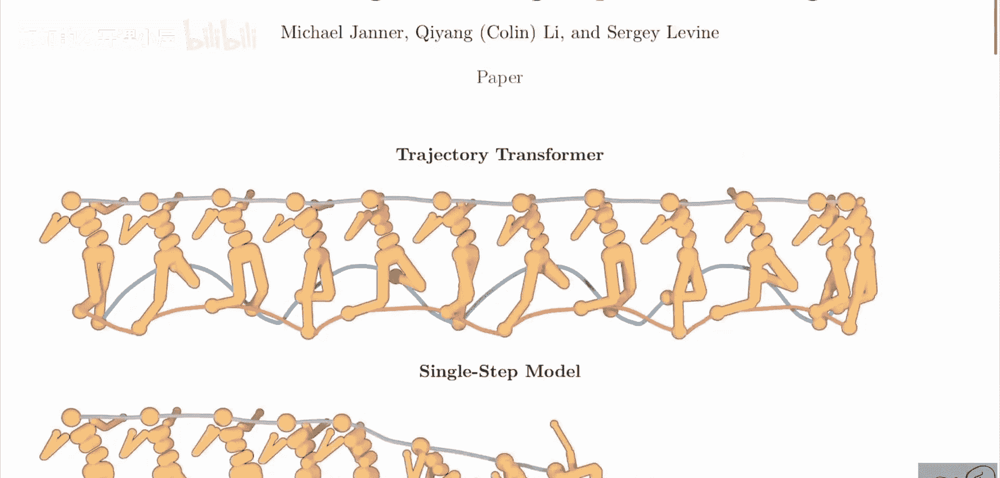

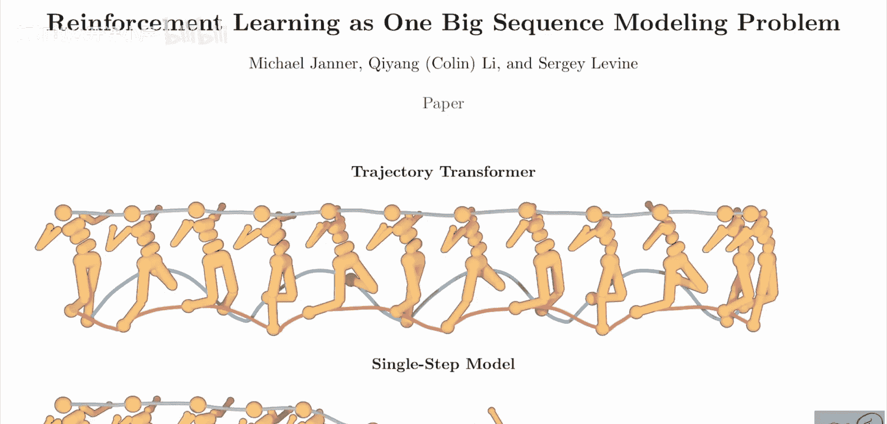

And。Oh wait， why did this show up？Reinforcement learning upside down by Schmiduber。

 this must just have gotten in here by accident。 Sorry， let's go back to this paper。

 They say we introduce a framework that abstracts reinforcement learning as a sequence modeling problem。

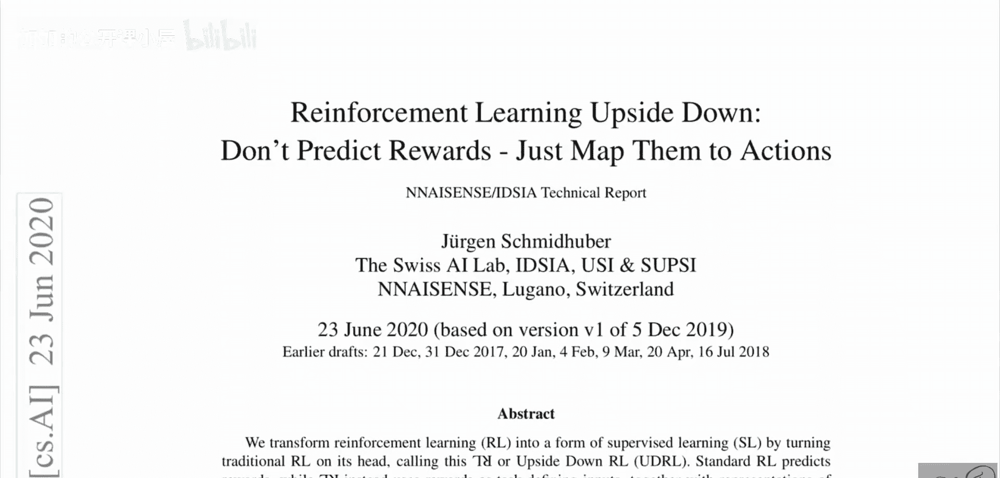

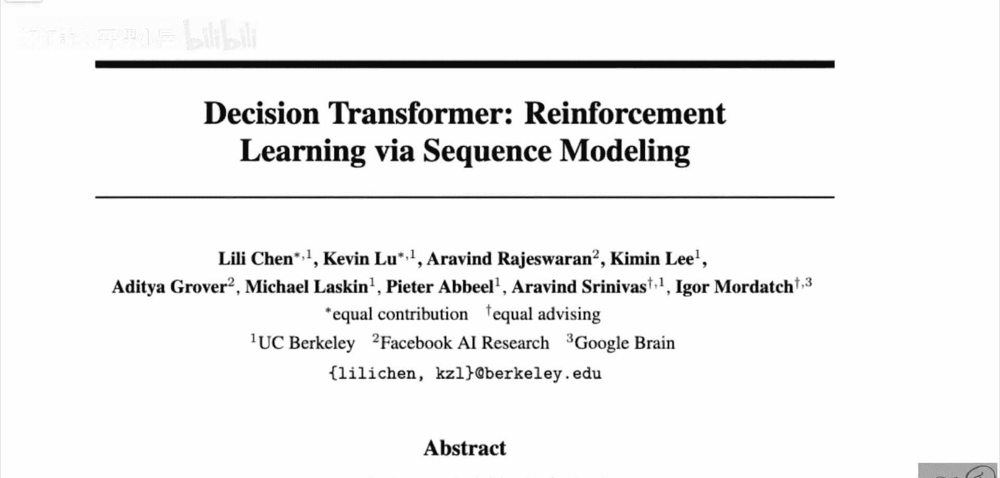

This allows us to draw upon the simplicity and scalability of the transformer architecture and associated advances in language modeling such as the GPT line and BRT in particular we present the decision transformer。

 an architecture that casts the problem of RL as conditional sequence modeling。

 and like prior approaches that fit value functions or compute policy gradients。

 decision transformers simply outputs the optimal actions by leveraging a causally masked transformer so as I said they ditch things like policy gradients or value functions。

 none of that we're simply going to do sequence modeling right here。

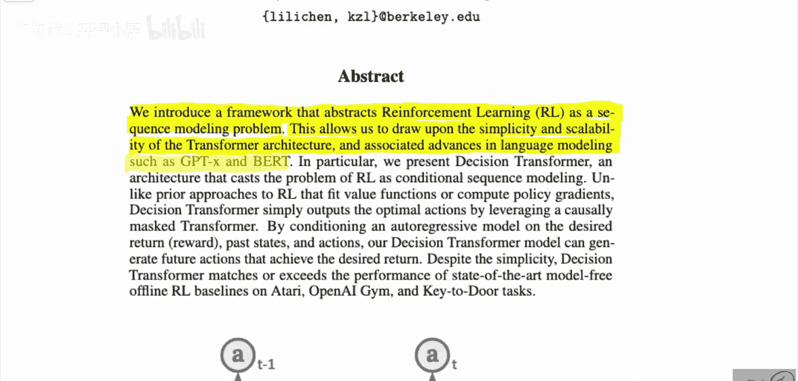

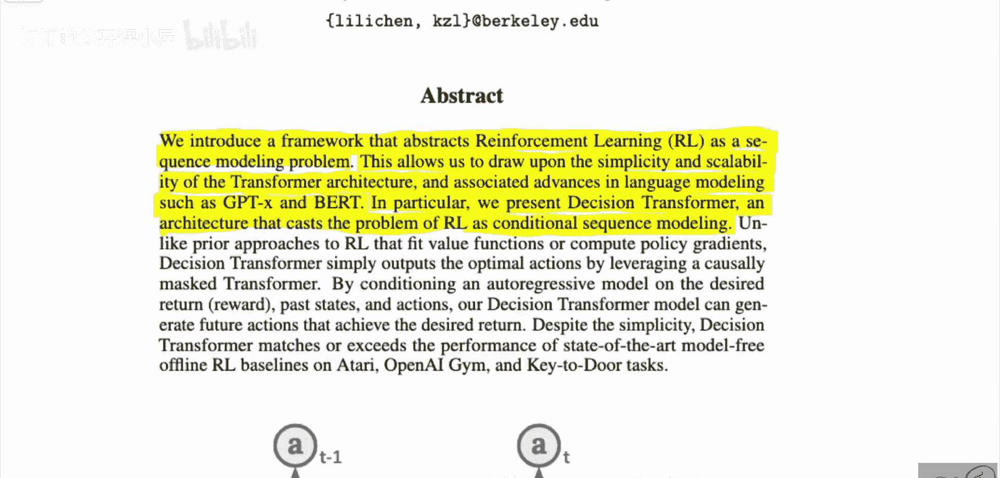

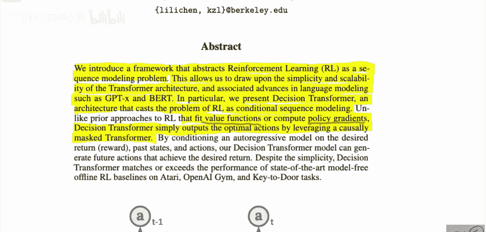

By conditioning on an auto regressive model on the desired return past states and actions。

 our decision transformer model can generate future action that achieve the desired return。

 So a key concept here is going to be this desired return thing and here as well。

 So there are multiple ingredients to this paper There's a lot to unpack right here。And lastly。

 they say it achieves it matches or exceeds the performance of state of the art model free offline RL baselines again this is sort of zooming down into a problem so we are in the world of model free and offline reinforcement learning algorithms there is as I said there is a lot to unpack here so first of all。

 what is offline reinforcement learning this is contrasted to online reinforcement learning online reinforcement learning is where you have an agent and an environment and the agent sort of gets to perform actions in the environment and the environment responds with a reward and a state or not really a state but an observation but sometimes it is the state if it's not a partially observable environment。

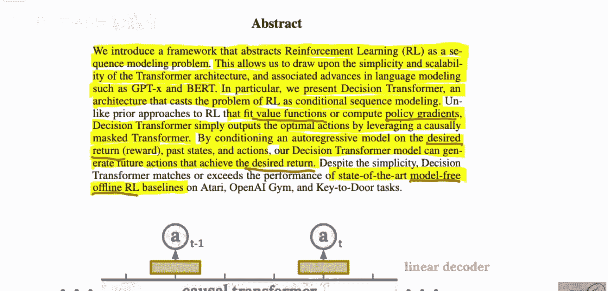

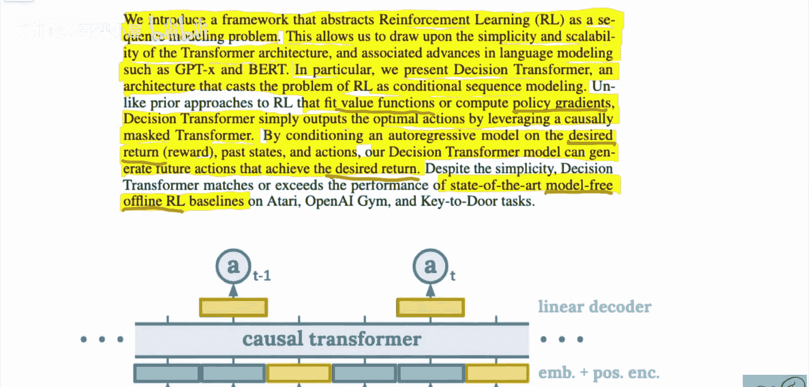

So the agent actively gets to interact with the environment to try out things。

 and its goal is going to be to maximize that reward。In offline reinforcement learning。

 it's a different situation。 So in offline reinforcement learning。

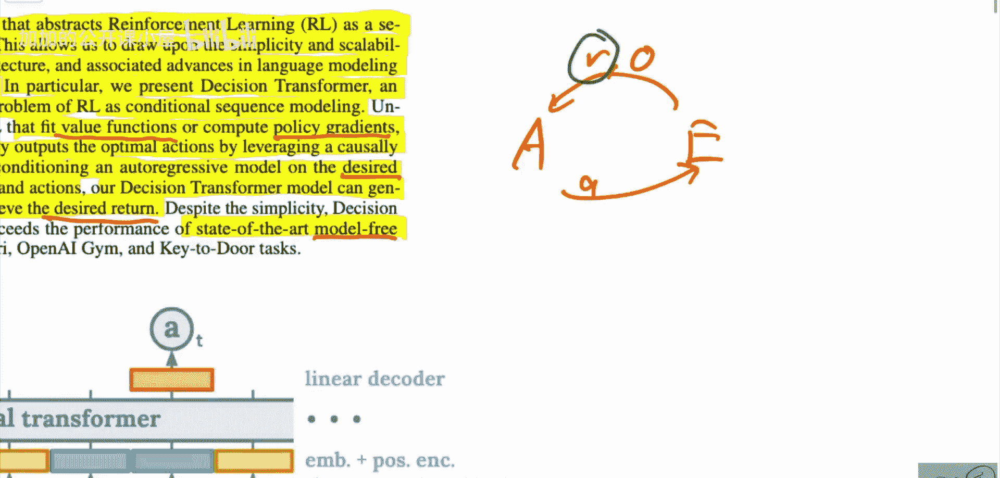

You are your agent is here。And what you get is not an environment， but what you get is a data set。

 And this data set will contain。 It will contain lots of。Experience from other agents。

 So you would simply get to observe what a different agent has done。

 And so there's going to be a lot of like episodes in here。

 So what happened in the past to this other agent。 And purely by observing that other agent。

 you somehow have to learn a good policy to achieve a good reward。

 This is different because you cannot go out and sort of test your hypotheses in this world。

 You cannot have a good idea and say， well， I'm going to try that。

You can't do sort of targeted exploration and so on。

 you simply get to look at a bunch of trajectories and then decide what you want to do。

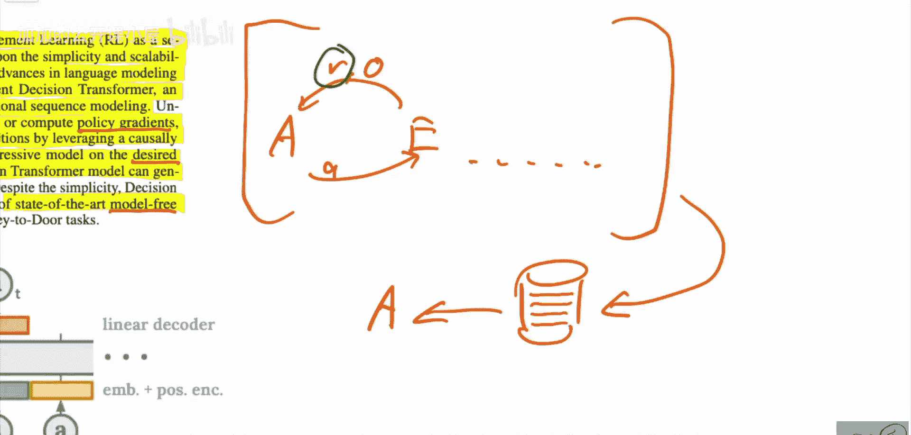

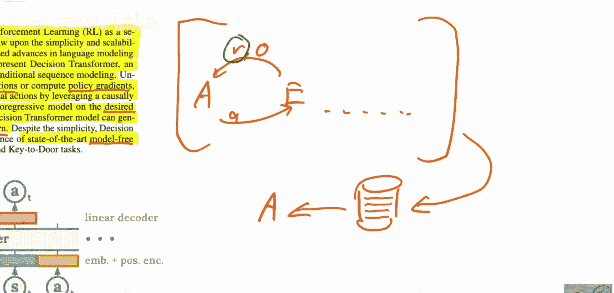

We need a bunch of different approaches here and。

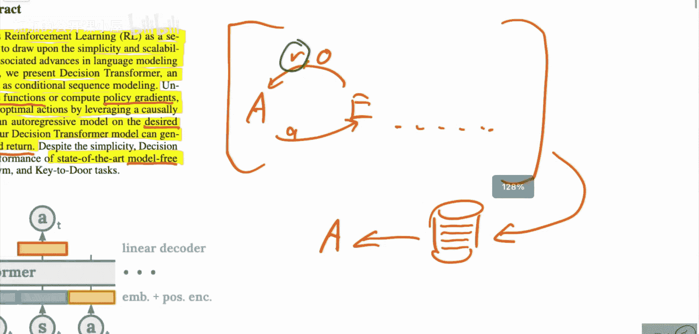

One that they compare to is so there are two that mainly that they compare to one is called they call it BC which is behavior cloning where what you're trying to do is you simply try to mimic the agent that you observe in the events where it has led to good rewards so that's how you maximize the reward you simply say well that agent there got a good reward so I'm just going to try to sort of clone that behaviors as behavior cloning from the name I'm butchering the explanation but roughly that's what it's supposed to do the other approach is you view this as a let's say more a traditional reinforcement learning problem where you cu learning so in cu learning。

What you do is you are in a state and you have maybe like three actions at your disposal and every time you again have three actions at your disposal。

 So you get this sort of tree that you could do。 So you're in the first state and what you want is you want to ask your Q function how much how much is。

How much is this worth， maybe the Q function says 5。

 how much is this worth 6 and how much is this worth4。

 So the Q function is supposed to tell you if you。Take this action and after that action you follow the policy。

Like after that action， you again do ask the Q function for the Q value。

 which what's the total reward you're going to get Q learning is very very classic reinforcement learning algorithm and you can actually do Q learning from a data like this it doesn't need to be yourself that makes the experience that's the thing about Q learning is that it can be done from offline data other than policy gradients you need sort of you need a correction if you do policy gradients and it usually doesn't work if it's complete offline it might work I'm not super informed like this but Q learning is possible from offline data and apparently the a currently good baseline is conservative Q learning which you're going to see in this paper which fixes the bug let's say the tendency for the Q。

functions in the offline setting to overestimate the Q value。

 So apparently they they tend to overestimate the value that you get from certain actions。

 conservative Q learning is a more like a pessimistic approach。

 So these are the two baseline that we're going to compare to you'll notice behavioral cloning some kind of relation to inverse reinforcement learning not really or or。

Yeah， so， so that's one approach。 Q learning is also an approach here。

 We're just going to do sequence modeling。 So what does this mean。

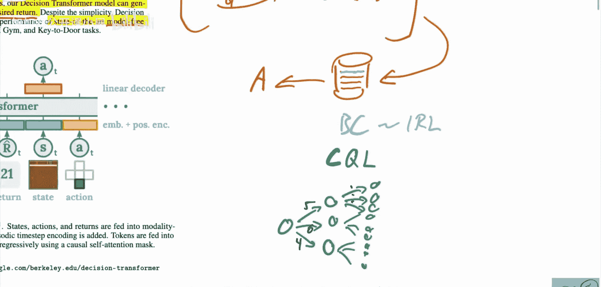

And the key concept， as I said， is going to be the condition of that reward。 Sorry。

 so this was offline R。 Now there are people have pointed out problems with the approach here。

 which some of those problems are simply problems of offline reinforcement learning So， for example。

 which data do you use right here。 turns out in their experiments they use a benchmark data。

 which is the data where this agent right here is a DQ N learner。 So an active reinforcement learner。

 So naturally you're going to get out like some some good episodes out of that。

 So it's more like learning from expert demonstration rather than from random random demonstrations。

 Okay so it's crucially important。 which data you use But that' that's a fault of offline Rl of the setting itself rather than of this particular。

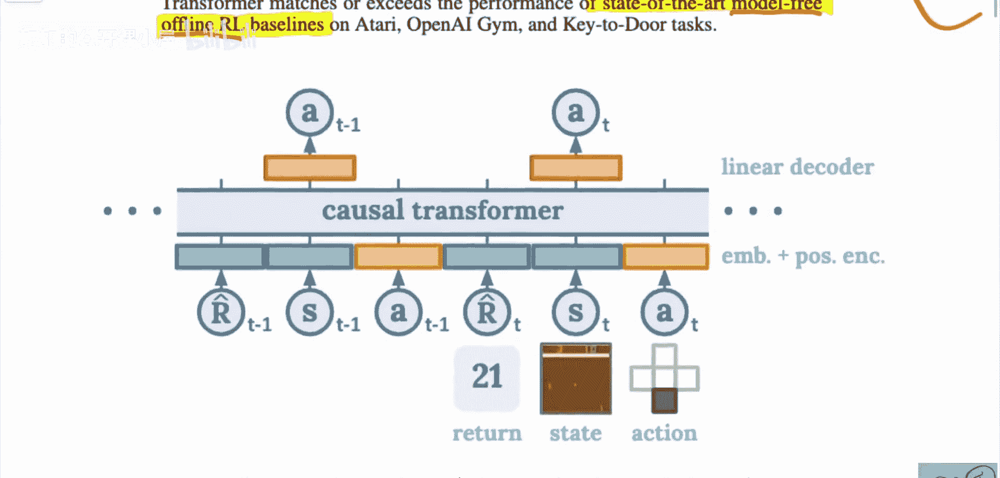

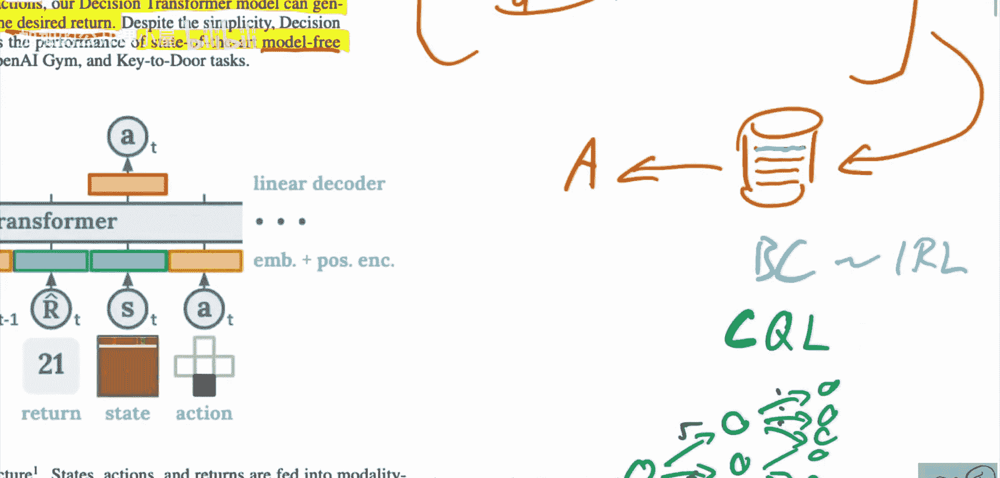

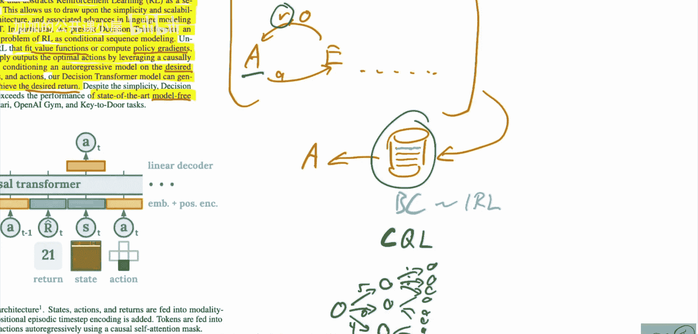