# YannicKilcher【中英⚡AI经典论文领读(全203篇)(下)｜Papers Explained】 p39 P139 高效且模块化的隐式微分（机器学习研究论文详解） [BV1j8x5zJEvx_p39]

Hello there。 Today we're going to look at efficient and modular implicit differentiation by researchers of Google research。

 This paper on a high level extends what you know from frameworks like Tensorflow or pytorrch or jackx in terms of automatic differentiation。

 It extends it to multilevel optimization procedures。

 So this paper makes it possible that you differentiate through an inner optimization loop without having to unroll that inner optimization loop and without having to implement the optimization procedure in a differentiable way。

 this has been done before for single instances of problems。

 always with sort of specific derivations for that particular problem。

 but this paper provides a unified framework of doing this。 and。

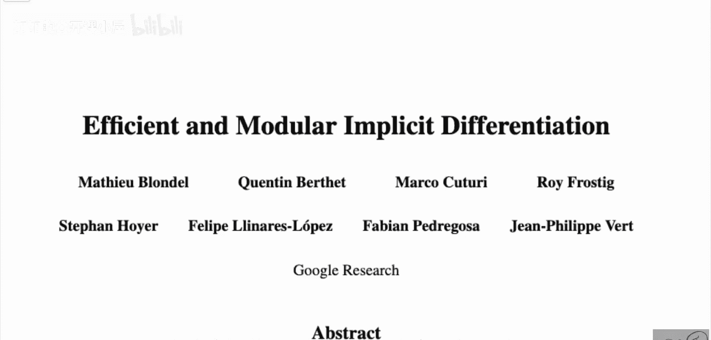

So it's a bit of a technical paper and we won't go in this two technical mode because I'm also not the most or the biggest expert on the methods used here I just wanted to raise a bit of awareness that this exists because the ability to back propagate through sort of inner optimization procedures and even like other things in a unified way without having to unroll。

 I think it unlocks a bunch of research that has been quite cumbersome so far and could be interesting to a lot of people。

 they do provide code and everything and they prove or they show that many special instances that have been derived in the past and also a bunch of new ones are just instances of their framework and can be solved sometimes much more easily with their framework they even provide some approximation guarantees and so on。

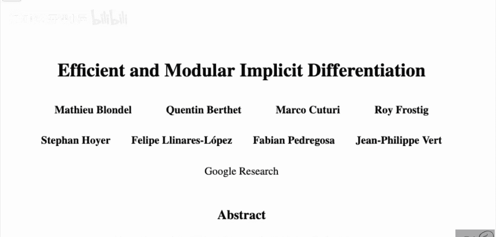

I think interesting to us is just going to be a little bit of the insight of why and how this works and the fact that it exists。

 so let's jump in。

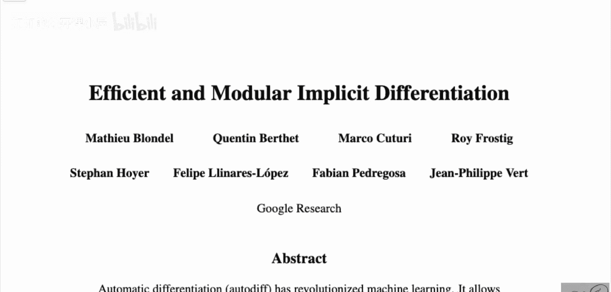

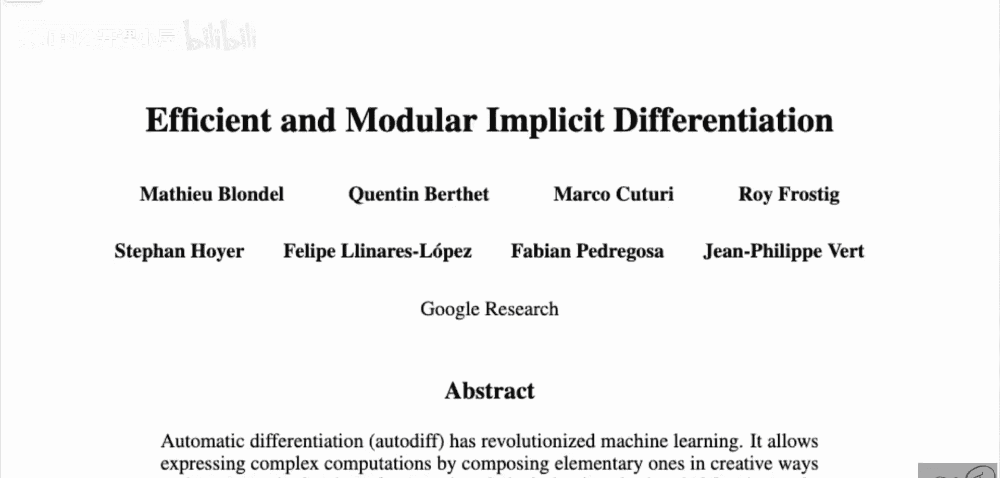

They say that automatic differentiation has revolutionized machine learning。

It allows expressing complex computations by composing elementary ones in creative ways and remove the burden of computing their derivatives by hand。

 This is absolutely true。 If you look at old papers in， in deep learning。

 half the paper would be spent on。You know， deriving the gradients of the architecture that was just proposed。

 So you could actually implement it。 And now we have Autodev， which means that the frameworks。

 they simply do this by themselves。 you just compose a bunch of functions。

 And you call gradient on them。 This is a big part of what has spurred the deep learning revolution in the past few years。

 at least from a implementation point of view， right。

 I don't think a lot of architectures would have happened if people always had to derive the gradients by hand。

And it's kind of obvious to do this if you know the backpro algorithm。

 but still it is a big helper now as I said， this paper this paper exposes sorry this paper extends the concept the spirit of AutodF to a much larger class of applications they say more recently differentiation of optimization problem solutions has attracted widespread attention with applications such as optimization as a layer and in bylevel problems such as hyperparameter optimization and meta learning So the key here is differentiation of optimization problem solutions so I have an inner optimization problem and I obtain a solution and I want to backproagate through not only through the solution itself but actually through the path that led me to finding that solution and meta learning is a good。

Example， hyperparameter optimization， of course， as well。 So in meta learning。What you do。

 and this is this is a simple thing。 there are many various tasks in meta learning。

 but I've done a video on one of those， which is called I Mammal。

It's an extension of Mammal and I think the ML stands for Me learning。The eye here for implicit。

 which is， of course， going to be related to the implicit differentiation we do right here or implicit the implicit here stands for the fact that we can implicitly derive the gradient we don't have to go through the whole unroll。

 So in imMl， there is a setting where you have multiple task you have。

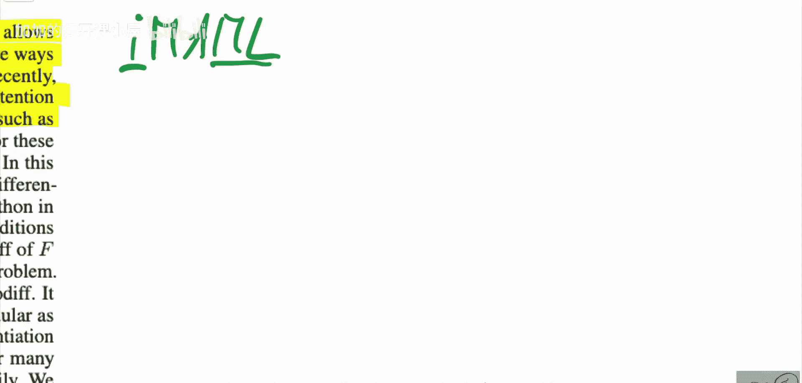

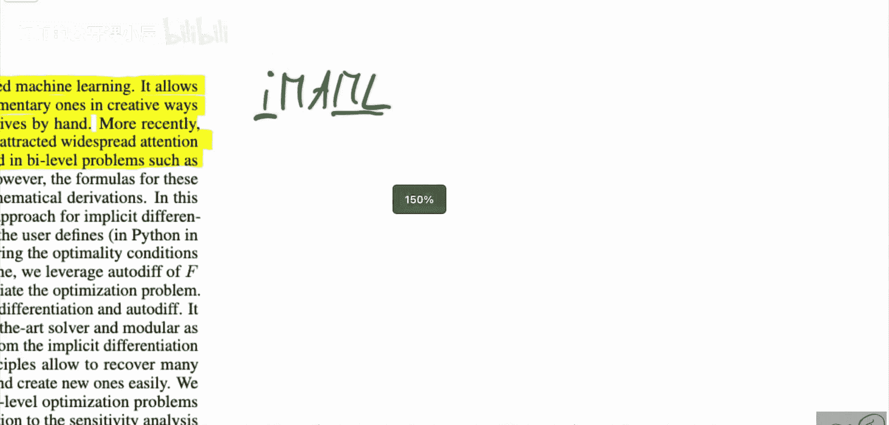

A data set and there is task1 task2 and task3， so maybe this is classifying food by taste。

 this is classifying food by calories， this is classifying food by some other nutrient or color or something like this now and this all should happen with the same architecture of neural network。

 simply you know solving different tasks So obviously the different tasks are going to have different optima。

 different local optima and from deep learning of course we know that these are never in the same place there are many local optima。

 but let's just pretend for a moment we knew that these were the three optimum。

The task of meta learning is， can we find an initialization that is really good such that if we fine tune on any of these tasks。

 if we if we get data from any of these tasks， we can learn it really quickly so if you know。

 you know， if you see here， if we choose this as an initialization。

 it's going to take us a while to get to any of these solutions， however。

 if we choose this as our initialization， we're here pretty quickly and in fact。

 if a new tasks comes that is similar to the other ones。

 let's say one here right that's kind of similar。 it's on the same。hyperperplane， whatnot。

 You can see that we're also there fairly quickly。 So the question is， how do we find the blue point。

 Obviously， we don't know where the green points are and， and they're non deterterministic anyway。

And the， the answer is， we start with。Anyone like this one， we start with a guess。 And we move point。

 you know， step by step into a better direction， just as we do with gradient descent。 However。

 how do we know what a good direction is in order to know what a good direction is。

 we need to know how good is this initialization。 So consider this one。

 How good is this initialization。 Well， in order to do that。

 we actually need to do the optimization procedure， So we do that， and we see， well。

 leads us in that direction， we optimize for a different task that leads us in that direction。

 And now we get an idea that， hey， maybe if all the tasks go into the same direction， maybe。

 you know， it would be good if we also went into that direction，  specifically。

 what we want as we want the gradient。The gradient with respect to our initialization of the solution。

Of a particular task， given that initialization， right Now， this solution itself， of course。

 is an optimization procedure。 So you have an inner optimization procedure that you want to back propagate through what you usually have to do is you have to unroll that optimization procedure。

 So if you think of gradient descent。 So here is your weights。

 And what you do is you subtract learning rate times the gradient。

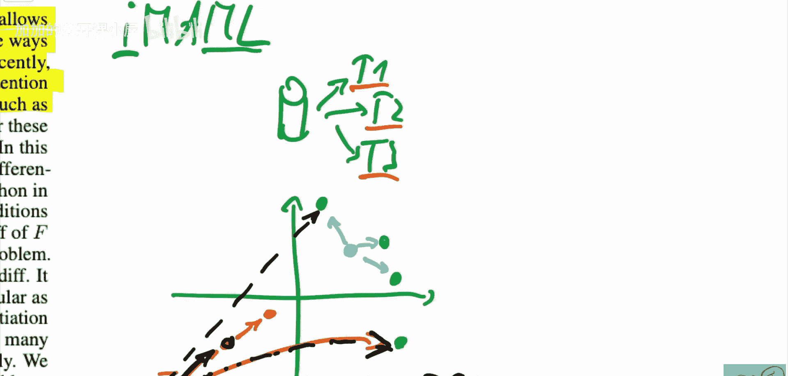

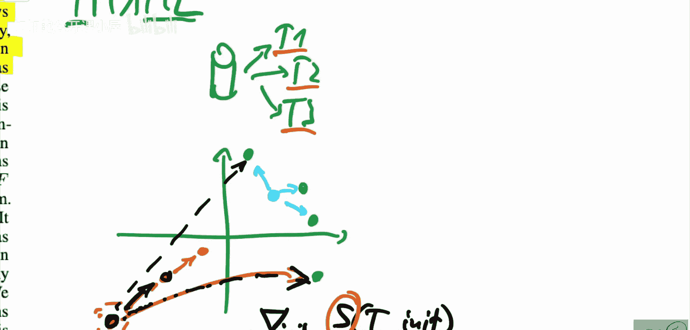

So here is it at step T， right。Learning rate with respect to。To the weights of F of X and W， T。 Okay。

 that's your standard gradient descent。 So what does that give you， All of that gives you W。

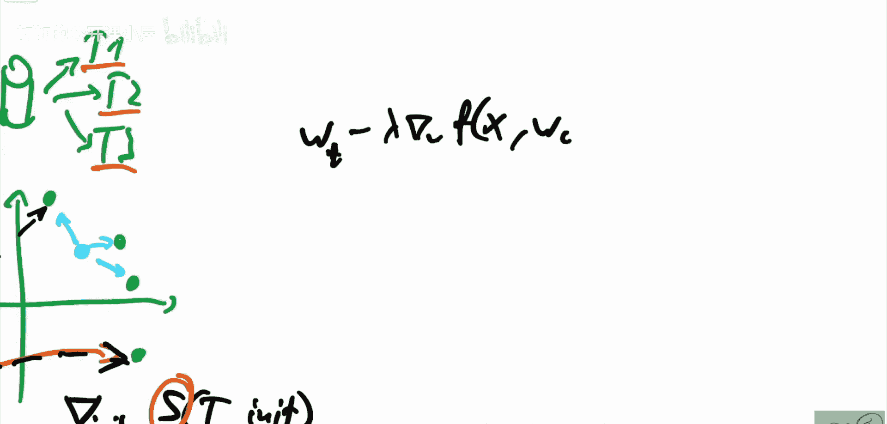

Ti。Plus one。And now you do another step of gradient descent。 Okay， so minus again。

 gradient with respect to this， this， this， maybe it's a different data point。 maybe it's the same。

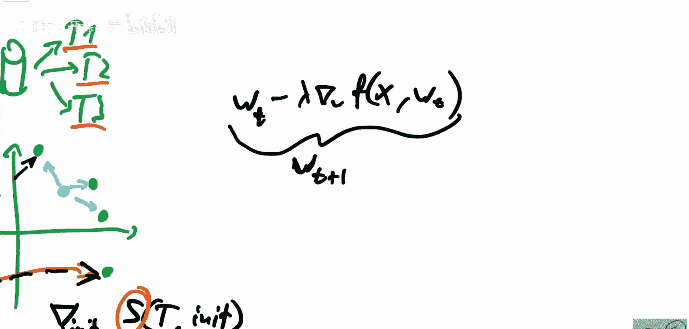

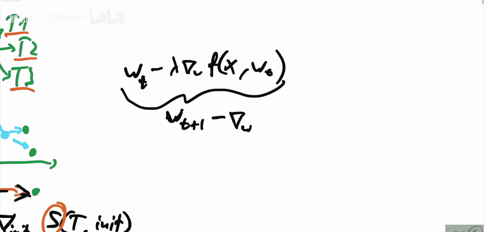

Plus 1。Okay， so its it already gets complicated because now this quantity here。

 which is all the quantity of above appears twice And if you do another step， of course。

 that quantity is going to to replicate and be anywhere。 and auto framework can keep track of that。

 So if you do this and you actually write down from your first thing， you write down。

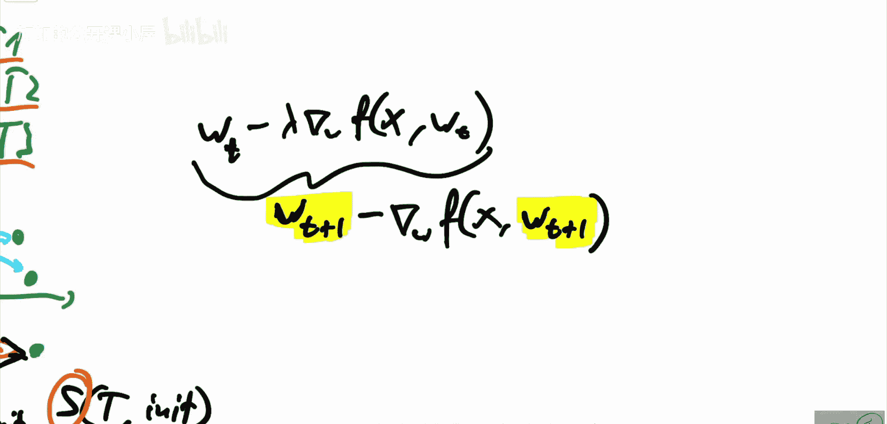

You can unroll all of this into one big expression that gives you the end of the optimization procedure。

 the end of gradient descent given the beginning。You can do that。 And the tensorflow or pi torch。

 they can keep track of this。 It's just， it's going to be a big expression。 It's going to be really。

 really slow， and further。What it needs what what you need to do is you need to actually implement the gradient descent procedure as a differentiable procedure。

 which is usually not done， usually in especially in Tensorflow and pytorch， the gradient descent。

 the optimization procedures， they're sort of outside of the audit framework in jacks。

 it's a bit different。 but in in Tensorflow and pytorrch， the optimization procedures。

 for good reason， they themselves aren't differentiable。

 So you'd have to reimplement them in a differentiable way。 All of that is fairly cumbersome。

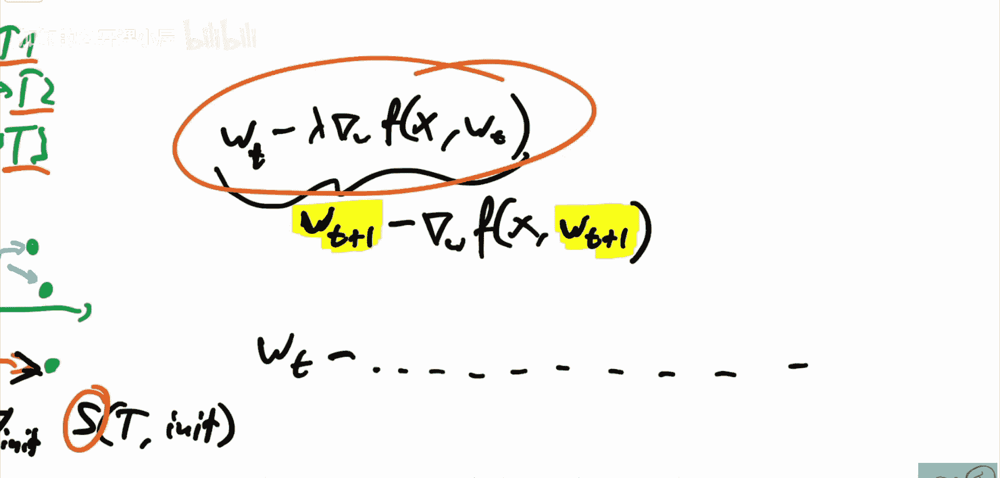

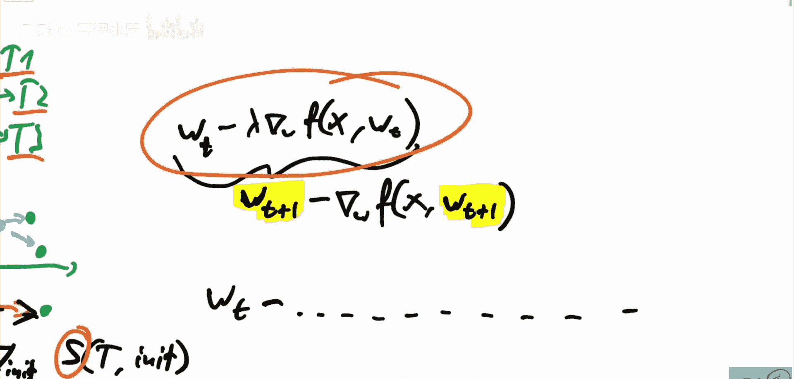

And people have asked themselves， can we do better？

