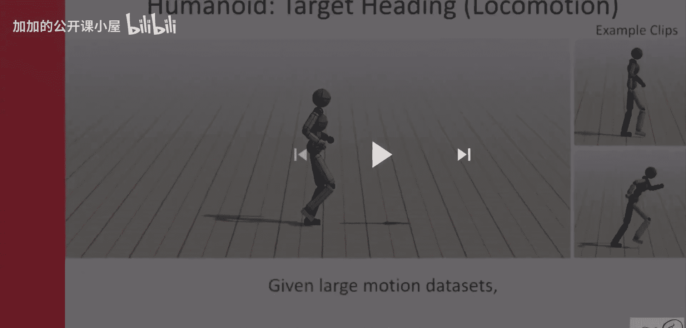
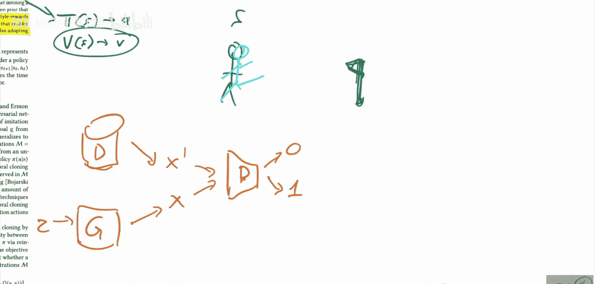

# YannicKilcher【中英⚡AI经典论文领读(全203篇)(下)｜Papers Explained】 p40 P140 AMP：基于物理的角色控制中对抗性运动先验的风格化应用（论文详解） [BV1j8x5zJEvx_p40]

Hey， yoo， where's my money。Or， give me my money。Alright， we're gonna get into this video in a second。

 Today， we're going to look at AM MP adversarial motion priors for stylized physicsbased character control by Xibbin Pengma Pitrobi Sergei Levine and Anju Kaazzawa And this paper is in the domain of control and reinforcement learning。

 but it's with a little bit of a twist。 So on the high level， this paper trains an agent。

 a physical agent， as you can see here， to perform some sort of goal in the case on the right。

 It's walking up to a target and punching the target。 But to do so in a certain style。

 and the style is provided by an expert dataset set or a demonstration dataset set。

 So the technique that the paper presents mixes two things。

 It mixes goal achieving reinforcement learning。

It also mixes adherence to a given style and the adherence to a given style。

 that's going to be the adversarial part right here because that's learned in an adversarial way。

 The mixture of the two at the end looks pretty， pretty cool。

So the setup right here is a setup of goal achieving and imitation learning。

 as we have already outlined。And the way it works is a following。 There is going to be a task。

 and the task can be， you have to reach a goal。 The task can be you have to punch something。

 you have to overcome some obstacles and then reach a goal。 any， anything like this is a task。

 So the goals are fairly high level。 And they are given obviously by a reward function。

 So you place the agent in an environment and there is a reward function。 By the way。

 the agent here is， as we already also said。Is this sort of physical agent that is going to have some sort of a 3D structure。

 so there's going to be joints that it can move there's a joint here and one here usually so and there is a head。

The agent is this physical thing and it's in a physics simulation， and each one of these joints。

 it can move kind of independently， sometimes free as a as a ball， sometimes it's restricted。

 It's modeled very much like a human。 There are other， I believe other models such as a Trex。

 which of course work differently。 but you have this agent and。The agent is supposed to reach a goal。

 like somewhere over here， there's a little flag is a goal。

And the way the agent can interact with the world is by putting force on any of these joints。

 so it can move these joints in prettyspec ways， and that constitutes the actions。

 so the agent will observe the state and the state here is given mostly by it can observe how all the joints are currently the velocity of of the joints or of the individual parts of itself in relation to itself so it can sort of feel itself and it also knows in which direction and generally how far away the target that it needs to reach is。

So that's the observation space。 the action space is it can affect these joints and the reward function is often modeled in accordance with the goal。

 So the reward function for walking to some goal might simply be you get reward if you are closer to the goal so this encourages the agent to go over there So we work with quite dense rewards right here because I guess the fundamental problems of reinforcement learning aren't exactly the point here。

 The point here is can you teach these things to achieve a goal while maintaining a certain style。

Now， this is the task and the environment。 In addition to that。

 you do get a dataset set and the data set is demonstrations of a certain nature。

 So this is not necessarily demonstrations of how to reach the goal。

 it can be any sort of demonstrations。 So usually when people do sort of imitation learning or learning from demonstrations。

 there is a bit， there are some requirements。 If you want to do pure learning from demonstration。

 Of course， the demonstrations need to be how to achieve the goal。

 and that we don' we don't have that here。 In other cases。

 you do need the sort of policy or the action of whoever performed the data set。

 we also don't need that here。 Our goal is simply going to be。 We have to reach the task while。

 while。Sort of adhering to the data set in a way。 And this way we're going to define in a second。

 So the data set， you can imagine， I think there is a good。Demonstration down here。

 you can imagine the the data set to give you sort of the style of movement。 So in one dataset set。

 you can have running movements and walking movements。 and in another data set。

 you could have these movements that where just the these actors walk like zombies。And。

The goal here is to combine the style of the dataset with reaching the goal。

 Okay so the combination would look like a zombie walking to the goal。

 which adheres to the zombie walk in the data and the goal specified by the task。Okay， naturally。

 you're you're going to model this as two different reward signals。

 So there is the reward signals of how much you reach the goal。

 and there is the reward signal of how well you adhere to this style in the data set。

 The reward goal right here is modeled by classic reinforcement learning。 So this is very much very。

 very classic。Where do we have it， So you would simply train。

I don't even think it it says here it's update G and D。

 so this is a policy gradient method reinforcement learning。

 which means that you do have a policy function which takes in a state and maybe a history and it will give you it will give you an action。

And with that， you also train a value function that takes a state and will give you a value for that state now。

The value function is purely for training the agent， because you do。

You do advantage estimation with this value function。

 but essentially this is a standard policy gradient method that you train this part。

 this lower part of the this lower part of the thing on sorry。

 you actually trained the whole thing on this reward。

But the bottom part you can imagine is it a reward comes from reaching a goal。

The top part also gives you a reward Okay， And yes。

 I want to reiterate both of these rewards are used to train the policy and the value in a policy gradient fashion。

 So both rewards ultimately are in this standard advantage estimation。

 reinforcement learning setting。However， the top reward is calculated differently than simply do you reach the goal。

 The top reward is a measure of how close you are in style to the dataset set。

 and that's given by this motion prior and the motion prior is given by agan by a generative adversarial network and I'm trying to to find the the formula here。

I think this here is the the best description of it， though it's just a formula so。

A generative adversarial model。 I'm pretty sure you're all aware there is a data right here。

 There is a generator right here， the generator gets some random noise as an input。

 it outputs a sample X from the dataset you get a sample X prime or a mini batch And then both of these or these either of these goes into the discriminator model and the discriminator has to decide for any sample。

 is it real or is it fake。 So the way this generatorrative adversarial network approaches the problem of specifying which motion are real in which ones are not is by looking at transitions。

 So the data here is not images or so like you're used to in are again， But the data is transitions。

 What does that mean So in every situation， your humanoid or whatnot is here and the goal is。

Over here。And this is one state。 This is S。 And then the agent takes an action。 Okay。

 the action could be， please lift one leg。 And how does that？ Well。

 so the new agent would be kind of here shifting the weight a little bit。And lifting one leg。

 So this would be one action， which would lead to a new state S prime。

