# YannicKilcher【中英⚡AI经典论文领读(全203篇)(下)｜Papers Explained】 p41 P141 XCiT：交叉协方差图像变换器（Facebook AI 机器学习研究论文详解） [BV1j8x5zJEvx_p41]

Hello there。 Today we'll look at excite crosscovariance image transformers by Facebook AI。

 Inria and Sobon University So in this paper the authors propose a kind of a transpose of an attention mechanism so instead of the attention working across tokens and tokens attending to other tokens now it is the features or the channels attending to other channels and in a matter across the entire sequence that you input this means there is no longer a quadratic complexity in the length of the input sequence and this supposedly works particularly well for image data so these are akin to the vision transformers that work on patches patched images and they reach comparable good performance on things like imagenet classification self-supervised learning but also dense。

ic like segmentation and so on。So we're going to look into this paper。

 it is kind of weird to how to think about this， so the idea is pretty simple。

 but I think it's kind of weird and the question is to me a little bit can this still be called a transformer in the way that it operates because as it seems to me after reading the paper and I think they also mention this during the paper。

 it is more like a convenet honestly， that just kind of has one dynamic part in it。

 so one of the convolutions is a dynamic convolutions。

 but we'll see and you know this could be a good architecture for future image for future image processing？

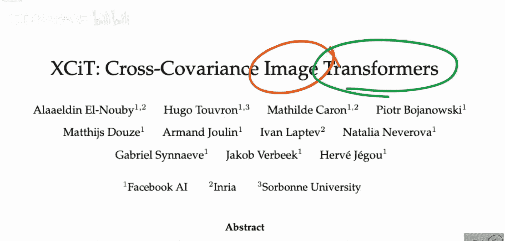

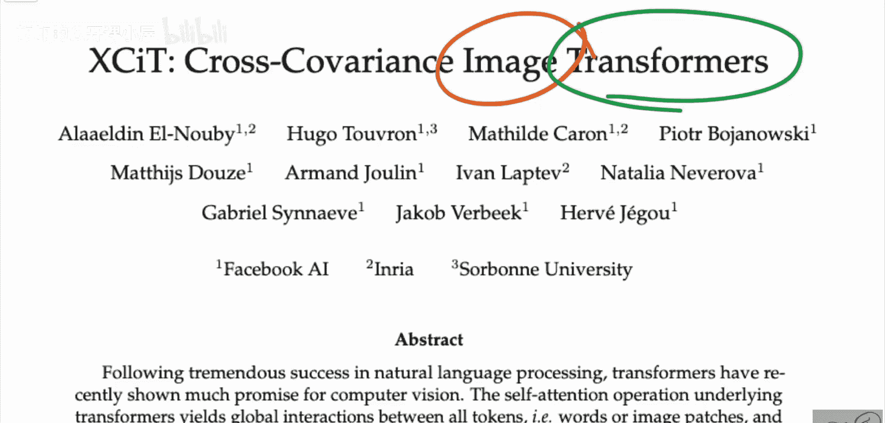

So here they say， let me grab my yellow following tremendous success in NLP transformers have recently shown much promise for computer vision so the self-atten operation underlying transformers yields global interactions between all tokens。

 i。e。 words or image patches and enables flexible modeling of image data beyond the local interactions of convolutions。

 this flexibility comes with a quadratic complexity and time and memory hindering application to long sequences and high resolution images。

 so this is the problem transformers good attention mechanism powerful， however。

 there is a quadratic complexity in time and memory in terms of the sequence length and that's why we can't apply it to long sequences or high resolution images。

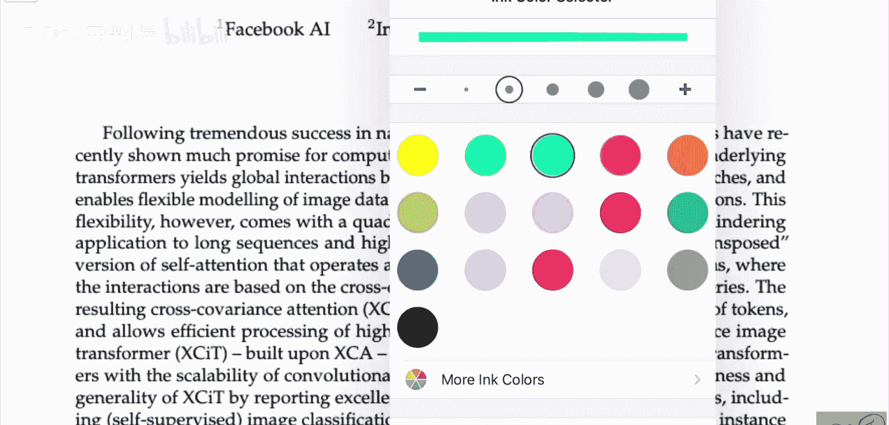

They say we propose a transposed version of self attention that operates across feature channels rather than tokens。

 where the interactions are based on the cross covariance matrix between keys and queries。

The resulting cross covariance attention has linear complexity in the number of tokens。

 allows the efficient processing of high resolution images。

 yara ya yara and then they propose an entire architecture built upon the XCA。

 the cross covariance attention， which they call excite。

So that's the cross covariance image transformer。 it says it combines the accuracy of conventional transformers with the sealability of convolutional architectures。

 sorry scalability。😊，We validate the effectiveness by reporting excellent results of multiple benchmarks。

 including self-supervised image classification on imagenet， object detection， instant segmentation。

 ya yada， they're super good。 Okay So what is this new kind of attention。

 This is the main graphic in the paper。 And on the left， you can see how the whole attention looks。

 So this would be the whole model is consistent of these excite layers。

 So you'd have sort of input tokens down here。 And then you have L of these excite blocks。

 And at the end， you'd have whatever a classification layer or a segmentation layer or something like this。

 But in our case， this here is what would be a selfat but followed by a feet forward network。

 And you can see that the it's essentially the same。 The feet forward network is still here。

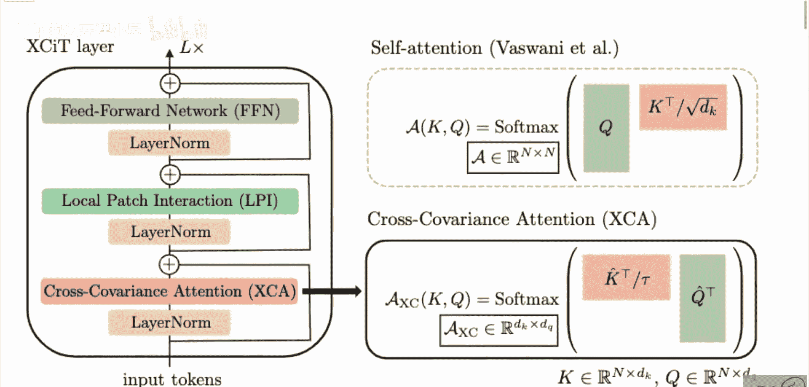

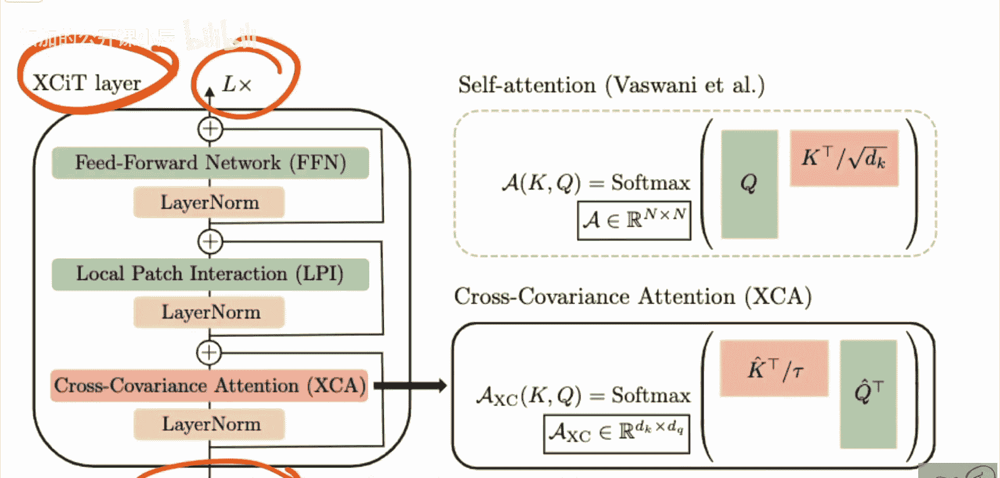

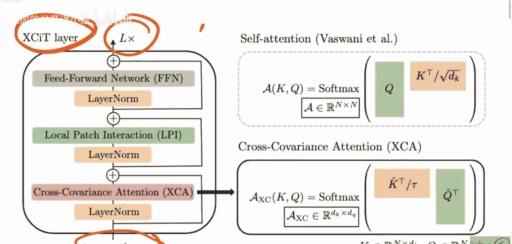

But the selfat block has been replaced by these two blocks。

 and the bottom one is this crosscovariance attention。

 which does attention pretty much like you're used to， there's there's a tiny difference。

 I said the idea here is pretty simple。 in the in the mathematical way。

 it's just a bit weird to think about it。 So on the top。

 you have the classic selfat that is used throughout transformers currently。 And on the bottom。

 you have this new proposed crosscovariance attention。

 And you might notice that the only thing that is different。

 if you look at the the pictures is that the green and the orange matrix here are skipped。

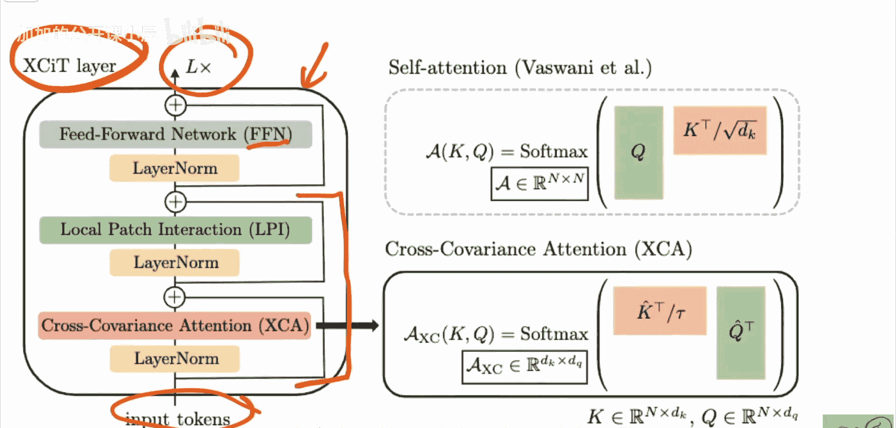

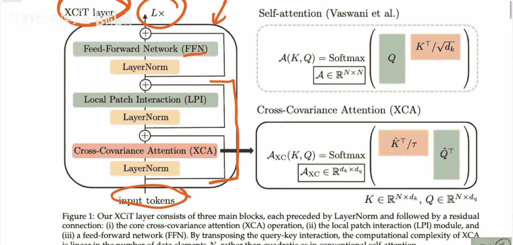

So for that， we dive a little bit into what attention does regularly， usually。

 So I think I've drawn this picture about a thousand times。 but forgive me if I do it one more time。

 okay， so。

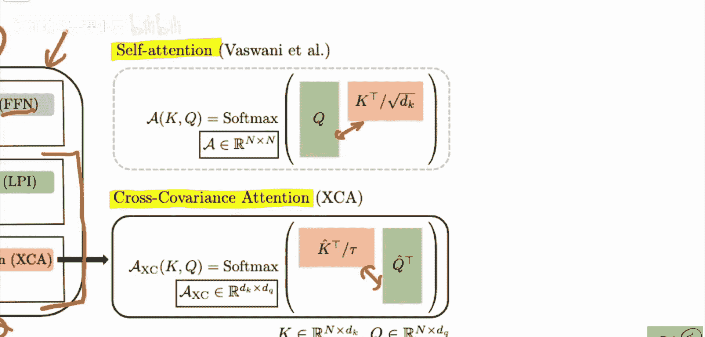

Every we have let's say we have a series of tokens like this one here。

 and this can be word word embeddings in language， but this can be image patches in images。

 so the way vision transformers work is it's prohibitively large to process each pixel individually。

 so what they do is they take the image and they put it into patches and now each patch becomes sort of one of these tokens。

Okay。As opposed to convolutional networks， which can actually work on these high resolutions directly by applying only the local convolution operation。

 So these are sequence elements of whatever form。 And every of the one of these sequence elements exposes a query vector。

 So the query vector is a vector that's supposed to tell sort of what it wants to know about the other sequence elements。

 And then also each one exposes a key vector。 So the key vector tells a little bit like what's contained in the in this token。

So。The way this is routed is that the query， each query is compared to each key。

 and then the information is routed according to which ones have the largest inner product。

 For example， the next representation of this token right here， we we need to look at its。

At its query。 And we need to compare it to all the keys that we find。 So in this case。

 only this key right here matches。 So we would expect that a lot of the connection between those two is very strong。

 Ultimately， what you're going to do in here in here。

 you're going to build up a fully connected layer， right。

 everything' is connected to everything with different strengths。

 but the strength of the connection is dynamic。 The strength of the connection is determined by the by the attention mechanism rather than fully learned。

 okay。So an MLP would be a fully learned connection matrix which is fixed。

 however an attention matrix is a dynamic connection matrix。In this case。

 in the cross covariance attention， we do something very similar。

 but we have to think a bit differently。 So now here what we have is essentially we have vectors。

Let's represent these token things as vectors。And。Let's have three。 No， we have five data points。

And they all have four dimensions。 We'll leave away query and key and so on。 right now。 So what。

 what you do is you don't watch the tokens as a sequence。 However。

 you watch the channels as the sequence。 So this here is now one element。 This is one element。

 This is one element。 And this is one element。 So you'd have to somehow trans， can I rotate this。

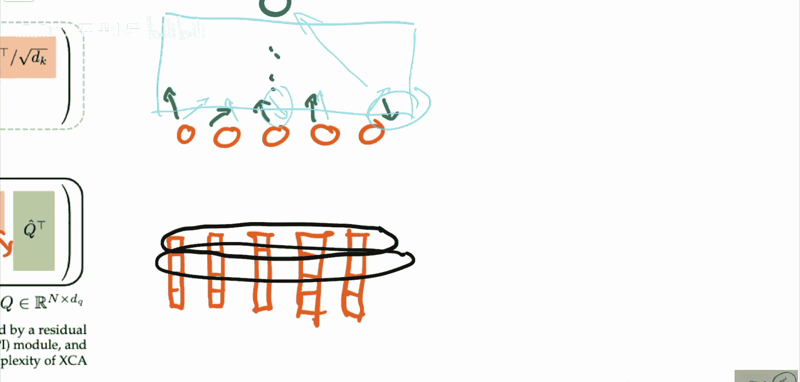

I cannot。

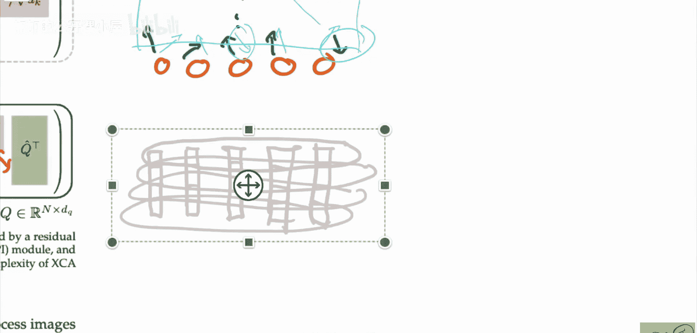

Yet， I cannot rotate it。You just imagine in your mind this rotateated and now each channel exposes a query。

And then each channel exposes a key。And now the information is routed not between sequences of not between from token to token。

 but from channel to channel。 So essentially， you look across the entire sequence in the first channel and you decide。

 okay， what kind of information is in this first feature across the entire sequence。

 And you can see kind of how that makes sense。 So with the self attention， you can see that。

 you know， a token in a， in a picture， it might be an eye。 So a patch。

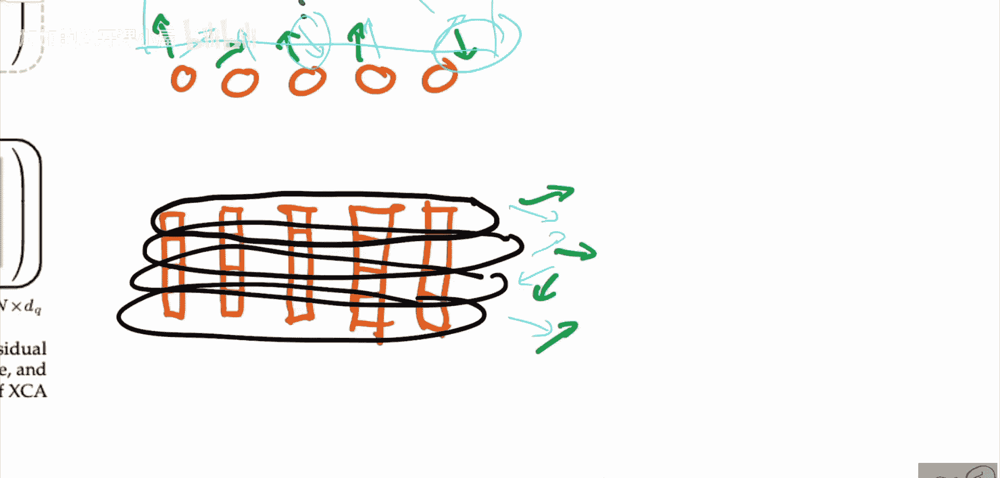

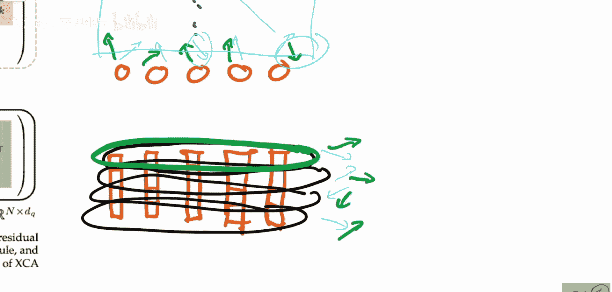

A patch might contain a part of an eye， right？ And then another patch might contain a part of a mouth right here。

 Okay， there is a tooth and。It， it would be important if these two things could communicate with each other。

 because that would give a hint that there might be a face in the image。

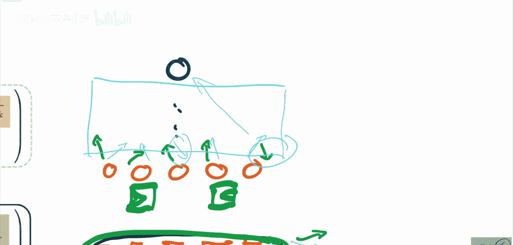

In this framing， we across we look across all of the things and maybe the first channel is responsible for recognizing I like structures anywhere in the image right across all the patch。

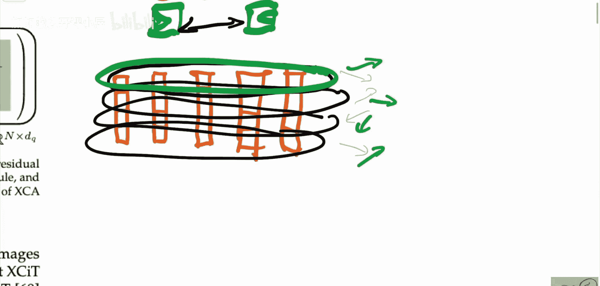

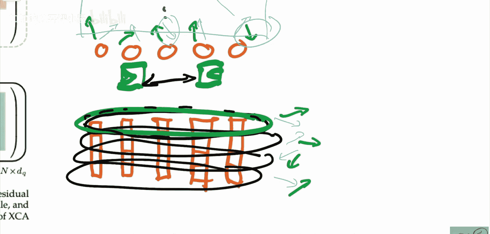

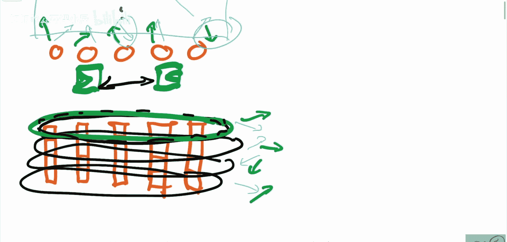