# YannicKilcher【中英⚡AI经典论文领读(全203篇)(下)｜Papers Explained】 p42 P142 机器学习中的对抗样本：凹痕流形模型（研究论文解读） [BV1j8x5zJEvx_p42]

Hello there， Today we're going to look at the dimpled manifold model of adversarial examples in machine learning by Adi Shamir。

 Odelia Melmed and Oriel Ben Schmuel。This paper on a high level proposes a new way of looking at the phenomenon of adversarial examples in machine learning specifically in deep learning。

 and they propose this model called the dimpled manifold model essentially arguing that classifiers put their decision boundaries right next to the manifold of data while only slightly sort of curving it around the data like this now the data manifold being low dimensionional。

 this results in a situation where you can cross the decision boundary really easily if you simply go perpendicular to the data manifold。

 which also is perpendicular to the decision boundary and if because it's just such a small dimple there。

 the decision boundary is pretty close and that's how you end up with adversarial examples that are super easy to get。

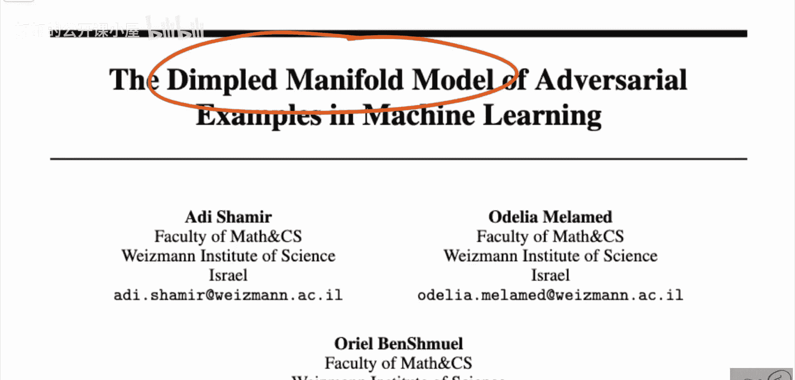

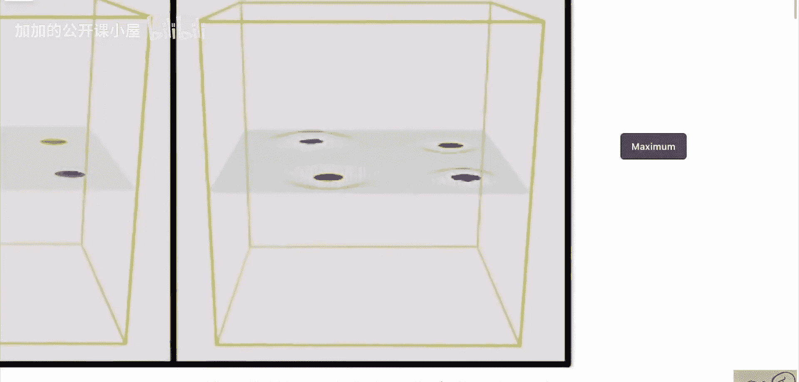

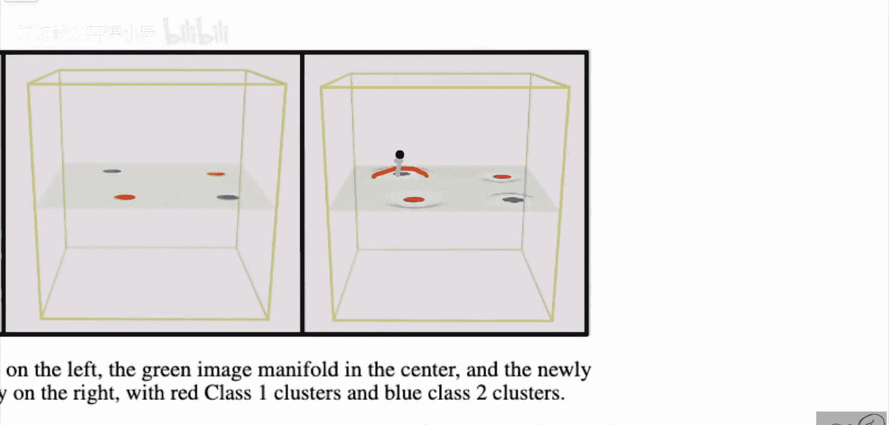

So it's not a new attack， a new defense， anything like this。

 it's simply a mental framework of explaining why adversarial examples exist on a high level。

 they have some conceptual thought experiments they have some explanations and some real world experiments Now I personally don't think that this is entirely it's not necessarily incorrect。

 but I don't think that this is really useful to think in this way and I'm going to explain why in general my opinion of this is it doesn't really add anything and I think it explains less than the models we already had。

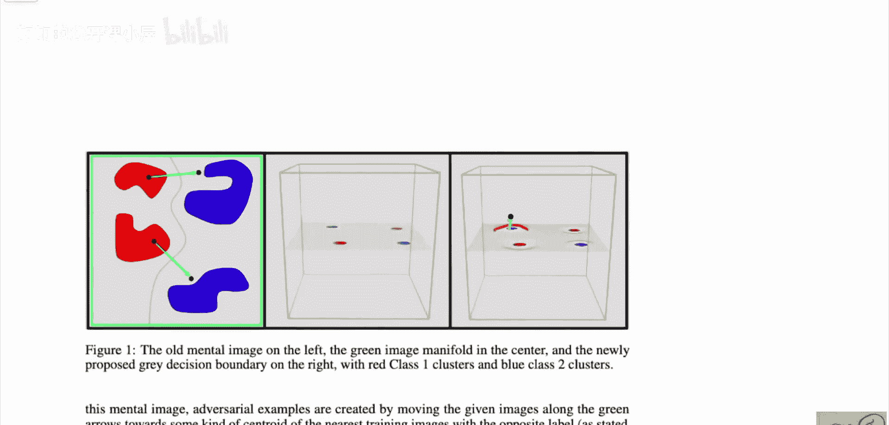

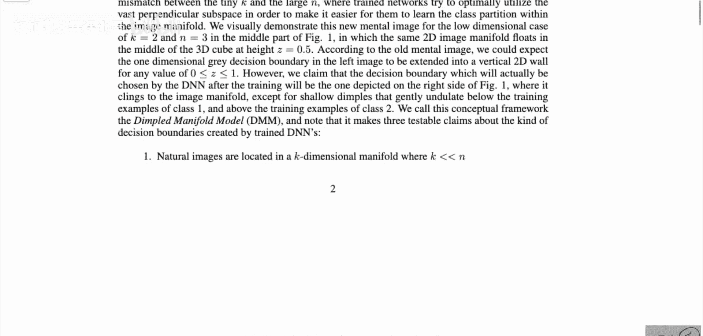

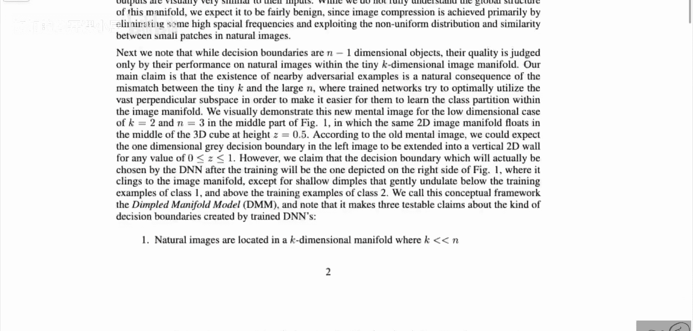

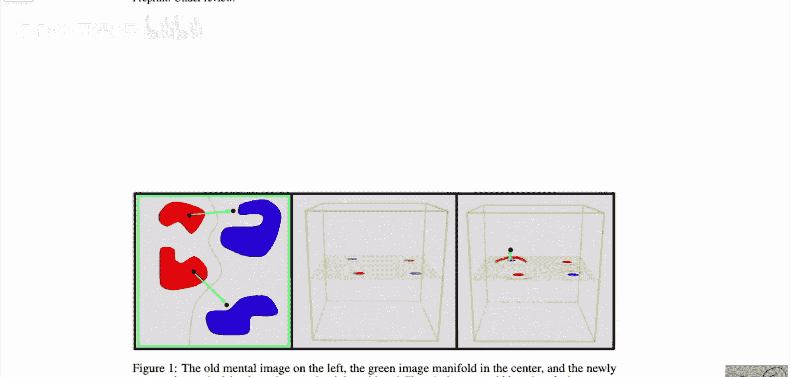

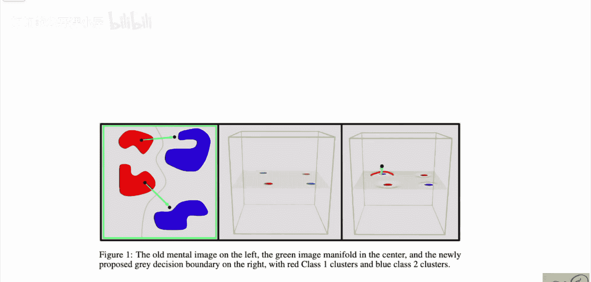

Yeah so that that's my opinion I'm going to get to it is specifically also the experiments they propose。

 I think that there is a big outcomes comes razor failure right there。

 but as I said we're going to get to all of this I'm to go through the paper and I want you to make up your own mind even though I'm going to try to bias you so yeah this is not a neutral channel in case you haven't noticed。

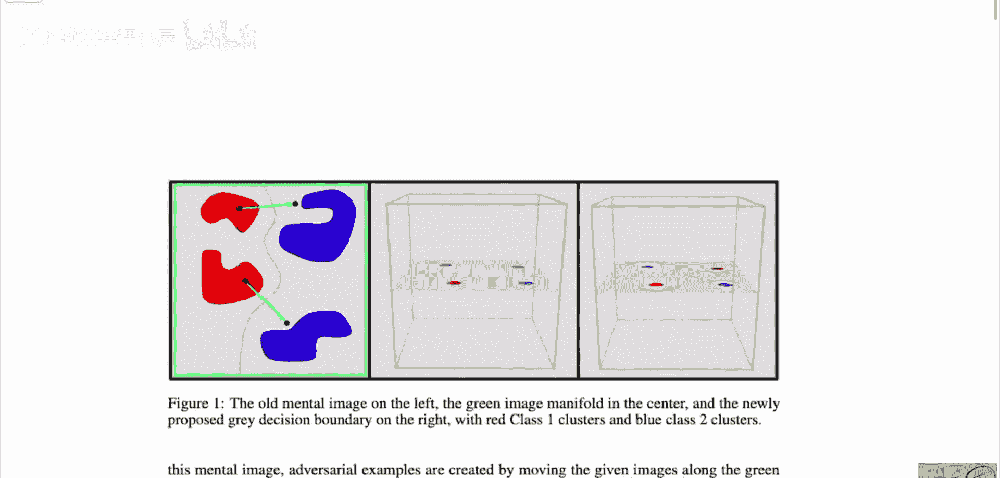

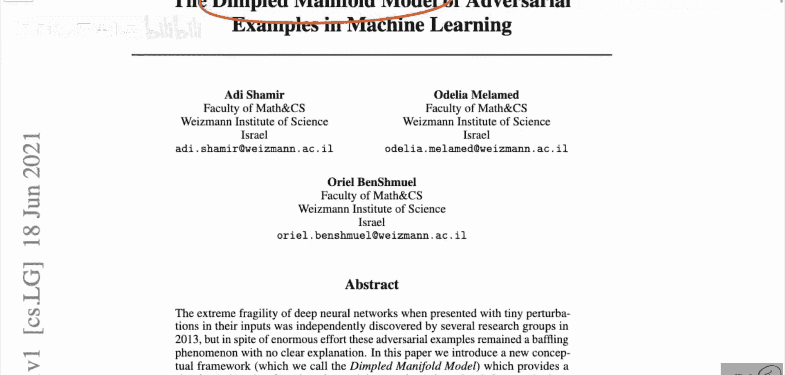

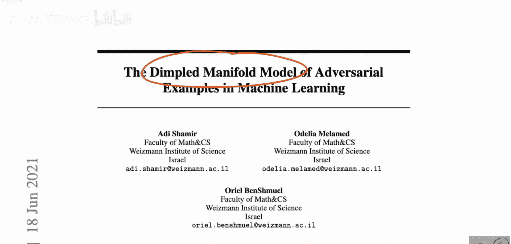

All right so if you you know like content or if you dislike it， tell me in the comments。

 tell me what you think of the paper， whether it makes sense。

 whether it doesn't make sense and so on I'd be very interested to see what you have to say yeah I read the comments so please。

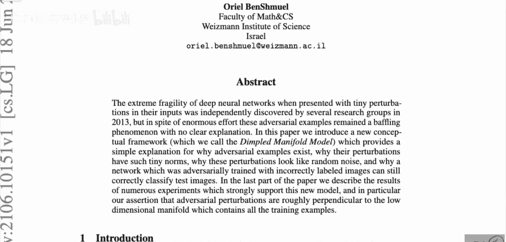

They say the extreme fragility of deep neural networks when presented with tiny perturbations but okay this starts out how every single adversarial examples paper always starts out saying okay deep neural networks are extremely fragile there's this phenomenon of adversarial examples Now if you don't know what adversarial examples are really briefly essentially this is it's a phenomenon where you take an image like the thing here on the left。

 the neural network thinks it's a plane with a very high probability and you change it to this thing right here。

 which as a human can't even tell it's different however the neural network will think that this is now a bird with very high probability and this is the change that you made it's magnified for you to see it kind of looks like random noise but it's a very particular noise that makes the neural network think it's something different and this is just it's tiny in its norm so you don't see it。

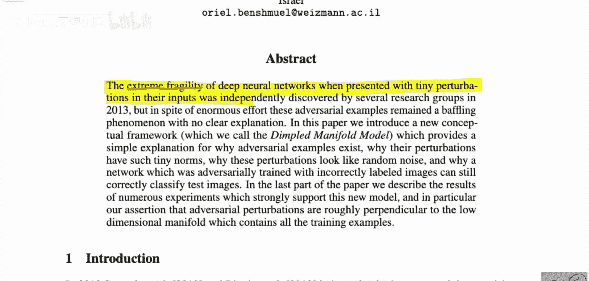

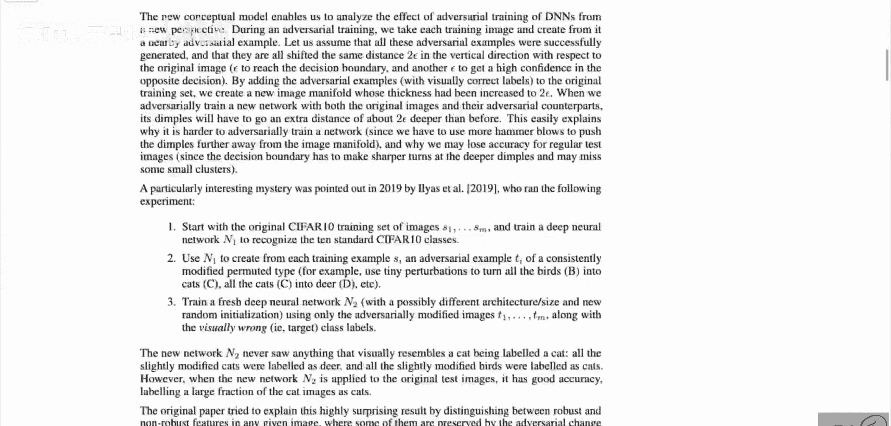

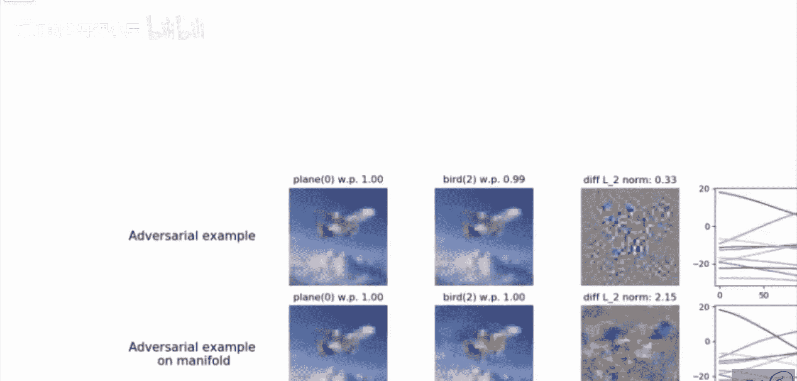

Now bird here is kind of close to plane， but you can change this into anything。

 literally anything you want， you can change this into banana or I don't know dog or any class you want using these techniques。

 so it's not about being close， it's really kind of a separate phenomenon。

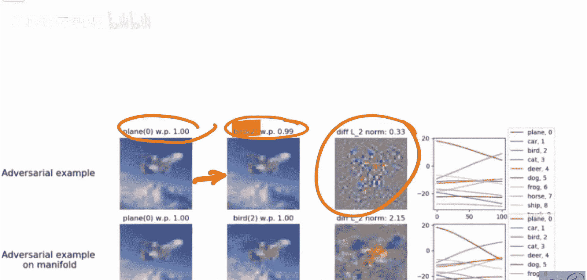

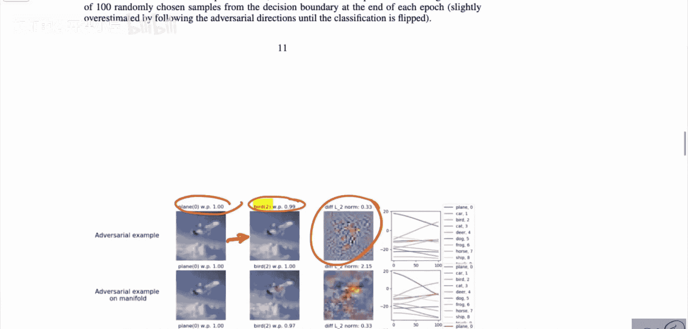

So that's adversarial examples and many frameworks have been proposed in order to explain these adversarial examples and they make a nice overview right here。

 many have been proposed over the last eight years， that DNNs are too nonlinear。

 that they are too linear were trained with insufficient number of training examples that are just rare cases where that images contain robust and non-robust features。

 etc。

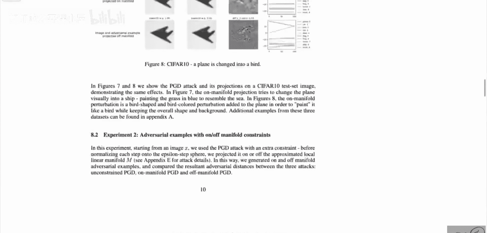

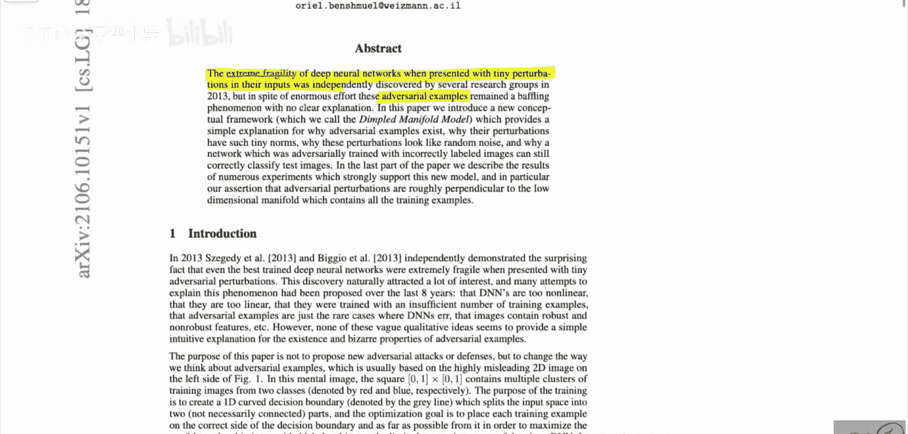

They say however， none of these vague qualitative ideas seem to provide a simple intuitive explanations for the existence and bizarre properties of adversarial examples。

 so that is pretty harsh criticism specifically the first ones are kind of yeah but specifically this last one that images contain robust and non-robust features which is sort of the leading hypothesises right now of why adversarial examples exist and what they are and then here are saying none of these none of these vague qualitative ideas seem to provide a simple intuitive explanation for the existence like let's see whether or not they're going to do better okay。

Soum。Also in the abstract， they go on and they say， okay。

 they introduce this new conceptual framework， which I call the dimpled manifold model。

 which provides a simple explanation for why adversarial examples exist。

 why their perturbations have such tiny norms， why these perturbations look like random noise。

 and why a network which was adversarally trained with incorrectly labeled images can still correctlyly classify test images。

Now this last part， if you're not familiar with the literature。

 it might come to you a bit random this why a network which was adversarially trained with incorrectly labeled images can still directly classify test images。

 this is a famous experiment from the group of Alexander Maddri， where also this hypothesis。

 this one。

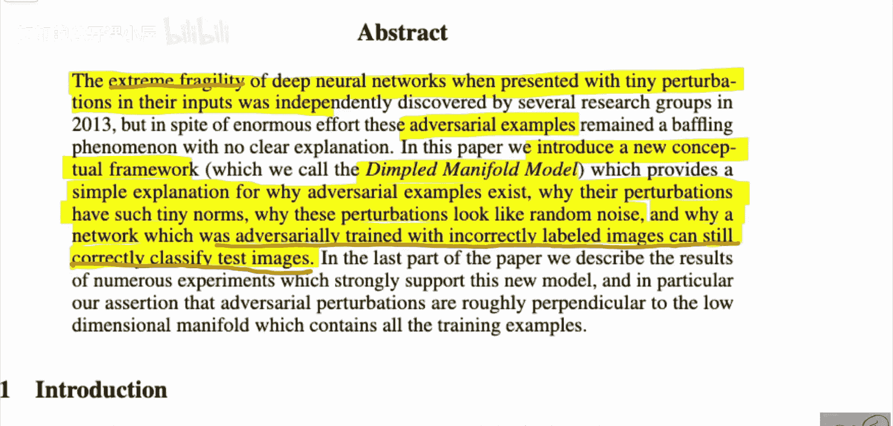

The robust and nonro feature comes from and any， any attempt at explaining adversarial examples after this paper has to explain why that experiment makes sense because it's kind of a non- intuitivetu experiment。

 And we're going to get to that as well。 But just so you know。

 that's why they write it in the abstract。 Now， I personally think they don't have a good。

 like this model here doesn't have a good explanation for why that works。

 They're sort of hand wavy trying。In any case， so they say in the last part of the paper we describe the results of numerous experiments which strongly support this new model and in particular our assertion that adversarial perturbations are roughly perpendicular to the low dimensional manifold which contains all the training examples also remember this experiment。

 they strongly support what in particular the assertion that adversarial perturbations are roughly perpendicular to the low dimensional manifold which contains all the training examples。

Now remember this that the experiments are supposed to support this particular claim because also that is going to be important down the road okay so let's get into the dimpled manifold model what is it。

 what do these authors propose and I''m going to try as best as I can to say what the authors are saying in the paper。

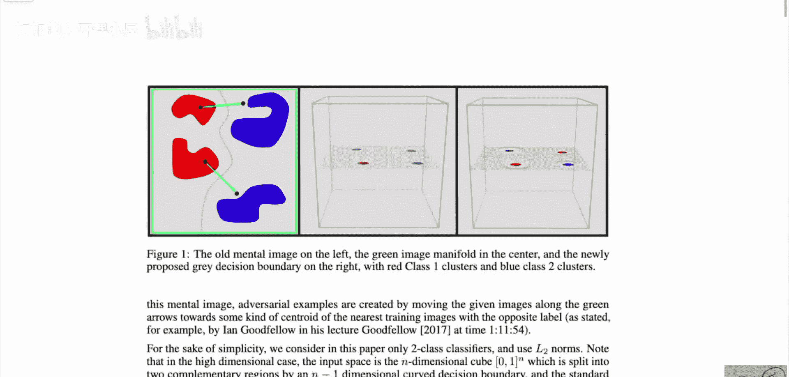

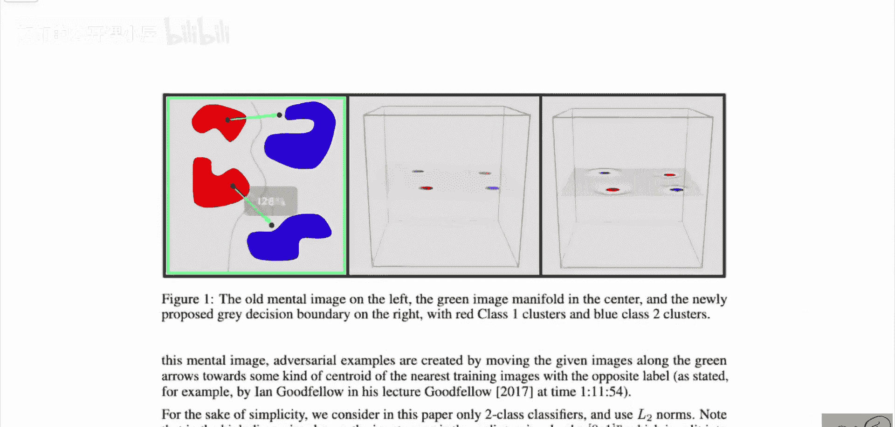

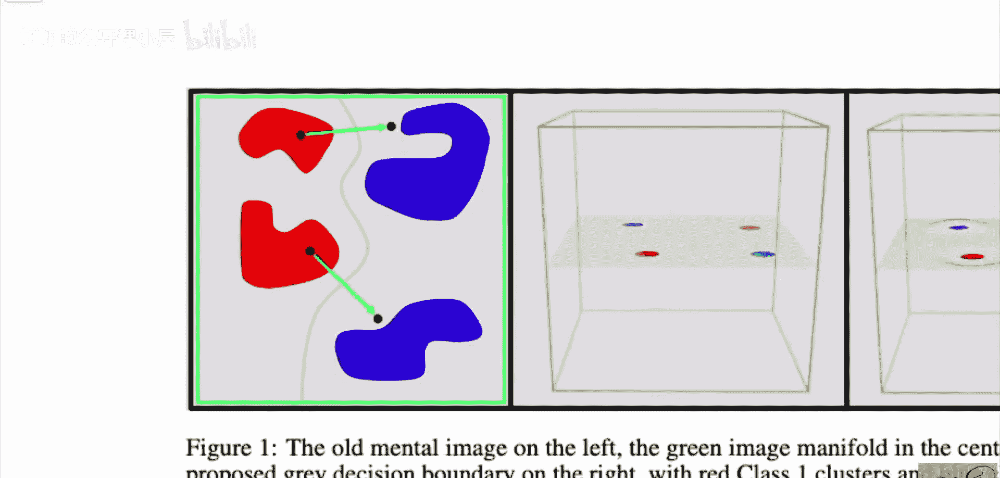

So they claim that there is an old mental image of adversarial examples and the old mental image is is。

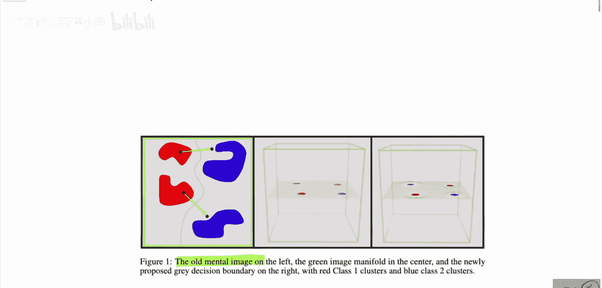

Here it's。They say we think the old mental image is based on the highly misleading 2D image on the left side of figure1。

 and that's this thing right here。

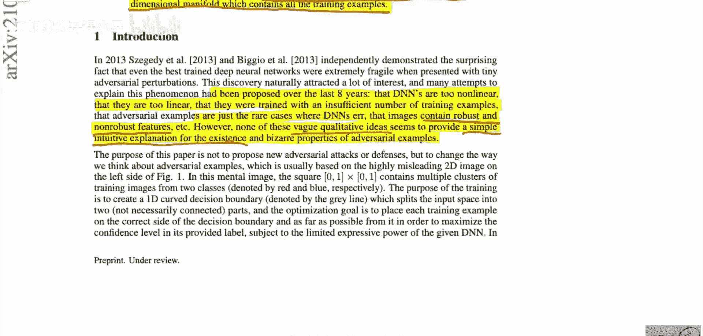

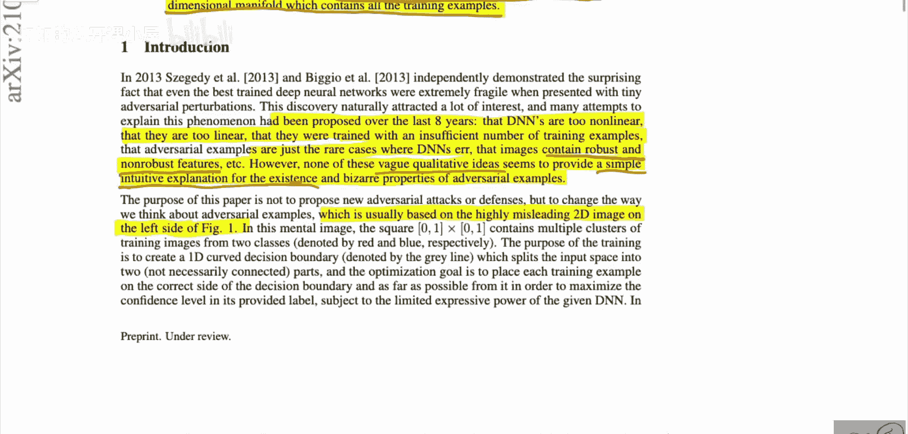

So the old mental image is that there is a data space right this here。

 if you think of images as data points， this would be the pixel space right so this is images with two pixels right now in this conceptual framework。

 but you have to sort of think yourself into higher dimension。

So they claim the old mental images the following you have sort of the data distributed somehow in this space。

 the data being the all the set of natural images or images you consider。

 which is kind of these subspace， these subgroups right here。

 there are a bunch of images right there and there and also there and there。

 so these are images of two different classes， the red class and the blue class。Now。

 they're distributed like this。 And what is a classifier supposed to do。

 A classifier is supposed to put a decision boundary between them。 And that's what they draw in here。

 So this would be sort of a reasonable decision boundary between the two classes， right？

 So now what do you do if you want to create an adversarial examples。 Well， necessarily。

 you have to start at an image of a class， this one， maybe。

 and you have to cross the decision boundary。 right， You want to fool the classifier Er go。

 necessarily， by definition， you have to cross the decision boundary。 So what do you do， the。

 the easiest way to do this is to sort of go straight towards the decision boundary。

Which is approximately in this direction right here， and then once you cross the decision boundary。

 you are done， you're on the other side， you have created an adversarial example provided， of course。

 that the image still kind of looks like the original image。

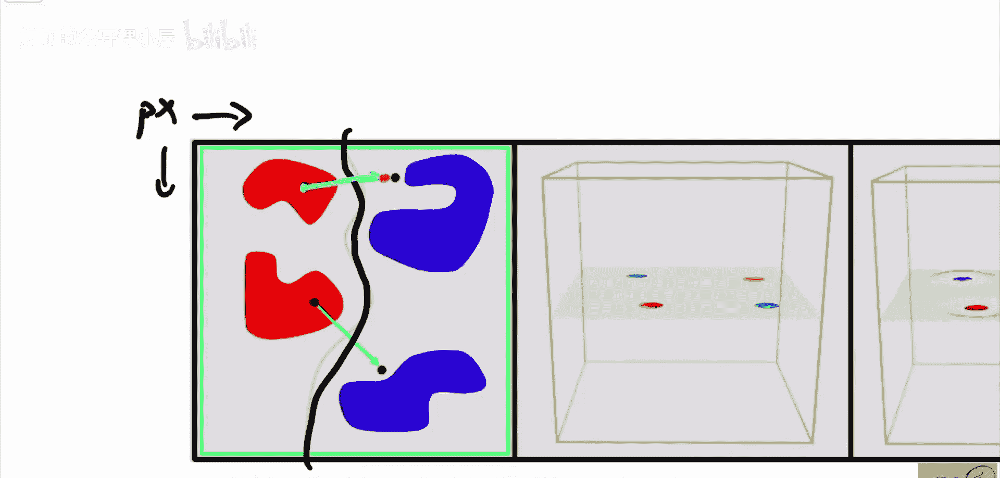

And so they say this has many， many problems。

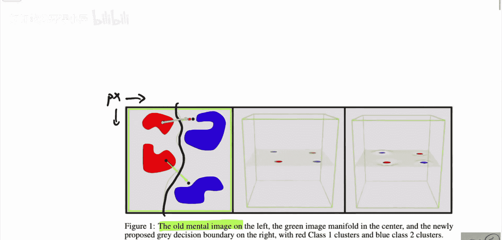

Here they say in this this mental image adversarial examples are created by moving the given images along the green arrows towards some kind of centroid of the nearest training images with the opposite label in which they mean this this thing right here。

 so we would move the images。

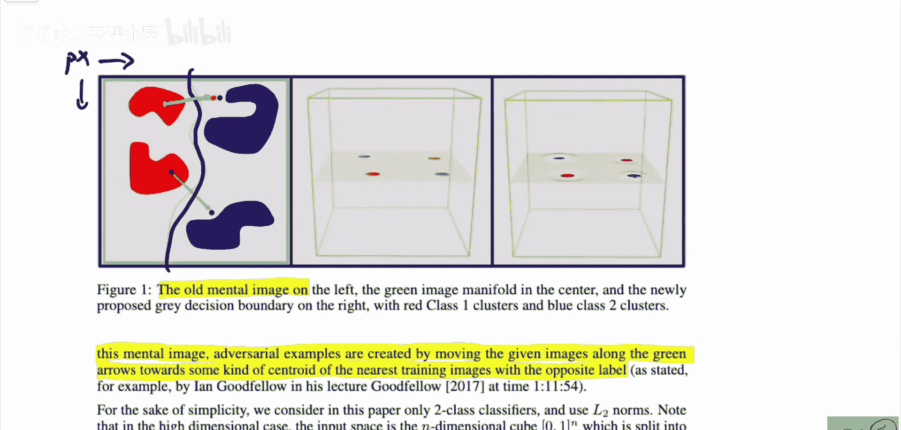