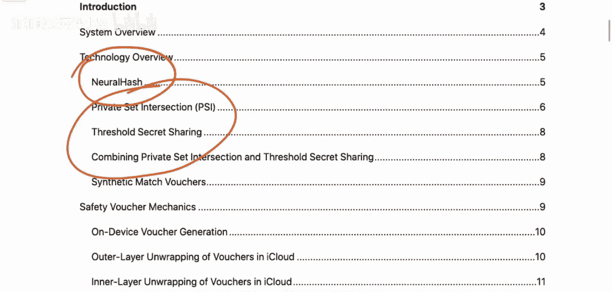
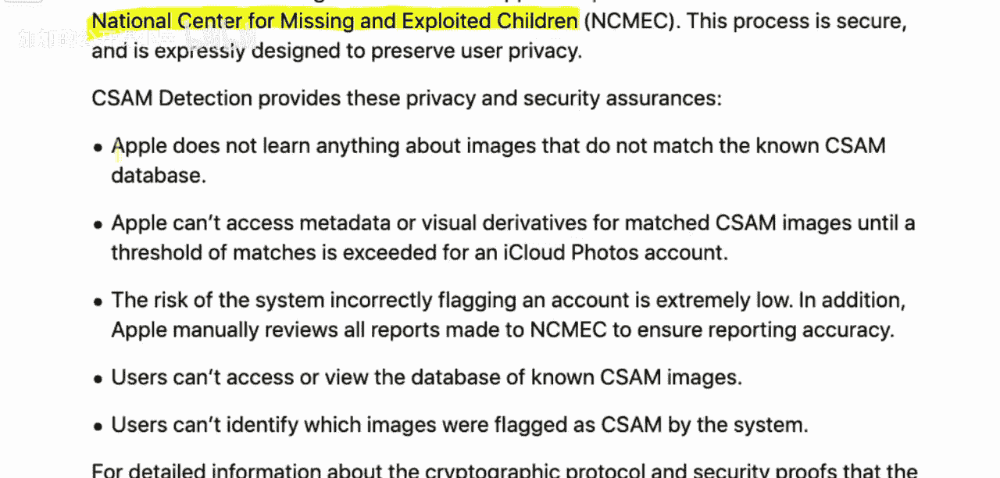
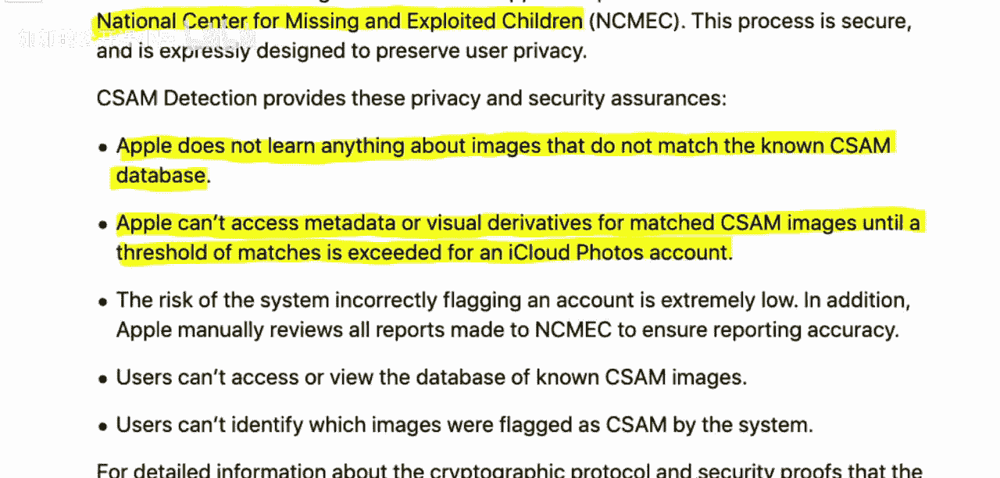
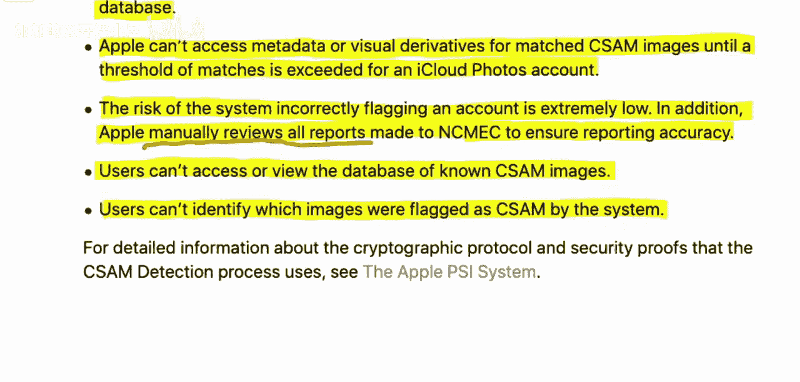
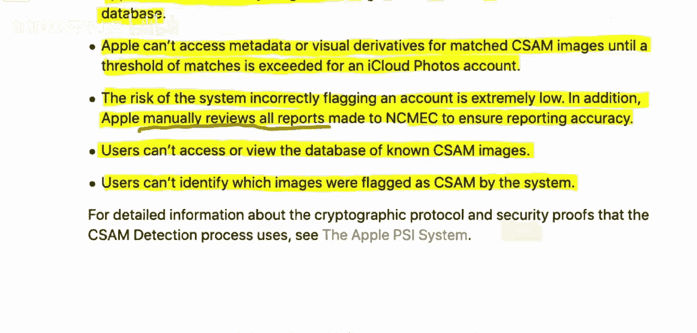
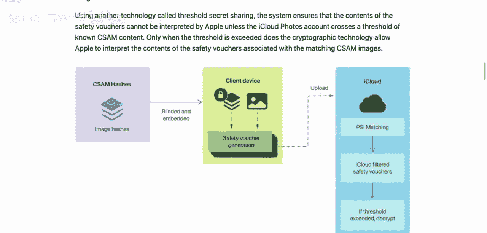
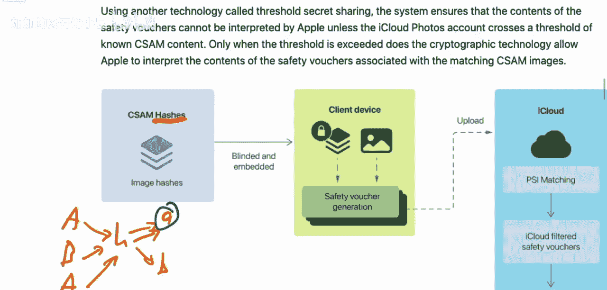

# YannicKilcher【中英⚡AI经典论文领读(全203篇)(下)｜Papers Explained】 p43 P143 苹果如何扫描你的手机（以及如何规避）——NeuralHash CSAM检测算法解析 [BV1j8x5zJEvx_p43]

Hello there Today we're going to look at CSAM detection the technical summary of Apple system in order to detect child abuse material of users before they upload it to iCcloloud so I recently reported on this in ML news and this story of course。

 not my story， but the general story has sparked a lot of controversy around the world with respect to privacy of users and Apple essentially coming to users phones to scan the phones for illegal content and so on。

 so now we have the technical summary where Apple details exactly what's happening and how they're trying to both preserve user privacy but at the same time。

 essentially catch people who create and share these types of materials now needless to say I think everyone's on board with reducing the spread of these materials。

questionestion is what kind of tradeoffs we're willing to accept in order to make that happen and the tradeoff here is mainly privacy of people。

 even though the system is designed to mitigate it。

 there are still weak points that where the system can be attacked the system can be used for purposes that it was not intended there are other problems。

 on top of that， at least in my estimation the system can be evaded fairly easily。

 so you you combine the system can be evaded fairly easily with we're going to implement the system that potentially has pretty you really nefarious consequences if someone gets control of it that is not a good actor。

I don't think you know we'll have to think about the tradeoffs of doing these types of things and yeah that's just that so we'll go through the report。

 we'll go through how the system works， how Apple describes it。

 and we'll go through its strengths and weak points and you can make up your own minds about that。

 even though I'm going to of course try to bias as you in a certain way。So keep that in mind。

All right， so we get here a essentially it's sort of a white technical white paper giving us a description first an overview and then a description of these various techniques。

 so there's going to be like a neural part with it。

 which is sort of the machine learning interface to this whole system since we're dealing with images。

😊，That's， you know that at the front end， essentially。

 then we're going to deal with a whole bunch of cryptography。

 slash security stuff which tries to preserve user privacy as much as possible while still allowing Apple to detect who shares this material。

Okay。

So。Here are the requirements of the system as far as Apple sees it。 So first of all。

 the the detection。 So this is CS S A。 It stands for。

Child sexual abuse material and the system specifically is designed to catch。

Identify and report iCloud users who store known material in their icloloud photos accounts so it's very limited in scope。

 In fact， Apple does not scan your entire phone all the time for anything that you might have it scans the things that you're about to upload to iCloud and as we're going to in fact see it just computes as you upload to icloloud it computes the security voucher and uploads that along with the material and it only is supposed to detect known material so there is a database。

 the database is provided by the national center for missing and exploited children and that database as far as I can tell Apple doesn't even have necessarily access to that database itself but for sure so they're not going to train a detector to classify abusive。

Material per se like so they're not going to catch new material until that new material is entered into this database。

 So this is essentially saying we have a list。We have a big list。

 the database of things that we collected from， you know。

 confiscated phones or whatnot collected from these websites and。We are simply going to check if。

In your iCloud account， there is any of those things。Right if any of those matches。

 then you have one of these known things， then we're going to report you。

Now the challenge is of course， to preserve user privacy。

 so here are the requirements that set they set upon themselves。

Apple does not learn anything about images that do not match the known CSA database。 Now。

 this is hard right， Apple can' just go to your icloloud account and and scan all the images。

 Otherwise Apple would know what the other images are so as I understand it。

Things in your icloloud are encrypted anyway。 so Apple can't do that so it can't just you know compare images because otherwise either you'd have to send the abusive images to the user's phone。

 which kind of defeats the purpose and then compare on the phone or you have to send all the users' photos in clear text to the server and then Apple would essentially see all the user's photos。

 which is also not okay。 So we're going to have to get a bit creative here。Second。

 Apple cannot access metadata or visual derivatives for matched images until a threshold of matches is exceeded for an iCcloloud photos account。

 So it gets even more complicated if you have like if you have one image they're not going to they don't want to they don't want to report you yet they going to set a threshold。

 let's say five images like if you have five matches in the database。

 then it's very probable that you're engaged in actively sharing or consuming this material and therefore we're going to report you like if it's below that probably their lawyers their lawyers can't make a good enough case and so they are going to say if it's below a threshold。

 we don't want to be able to decrypt this we only want to be able to decrypt all of the things once a threshold is exceeded So this is yet an additional constraint that we have to somehow work with。

 we have to design an algorithm that allows us we cannot。

Derypt anything until we have enough threshold exceedances， you know excesses， what's the word。

 I don't know。 Okay， let's go through the other requirements more quickly a bit。

The risk of the system incorrectly flagging an account is extremely low， in addition。

 Apple manually reviews all reports made the instit to the government to ensure ensure reporting accuracy。

This is a good goal， right however。I think we've all encountered websites that told us that some decision was manually reviewed。

 but it was pretty clear that it wasn't right so this is a goal we know that as soon as there's like pressure as soon as there is something more important going on as soon as this system is overwhelmed。

 they are just going to swap out humans for robots I don't know how much pressure there needs to be for these humans to be swapped out but still at least initially they're going to review all of the reports they make。

Then users cannot access or view the database like this this should be fairly obvious and users can't identify which images were flagged as being in the database by the system so you can't design an algorithm that only transmits data to Apple once a match is found because then the user could inspect the network on their device and they could figure out which of which of the images is problematic and apparently notify their whatever their friends or something so you don't want that you want the users essentially to upload all their stuff。

 they never there's always a bit of data that goes with it if there's a match they don't initially know about it and I guess until the police knocks at their door so these are the requirements。

So this is an overview what we have is we have this database if the database of this material what we're going to do with this database is we're going to compute some hashes from it so these are a hash now a hash essentially is simply a representation of a piece of data that is shorter but still uniquely identifies the data so if I have a hash function H and I input image A I get out hash a if I input image B I should get out a different hash B and if I input image a again。

 I should again get back back a this is a classic hash there hash functions are designed to if we。

