# YannicKilcher【中英⚡AI经典论文领读(全203篇)(下)｜Papers Explained】 p44 P144 PonderNet：学会深度思考（机器学习研究论文解读） [BV1j8x5zJEvx_p44]

Hello there Today we'll look at Pondernet， learning the Ponder by Andreabanino。

 Jan Baager and Charles Blonll This paper on a high level introduces a recurrent architecture or a principle of recurrent computation for deep networks that essentially says the network recurrently computes its output at each step and at each step it can decide to stop now because it is satisfied with the answer that it has The idea is that at a complex task you can compute for many steps because it requires many steps of thinking and then give the output and for an easy task the network can decide to output right away because it already has computed the solution this decision can be done on a per sample basis so for each sample the network can decide when it's time to give the final output and。

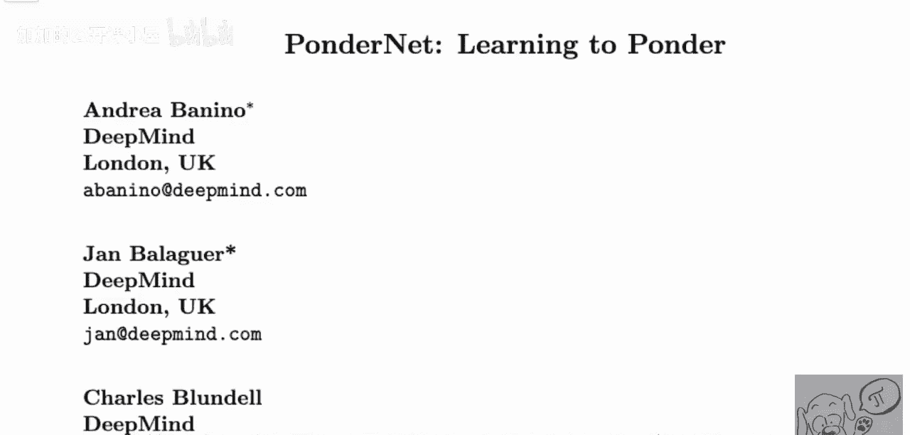

This is not necessarily a paper that just makes something bigger and then pushes state of the art on some benchmark and that's why piqued my interest is that it tries to rephrase a little bit how we think about the connection of deep learning and algorithms like classic algorithms by themselves。

 essentially this is a dynamic if condition in this algorithm that decides when it's time to stop and I appreciate that not everything has to be a state of the art pushing here。

 this is simply，A cool method to do something that's relatively new。 Of course。

 things like this have been done before， and they are discussed at length in this paper。

 how this paper is different from other papers that do similar things。

 and it does push state of the art， just not on benchmarks that you might be super duper familiar with。

 But yeah， it's it's a cool paper。 It's a short paper。 The idea is pretty simple。

 and it appears to work。 And yeah， that's exciting stuff so。😊，We're going dive into this paper。

 have a look， have a look at what's new in this particular model， how it works。 and yeah as always。

 if you have feedback， leave a comment， subscribe， I'd be happy for that and。Yeah。

 thanks for being here。Okay， so in the abstract here， they say that in a standard neural network。

 the amount of computation used grows with the size of the inputs。

 but not with the complexity of the problem being learned， So which is true， right。

 in a standard neural network， you have a forward pass。

 be that in a fully connected neural network where you have， you know， you have your input。

 and then you go layer layer， later， later， later， and then you have your output。

 This computation here is always the same。 no matter the input， even in a recurrent neural network。

 right， you have。Kind of an input right here at the beginning， you have a layer。

 then you have an input again， and then you have this that goes into the same layer。

 and then you have the next input that goes into the same layer。

 even a recurrent neural network usually usually just does the same forward pass This is a little bit different if you have something like a language model that can emit at some point a you know a stop token。

or an end of sentence token at which point the computation essentially stops。

 but it's a little bit of a different thing than we consider right here right here we consider a neural network that has to find the answer to a particular problem and we're going to see the problems down but one problem that they present is the parity problem So the parity problem is you get a string of zeros and ones I think there is also a negative ones in there but I think they're bit for a distraction and the answer you're looking for is as a whole is the parity So the amount of ones in this string odd or even so this requires a let's say an integrated view of computation This is essentially a classic algorithm that you have to perform over this string and neural。

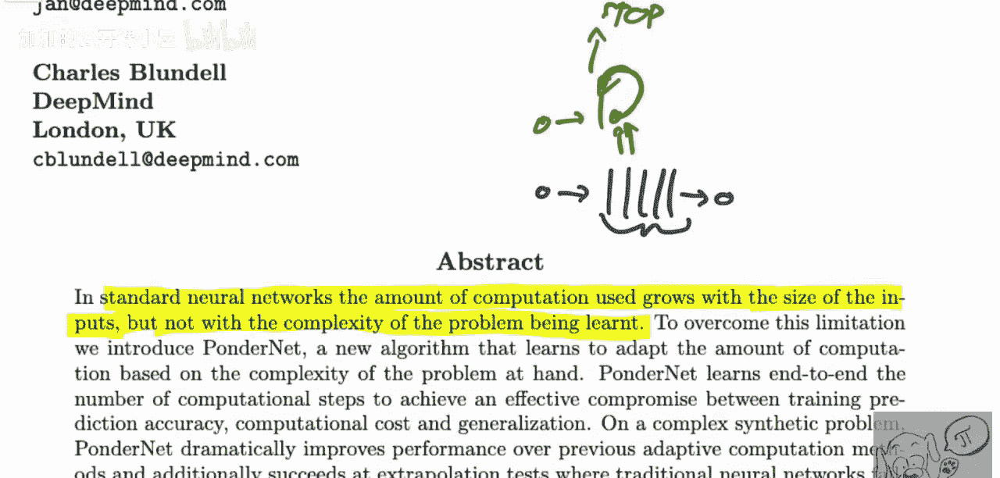

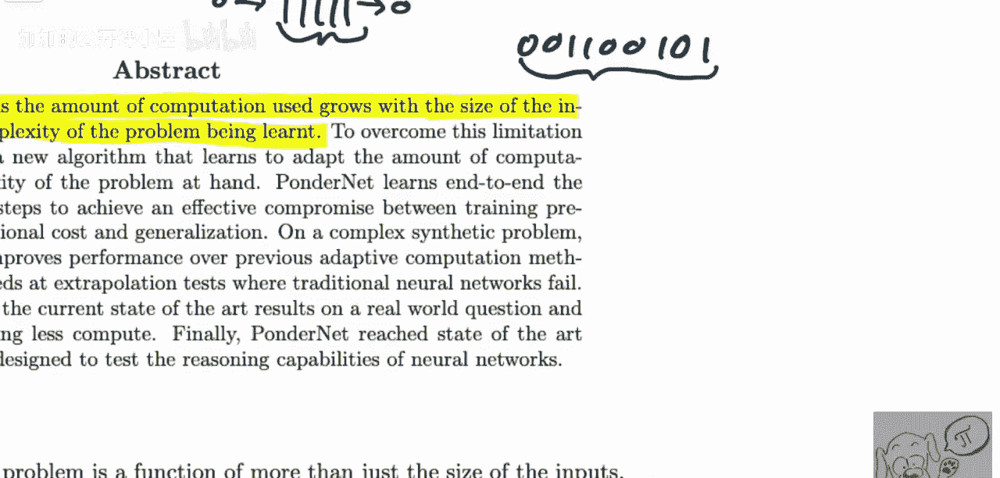

Networks as good as they are in computer vision and speech recognition。

 they are having trouble with simple algorithmic tasks like this。

 So the idea of of this paper here is that。

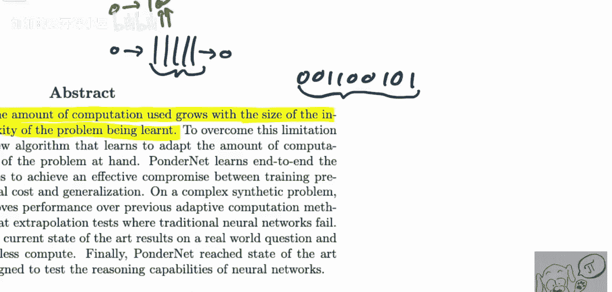

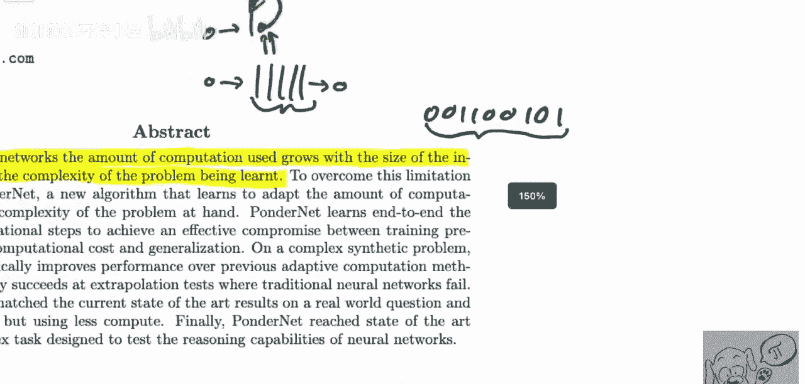

Well， it doesn't make sense to apply a neural network that always does the same amount of compute。

 right， I shove this sequence just like in here。 It doesn't make sense because you know。

 if there is just a single one in the string and I see that right away。

 I can give the answer right away。 Howevers if it's a long string and it has a bunch of ones。

 I might need to think about this problem for a while。

 and thus adapt the number of computation steps I do in my head。

 I might you know first if I look at this string。 I might first connect these two， you know。

 and then that's two。 and then I might connect these two。 that's two again。

 and then I might connect these two， that's four， there's nothing here， there's nothing here4。

 So that's kind of like one，2， three steps of computation。 So that's the rough idea。

 whereas if the string was shorter and and more regular， I might need less computation。

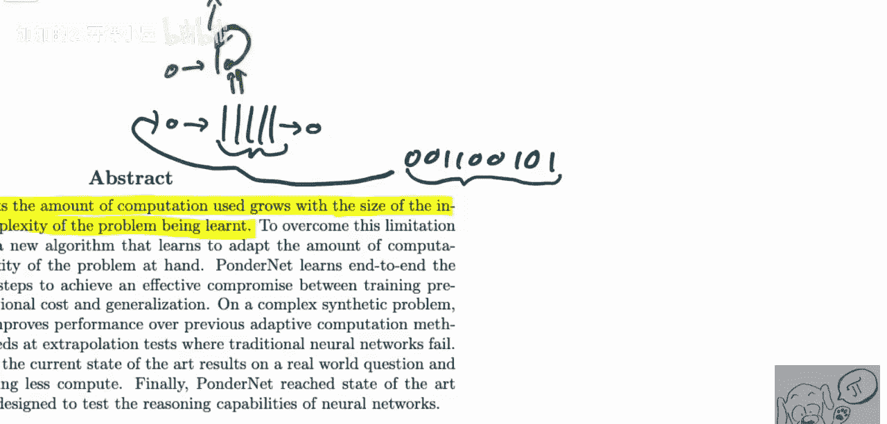

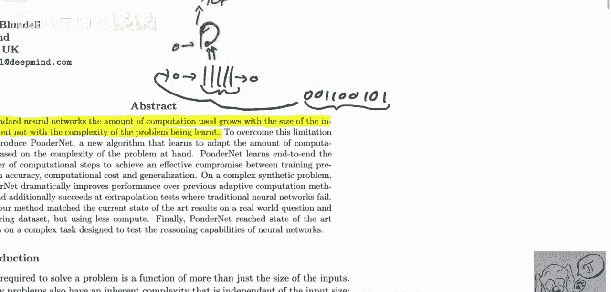

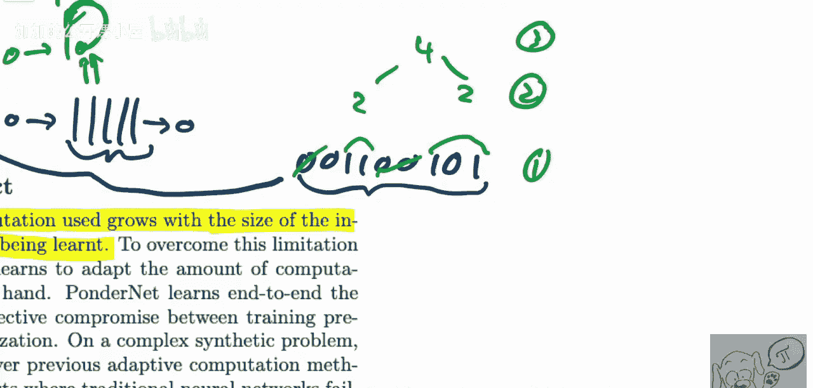

So they say to overcome this limitation， we introduce Podernet。

 a new algorithm that learns to adapt the amount of computation based on the complexity of the problem at hand。

 Pondernet learn end to end the number of computational steps to achieve and effective compromise between training。

 prediction， accuracy， computational cost and generalization。So we are going to see how they do this。

Yeah， exactly， so then they go into the tasks， their experimental tasks in this paper are sort of these constructed tasks where people know you need this dynamic computation。

 they're not going to compete on like ImageNe or something like this。

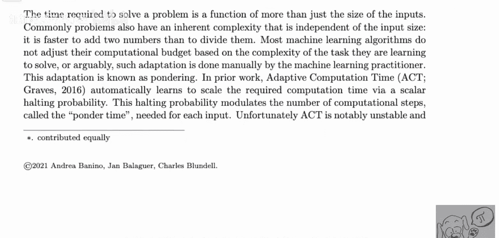

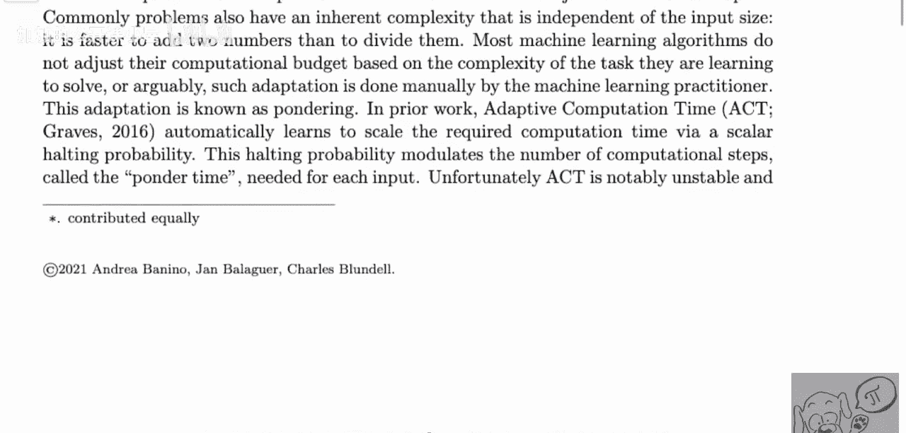

So a majority of the paper is in contra posing their model against this ACT model。

 the adaptive computation time， I believe， so there have been previous attempts at doing dynamic computation time。

 yet either they have so it turns out they kind of finicky， and this model here。

 this Pondernet model has a bunch of advantages。They say they present Pondernet that builds on the previous ideas。

 it's fully differentiable， which allows for low variances gradient estimates unlike reinforced。

 so a couple of previous attempts have been with reinforcement learning so let's just learn the number of steps or when to stop using reinforcement learning and that as you might know is very。

 very noisy it has unbiased gradient estimates which is also unlike other models in the past。And。

Yeah， so they say。This has consequences in all three in all aspects of the model。In Pondernet。

 the halting node predicts the probability of halting conditional on not having halted before。

It kind of seems obvious， but apparently that no one has done this so far。

 So what do we need for an architecture for Pondernet， they say this down here。

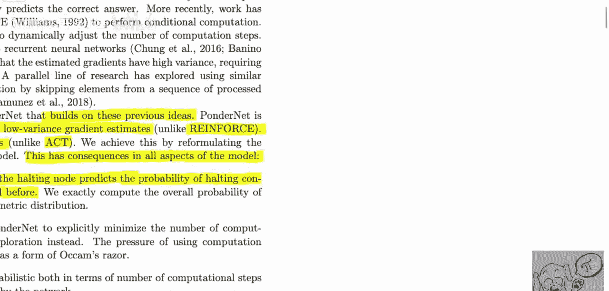

Essentially that's the architecture， it's an inline formula which you know。

 but that's the architecture， so what you need is you need an input okay。

You need an input which is X， your input。And X is transformed into a hidden state。This is， let's say。

 the hidden state at step one。Those two， or you can also reformulate this as just the hidden state。

 the hidden state is going into S， the so-called step function。

 and that's the recurrent function right here， so into this step function you can put anything you want。

 you can put like a CNN inside， you can treat this as an LSTM since you're going to apply recursively sorry recurrently and anything you want can be the step function as long as it can be applied recurrently。

So this step function is going to give you the next hidden state right so you can see it's a recurrent neural network。

 however it is also going to give you the output at that particular point in time。

 so y1 I guess that'll be here and it's also going to give you this number lambda n。Now。

 what are these？From here you could apply the step function again， you'd get H3。

 you'd get the output 2， and you'd get Lada， sorry， that's a1， that's a2。

So it seems like it's just a recurrent neural network and if I were to push。

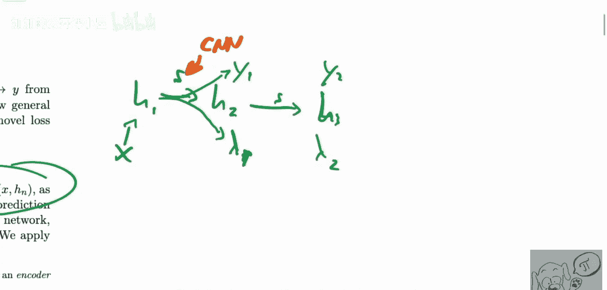