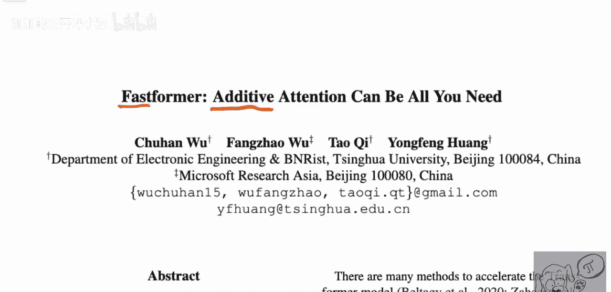
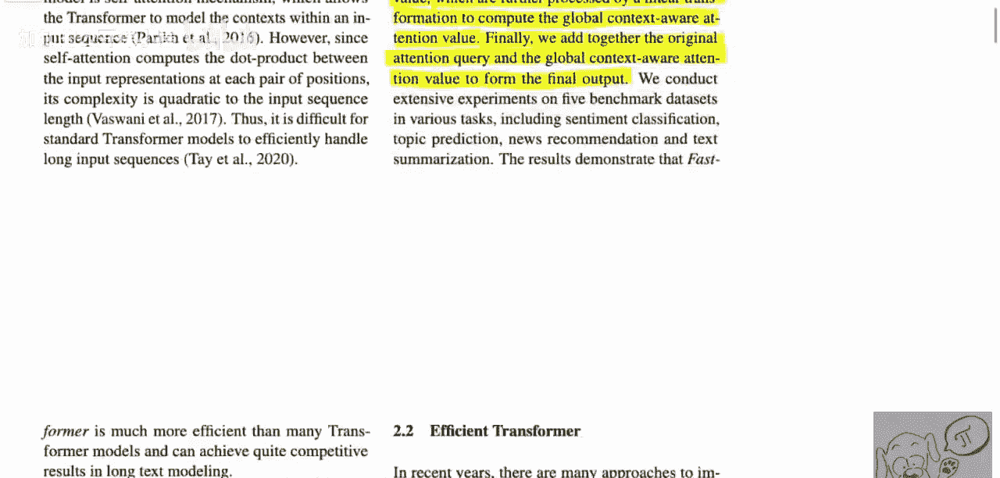
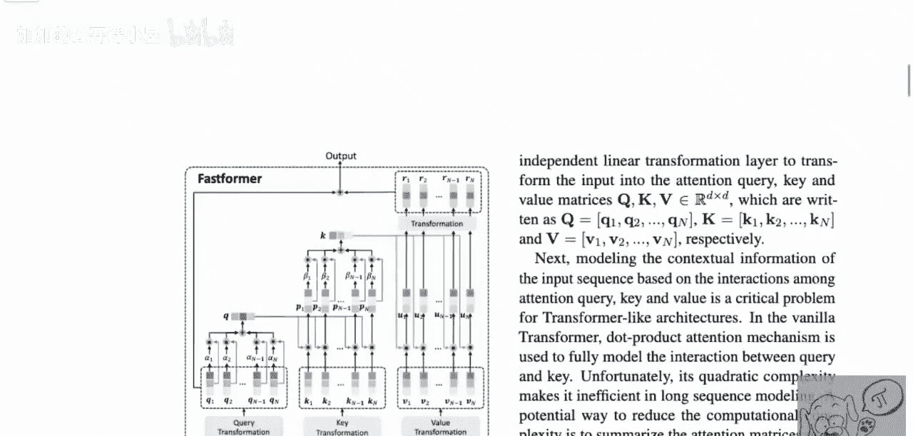
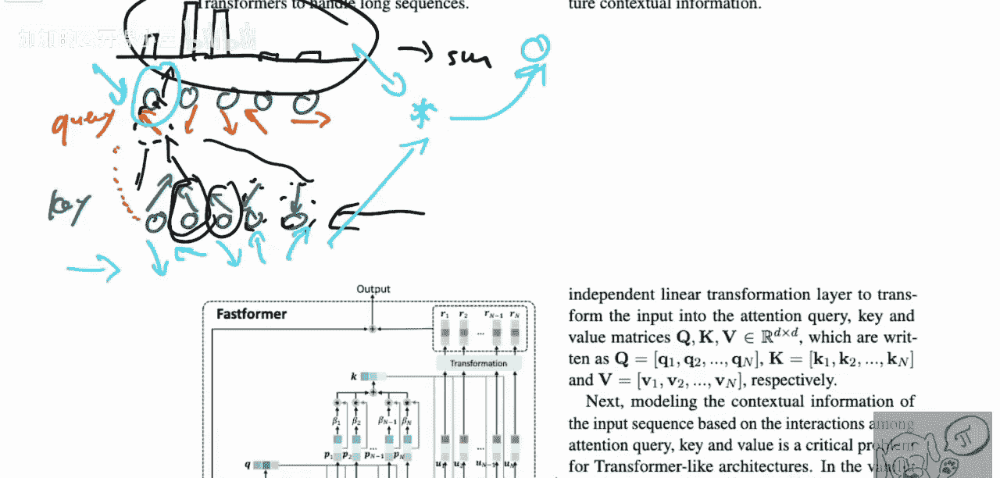

# YannicKilcher【中英⚡AI经典论文领读(全203篇)(下)｜Papers Explained】 p45 P145 Fastformer：加法注意力可能就是你所需的一切（机器学习研究论文解析） [BV1j8x5zJEvx_p45]

Hello there。 Today， we'll look at fastform additive attention can be all you need by Chu An Wu Fangou Tao Qi and Yong Feng Huang。

 So this paper definitely wins out in the category of most innovative paper titles of the last few months。

 as apparently we've gone from is all you need to can be all you need。 So a big win on this front。

 As you might have guessed from this title， the paper is introducing a new kind of attention mechanism。

 If you don't know what an attention mechanism is and during machine learning you might want to find out。

 I have a video on attention is all you need。 So the new attention here is additive attention。

 which is supposed to be a much， much， much faster way of doing attention。

 thus the name fast former this additive attention circumvent。

this quadratic bottleneck that we usually have in the attention mechanism instead of doing sort of multiplicative attention they do what they call additive attention Now the naming in my opinion is a bit confusing and the whole concept is a bit confusing so on a high level that's what they do to design a new attention mechanism my opinion of the paper is that it's kind of。

Deceptively naming things to make it appear like it's an attention mechanism where in reality it seems to be sort of just sort of a feet forwardishh layer type of thing that they propose maybe not even so you know we'll go into that their promises are that of course circumventing this quadratic bottleneck of attention you can input much longer sequences into the context of a transformer and you can do it also much faster for the same length of sequences since everything is just additive and not multiplicative we're going to find that out they claim they have a lot of experimental evidence and yeah if you like content like this you know don't hesitate to subscribe if you haven't done so already。

So the abstract reads transformer are very powerful， okay？However。

 the attention mechanism is inefficient due to the quadratic complexity to input sequence length。

 they say although there are many methods on transformer acceleration。

 they are still either inefficient on long sequences or not effective enough by effective。

 I guess they mean their performance suffers too much。

So they say they propose fastformer an efficient transformer model based on additive attention so instead of modeling the pairwise interactions between tokens which is what attention does。

 we first use additive attention mechanism to model global context and then further transform each token representation based on its interaction with the global context representations now if this sounds confusing to you it does so to me too。

 they go a little bit into more detail right here， they say they have this additive attention。

Wwhichch is linear complexity instead of quadratic as unusual transformers。

 so here is a bit more detail， we use additive attention to summarize the input attention query matrix into a global query vector then we model the interaction between the attention key and the global query vector via element wise product to learn the global context where key matrix we further summarize it into a global key vector via additive attention。

Then we use elementement wise product to aggregate the global key and attention value。

Which are further processed by a linear transformation to compute the global context to where attention value。

 Finally， we add together the original attention query and the global context to where attention value to form the final output you know still after this paragraph doesn't make too much sense to me to understand So we'll go to the diagram adjust one second。

 but here is essentially what they promise。 Okay they propose an additive attention based transformer named fast For to our knowledge。

Fastformer is the most efficient transformer architecture。

 so that's one they propose the most efficient transformer architecture。Second。

 we propose to model the interaction between global context and token representations with element wise product。

 which can help fully model context information in a efficient way Okay so the element wise product seems to be the second component。

 so theres additive attention， there is element wise product and then lastly they say you know our experimental data sets validate our approach。

Alright so here is the coveted diagram of the fastformer。 It's a little bit complicated。

 but I want to go back a little bit to the regular attention mechanism I know I've done this a lot but I think in this context it is really worth discussing So in a regular attention mechanism。

 what do you have you have some sort of an input sequence each one of these things can be a vector。

 some sort of an embedding vector or something like this， but it'ss a sequence。

 essentially it's a set， but we think of it as a sequence of let's say tokens in natural language and we want to transform the sequence of one layer into a sequence of equal length of the next layer so if we stack many of these layers together。

 we sort of want to improve the representations of these tokens layer by layer by layer such that we can at the end of the transformer understand what each token means。

The context of all other tokens， so if this is a sentence， my house is very green。

Then at the beginning each word is just an isolated piece of data at the end of these transformations。

 we want sort of all the tokens to be aware of all the other tokens in the input and sort of capture their in context meaning。

Now what we need to do is we need to transform one set of representations into the next one。

 the way we do this is by the attention mechanism， so the attention mechanism essentially from each of the tokens it derives three different things one is called a key。

 so the key is a vector， so the key。Is a vector for each token。

 and that vector describes kind of like what the content of this token is so far。 Okay。

 so one vector is the key， which allows the token to advertise what it has to offer。

 The other one is the query。Which allows each token and that's also derived from the same token。

 but I'm going to draw it up here。 The query means what does this token want to know about the other tokens in the sequence。

 so this can be different from its content。 So as you see the query and the key they might be different。

 there are variances where there's the same but usually you derive two different values from each token and then what we do is we route by inner product so for every single query you aggregate across the entire input sequence sequence you aggregate by inner product。

 which means that this would get routed here by a lot。

 this one maybe be two these ones not so much and so on。

 So you aggregate essentially the inner product which for each query gives you a histogram a histogram across the sequence saying okay this information here is mildly relevant this one。

As more relevant， this one is slightly relevant。 These ones aren't relevant at all for me。

 this histogram， you then normalize via a softm operation。And that gives you。

 I mean that gives you a real distribution over the input So with the query and the key you decide how you want to aggregate the information in the input sequence for one particular element in the output sequence and you do this for every element So for every element you get a distribution of how you want to aggregate and then in the last step every single item also emits what's called a value and the value is yet another vector and the value I guess you don't even have to actually transform anything。

 the value you can just take the information itself of the token if you want。

 but essentially the value is ultimately what you multiply together with this distribution and then that becomes your next layer representation for this particular token。

So the whole query key attention mechanism is simply to decide how do I want to aggregate the different values of the input sequence for any given token in the next layer。

All right。Okay， I hope this is clear So the query the key advertises what the contents are。

 which is kind of like the value， the value is the actual contents。

 but the key is more like an addressable representation of the content and the query emits what do I want to know about the others。

 So you match the queries of myself with the key of the others and that aggregates。

 Now in that context， let's look at the fast form So we said there are two elements There is first。

