# YannicKilcher【中英⚡AI经典论文领读(全203篇)(下)｜Papers Explained】 p46 P146 ALiBi - 短训练长测试：线性偏置注意力机制实现输入长度外推 [BV1j8x5zJEvx_p46]

Hello there。 Today， we'll look at train short test long attention with linear biases enables input length extrapolation。

 also called alibi by oppress， Noa A Smith and Mike Lewis。 So on a high level。

 this paper replaces the position encodings or position embeddings of transformers by a new very simple system that enables these transformers to extrapolate to much longer sequences at inference time。

 then they have been trained on。 So you can train on quite short sequences。

 and then inference will not suffer will not degrade。

 even if the inference sequence length is much longer than the training sequence length。

 This goes from two times longer to 10 times longer to more。So。

This builds on what people have learned on of position encodings in the last few years。

 what works and what doesn't。 And it sort of advances this one more step。

 There's still room for improvement after this。 but it's quite a simple thing to do。

 The code is available。 I of course a link to it in the description。

 and it seems like is might be worth a try。 if you implement transformer based language models and you want to infer on longer sequences than you've trained on。

 give this a try。 As always， if you enjoy paper reviews。

 Don't hesitate to subscribe and tell me in the comments what you think。

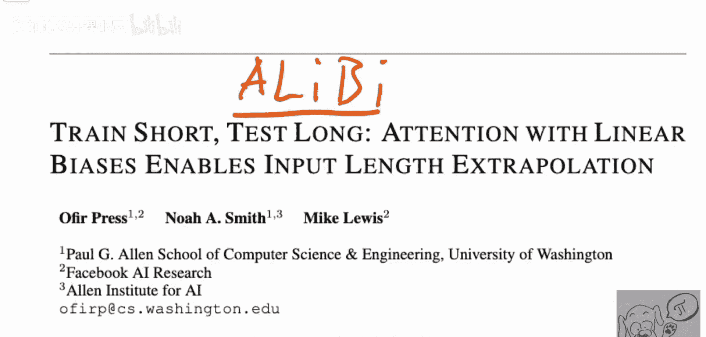

Alright， let's get into it。 So what's the problem。 The problem is position encodings。 As we've said。

 Transformers were released in 2017 by the original attention is all you need paper and they already dealt with the question of position encodings。

 Now why is that。 that's because a transformer fundamentally isn't a sequence model per se。

 It's actually a set model， right， So let's say you have a sequence of tokens。 And in this paper。

 we exclusively deal with sort of autoregressive text generation。

 but there's no actual reason why this is the only case where this should be useful。

 but that's what we're dealing with。 So you want to predict the next token from a series of tokens So here you have five tokens and you want to predict the next one that comes after that。

 and then the one after that and then the one after that and so on。

 So since a transformer essentially。

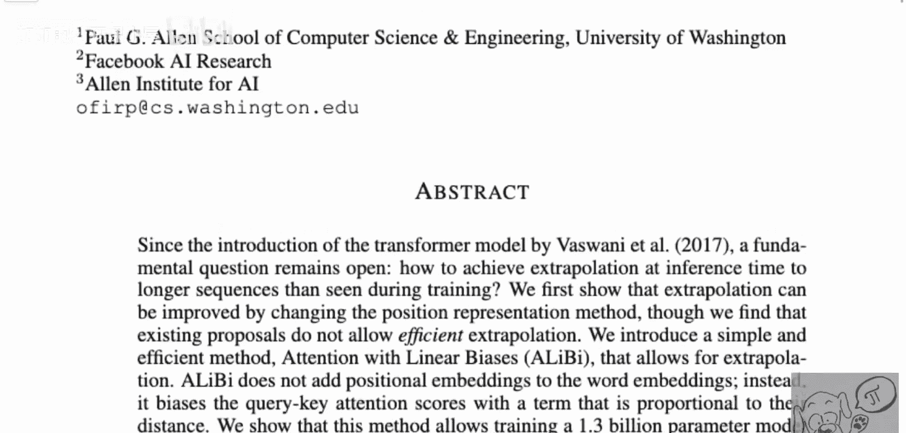

Forms a sequence of inputs into an equally sized sequence of outputs in every layer。The transformer。

 other than a fully connected network， the transformer itself doesn't really know per se where a particular item is。

 So， for example， for this node right here， the transformer would generate a query。

And then match that up to keys that are that are emitted here。

 And then it would route information via the inner product。 However。

 it doesn't matter if this node here， for example， is here or over here， if it has the same key。

 the information routing happens the same way。ergo to the transformer doesn't matter where the inputs are。

 So essentially， it's dealing with the input sequence as a set and not a sequence。 Now。

 recognizing that the original transformer already had to deal with position embeddings， meaning。

 you know， if let's say every sequence element comes in and initially， that the initial sequence。

 you give every token and embedding。 So these are your standard token embeddings that， you know。

 from word to V or glove or something like this。So initially， you give every token a similar bedding。

 Now， let's say these two tokens here are actually the same token。So。The cat and the and。 Okay。

 maybe no， but。So two words can be the same， right in the same sentence。

 even though they might mean a bit different things because they're at different places。

So what you want to do is you want to。Ament these embeddings right here by position embeddings。

 and the position embeddings can be as simple as simply appending。 let's say， okay。

 to any of these vectors I append one dimension。 I simply write the position in it。

 So this is value 0。 This is value 1。 This is value 2。 I simply append the dimension。

 and I put the number there。 This won't work too well because we're sort of in linear space and numbers between 0 and 1 and so on。

 So there are various schemes， how to do this。 The first scheme that the original paper came up with is this scheme of these sinusoidial encodings。

 which means that。

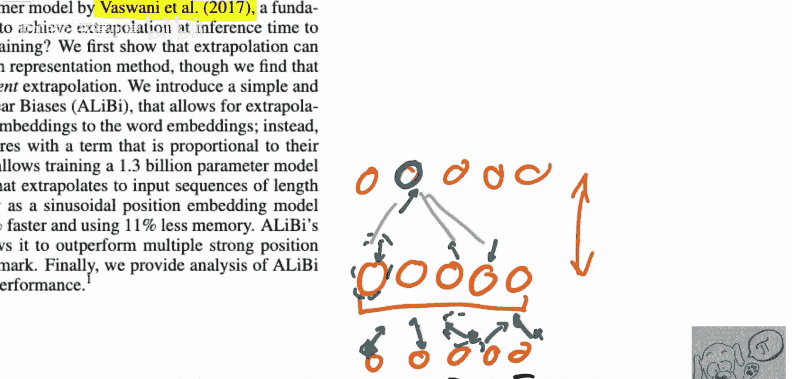

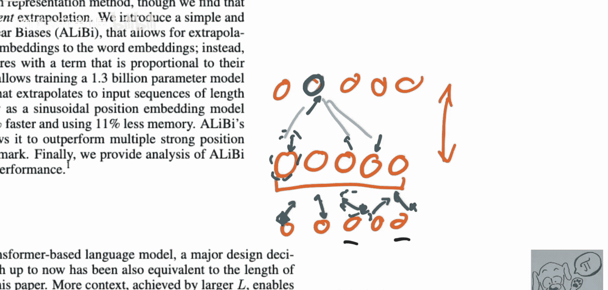

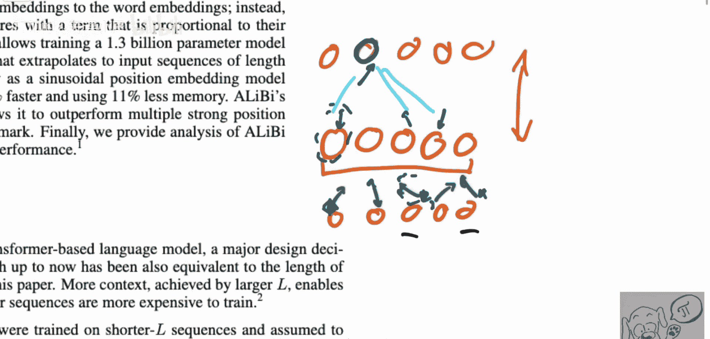

If we， let's。

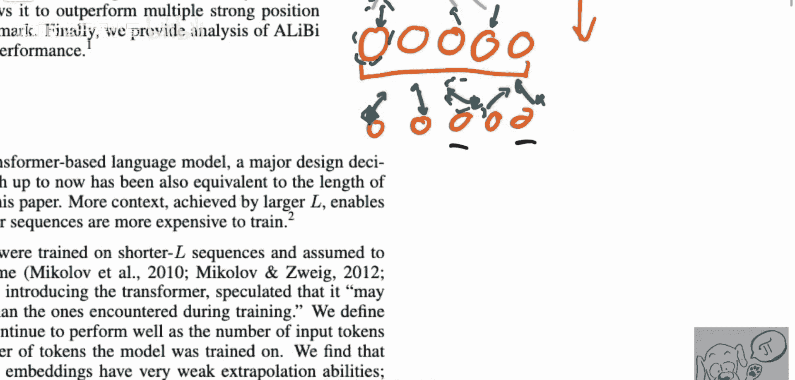

Let's go down here。This is our sequence。 How do we make the position encodings， And they said。

 why don't we or let's make6。 Why don't we have multiple dimensions of position encoding。

 So Our position encoding is a vector。Now。Let's say that the one dimension。

 we simply index a really long sine wave。 So the sine wave would continue back here。

 a really long sine wave by the position。 So the， this token would get。 So here is the。

Here is the zero。Right，This is a sine wave。 So the first one would be assigned a 0。

 Then this one would be assigned like a 05。 This one like a 0。705。And so on， right， You see like。So。

 but then these aren't unique， right， for example， this and this。

 they have the same one on the first dimension。 Let's say， well， in the second dimension。

 we'll do a sine wave， but we'll make it double。Double as fast like this。 Okay， and now again。

 we index all the tokens by where they are。 So this again would be 0。 This may be 07 here。 Now。

 this would be。Also 。7 maybe。 and now this would be。This is almost。 this is like。0。1。

 So now you can see this vector here is already different from this vector here。

 So as you build up your sine waves， you can make them even faster。Right， and even faster。

As you build that up， you eventually get unique representations for each position。

 but also the advantages and that's what the original paper hypothesized is that。Now。

 the transformer can reason sort of about distances between tokens。 so it can say， well。

 if two things are relatively close， you know， in this topmost dimension right here。

 I can be reasonably sure they're kind of close together。But how close together， Well。

 if they're also pretty close in the lower dimensions。

 then they're probably right next to each other， right， Or you can say， well。

 I want something that's like， you know， medium size apart from， from this word that I'm all。

 not right next to it。 but you know， kind of a way。

 So it would look for something that's kind of different in one of these dimensions。

 So the hypothesis was that， you know， with these things。

 it could reason about absolute and relative positions from the tokens to each other。

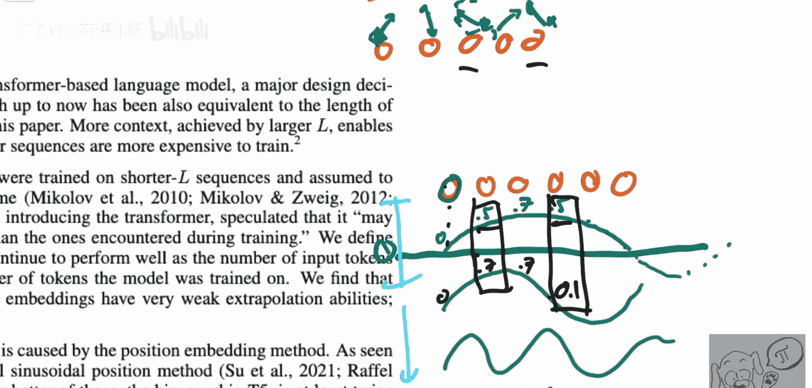

Right， it doesn't have to learn that word relationship between word 1 and word 3 and word 2 and word 4 separately。

 It could actually just learn at one point， the relationship between any two words that are a bump apart in this dimension。

 and then that would replicate across。 and it could potentially also extrapolate。 However。

 this didn't turn out to work really well。

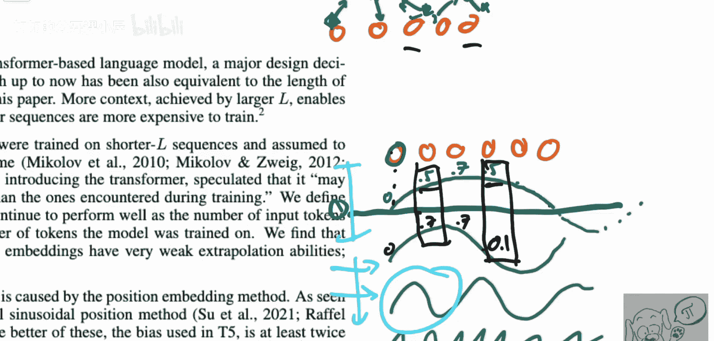

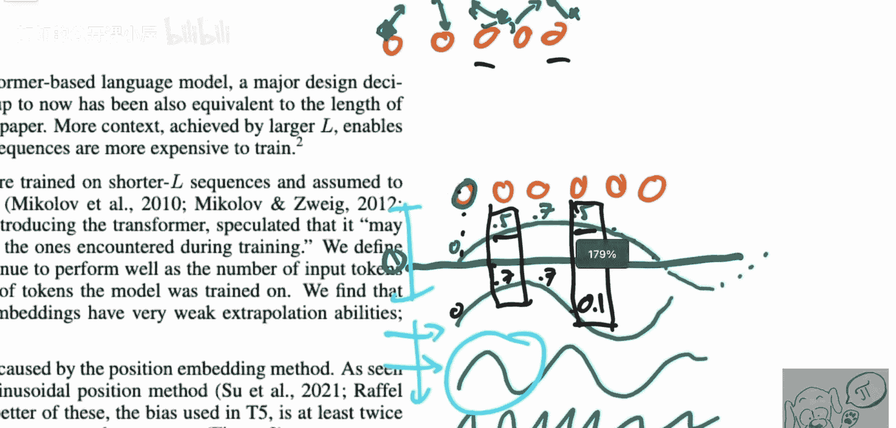

And that is for two reasons。At least this paper makes it seem like that's for two reasons。

 The first reason is that it it doesn't like the embeddings themselves don't really seem to extrapolate that well。

 So the functions that are learned from these embeddings。

 It's not like they transfer to longer sequences。 as as much。 That's the first point。

 The second point is these vectors that we build up here。

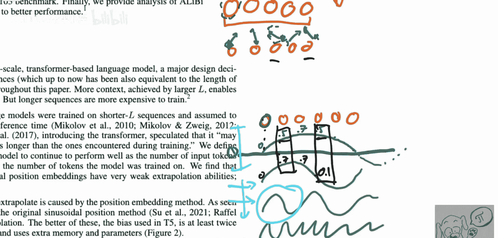

The position encodings What what they were doing is they were simply adding them to the vectors that are the word embeddings。

 And you know， that works fine。 I guess， especially if you also train the word embeddings at the same time。

 the model can sort of circumvent that。 But as you go up the layers。

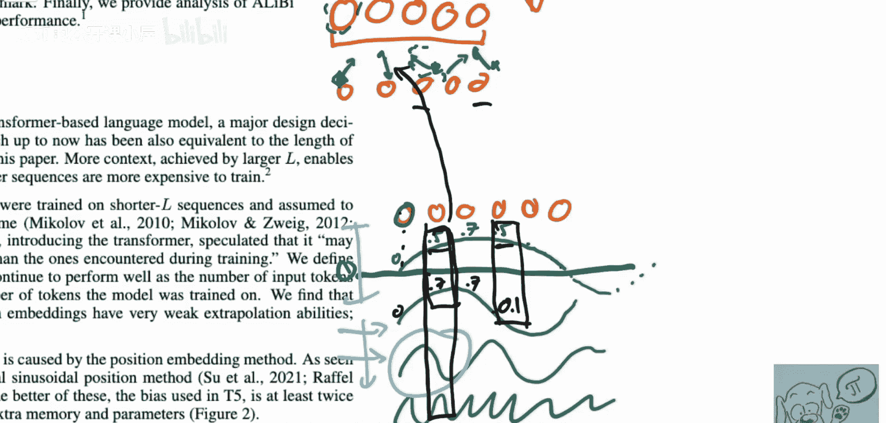

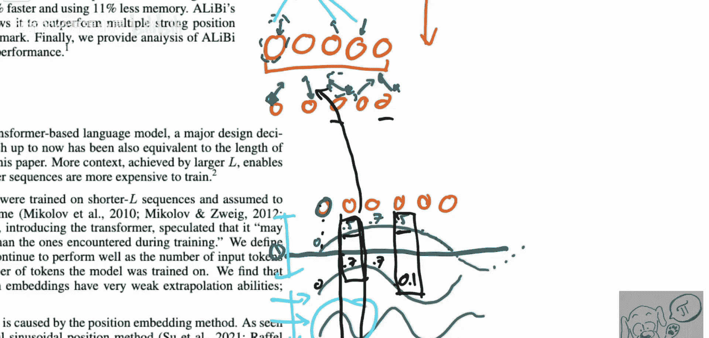

As you go up the layers， you have to carry through this information。

 So now all your computations within a layer have to， first of all。

 deal with what are the meaning of the tokens and how they relate to each other。 But second。

 it would also have to carry through this positional information to the upper layers。

 And that's where more follow up positional encodings made at sort of a difference in that。

 for example， they said something like， well。

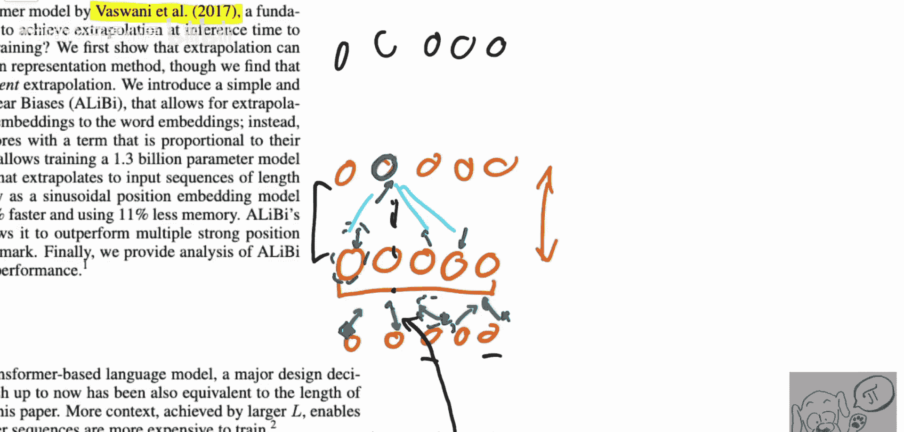

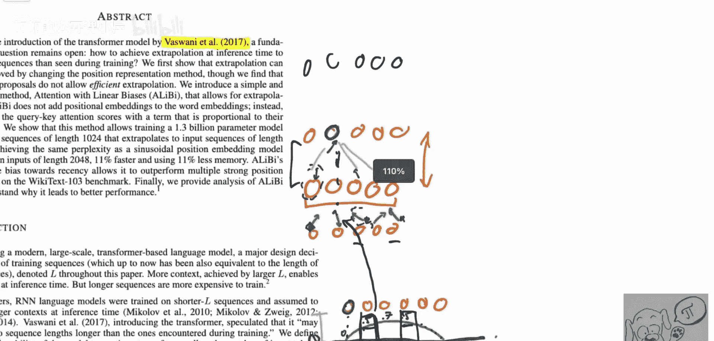

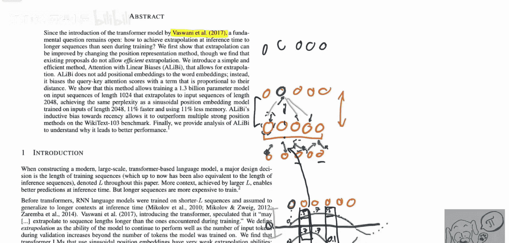

We don't want to just add them to the bottom。 We also。

 we kind of want to inject them into every layer separately。 right， inject them here。

 We inject them up here and so on。 So the model always has access to the position encodings firsthand and doesn't need to carry。

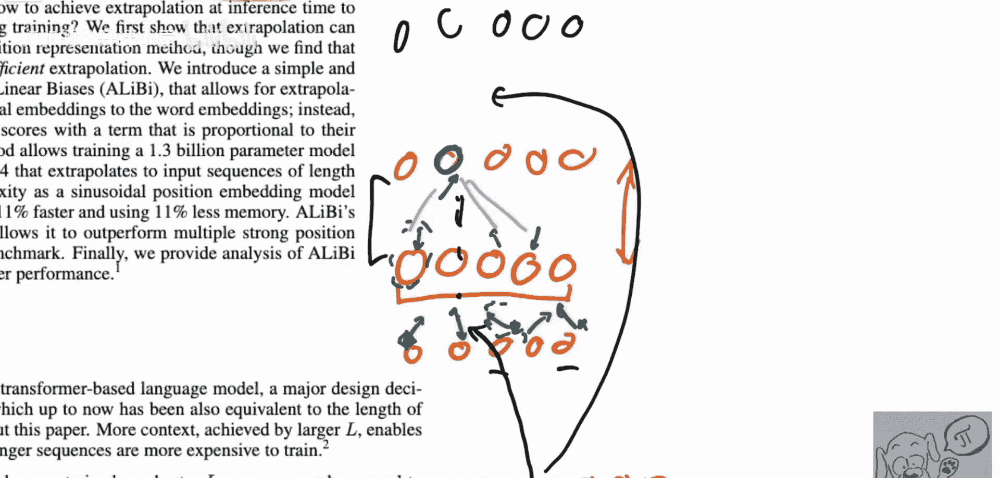

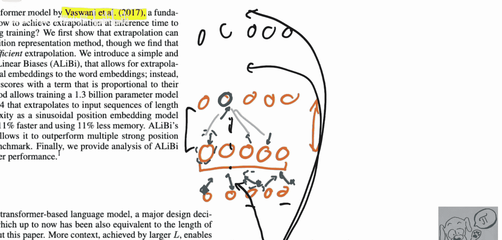