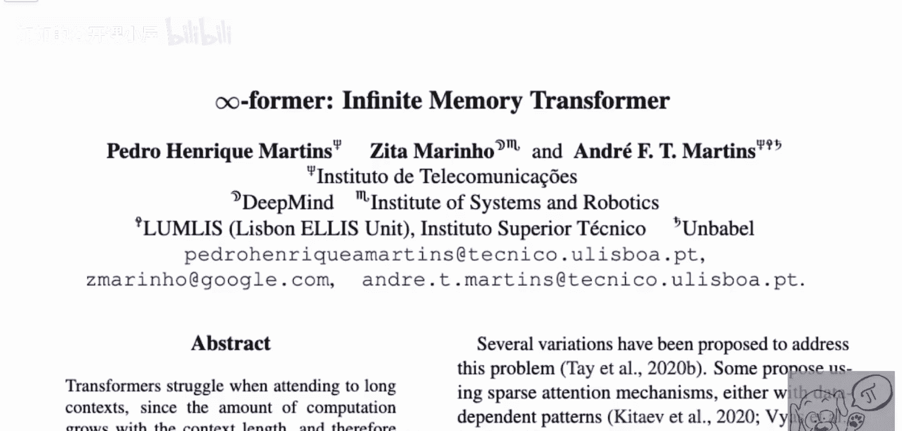
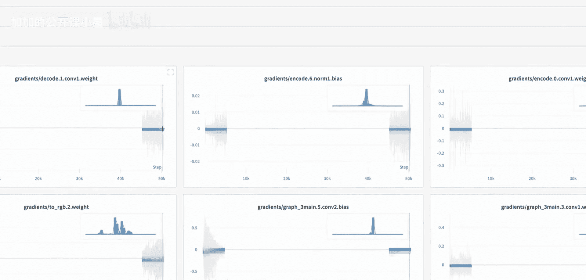
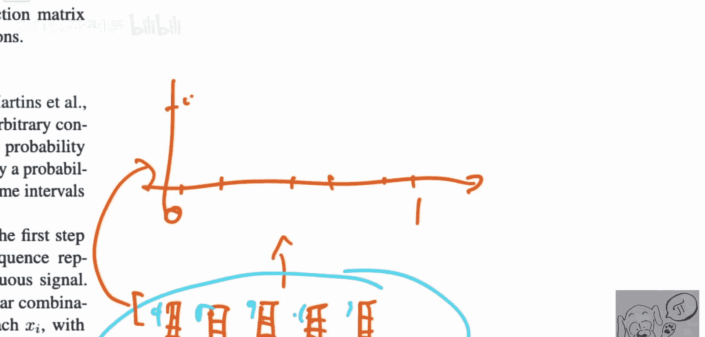

# YannicKilcher【中英⚡AI经典论文领读(全203篇)(下)｜Papers Explained】 p47 P147 ∞-former：无限记忆Transformer（又名Infty-Former ⧸ Infinity-Former，研究论文解读） [BV1j8x5zJEvx_p47]

Hello there。 Today， we'll look at Infinity former Ined memory transformformer by Pedro Enrique Martintens。

 Ztamarino and Andre Ft Martintens， on high level this paper proposes a transformer that can attend to unbounded memory in the past。

 it does so by building up what it calls a longterm memory which is a continuous signal rather than a discrete signal as most of the other transformers do。

 it uses continuous attention to do so， and that enables it essentially to continuously compress the past into this continuously longterm memory and then attend to it as it predicts next tokens。

 it also introduces the concept of sticky memories which essentially are events in the past that are of particular importance to the future。

 so by keeping those sticky memories specifically around the。

🎼Performance again so we'll go through the paper， what the model looks like。

 how it works and what it does in the experimental results you wouldn't have guessed it but this video is sponsored by weights and biases if you're in the ML space and you don't know about weights and biases what are you doing if you track your experiments using a spreadsheet of paper Tensor folder I used to uses and biases' one of code and you can your experiments the cloud not just metrics but models data output images you want say hello to Zuric。

🎼Believe me， when I started the PhD， I was looking for something like weights and biases and I tried every single thing there is。

 I tried every productivity tool， every note taking tool。

 and I just couldn't get anything to work for one part because the features were just lacking or the other part because I was just too lazy and weights and biases solves both of those problems。

 it has all the things that I need to track my experiments， collaborate with others and so on。

 but also it's just a single line of code and everything else works automatically。

 It even boosts my productivity because whenever I have logged a model。

 I can just call a function to download that model from the weights and biases website。

 I don't need to place it in a correct folder or keep track of it myself。

 It's just there On top of that， it relieves me from the stress of writing stupid overleaf reports because I can write a weights and biases report and share that with the people that I want to show my work to。

 The weights and biases report is so much more useful than a P。

🎼It's essentially a website， but you don't need to code any HTML or CSS or whatnot。

 You can include dynamic content。 You can reference the runs you did。

 you can pull out data from the runs。 You can present that in a neat fashion。

 and it gets really easy。 You don't even need to。

🎼嗯。🎼And it gets even more simple， you don't need to even set up anything In fact weights and biases runs in the cloud by default。

 you can host it on premise but it really wants to live in the cloud。

🎼All you have is an API key you log in and you're good to go so please check it out accounts are completely free for personal use I promise you will not be disappointed give it a try and now let's get into the video bye bye。

Cool， so there are a couple of good things and a couple of questionable things about this paper。

 also there are a lot of engineering choices in this paper which I don't necessarily want to go into。

 there are a lot of things that one could do differently I feel which influences the experimental results as well。

 I guess， but we'll just take it for what it is。The other thing is that I believe this should be called。

Not infinity Form but infinity For， that's actually how you find it on if you Google for this you can enter infinityform。

 infinity being of course the abbreviation in LoX for this symbol right here and I think you know to make it more unique we should just call this the infinity Form。

All right， so what does the inFtiformer propose， they say in the abstract right here that transformers struggle when attending to long context since the amount of computation grows with the context length and therefore cannot model longter memories effectively。

So there are a number of things hidden right here。 they see the amount of computation grows with the context length now for classic transformers it's actually worse right the amount of computation grows quadraically with the context length。

 but even for some of these， let's say linear transformers。

 the amount of computation still grows linearly with the context length。

 so they see even this as a problem， they say they cannot model long- termm memories effectively。Now。

They say several variations have been proposed to alleviate this problem。

 but they all have a finite memory capacity being forced to drop old information in this paper we propose the inftiform。

 which extends the vanilla transformer with an unbounded longter memory。

By making use of a continuous space attention mechanism to attend over the long-term memory。

 the informerss attention complexity becomes independent of the context length。 Now。

 already remember right here， there is rarely a free lunch。

 I don't want to say there is no free lunch because I've definitely eaten free lunches before。

 but there is rarely a free lunch in these kinds of things。

 if we have a finite computation we cannot pack infinite information in there。

 So if we are attending to unbounded longter memory that means something else will have to give。

 And of course， the thing that gives here is just the amount of information you can retain。 Now。

 this can be a good thing to trade off sort of boundedness in time for boundedness in information yet still。

 you have to keep that in mind。 As I said， they also introduced this thing called sticky memories。

That keep important things around。Now。As we go through this， this gets in my mind。

 at least this gets more and more into just like a classic LSTM model， So the classic LSTM model。

 of course， takes in some sort of input then models a hidden state then propagates that hidden state when it inputs the next thing and so on and it sort of has to keep track of what's important in its own hidden state as to decide what it wants to remember what it doesn't want to remember So as with the transformer。

 the LSTM has in fact an unbounded memory it can remember things for arbitrarily long yet it only has finite capacity to do so it needs to overwrite some memory every now and then so this is a bit how you can think of this model is essentially the same principle as an LSTM trading of unboundedness for finite representation space I'm not saying this。

In LSTM， it is a little bit different， it might be a smarter way to do unbounded computation。

 it might not be， but in concept it is the similar thing。Okay。

 so what's up with this continuous attention that they keep talking about？This is in essence。

 quite a simple concept， namely if you have a sequence of let's say tokens and every token has an embedding vector。

 so every token is associated with a vector that is its embedding and this can be the first layer but this can be also the intermediate the intermediate values of the computation。

 so from one layer to the next you always in the transformer have number of tokens of these embedding vectors that travel through the model they get transformed into by the next layer into new embedding vectors and so on and so on。

Now the inftityform， what it does is it takes this signal right here and changes that from a discrete signal into a continuous signal。

 so you would no longer have dimensions that you know first the topmost dimension here。

 the first dimension of all these vectors might be whatever 459。13， that's no longer the case。

 what you would have is like a continuous signal。OkayNow how do you do that pretty easily？

What the infinity formerer does is it takes each of these dimensions separately。 Okay。

 each of these dimensions。 it plots these points up on a sort of continuous plane。 So this。This here。

 So this， it labels it from 0 to 1。 So you divide this interval into， I guess。

 five different points because we have five tokens for the first one。 You label。 Sorry about that。

 You label with a 4， Where is a 4。I suck at this。So here is a4， so dot here， then here is a5 I guess。

