# YannicKilcher【中英⚡AI经典论文领读(全203篇)(下)｜Papers Explained】 p48 P148 地形变分自编码器学习等变性胶囊（机器学习研究论文解读） [BV1j8x5zJEvx_p48]

Hello there Today we'll look at topographic VEs Learn Evariant capsules by T Anderson Keller and Maxwelling On high level this paper proposes a new type of variational autoencoder where the latent variables aren't independent but are organized in a topographic way。

 what that means we'rere going to look at that， but in essence it means that。It can。 It can， it can。

Represent transformations in the real world of a certain kind。

As transformations inside of the latent space of the model， so the whole question is here。

 how do we build a latent space and a model where this naturally happens as we train it？

So we want the real world to somehow correspond to the latent space in a way such that if the real world moves。

 the latent space moves equivalently or equivariantly。 That's where this word is going to come in。

 So we're gonna go through the paper。 I have to say I don't understand this fully as well。

 these variational frameworks they are always kind of I feel kind of math heavy and they take a very different approach than the papers I might be used to。

 So I'm going to tell you what I think is going on here。 And if I'm completely wrong。

 this is entirely possible， please let me know。 Alright， let's dive into the paper。

 this is the first graphic right here that shows kind of an overview over the system。

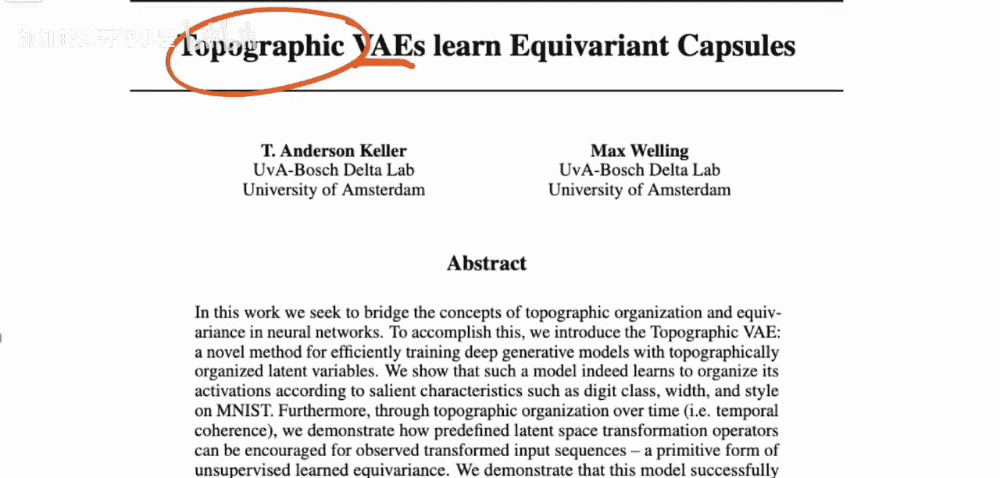

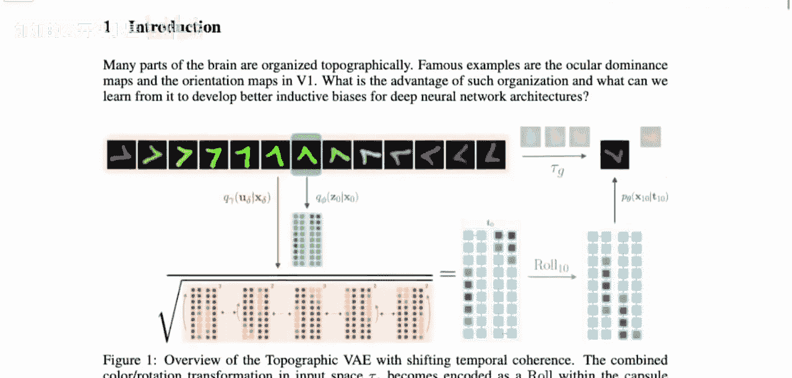

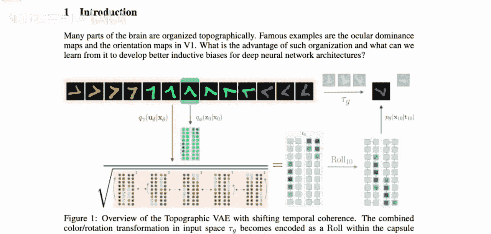

So what do they want to achieve What they say is we're not going to consider we're going to try to build a generative model like a variational autoender。

 but we're not going to consider any kind of data。 we're going to consider data essentially essentially frames of a video so we're going to assume that what we're looking at is kind of a video and the transition in the transitions inside the video or sort of continuous sort of monotonic and and slow So here you can see the seven rotates slowly and also changes its color slowly relatively monotonously over this sequence。

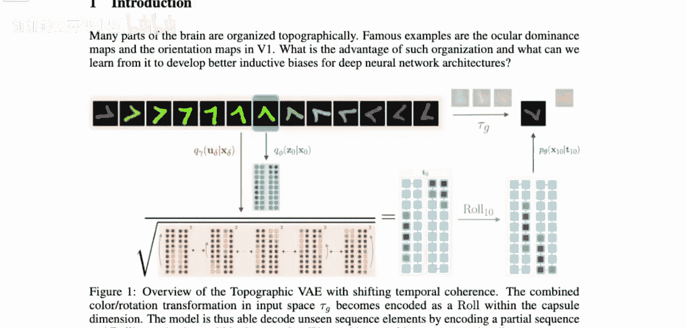

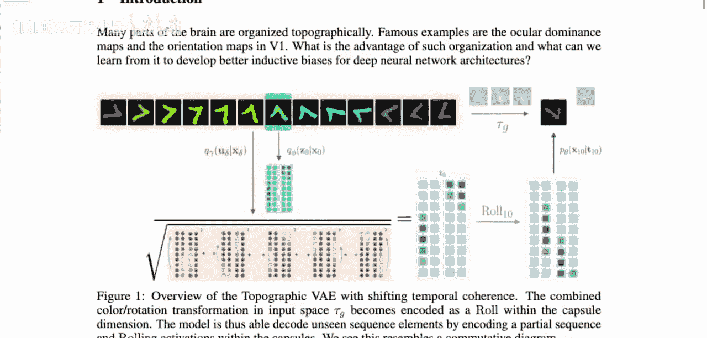

So what they're going to say is we're going our model is going to take。😊，This entire sequence。

 one picture is going to be kind of the focus here。 So this green one is the focus。

 but we're going to take in this entire sequence right here into the model。

 And we want the model to come up with a latent representation of the focus image。 In this case。

 it's going to be。 we'll jump a step here is going to be this thing right here。 Let's call that。

 I don't even remember how they call it。 Let's call it like Z hat。 Okay。

 this is a latent representation of the focus image。And now。

 obviously in a regular variational autoender， I could now push this again into the decoder and get back the same image and I can do so here as well。

 However， we want something else as well。 we also want that if I now。

Transform my latent space in a certain way。 And this way is going to be this roll operation in this paper。

 If I transform my latent space in this way， I want this to correspond to moving forward in this sequence。

 right？ So I have a sequence as an input。 and I say， well， my latent space should be such that if I。

Perform certain operations right here in this case。

 I roll by 10 that that corresponds not to the picture that I've input。

 but to the picture that would be if I were to observe this transition10 steps into the future。

So roll by 10 and roll in this case means you can see here they have two of these what they call capsules。

 I think they call them capsules， the left one and the right one。

 and the role simply means that I take every variable latent variable and I simply roll them forward。

 So this is over the latent dimension。 I just roll them forward by one step。

 I do that 10 times this is as you can see this is arranged in sort of a taus here in a1 d tous。

 So I can just roll this around and also this capsule。

 I can just roll it around 10 times and that hopefully if we train the model correctly should correspond to not the input image。

 but the image that is 10 steps into the future。 So that is the goal。

 Now we don't want to train a model explicitly to predict 10 steps into the future。

 that would be would be a valid task， but it's not what this model wants。

 What this model wants is say can we build a model。

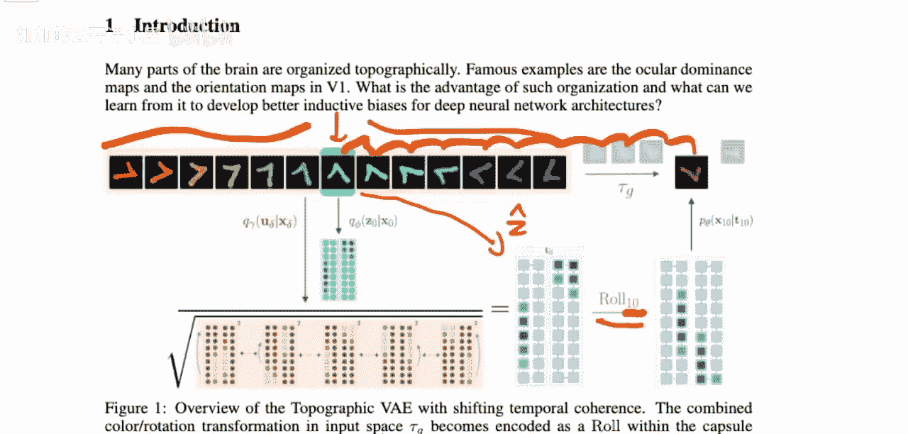

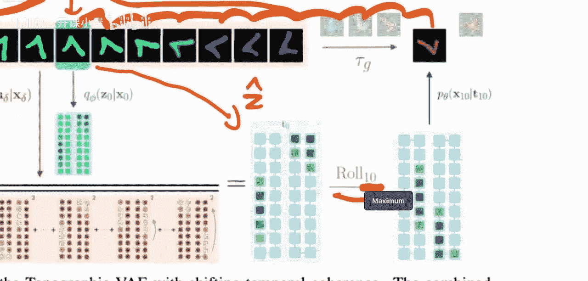

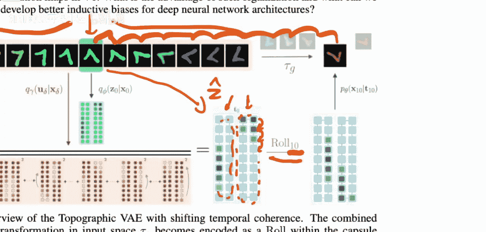

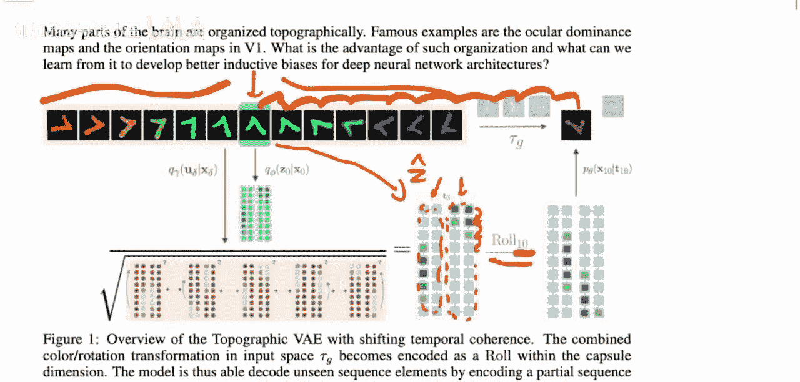

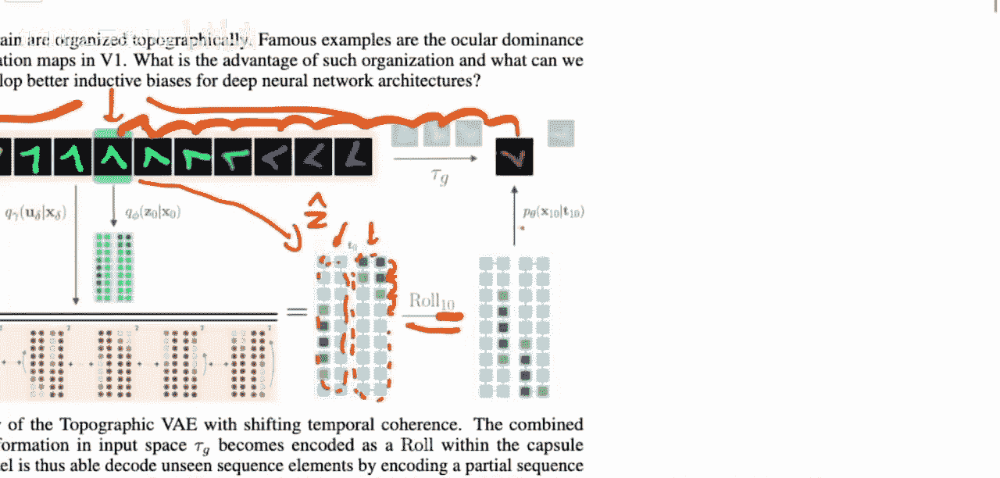

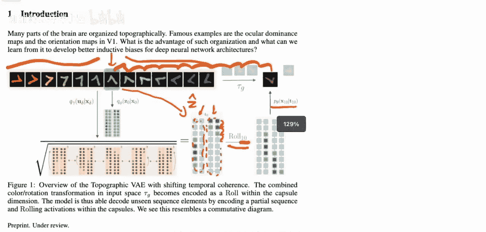

architecturerittecture and the latent space architecture such that this kind of happens automatically。

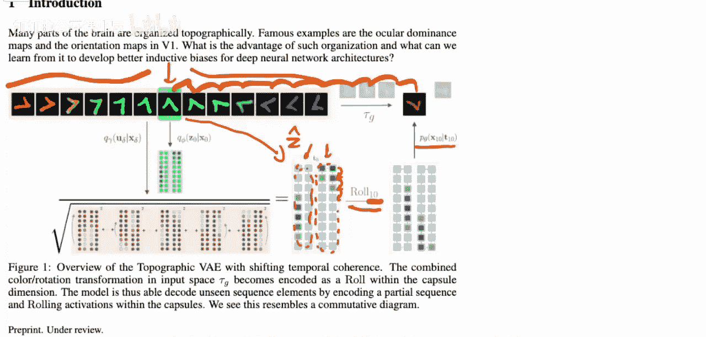

And let's see。 Well， you can already see kind of how this latent space comes to be。

 I said this z hat here is going to be the latent representation。

 You can see that is not the thing that is directly output by the encoder the encoder in this case outputs many things。

 So it outputs a z variable。 So the z hat is what I call kind of z normalizedized。

 The z variable is kind of z unnormalized。 So it outputs a z variable for the focus image。

 but it also outputs these U squared variable or it outputs the U variables which we then square。

 So these U variables right here or output I'm gonna guess this is from this image and this is from this image and this is from this image and also kind of look into the future right here。

😊。

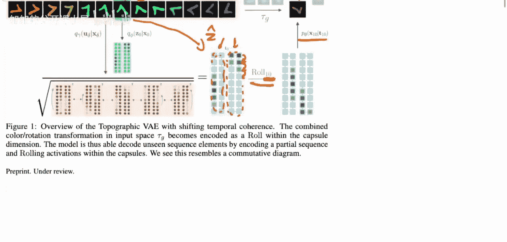

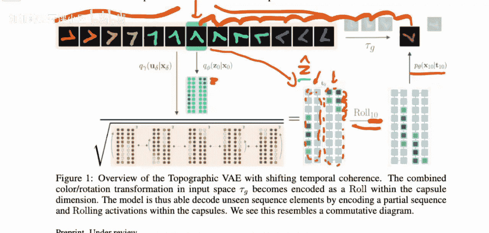

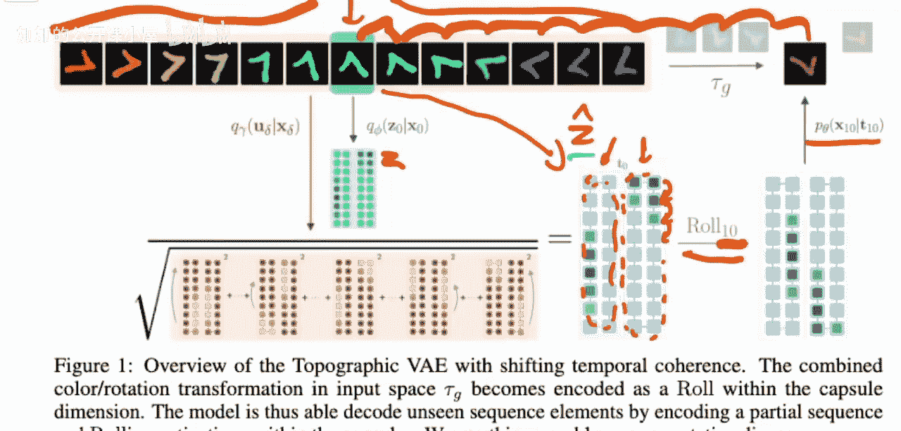

And yeah， so I have these U variables。 and I define sort of a a window， a context window around。

 which I look。 And I also predict them。 I square them。 and then I sum them all up。

 I pull the square root right here， and I divide。 So this is why I say kind of a normalized Z is what comes out of this。

 But it's fairly， fairly complicated， right。But this is going to， in a way， encourage this behavior。

 So let's see why that is。 And for that， I want to just draw back a little bit to like a regular VE。

 a regular variational autoenrs。 So if in a regular VE。

 you have like an image this is encoded decod and you get back an image right So in a regular VE。

 what you assume is you assume that the latent space is sort of made up out of these independent latent variables。

 latent random variables they're Gaussian distributed and yeah they I already said they're independent from each other。

And you you claim if I know the latent variables， so essentially if I know the mean and variance of these。

 then you know producing an image is is easy， right。You can simply train a neural network。

 I input you know which， which。I input what values my latent variables are or how the Gaussians are parameterizedAlternativelyly。

 I input that， and I train the decoder to produce a picture from that。 That is easy。 The question is。

If I have a picture， trust the cat right here。If I have a picture。

 what are the corresponding latent variables you know what are the values of the latent variables that make sense right here and of course。

 in a VE， we train the encodeder and the decoder jointly such that they cooperatively can construct this latent space like。

 okay， how， how should how should the latent space look from which the decoder decos。But I。

 I just wanna turn your。Attention to the question of the encoder's job is essentially to take in an image and produce what values the latent variables are。

And the latent variables are assumed to be independent from each other and Gaussian distributed。

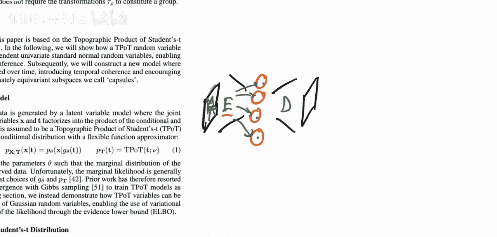

Now this is where this model right here differs so this model says， well。

 we're going to assume we have observed and latent variables observed variables。

 x and latent variables T observed or I guess the images or the image sequences and T are the latent variables。

So this， I guess this would be equivalent to Z hatt to what I call Z hatt， they call team。All right。

They say well formulate the joint distribution and note that in this framework。

 in these variational frameworks， I don't。It's not my thing either， but what you do is you always。

 you propose a mechanism by which the data and by which the variables are are generated。

 So you as a designer of the algorithm propose the structure of how the latent variables。

Work together and then you have some small parts in there that you say。

 well these things I don't know， I'm going to let a neural network do these things。

 but essentially you come and you impose a structure upon the world right and you know if you get the structure correct。

 your model will work fine if you don't get the structure correctly your model won't work fine。

 but this is a bit of a different way of working then you know saying well I train a convnet。

