# YannicKilcher【中英⚡AI经典论文领读(全203篇)(下)｜Papers Explained】 p50 P150 会议同行评审的不一致性：重审2014年NeurIPS实验（论文解读） [BV1j8x5zJEvx_p50]

Hi there。 Today， we'll look at inconsistency in conference peer review revisiting the 2014 Nipps experiment by Corina Cortez and Neil D Lawrence。

 which were actually the chairs of the 2014 Nipps conference so they are going to have access to some data that the rest of us sadly don't have access to。

 but also it allows them to make pretty cool research on how conference reviewing works and whether or not it actually can determine the quality of a paper or how much of it is just random subjective reviewer decisions。

Now， this paper， particularly here， takes up the papers that were subject to the 2014 neuroips experiment and tracks them over time。

So it's it looks at the papers that were submitted， how did they perform in the subsequent years。

 meaning how many citations that they accumulate， both for the accepted and for the rejected papers。

 and they find some pretty interesting results right here。 So we'll dive into this。

 The paper is not too long and the conclusions are fairly straightforward。

 I still think its it's really cool that people actually follow up on this work。

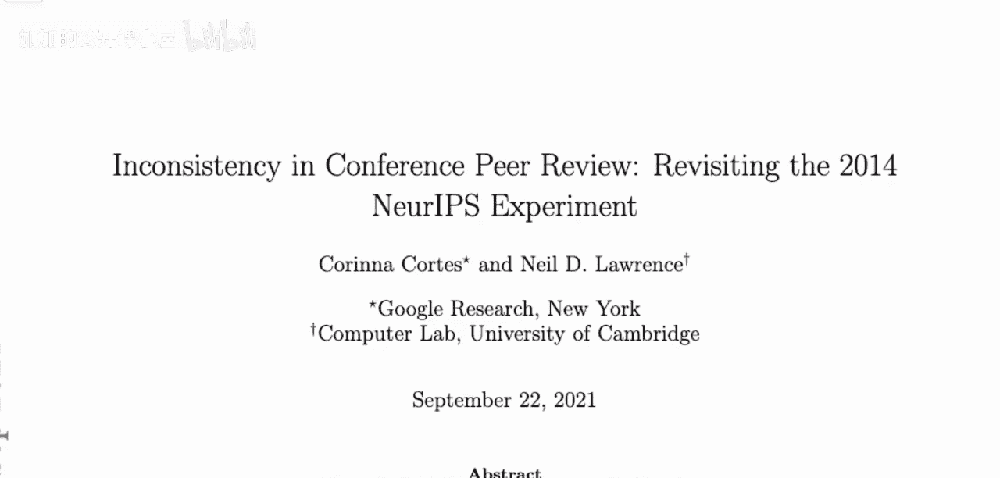

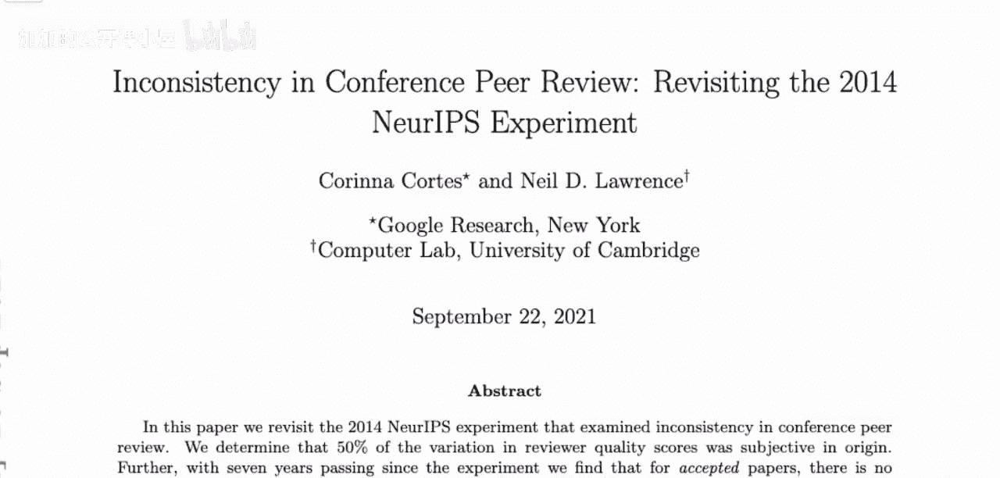

So for those of you who don't know the 2014 Nurrips experiment， that is the wrong color。

 the 2014 Nipps experiment was an experiment in assessing how much of review of conference review is random。

 essentially。

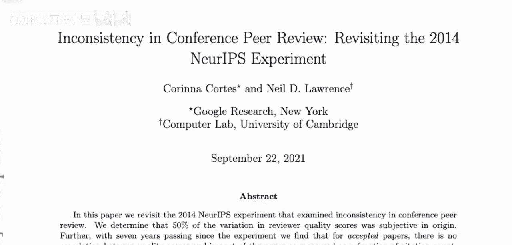

So what you did was， and I think they have a little section about this here。 Yeah。

 so they selected about 10% of the submissions。 These were 1 and70 papers。

 and these would undergo review by two separate committees。

 So whereas usually you have a paper that goes into a review。 Let'ss call that a committee。

 which is a bunch of reviewers and an area chair， and they make the decisions of whether to accept or to reject。

 And yeah， at the end， you have a decision。 So in this experiment， you would take a paper。

 you would actually give it to two different committees。 Committee 1 and committee 2。

 Committee 1 would only be selected from kind of one half of the reviewer pool and committee 2 would only be selected from the other half。

 These were random assignments and。

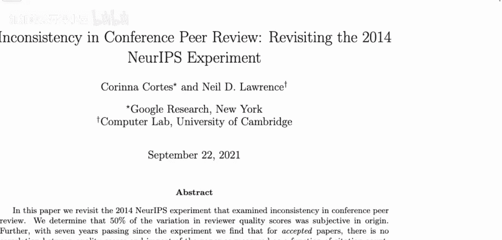

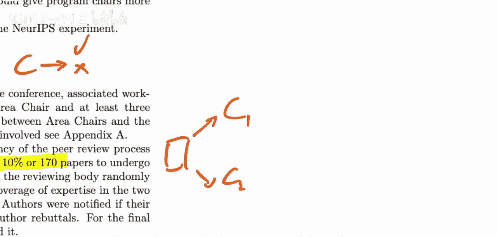

呃。To the two pools and also the papers who participated were randomly selected。

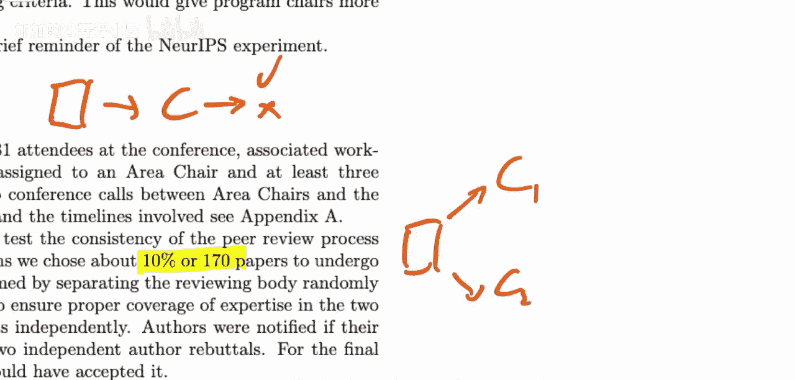

So each of these committees would reach their own decision， accept or reject。 And， of course。

 the interesting part is how many of those agree or how many of those disagree with each other。

 And by the way， the paper would be accepted finally， if the max。

 So if either of the committees would accept the paper。 And if I recall correctly。

 this year's Nips conference actually repeats that experiment from 2014。

 So we're going to have another data point in hopefully assessing how conference reviewing has developed over the years。

 whether it's gotten better or actually worse。

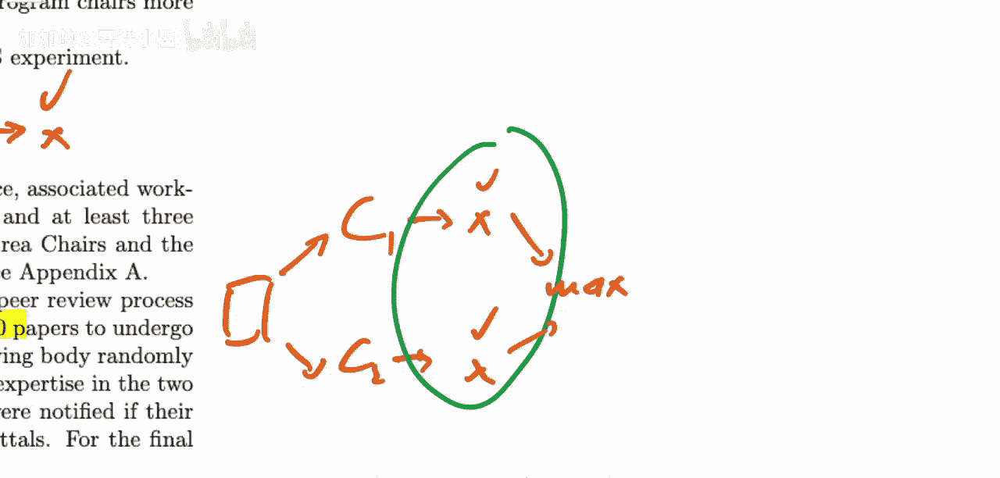

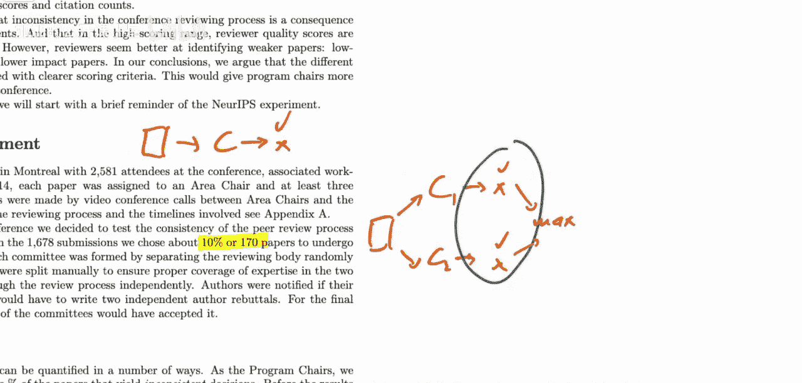

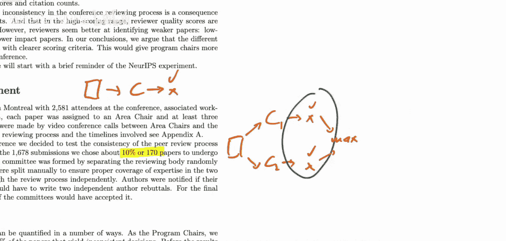

Alright， so that was the experiment in 2014， but by the way the authors here have decided that the name changes is retroactive。

 I never know， I never know when talking about old Nipps conferences。

 whether I'm supposed to say it was NIps 2014 or Nips， in any case in this paper we're doing Nips。

So what was the outcome of that experiment， and that's pretty interesting and namely。

 here you can see these are still 2014 numbers， committee 1 and committee 2 split up so。

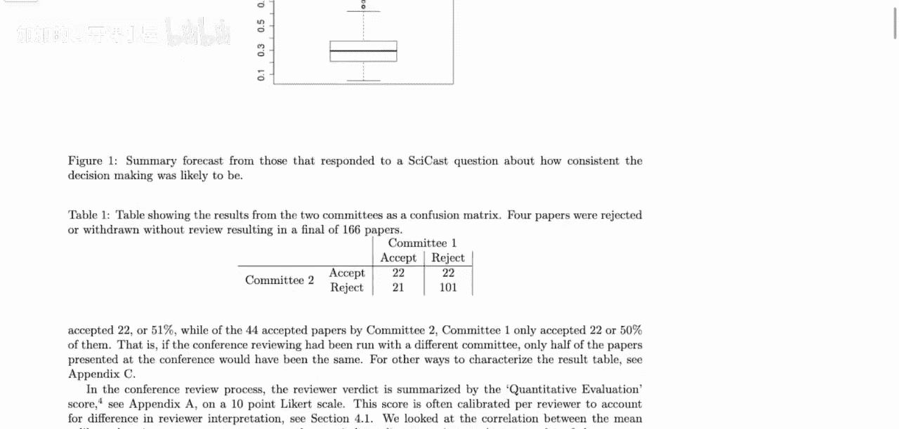

It's not the same committee 1， of course， but committee 1 would always be reviewers selected from kind of the first half of the population Committee 2 from the second half。

 They did agree on most of the papers， as you can see here or for 101 papers。

 they agreed to reject for 22， they agreed to accept。 However， for 43 of the papers。

 one committee would accept and the other one would actually reject。

 So for about 25 per cent of the papers， the two committees would disagree。25%。 its， you know。

 it sounds， it's a lot， but it doesn't sound like that much。

 but if you look at it in a different way where they say right here。

 if the conference reviewing had been run with a different committee。

 only half of the papers presented at the conference would have been the same。 So this is looking at。

 if youd， for example， always go with committee 1。 you would have these papers。

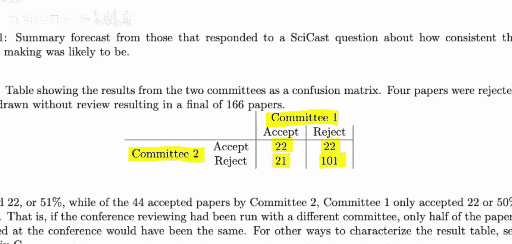

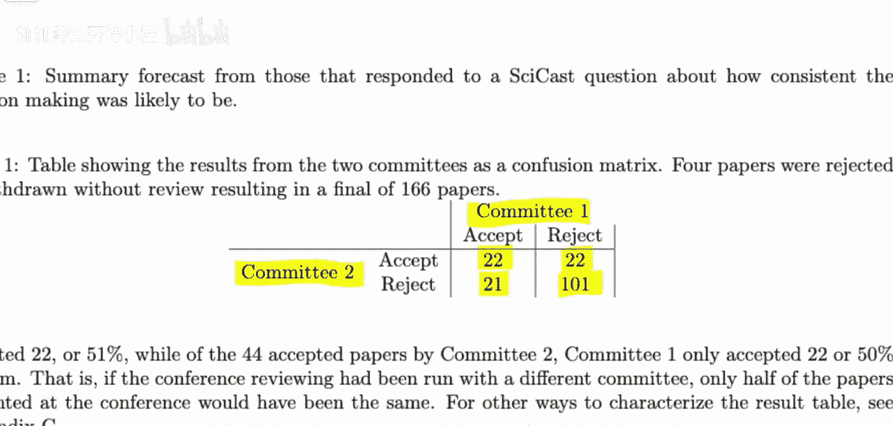

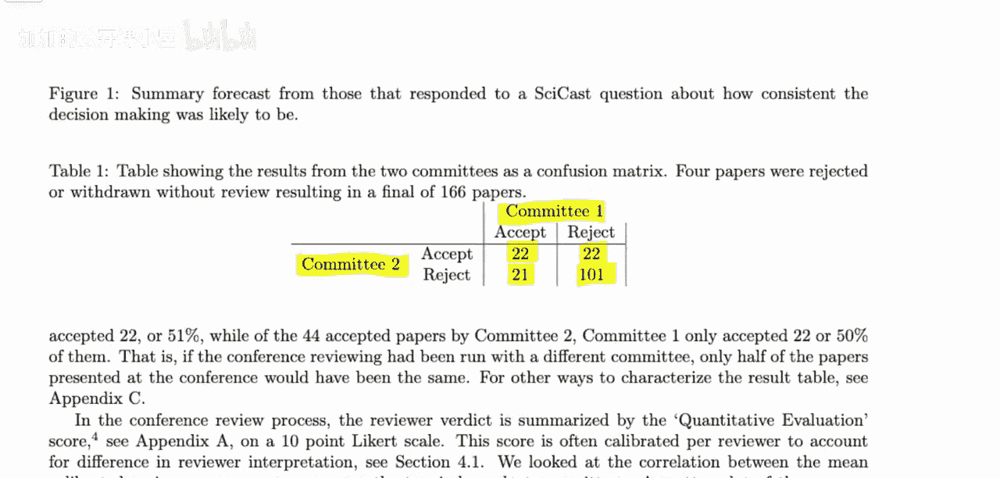

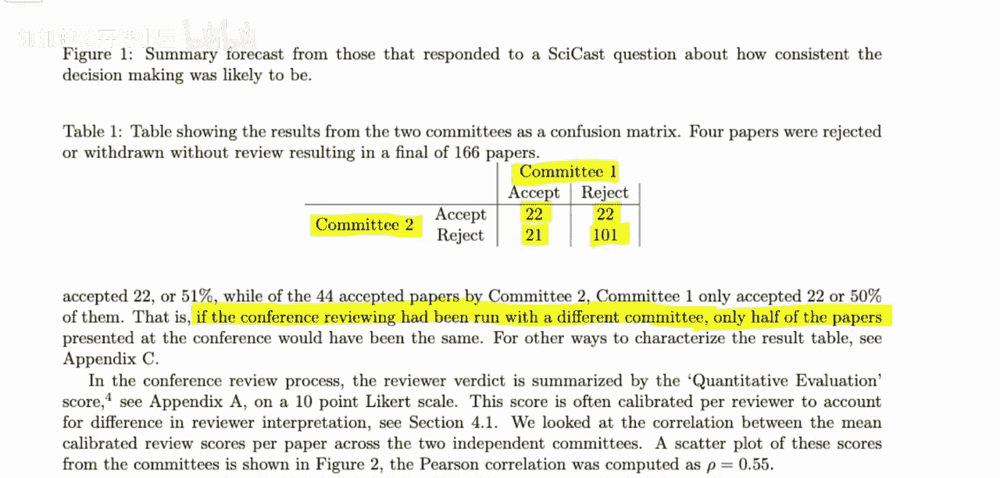

But if you would always go with committee， too， you would have these papers。 therefore。

 but the simple selection of the committee determines about half the papers at the conference。

 So if you're at the conference， you walk through the the big halls of posters or you look at the proceedings you have to keep in mind that half of the papers are there。

 only purely because of the random choice of or not purely， but they wouldn't be there。

 had the reviewing committee been a different one。 Ha the papers。 that's kind of crazy。

 And of course， this sparked a lot of discussion right here。

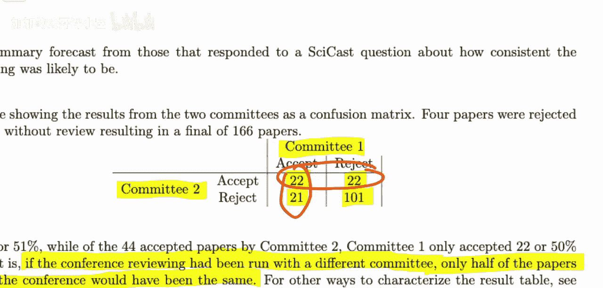

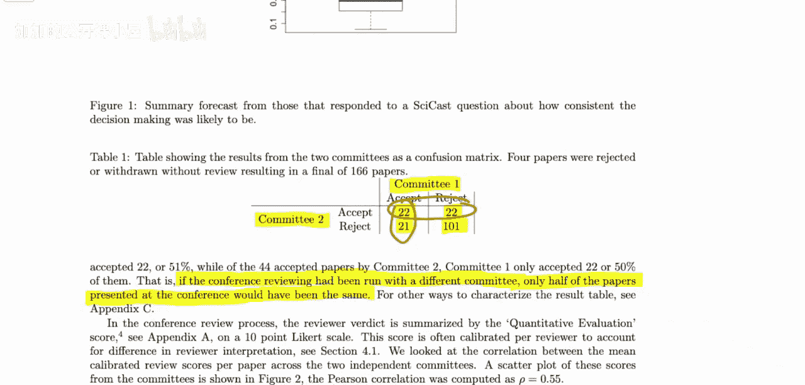

So this is the outset。 This was the results from that time。 And now we're going into new analysis。

 So they do three different distinct points of analysis。

 The first one is they do the title is called reviewer calibration。

 So they try to figure out what portion of a reviewer's assessment of a paper is let's say objectiveive and what portion is subjective。

 So what portion of a score is simply due to the reviewer's subjective feelings about the paper that doesn't match with any other reviewer's scores。

So here you can see this， for example。What you can do is you can build a model。

 You can build a model。 You can say why I J。 that's the score that the Jeth reviewer gives to the I of paper。

 And， you know， being the conference chairs， these these authors here would have prime access to that data。

 So what you observe is why now you can say we assume this is a combination of three things。

 First of all， we assume that there is some sort of a objective paper quality， which is F。

 this is the objective quality of the paper， this is actually what the reviewers are trying to predict。

 So when the reviewer posts the number Y into the system。

 they're trying their best to actually assess F I。However， there is also this B， J right here。

 And this is the bias that the Jeth reviewer has in calibration。

 So not everyone did not everyone sees the one through 10 or one through 9 scale that we have in the same fashion。

 and therefore。What's like a three to me might be a5 to you so。We have to correct somehow for this。

 And the inclusion of this BJ factor is how we account for that。 And then lastly。

 you have this EI J factor right here。 And this is the subjective portion of the score。

 So this is independent of the objective quality of the paper。

 This is sort of the subjective bonus or penalty that reviewer J gives to paper I。

 And our goal is going to be to figure out how do these two numbers compared to each other。

 How much of the score is objective versus subjective after we have calibrated for reviewer for general reviewer bias for calibration bias。

 let's say。Keep in mind， this is a model。 This is how we imagine the world。

 All we observe is this why thing right here。 What we can do is， of course。

 we can put up a linear system of all the scores， right。And of all the scores。

 because every reviewer does give more than one score in this conference and every paper gets more than one reviewer's scores so we can put up a linear system。

 But it turns out this is over parameterized because you only have as many numbers as you have these parameters right here。

 So the rest， both parameters。 They don't。 You don't have enough data points to assess that。Now。

 as as much fun as over parameteraized models are in deep learning， they're actually not that good。

 if you want to estimate a linear system。 So what people do。

 they come up with regulars and baesing approaches and yada yada， yada。 I'll skip all of this。

 to just give you the numbers。 So the model that these authors come up with。

 determines that the factors of the linear systems are as follows。

 This here is the factor that goes with the F I。 This one is the one that goes with the BJ。

 And this one is the one that goes with the E I J。😊。

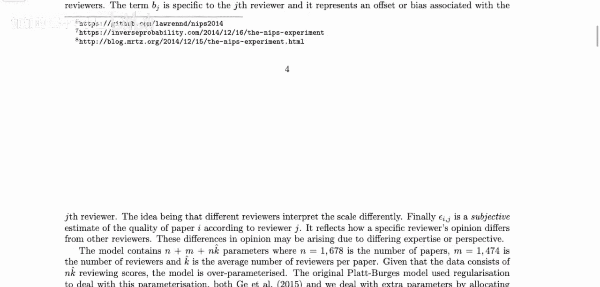

And you see， you， you， you， you pull out this one and then you simply compare the number on the left to the number on the right。

 And you'll see they're almost exactly the same。 And that means， and they formulate this here。

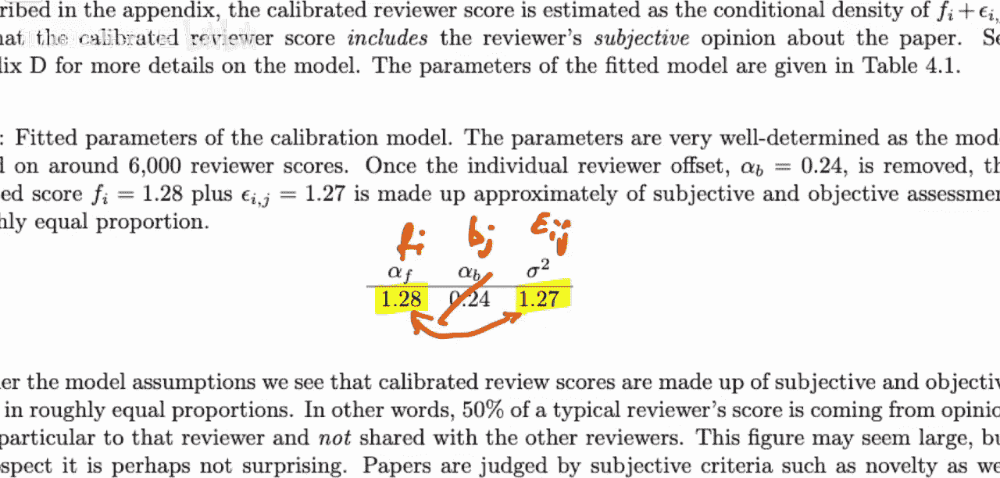

In other words，50% of a typical reviewer's score is coming from a。

