# YannicKilcher【中英⚡AI经典论文领读(全203篇)(下)｜Papers Explained】 p51 P151 我们能将深度学习扩展到何种程度？深度学习的收益递减（文章评述） [BV1j8x5zJEvx_p51]

Hi there。 I saw this article in Irile Spectrum called Deep learning's Diminishing Returns。

 The cost of improvement is becoming unsustainable。 This is by Nielsey Thompson， Christian Greenwald。

 Kion Lee and Gabriel F。 Monso。 And I thought it was an interesting read。

 because it talks about the computational limits that we're reaching with the learning today。

 And I have it over here in annotable form， though it might not look as pretty。 I think the article。

 it leads up to the point where it shows just how much compute will be needed to make further improvements in deep learning and what the consequences of that might be。

 And some of the ways that people are trying to get around it。 Now。

 I don't agree with everything the article says。 but I think its it's a pretty neat read It's pretty short。

 So I thought we can talk about it a little bit。 So the article starts out with。

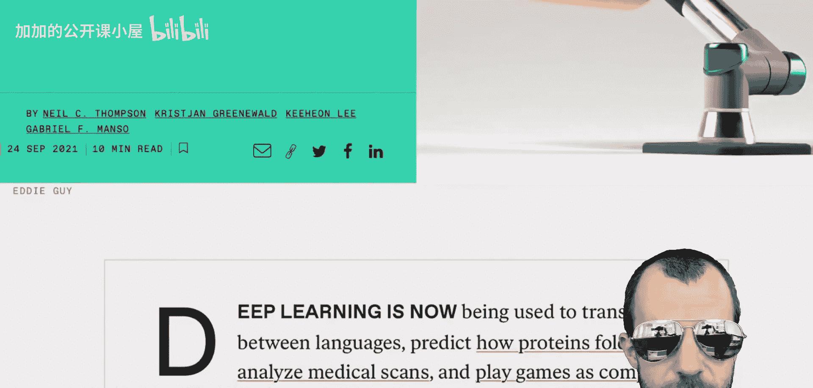

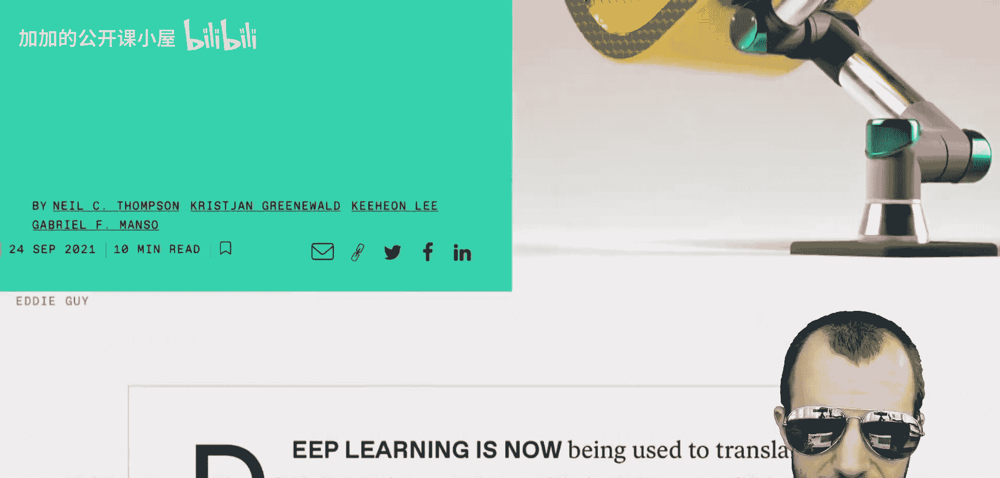

praising deep learning for achieving so many things， for example， translating between languages。

 predicting how proteins fold and many other things playing games as complex as go they say it has risen relatively recently。

 but it has a long history they mentioned 1958 and Frank Rosenbllot at Cornell。

 designed the first artificial neural network。 they say Rosenbllot's ambitions outpaced the capability of his era and he knew it Apparently he said as the number of connections in the network increases the burden of a conventional digital computer soon becomes excessive So why are deep neural networks working because of course computers have increased in power massively just for computing power there has been whatever a 10 million fold increase according to Moore's law and that's usually just measured in something like CPU instructions and now we went't even。

that building special purpose hardware such as GPUs which aren't actually special purpose for this。

 but also TPUs so they say these more powerful computers have made it possible to construct networks with vastly more connections and neurons and greater ability to model complex phenomena and of course these are the deep neural networks that power most of today's advances in AI they draw a comparison right here。

 they say like Rosenbl before them today's deep learning researchers are nearing the frontier of what their tools can achieve essentially claiming that we are in a similar situation today we have the models that can achieve things and we know pretty much that scaling them up can increase performance however we're kind of at the limits of how much we can scale For example I reported on this that Sam Altman apparently said GT4 will not be much bigger than GT3 it will be trained more efficiently。

Will have some smartness in it on how it's processed it will use more computed but it will not necessarily be that much bigger in scale So the first thing the article touches about deep learning is the fact that deep networks are overparized for example the noisy student model has some 480 million parameters yet is trained on only 1。

2 million labelbeled images which is the imagenet data set of course the noisy student model if I understand correctly also may leverage unlabeled data but granted today's neural networks are massively over parameteraized they have more parameters then data points available therefore they should horribly overfi but they don't they say classically this would lead to overfitting where the model not only learns general trends but also the random vagaries of the data was trained on deep learning avoids this trap by initializing the parameters randomly and then iteratively adjusting sets of them to better fit the data using a method called stochastic。

Gadient descent surprisinglypri， this procedure has been proven to ensure that the learned model generalizes well Now I'm pretty sure that we are not yet sure why exactly deep networks don't overfit or why they generalize as they get over parameteraized。

 I know there are some proofs around Sd and so on。 but these proofs usually require assumptions that just make them completely lose touch to reality。

 but the core message is true。 deep networks are over parameteraized and that is probably one of the reasons why they work so well and being overparameterized they are quite flexibility they say the good news is that deep learning provides enormous flexibility。

 the bad news is that these flexibility comes at an enormous computational cost。

 This unfortunate reality as two parts They say the first part is true of all statistical models to improve performance by factor of K at least K squared more data points must be used to train the model This is really hold for。

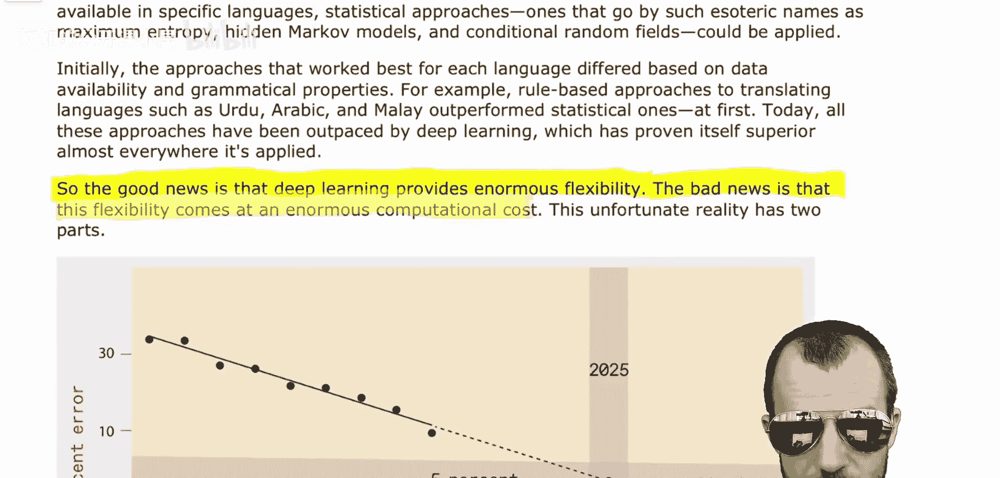

All statistical models is this from the same theory that says the statistical models should overfit when they're over parameteraized。

 I'm not sure the second part they say of the computational cost comes explicitly from over parameteraization Once accounted for this yields a total computational cost for improvement of at least K to the fourth power meaning for a tenfold improvement you would need to increase the computation by 10000 Now regardless of whether you think the theoretical analysis is actually accurate here again this is from the same area that says these models should overfit horribly it doesn't matter because these people have actually collected data and they say theory tells us that computing needs to scale with at least the fourth power of the improvement in performance in practice the actual requirements have scaled with at least the ninth power So when you actually measure how much people need to scale computation in order to achieve given performance then it's much。

than the theory predicts In fact， they have these neat graphs right here So on the left you can see the percent error。

 I believe this is the imagenet classification data set and on this axis you can see the time here you can see that over time as time progresses the error has come down and down and down again as new state of the art models were proposed ever since the 2012 success of AlexNe and if you extrapolate that you can pretty clearly see that around 2025 we should be at approximately 5% of error See I thought you'd had to actually do something to reach a new state of the art on INe but as it turns out we just need to sit here and wait until 2025 jokes aside they overlay this graph with another graph right here and that is the comparison of again。

 percent error on the Y axis but now it's not the year in which the achievement was made but it is number of computations in billions of flops。

Notice the log scale down here Now I have to say this graph right here makes it pretty clear that there might be something like a relationship。

 even maybe a linear relationship that you can extrapolate right here I'm not so sure like these models are up here and then goes like here and then it goes here and then it goes here and then it goes over here to 2020 and really without that you probably have a line that goes something like this now in any case if they do actually the line that they're doing then you can see that if you extrapolate the same thing to this 5% error rate you do end up at something like 10 to the 18 flops and they also compare this to the equivalent carbon dioxide emissions for example right now we are somewhere between the CO2 generated by the average U resident in one year and the CO2 generated by the average U resident in a lifetime the current models somewhere in between to train them once if you actually extrapolate this to the 5% error rate to the10。

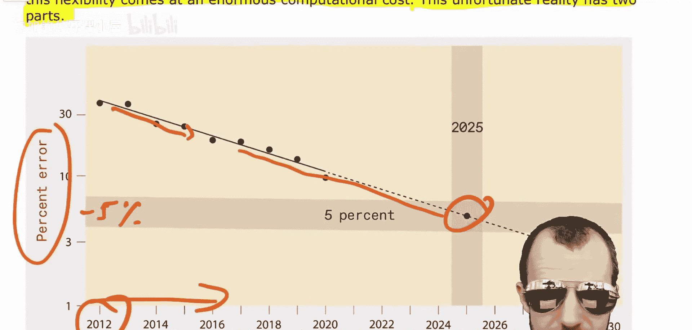

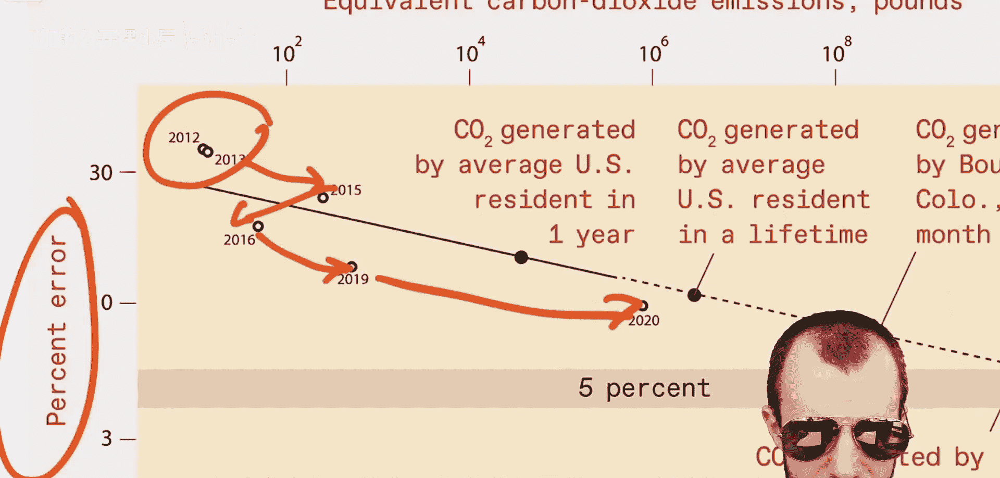

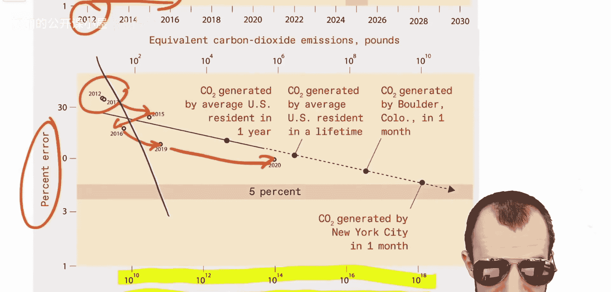

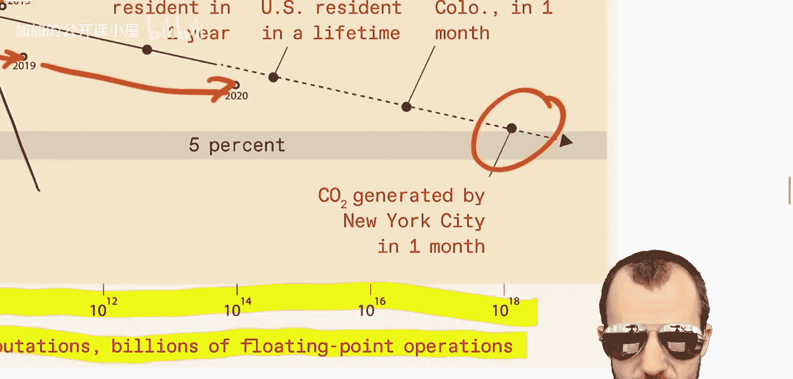

The 18 flops then it becomes suddenly CO2 generated by New York City in one month。

 So the entire city of New York City for one month is the same as GPUs go to train Inet Now that is pretty shocking I have to say you know it checks out they have done the research they extrapolated correctly here and they come to this conclusion the CO2 equivalentence I'm sure they are measured correctly and so on。

 I do have several problems with this though the first one I already said the zigzac in this graph right here doesn't really suggest that you can simply extrapolate over these advances。

 Also the 2020 point seems to be quite out there。 So if there was any architecture search involved if there was any giant freetrain involved or anything like this I'm sure that adds to the CO2 emissions but it doesn't say that you cannot achieve the same thing with something else So whether the slope of the line is really the black one right here or more like the blue 1 I drew。

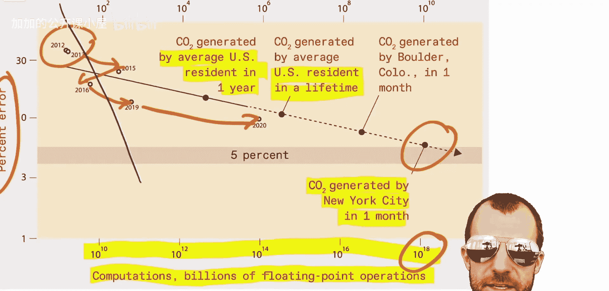

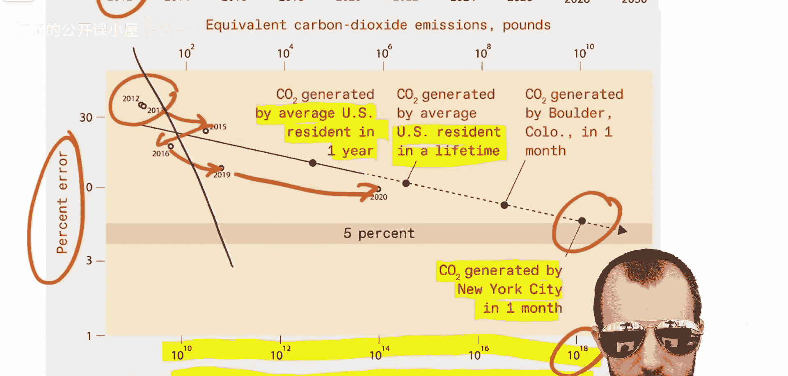

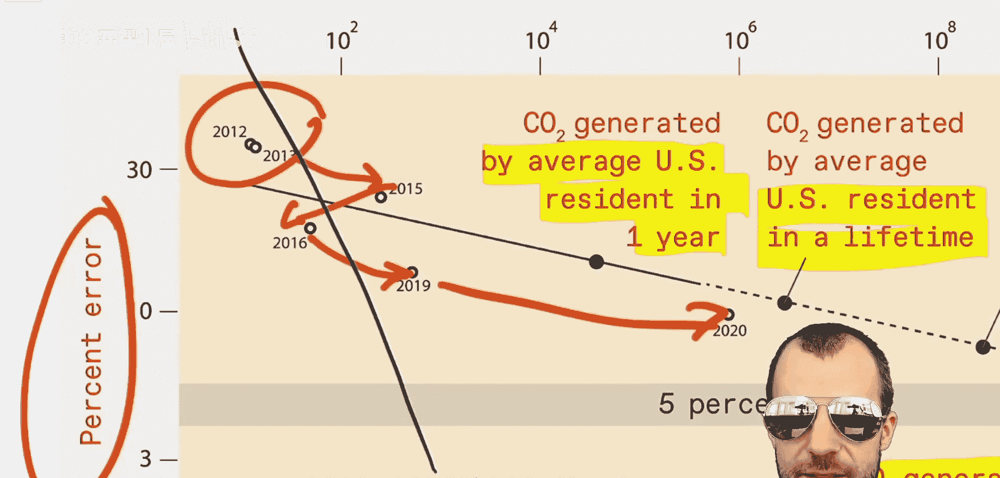

Makeakes quite a bit of a difference actually makes an exponential difference so I'm a bit doubtful that you can really pinpoint this 5% error point25 years in advance it's 2022 now so three years but still and speaking of CO2 equivalentence not all energy is equal for example Google prides itself in being zero emission therefore if Google trains a model there is no CO2 equivalent presumably now I think carbon neutrality and zero emissions in words like this are sometimes a bit of a scam but still not all energy is equal and especially these large companies they can distribute their workload across the planet to where the energy is used most efficiently and lastly and this I think should really the main point here is that we have made advances none of these achievements here that we've made over the past years are only scaling up the scaling up always came with some sort of invention that made it more efficient or more viable to scale up。

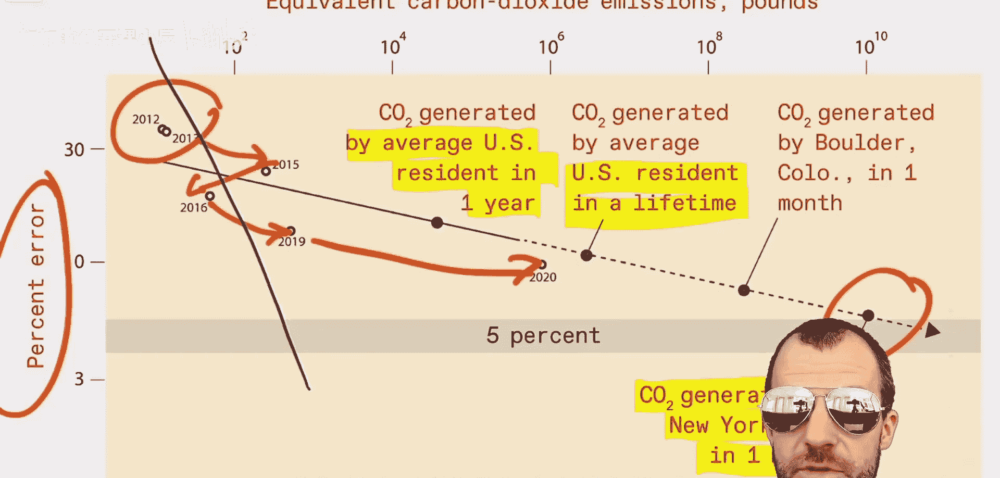

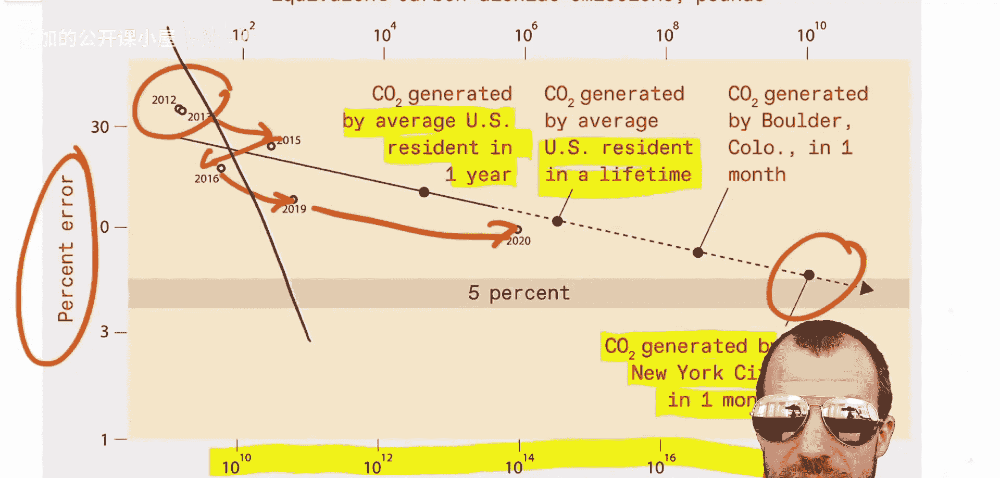

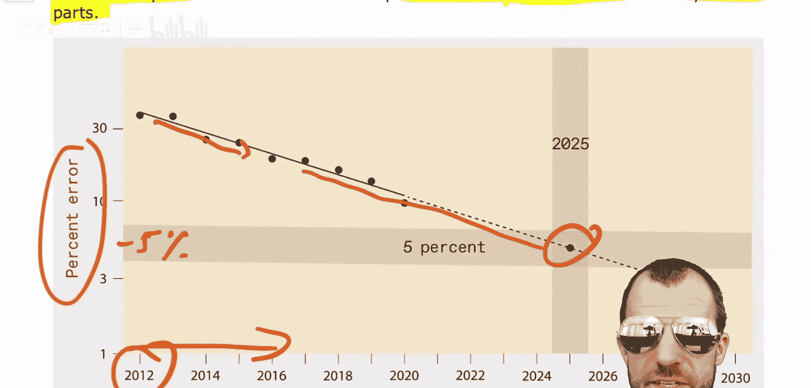