# YannicKilcher【中英⚡AI经典论文领读(全203篇)(下)｜Papers Explained】 p52 P152 Grokking：小规模算法数据集上超越过拟合的泛化能力（论文解读） [BV1j8x5zJEvx_p52]

Hi there Today we'll look at gring generalization beyond overfitting on small algorithmic dataset sets by Atheia Power。

 Uurri Bda， Harry Edwards， Igorbabushkin and Vant misra of openAI on high level this paper presents a phenomenon that the researchers call Groing where a neural network will generalize all of a sudden having after weigh the point of overfitting on a dataset。

 so you train the network， it completely overfits on a data。

 training loss is down training accuracy is 100%， but it doesn't generalize it all to the validation set and then when you continue training the network。

 at some point it will just snap into over into generalizing on these dataset sets that they're researching to like 100% generalization so 100% accuracy on the validation。

And this is extremely interesting and as you can see。

 the paper has been presented at a workshop at I Claire 2021。

 which means that it is not yet it's sort of work in progress so。There is still a lot of。

Uncle things about this phenomenon， it's a as I understand it a phenomenological paper that just presents。

 look here is something interesting that we found and I think it's pretty cool so we'll dive into the paper we'll look at this phenomenon。

 they do dig into it a little bit into what's happening here and try to come up with some explanation。

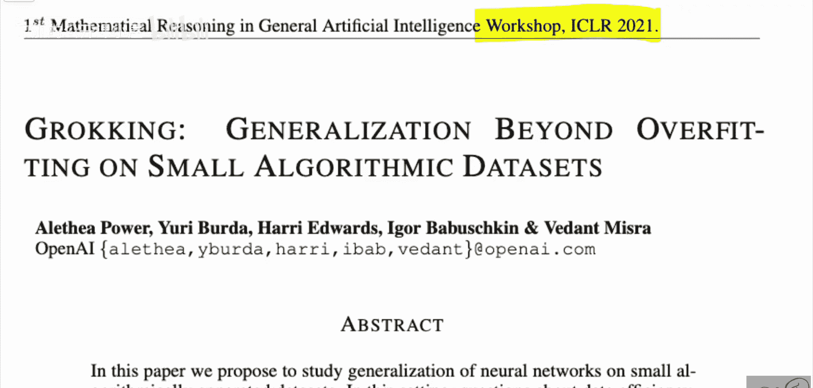

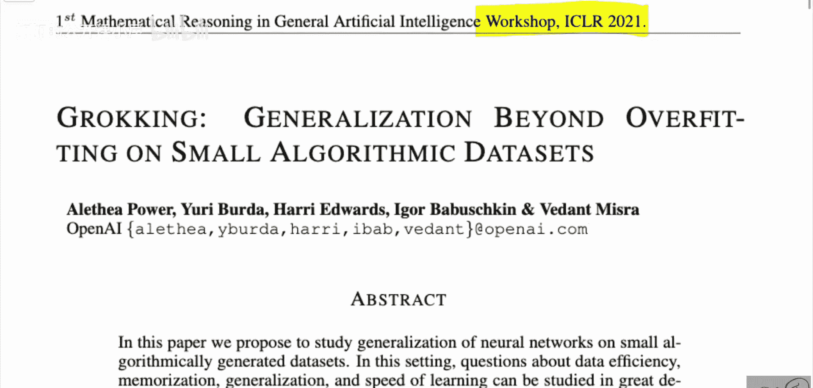

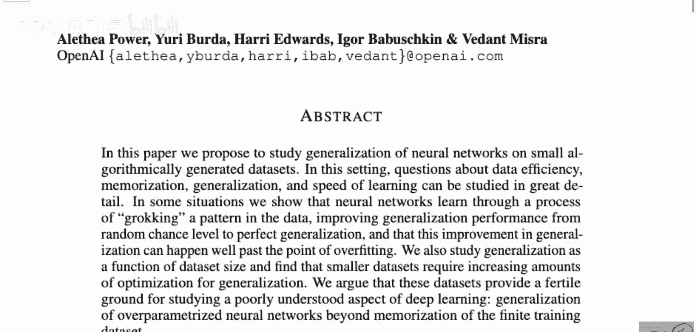

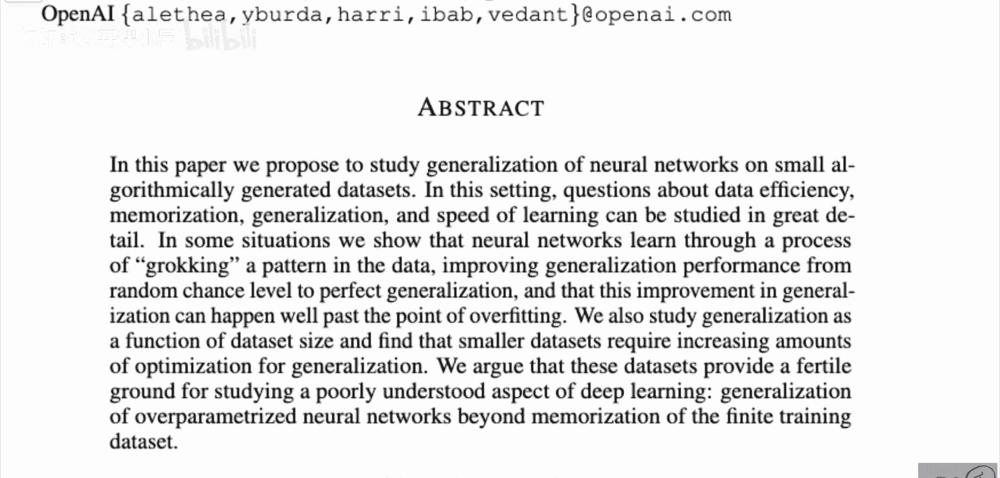

So the basic premise of gring is the graph you see on the left right here now it is a little bit pixelish but I hope you can still see what's happening the red part is the training accuracy and on the X axis you have number of optimization steps and this is a log scale so that's important to see this is a log scale for training steps in this direction。

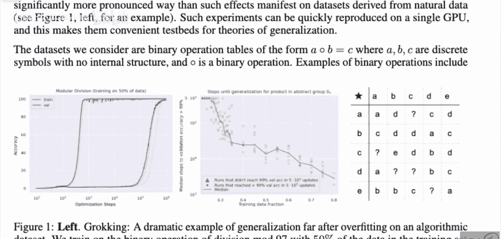

Now the training accuracy naturally after a few steps。

 it shoots up to 100% we'll get to what data sets these things are in a second。

 but it's important to see the network can in fact fit the training data extremely well and it just overfits however the validation accuracy if you can see it there is a little bump here。

 but then it it goes down again almost I don't know whether we should even regard this as a little bump that's actually happening。

 however it just stays it stays down， it stays down and then after you can see orders of magnitude more steps。

 this is 10 to the second，10 to the third，10 to the fourth，10 to the fifth steps it shoots up。

And it starts to generalize as well。This is very interesting because you know。

This essentially means you keep on training for a long time and when all hope is lost still the network at some point will generalize now why is this happening and as I understand it it's not the case often that the network like drops down again out of generalization though I haven't haven't actually seen this investigated like if they run for1 to the I don't know how many steps but it seems like once the network is generalizing is has training accuracy of 100% it doesn't fall out of that again so the question is how does this happening like what's happening here why is this happening。

 why is it all of a sudden and what makes it work and for that it's a bit important to understand a very related phenomenon in fact a connected probably phenomenon called the double descent phenomenon in deep learning the double descent phenomenon graph looks somewhat。

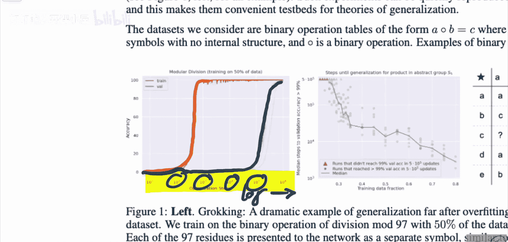

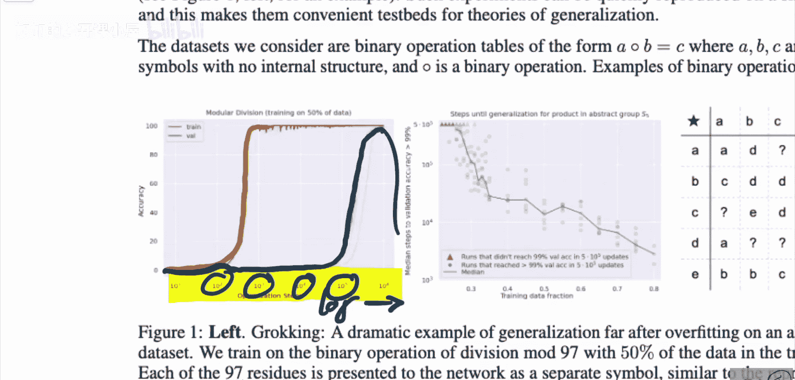

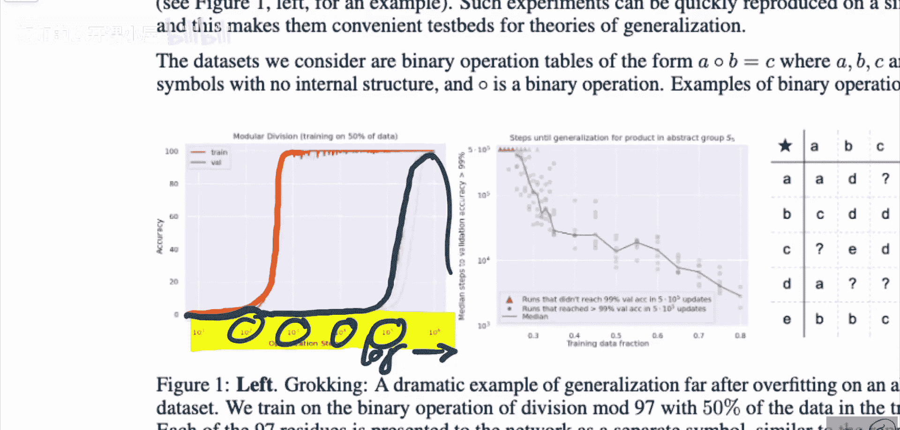

In that the premise is that on the x axis you have the number of parameters in a network。

 so the number of parameters in a neural network， and then on the y axis you have， let's say loss。

Or actually， let's say accuracy。I'm not sure。LosMost of these plots for the double descent phenomenon are actually loss。

 so if you consider the training loss。As you increase the number of parameters in your neural network。

 you will fit the data better and better the training data。

 So you get a curve that goes something like this。 and then it just stays at0 right so there's zero training loss as you increase the number of parameters every point on this line is a neural network with a given number of parameters that has just been optimized to convergence。

 that's important to remember on the left here， we saw a graph during optimization on the right here is a graph of many different networks。

 all of which have been trained to convergence。 Now。

 what you see with the validation loss in this case。 So if you look at the validation loss it might。

At some point it might come down with the training loss right and then in the classic fashion of machine learning you as the number of parameters go up。

 you start to sort of overfit， the validation loss goes up again because you start overfitting you start memorizing the training data and then at the point where pretty much the number of parameters equal the number of training data points like the number of let's just call this n。

Then you have again like a really crappy validation loss because you're just remembering the training data。

 however， if you increase your parameters beyond that point。

 so if you scale up your neural networks even more。

 the validation loss will come down again and actually end up at a lower point then if you were on this place over here。

 if you had not enough parameters， so there is a point beyond overfitting where you have more parameters than data points and interest interestingly four neural networks。

 it is the case that。It happens that they can achieve generalization， in fact。

 better generalization with over parameterization than comparable under parameterized models。

 which flies in the face of all statistics and what not but we know this phenomenon exists okay。

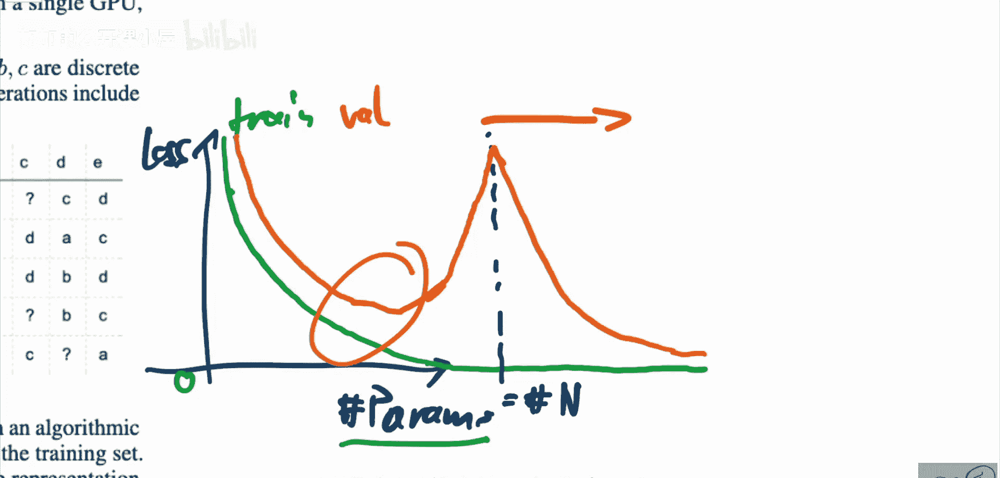

So we knew that。

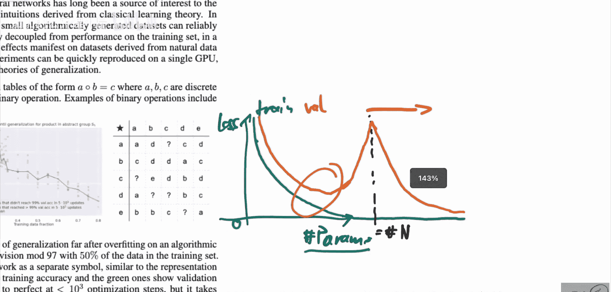

Things like this can happen like the training loss can be perfect。 And still。

 we can have generalization， right， The grocking phenomenon is a phenomenon where。

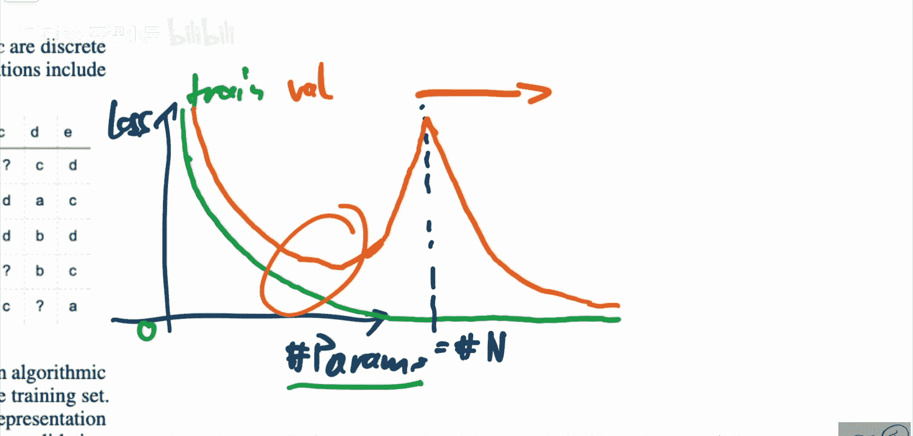

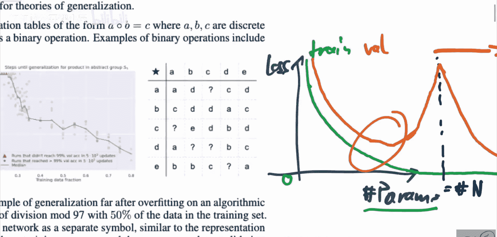

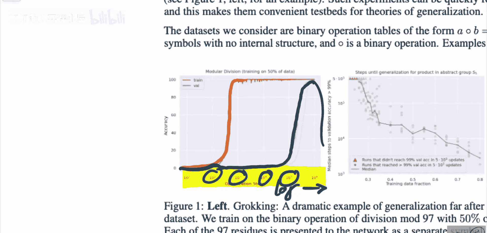

'm I'm going guess the creators of the double descent phenomenon haven't looked quite as far in order to I guess they simply ran training to convergence for a number of steps and then they looked at the validation loss so I guess they would have stopped somewhere in between here between 10 to the third and  ten0 to the fourth steps this research here is simply what happens if we let it run for a really long time then this shoots up as well and it seems like it seems like for a lot of conditions you can do this。

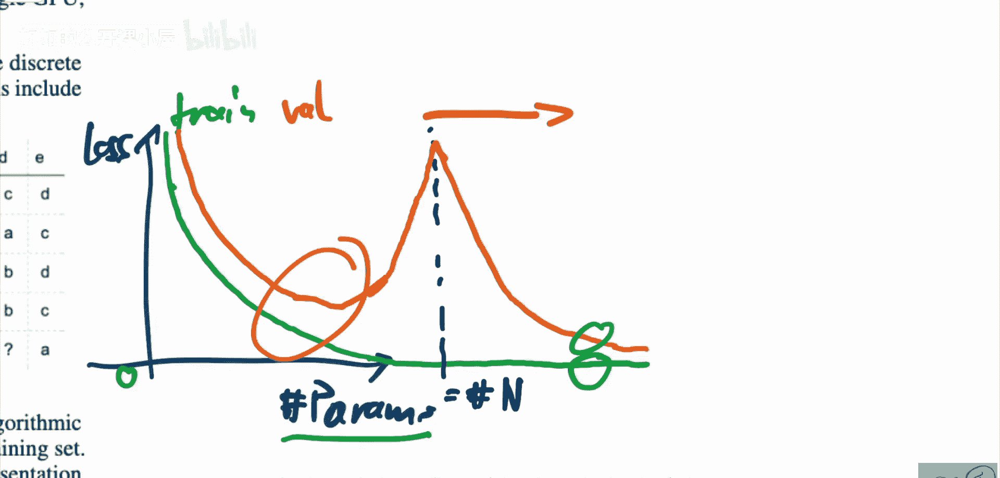

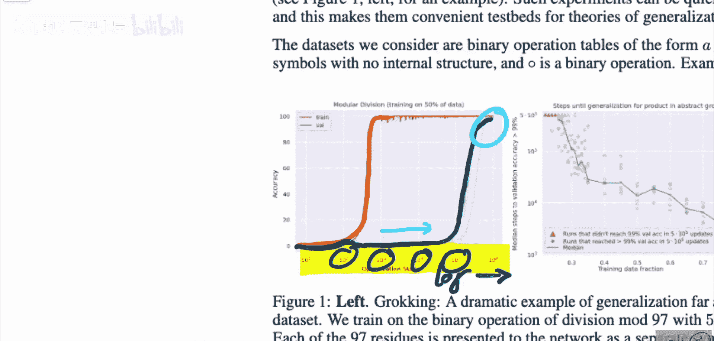

So now it's worth looking at what kind of data sets we are we are interested in here。

 The data sets are synthetic data sets in this paper。

 The synthetic data sets are binary operation tables。

 So here the data sets we consider are binary operation tables of the form a and then here this is like some sort of an binary operation a。

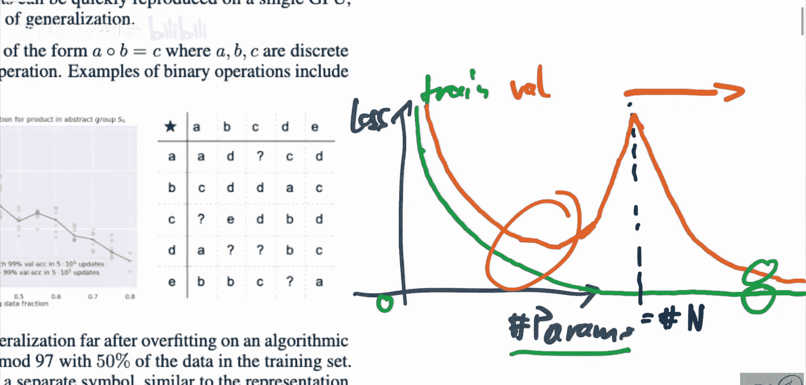

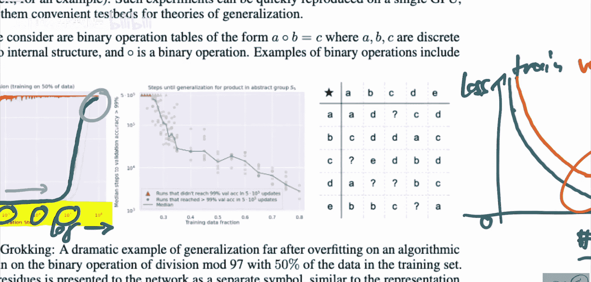

Let's just call it multiplied A multiplied by B equals C where A B and C are discrete symbols with no internal structure and the circle is a binary operation examples of binary operations include addition composition of permutations bivari polynomials and many。

 many more In fact， they have some examples， I think down here。

 So here you see some examples like addition and multiplication but also more complicated things like a polynomial that you then。

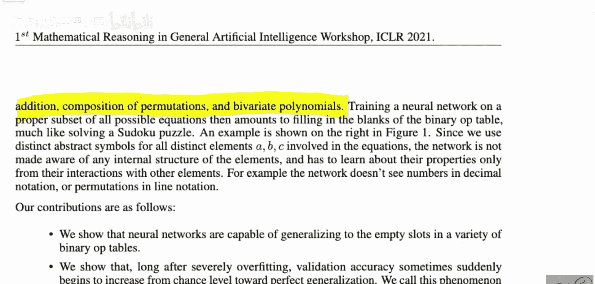

You then do modo a prime number， division modo， a prime number and so on and so。

The way you create a data is you construct a table。

 and then the table you have a number of these symbols。

And then you define binary operations by simply filling in that table so if this were I don't know。

 like a plus a plus B and A and B are numbers， then write a plus B is C if a is 1 b is 2。

 c is 3 and so on， but you can define this as。

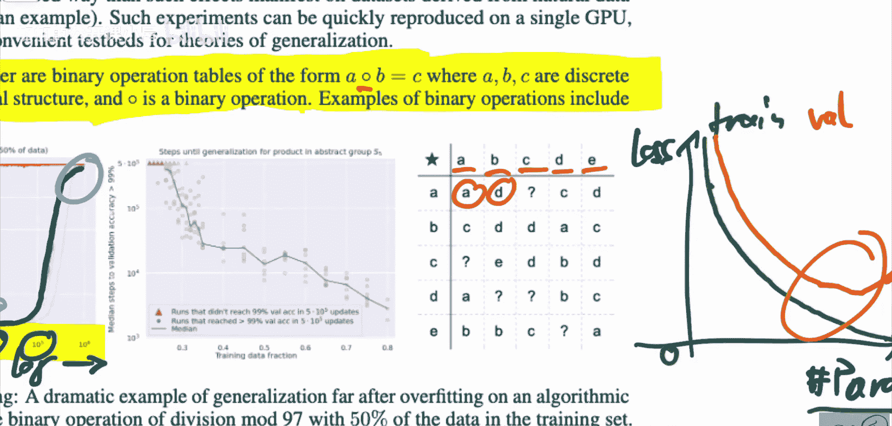

Many different things， a lot of the experiments in this paper are of the group S5。

 which is the group of all permutations of five elements。

 which I think has like so this is a group with 120 elements so your table would here be 120 by 120 and the operation would be the sort of composition of permutation so every permutation of five elements composed with another permutation gives you yet another permutation of five elements so you can just construct this table。

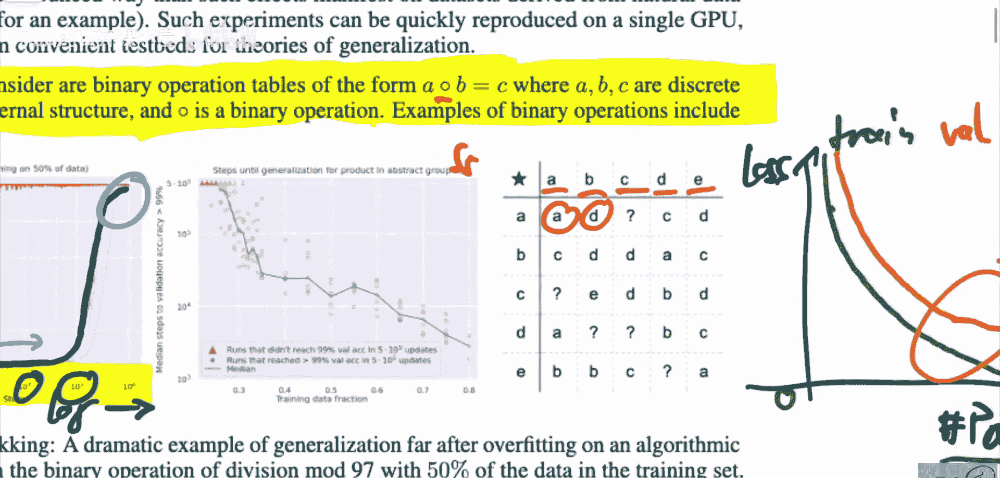

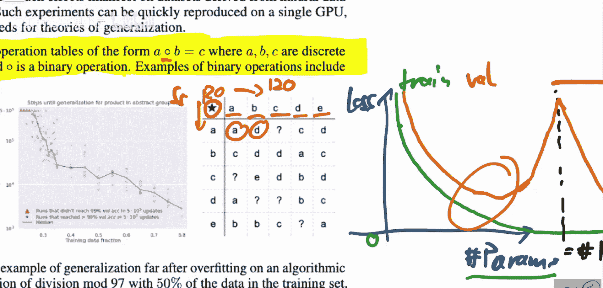

And then what you do is。