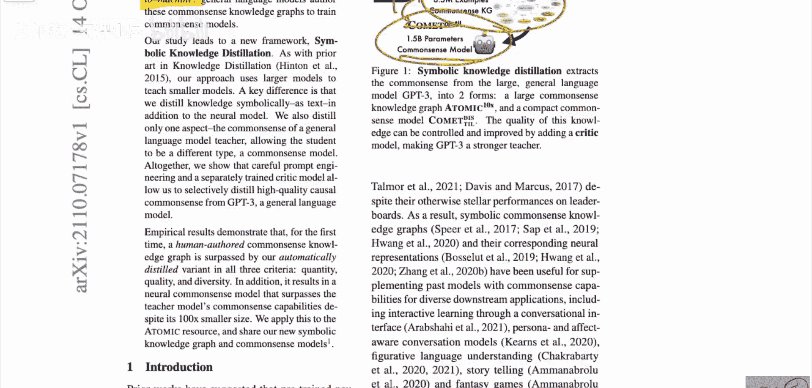
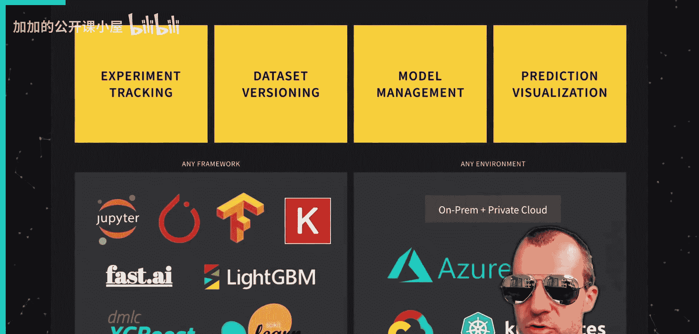
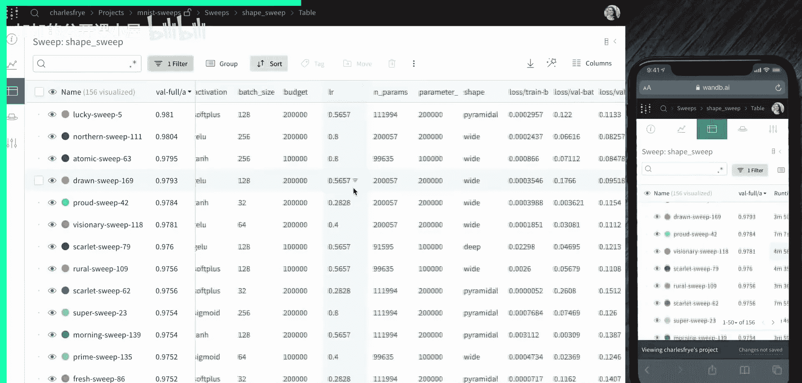
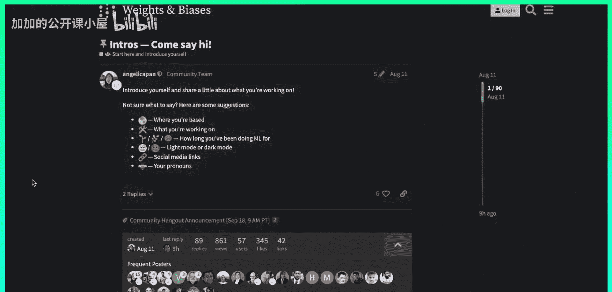
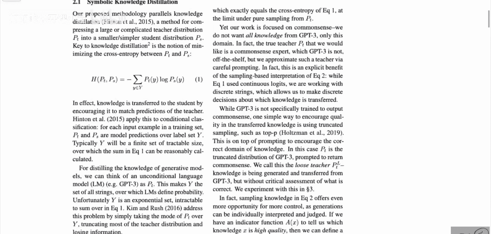

# YannicKilcher【中英⚡AI经典论文领读(全203篇)(下)｜Papers Explained】 p53 P153 符号知识蒸馏：从通用语言模型到常识模型（解析） [BV1j8x5zJEvx_p53]

Hi there Today we'll look at symbolic knowledge distillation from general language models to common sense models by Peter West and others of the University of Washington and the Allen Institute for artificial intelligence on a high level this paper takes a new approach to symbolic knowledge generation so to automatically coming up with knowledge graphs with symbolic knowledge graphs and rather than trying to mine this symbolic knowledge automatically from raw text or from existing knowledge base they mine it from GT3。

 so they use the GT3 large language model in order to first come up with a corpus that gives them a corpus of symbolic knowledge and then they use that corpus in order to train a model that they call a common sense model。

 but essentially a knowledge graph completion model So this is a new。

Paraigm where you go what they say from machine to corpus to machine and it is there the paradigm they advertise here in contrast to what people did before。

 from human to corpus to machine which is where humans generate a corpus and then you train the machine on that corpus so we're going to look in into how they do it。

 it's pretty surprising what they find in that for example， the distilled model。

 the models they come up with at the end， they tend to be better not only than the humans or the human fed models。

 they even tend to be better than the original teacher。

 the GT3 teacher and this is a result of how they combine the different elements here of the system and they strategically they strategically bring in outside help in the form of human knowledge so this could be a recipe。

For much more broad applications， not only knowledge knowledge graph generation。

 but various natural language tasks， they combine cleverly prompting。

 training small models and as I said， bringing in small amounts of human annotated data strategically。

🎼As I said， we'll go through it， well look at the different stages and yeah tell me what you think in the comments。

 subscribe if you haven't and let's dive in But first a quick word from our sponsor weights and biases your onestop shop if you're a machine learning researcher practitioner a hobbyist a power user does not matter weights and biases is with you from the inception of your idea tracking your experiments to really getting the fine details right optimizing your hyperpara up until you deploy your model and track all of your metrics not only does it do that it also organizes your data sets your models and you can generate super cool reports from all of that In addition to that it lets you have great insight into what your research and what you produce and all of this runs in the cloud really effortless with a single line of code though today I want to talk to you about a yet not so wellknown feature of weights and biases and that is the weights and biases community。

🎼So I believe they recently migrated this from like a giant Slack onto this new Sleek community website it's a discoursebased forum essentially where you can get help not only for weights and biases stuff but also machine learning in general but not only is it a help page it's a discussion forum about all things machine learning Also they organize regular events bookread groups and paper discussions and so on so if you're interested don't hesitate and hop over to the introduce yourself thread and take part in the discussion As I said this is still a pretty young place but it's bound to grow over the near future and of course if you want any advice on weights and biases how to use it what the best practices are this is the best place to do so thanks again to weights and biases for sponsoring this video it's an awesome system I invite you to check it out and back to the video。

So what's the deal with knowledge？I can't read this without pronouncing knowledge as knowledge。

 so what you want to do is you want to have symbolic knowledge and in this particular case。

 the symbolic knowledge thereafter is what they always have to have what they call an event。

And a relation。 So an event。Relation an event， they give some examples。

 but essentially the event is some kind of situation that a person finds themselves in。

 It's common sense reasoning。 So it's not like Napoleon was born in France or something like that I don't even know if that's true。

 but it's not that it's common sense reasoning。 So the event is a person finds themselves in some sort of situation or two people。

 It can can be one or two people。 Then the relation is some sort of。Well， it's probably better。

 We make an example。 The relation is some sort of。This， for example。

 this is the situation right here， x starts running。

The relation is these are predefined relations and we deal with seven different relations right here The seven relations are chosen because they represent sort of causal causal knowledge one of them is effect which means what is the effect of this event or what is one possible effect of this event and the goal of the model is to come up with this thing down here so you prompt the model by saying x starts running we have the effect relations or the model supposed to come up with the effect of starting to run now there is not only one correct example there are many correct examples right here but one example is x gets in shape this is not a direct logical you can't prove it mathematically or you can't check it and that's why it's called common sense reasoning a human would look at this says X starts running。

Is the effect of that that x might get in shape， Yes， probably， so that is a valid triple。Okay。

 let's look at another one， let's maybe take one with two people in it， no。

 there is none with two people right here。Let's see。X is not well liked， that is the event。

 the relation that we give to the model right here is the react relation。

 which means how does X react to that event？So X feels lonely。

And that as well kind of makes sense right if you you as a human judge this。

 you apply your common sense， makes sense， so I hope the task is clear given an event and a relation where the event can be any anything like anything involving X or X and y which are one or two people and any piece of text right this is any piece of text thread here。

And the relation， the relation， they are seven different predefined relations。

You have to give the result right here， the inference， and the inference again can be any text。

So this is quite a challenging task right and humans have come up with a data for this task。

 I don't know where they describe it right here， they have come up with a data called Atomic 2020 so the atomic dataset is a dataset that where humans go and humans make these triples right it's a dataset made by humans as you would make datas。

 this takes a lot of work costs a lot of money and we would like to have methods for not having to do that necessarily。

So either to cut out the humans altogether or to use the human labor more strategically。

 such that it doesn't cost as much。嗯。And they also the model that's trained on this human corpus it's called common sorry comet 2020。

 that is if we simply feed the human corpus to a deep learning model。

 have it learn to predict the inference from the event in relation that model is called comet 2020 and that's going to be our baseline and obviously we're going to surpass that so the result of this paper is going to be a another corpus called atomic 10x。

 which is 10 times the size of the human atomic data set which is going to be better or larger and with appropriate filtering。

 also better in quality than the original corpus which is surprising and then also the comet distill model which is the model that's trained on the atomic 10x data and that is going to be as well depending on the filtering。

Better than the original Comet 2020 model that's traineded on human data。

So that's the goal that we get there， we get to a model that is better than had we trained on human data。

And along we get a corpus that is better than the human corpus。

