# YannicKilcher【中英⚡AI经典论文领读(全203篇)(下)｜Papers Explained】 p55 P155 自回归扩散模型（机器学习研究论文详解） [BV1j8x5zJEvx_p55]

Hi there。 Today， we'll look at autoaggressive diffusion models by Emil Hogeboum and others of Google research。

 This paper on highlevel proposes a new type of autoregressive model。

 specifically one where variables can be decoded in arbitrary orders this is akin to the new types of diffusion models that have been used for generative models。

 and it essentially amounts to something like Bt in sequence。

 the training objective is made such that we can decode variables as we like。

 and I can show you the results。 the results are going be that we can， for example， sample pictures。

 pixel by pixel in order to make a generative model。

 So rather thanganNs which produce pictures all at once or what we had so far。

 autoregressive models but with a fixed order for example， from left to right。

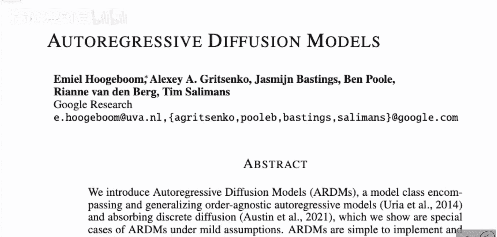

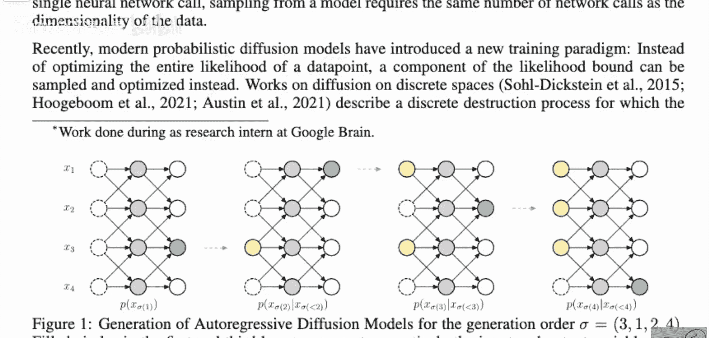

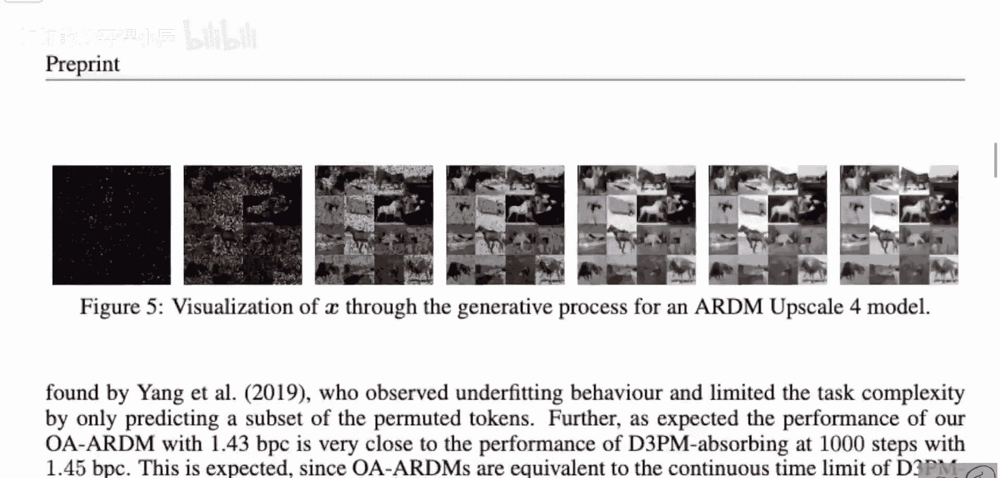

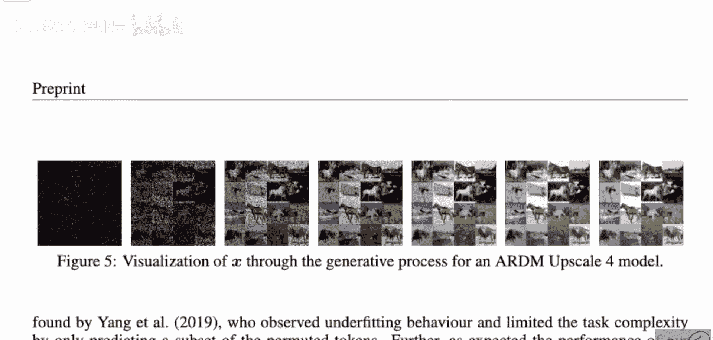

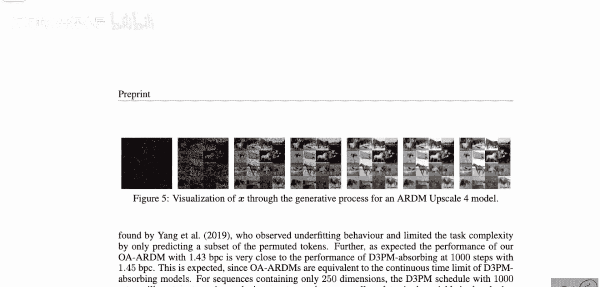

Now we can do it in any order。 In addition to this。

 they introduce techniques where you don't have to go pixel by pixel。

 but you can do multiple pixels at the same time。 and speed up by a lot。

 So this is a paper which is also community informed。 So this is a community informed paper review。

 which means that in on our Discord server， we have regular paper discussions。 This was one of them。

 I tried to pay attention I don't can't say yet whether that has worked。

 but I'm trying to try to recount here a little bit also。

 So my opinions are influenced a lot by what was said at the paper discussion。

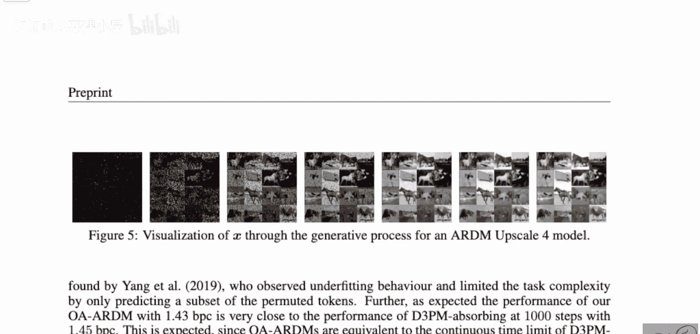

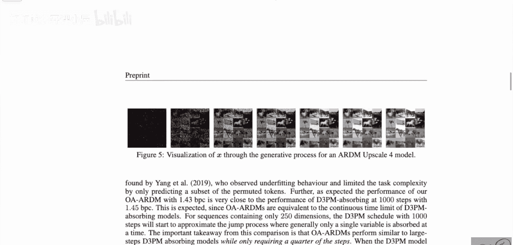

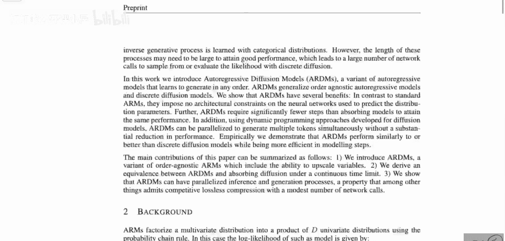

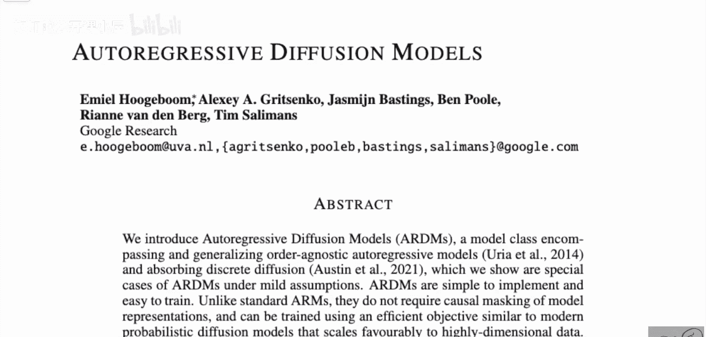

If you want to influence my opinion， feel free to join our paper discussions Okay so there。😊，We go。

They say they introduce these autoaggressive diffusion models。

 which is a model class encompassing and generalizing order agnostic autoaggressive models and absorbing discrete diffusion models。

Which they show are special cases， yada， yada， yada。

They say they are simple to implement and easy to train， unlike standard autoaggressive models。

 which you might know as LSTMs or standard order aggressivegressive models or GPT type transformers。

 these are all autoaggressive models， they do not require causal masking of model representations and can be trained using an effective objective similar to modern probabilistic diffusion models that scales favorably to high dimensional data。

At test time， the ARDM support parallel generation。

 which can be adapted to fit any given generation budget so you can trade off how long you need to produce a given sample with the quality so you can say I want it faster and you'll still get a sample。

 you'll just get like a lower quality sample。We find that they require significantly fewer steps than discrete diffusion models to attain the same performance。

 Ya， ya， they also do loss less compression with it。 Okay。

 so what's the deal with autoaggressive models， right， if I want to if I have a bunch of variables。

 let's say I have a piece of text or something like this。

 what I'd have to do is Id you know what you usually do in G， you give a prefix。

 and then you decode token by token from left to right， right。

 a cat and then the model has to predict set on the and so on。

 So you predict from left to right one by one。 that's also how you train。

 you train from left to right， you predict from left to right。

 And with text that makes kind of sense because we also read from left to right However。

 it would also make sense to do this in a different order。 So if you have a cat。And you first decode。

 let's say， mat right here。Then if you first do that， then it becomes pretty clear what's in here。

 So in order to give the model sort of the biggest freedom。

 you could let it decode in other places first， and then it could decode the mat here first。

 which would sort of determine the rest of the sentence， whereas on the top。

 the model already sort of has to have in mind what it wants to say later。

 like the fact that that there's mat here， in order to produce all of these things here。

But in in this way， the model could predict that first。

 And then the rest is sort of determined so it could impute that a little bit and。

This all of this is just to show you that is not the only way to decode left to right and even more so in something like image GT。

 So you have an image。 And in again， I produce the whole picture at at once。

 but in something like image GP what I do is I start at top left。

 And I simply start producing the pixels left to right top to bottom right That's it。

 And there is not really a reason why this is the best order to produce things that It's simply that we train in this way。

 And that means we have to predict in this way。

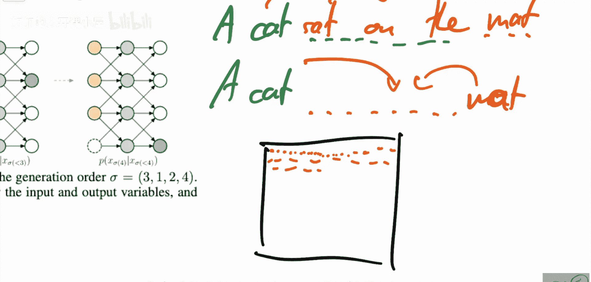

What the auto aggressive diffusion models do is they say we're going to train a model。

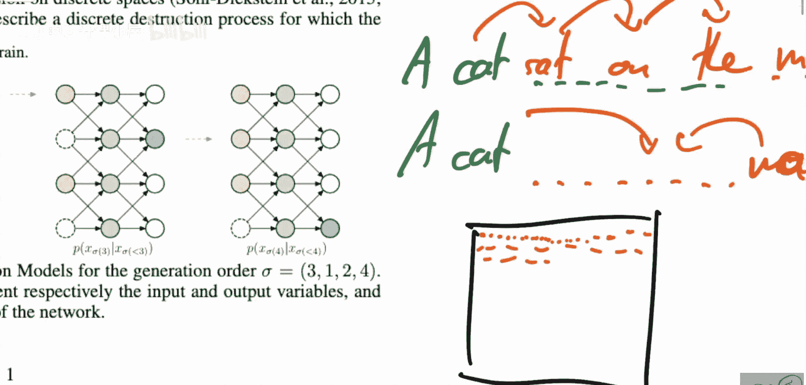

That can produce a sample in any order。

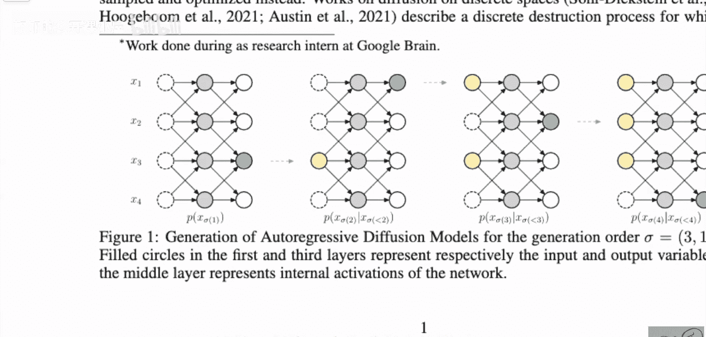

It doesn't matter which one so we could start off with like this pixel then go to this then ask for this。

 then ask for this。 We can even ask the model something like which one do you feel best about。

 like which one are you most sure about and the model can tell us and then that's the one that we could we could decode further we can also tell the model to decode like three pixels at a time and then these three pixels and so on。

 so that's the tradeoff I mentioned。

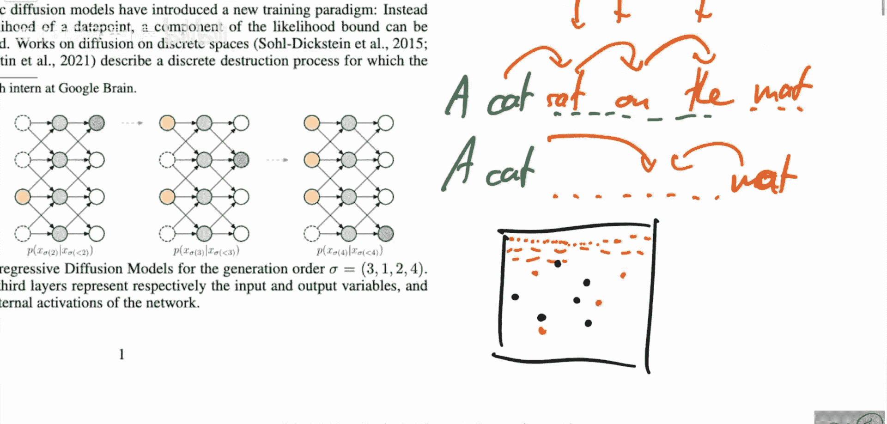

So this is how it looks in practice。 What you're going to have is you're going to have a。A neural。

 So here the vector is your sample， right， and usually you would decode top to bottom。

 That's sort of the analogous to left to right。 That's what you usually would do。 However。

 in this model， you can see first， it's empty。 So nothing is decoded yet。

 You have your neural network， you have your predictor， let's say that predicts a distribution。

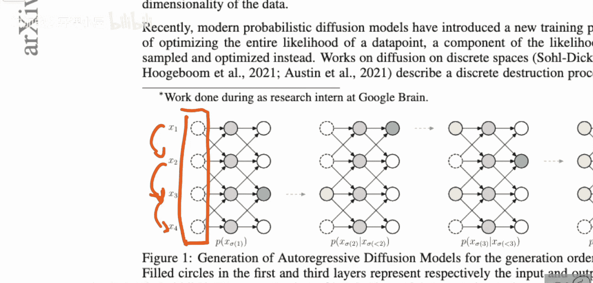

So for every single item in the sample， it predicts a distribution。

 So these here are categorical variables。 So it's going to be predicting a distribution。 and so。

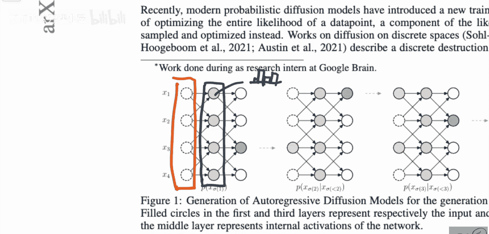

All of these， for example， if the years are pixels， all of them predict a color。

 So prediction is made for the whole image and not just for the thing you want to decode。

 And after that， you decide on one of them that you actually want to decode。

 you sample that or you take the the maximum class or whatever。

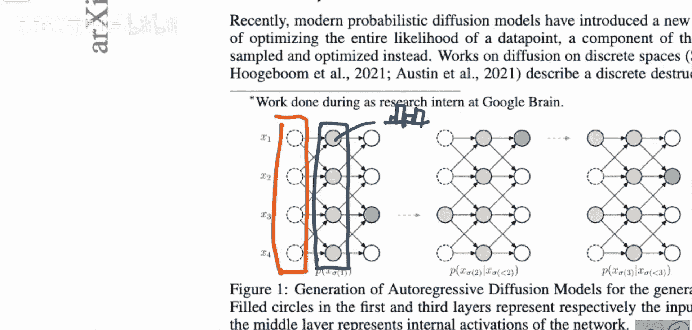

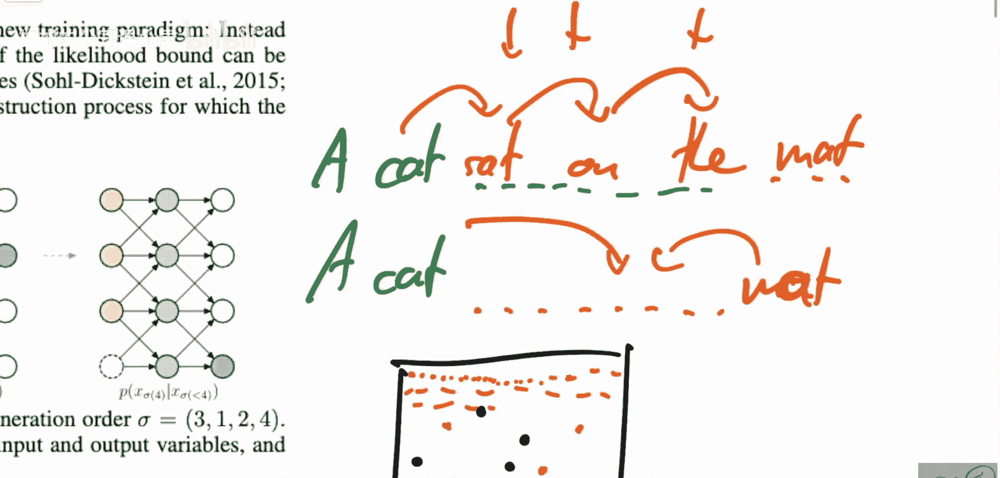

And then you continue right， then the next step， so in the next step you have the same sample。

Except that one of the values is now already decoded。 the other ones are still empty。 Again。

 use a neural network to predict a distribution for the entire image。 We'll see that， you know。

 for technical reasons， even this here is actually predicted。 It doesn't need to be， but。

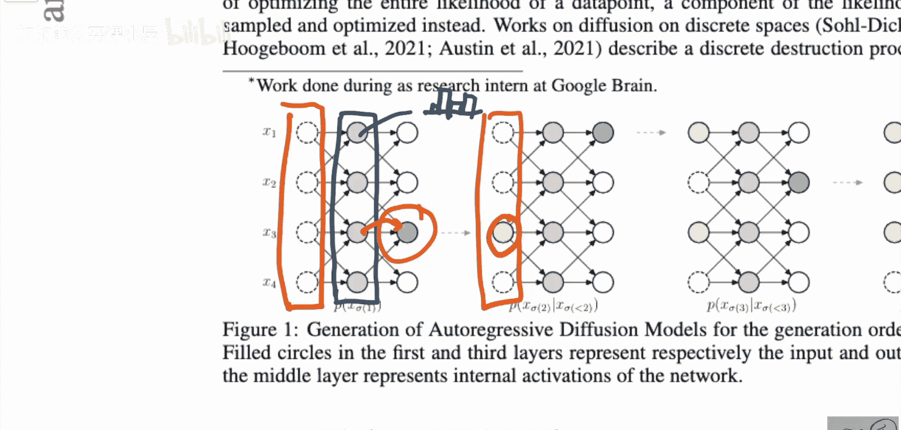

The important part is that you're going to predict the entire image at once。And then you decide to。

 again， decode one of them。 that's your choosing。

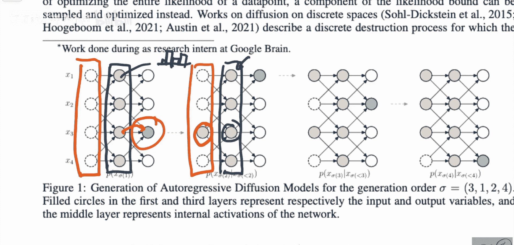

So this one。 and you can see that， you know， this， how this goes on。

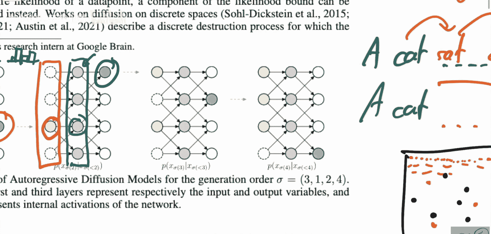

Specifically， which ones you decode decode is given by a， by this thing right here。

 This sigma is a variable that stands for a given permut。 So what you would do is if before。

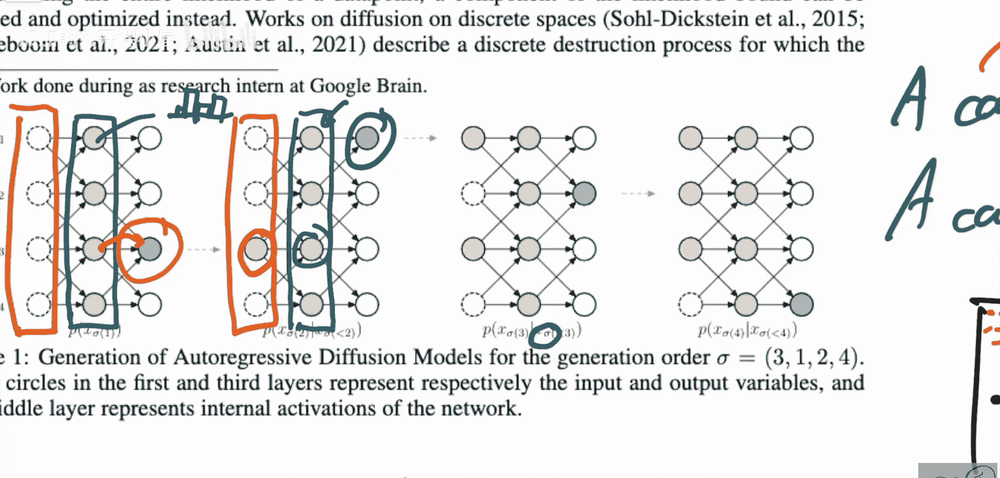

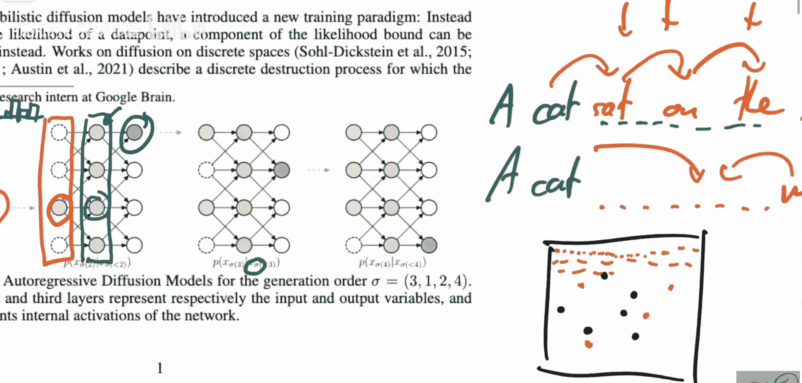

Before you sample， you can select a permutation。 you can say here is the the order in which I want to decode。

 and then you decode according to that。 but in my mind。

 it doesn't matter even if you decide on the fly， so you can decide on the fly。 You know。

 here is here's my desired order。 I want to decode in that way。

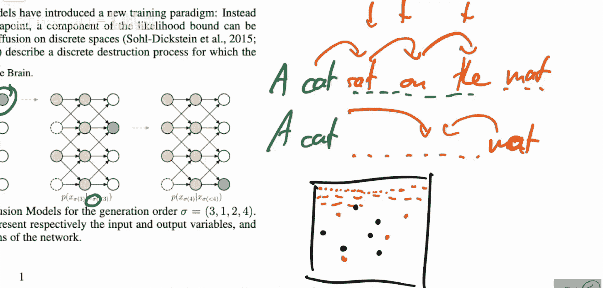

Now， if this seems familiar to you， if you have seen a model something like this already before。

 then if you're thinking of Bt， you would be sort of correct。

 So even the paper says that this is kind of like you take the Bt model and you just kind of stack it or you just repeat it。

 notice the。

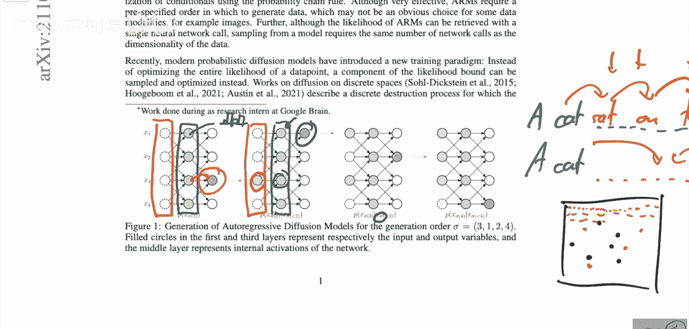

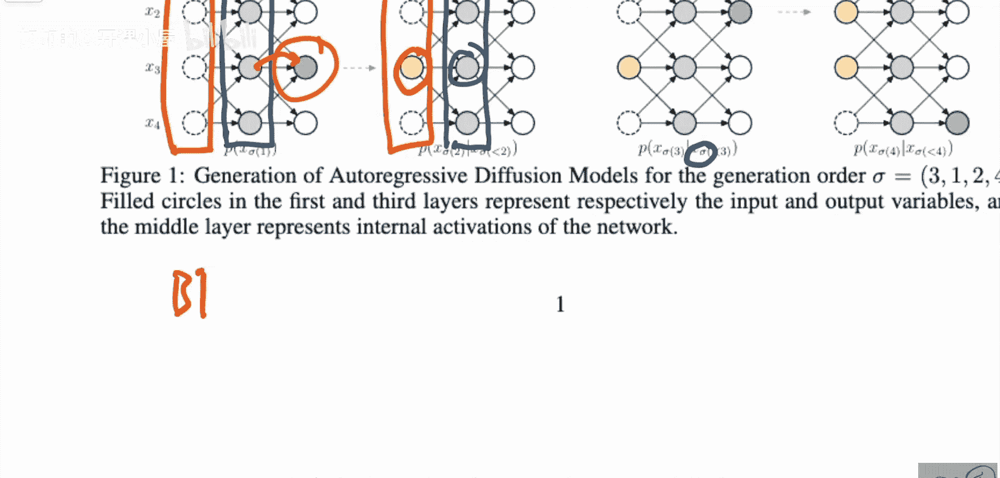

This here， these are always the same neural network。

 So the same neural network will predict every single step right here。

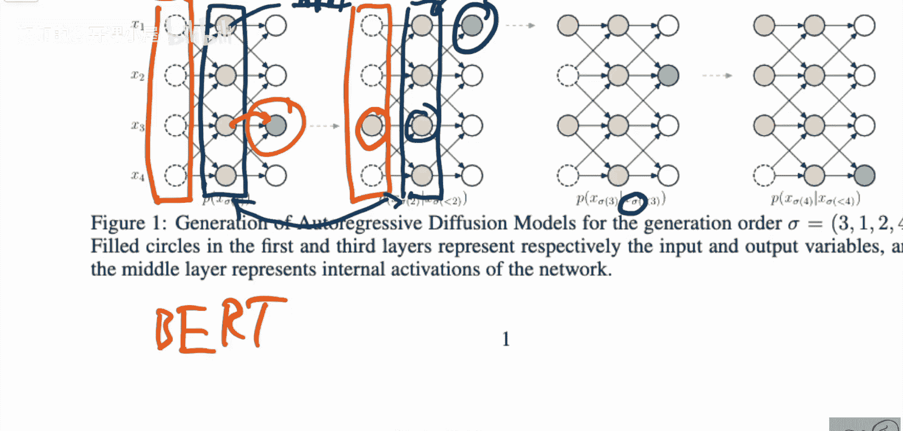

That's why it's an auto aggressive model， right， because you input the output into the same neural network again。

 So what do you do in Bert， You have a bunch， you have a sentence， right。

 A cat S on if you do masked language modelling， you put that through the neural network， right。

 That's Bt。And out comes one sort of output per token。Now what you do when you train Bt。

 you mask some of the tokens， right， for example， this one and this one。

 and then Bt predicts these bird predicts these at once。

 this one and this one and what you want to do sorry， Bt predicts these tokens at once。

 and that's a categorical distribution。

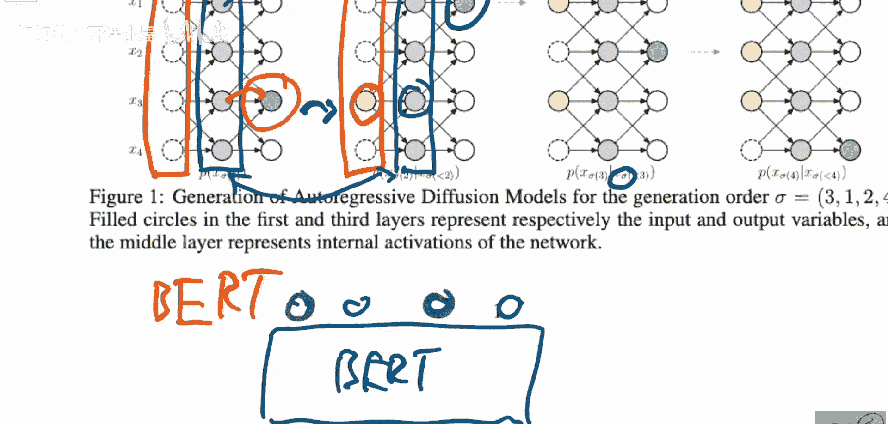