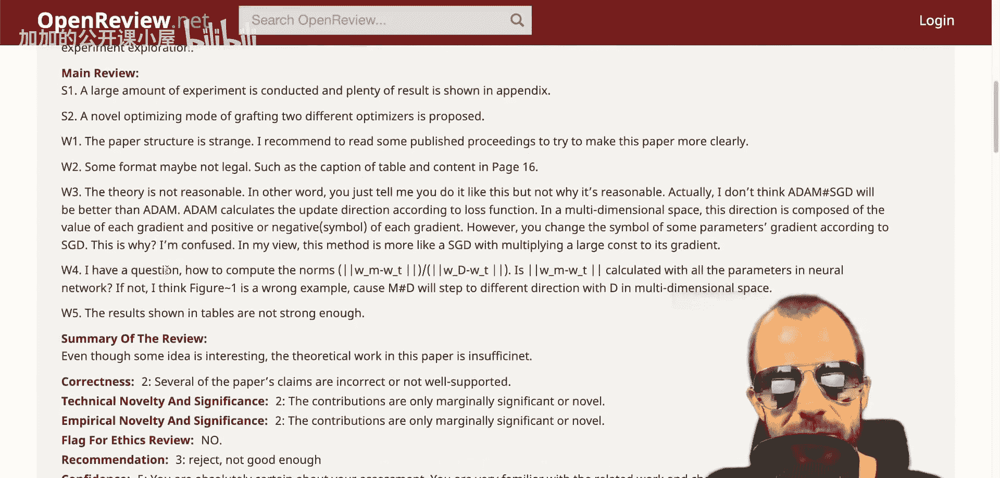
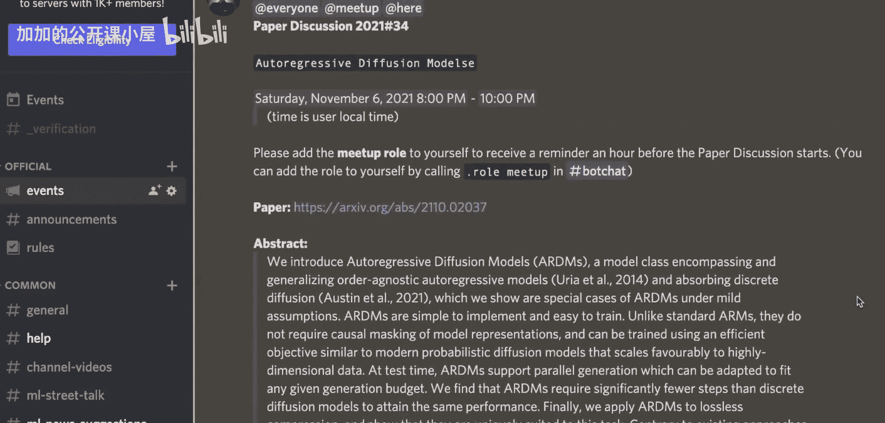
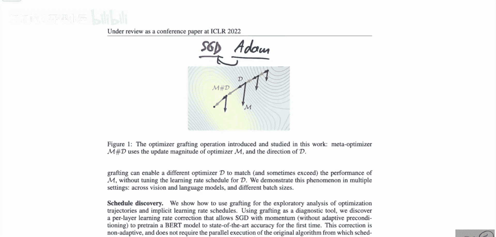

# YannicKilcher【中英⚡AI经典论文领读(全203篇)(下)｜Papers Explained】 p57 P157 学习率嫁接：优化器调优的可迁移性（机器学习研究论文评述） [BV1j8x5zJEvx_p57]

Alright， so I just got done making a video about this paper and I was trying to upload it。

 So I looked at the open review page and I read the first review。

 and I just thought I had to show you this。 Now， before you see the review of the paper。

 but just look at this review。 So the paper is about optimizer grafting。

 It's about transferring the learning rate of one optimizer to another optimizer。

 It has some experiments in it and proposes this algorithm to investigate sort of learning rate schedules。

Okay， main review， S1， which I guess is strength 1。

 A large amount of experiments is conducted in plenty of results shown in the appendix。 Okay。

 as to a novel optimizing mode of grafting to different optrs is proposed。 Go。

 So you know a little bit about what's in the paper。Weakness 1， the paper structure is strange。

 I recommend to read some published proceedings to try to make this paper more clearly。😊。

What just to say these， these are accomplished researchers right。

 that are the authors of this paper actually show who the authors are is the structure is straight。

 I recommend reading， you know， read a bit。 maybe， maybe a book， maybe， you know， you'll。

 you'll learn something。 weakness to some form it may not be legal， okay。😊，Weakness 3。

 the theory is not reasonable， not by the way， the paper proposes no theory。

 The theory is not reasonable。 In other words， you just tell me you do it like this。

 but not why it's reasonable。 Okay， I mean， that is a， that is。

 even though the paper explains clearly why they do everything that might be a criticism like you haven't really given a theoretical foundation for your reason。

 But then actually， I don't think Adam grafted onto S GD。 So this is the new method they propose。

 It's S GD with the learning rate of Adam。 Actually。

 I don't think Adam grafted onto S GD will be better than Adam。

Notice this is what they show in the paper that they make experiments to show that this is the case。

 And it's not like this person has tried it out and has said it doesn't work for me or it doesn't work in this other paper。

 No， no， no， no， the entire thing that this person says is， I don't think this will happen。

 No reason what。Why， what is this， This is， this is the type of reviewers that people have to fight with。

 And then there is like some herbeity， Herbeity， Herity Herbeity。 I'm sorry。

 if they show in the paper that this is the case， then either you claim they are lying。 and。

 or you have conflicting evidence or anything like this。 But simply sitting here saying。

 I don't think so。What， what？I mean， a。Then， a week。Why this， this is， this。

 this is why I'm confused。 In my view， this is method is more like an S GD with multiplying a large constant to its gradient。

 I mean， at the end， that's what it is， but。Like has this person actually read the paper， weakness 4。

 I have a question。 That's a weakness。 A weakness is。 I have a question。How to compute the norms。

How to compute these norms？It's norms like the paper clearly like they don' okay。

 they don't say it's L2 norms， but they clearly， you know， how do you compute the norm of a vector。

Is this calculated with this is answered in the paper。 This is clearly answered throughout the paper。

 If not， figure one is a wrong example。Well， it's， it is。 So it's。

 how is it a weakness if you have a question that is answered in the paper and then weakness 5。

 the results shown in tables are not strong enough。Right。

 a large amount of experiment is conducted and plenty of results is shown in the appendix。

 The result shown is not strong enough。Well， what， what do you mean， Not strong enough。

 Like not highly performant enough， because that's not what the paper is about。 Not strong enough。

 You mean not enough because。Well， the other reviews。

 it's not like the other reviews are necessarily good reviews of the paper。

 but at least they have some criticism like， hey， you， you know。

 you're not theoretically motivated or something like this。 And， and， and they are a bit extensive。

 But I'm like this is what this is。You know， it's it's it's I guess， you know。

 if you're some company researcher and so on， you know。

 your bonus might depend on a submission being accepted or not， which you know。

 if you're at Google or so， I mean， you're doing well right but if you're like a PhD student and you need to get papers accepted in within a certain amount of years and then I don't think that well you clearly show in the paper is the way it is because I just pull it like somewhere out of here。

Okay， enough of me ranting， let's go into the paper。 by the way， I make one mistake。

 I make one mistake in the paper， which is kind of similar to what the person is here。 So I。

 there is a diagram。 And I'm gonna there just gonna describe it right here where I。

 where I say there there's an arrow like this and an arrow like this。 And I say， well。

 the combined update step would be something like in the in between， which is， is not the case。

 it would be actually one of the arrows just rescaled arrow up。 okay。Bye last thing。

 this is the best I forgot。Confidence， you are absolutely certain about your assessment。

 This is the highest score。 This is the reviewer rating themselves。

 You are very familiar with the related work and checked the math and other details。 really。

 because here it says， I'm confused。 And I have a question。😊。

The following is a community inspired paper review。

 which means that we have talked about this paper in our discord paper discussions。

 We do this regularly， and I can take a lot of good opinions from there and bring them into my videos。

 If you're interested in joining these paper discussions。

 join our discord and watch the events channel。 Hi there。 today。

 we're going to look at a paper by Naman Agarwa Rohan Anil， Iad Hassan， Tom Kran and Cyil Chung。

 but it is not the paper that you see right here。 see this paper is called disentangling adaptapive gradient methods from learning rates。

 and it's on archive with the authors。 Now， allow me to present this paper right here under review at ICl with anonymous authors that's called learning rate grafting transferability of Opr tuning。

 Now， suspiciously， the two papers have pretty much exactly the same content。 So， you know。

 save to assume that we。😊。

Might make an educated guess about who these authors might be I'm going to review the obviously newer version because newer is always better so what is this paper about this paper is about a technique called learning rate grafting and grafting means that we transfer the learning rate from one optimizer to another optimizer。

They have a bit of a graphic right here， so what we would do is we would take two different optimizers and think of things like SGD or Adam or something like this。

These are fairly popular optimizers in deep learning。 We would take one of them。

 and that one would give us the information of what the direction of updates of our weight is。

 So's let's actually say S GD here is this purple one in this direction。

 You can see that will follow in general， the direction that S GD tells us to go。 However。

We don't go exactly what SGD， we don't do what SGD tells us to do instead of we take the learning step size or the learning rate from atom and we go that far。

 so one algorithm dictates where we go， the other algorithm dictates how far we go。

And what this does is it implicitly transfers the learning rate schedule from one optimizer to another optimizer。

And as a result of this， many， many things happen。One simple thing that results from this is we're able to investigate some of the differences between the optimizers。

 Surprisingly， one of the things that this paper finds is that maybe the different optimizers it's a bit over let's say over described overhyed what the differences really are between them a lot of times it simply comes down to the learning rate schedule that the optimizers induce and as soon as you transfer that to another optimizer。

 the other optimizer will perform just as well。 So the differences between a lot of these optimizers might just come down to the learning rate schedule。

Another thing that they can do is they can， for example， transfer these learning rate sorry。

 adaptations that want us to the。

