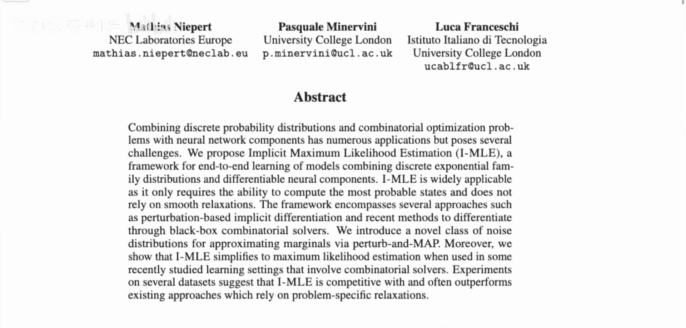
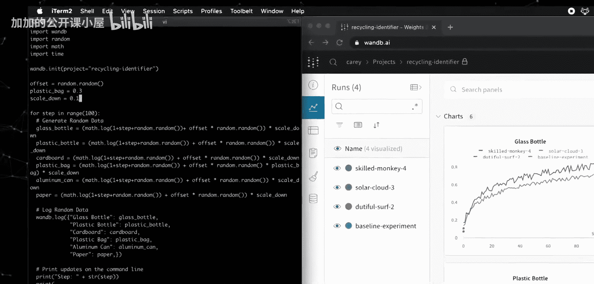
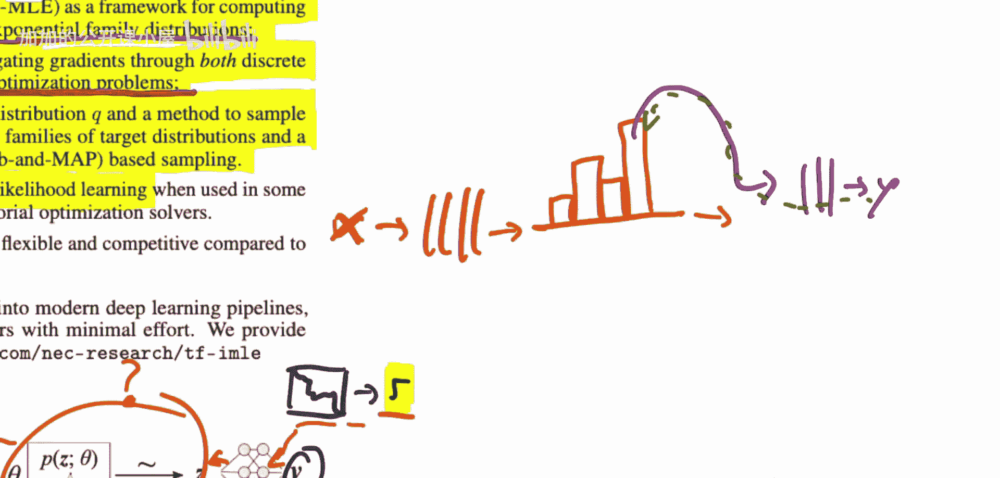

# YannicKilcher【中英⚡AI经典论文领读(全203篇)(下)｜Papers Explained】 p58 P158 隐式最大似然估计：通过离散指数族分布进行反向传播（论文解读） [BV1j8x5zJEvx_p58]

Hello there today we're looking at implicit MLE back propagating through discrete exponential family distributions by Mataniard。

 Pascal Minervinni and Lucca Francessky This paper is a paper that we've discussed in our regular paper discussions on Discord and so it is informed by everything that I have heard there if you want to take part in these discussions and influence my opinions you're very welcome to do so the link to the discord is in the video description All right let's get into this paper right now this paper proposes essentially a discrete layer for neural networks。

 this is maybe how I can describe it and the basic setup is in this figure right here so let's say you have an input X which might be some sort of a continuous input like an image they do give an example by the way the authors they have quite helped。

F code that's available but also they have made themselves a little video about the paper and I also recommend that you go watch that video because it's quite helpful so what they give as an example in the video which I find a good example is you have a map of and they use I think they use even warcraft maps but you have a map and you know there's like a lake somewhere and then there's like a little little house right here and so on your task is to go from the top left here to the bottom right so you need to plan your way somehow through that now you don't get this as a graph that would be directly input into dike Strs algorithm however you get this as an actual image right。

Yet the， the。The solution here is going to be some sort of a path， some sort of a gold path。

 that's the label。Or maybe something even derived from the gold path like how long the gold path is。

 so maybe that's five long or something like this so it's very complicated you first need to recognize where can I even go based on the image on the left then you need to find the shortest path based on you've determined where to go then you need to evaluate based on that shortest path you need to evaluate some property for example。

 as I said how long is the shortest path or just you know follow the shortest path on the actual map。

So it's a mix of continuous and discrete elements and specifically the part in the middle that's described by this P of Z right here。

 that is going to be some sort of a discrete solver。

 in the case here it's going to be a shortest path algorithm。

Now the question is how can we run back propagation if we only have the label on the right hand side。

 how can we back propagate， I mean we can back propagate from the label through here。

 right this is a neural network that maybe determines some property of the shortest path but then how are we going to back propagate through this layer right here back to this neural network that's supposed to extract the input graph to the dixter algorithm from the image。

And that is a challenge， there have been some solutions already， for example。

 some one famous example is a score matching， sorry， that is also an example。

 but the famous example is the straight through estimator。However。

 that it doesn't always work it fails sometimes And specifically here the authors propose a different framework in this implicit Emily framework。

 I'm going to look at how that's built up。 this is a very technical paper and I'm by no means an expert in these things。

 I just try to give you a little bit of the idea of what's happening right here。

 so that you know what's going on。 and if you have something like this in your neural network like a combinatorical optimization solver or anything like this。

 then you can just go grab their code and use that as a layer。 It is really super simple。 All right。

 that was the overview now let's get into the paper。 Hol on。

 This video is sponsored by weights and biases。 weights and biases is your one stop shop for all your machine learning needs。

 It will track your experiments with a single line of code。' upload automatically all your logs。

 all your configurations， everything。

Your cloud， it will automatically grab all the output， all metrics。

 all the configurations of your experiments and store that in one neat location so you can see your experiments you can track them wherever they run you can compare among the experiments but you can go further you can then tune your hyperpara according to the results of those experiments and all of this is done automatically in a distributed way you can literally sit on your toilet on your smartphone and tune your hyperpara and start new experiments but it's not only experiment tracking and hyperparameter tuning weights and biases has tools for the entire pipeline of machine learning research from the initial idea up until the deployment and beyond that when you actually want to track what you've deployed weights and biases has cool methods to track all of your data and their dependencies to each other as well as your models and all kinds of other artifacts that you might produce the very powerful visualizations for all the inputs and output。

Of your pipelines as well as the models themselves All of this runs in the cloud。

 but if you're concerned about privacy there are options to selfhost the system is free for personal use and for academics and they have great plans for enterprises Small teams large teams doesn't matter So thank you very much Waits and biases for sponsoring this video if you don't know them yet absolutely check them out It's free it'll make your life a whole lot easier Now let's get into the video。

As I said the the。The problem right here is that you have these kind of discrete tasks sometimes as a part of an entire learning setup。

 so the paper makes different contributions but here are they here they're listed out they say we propose the implicit maximum likelihood estimation as a framework for computing gradients with respect to the parameters of discrete exponential family distributions so what we want is of course gradients gradients of this discrete process in the middle and the discrete process specifically is going to be formulated as a exponential family distribution and we're going to see how that happens。

They say we show that this framework is useful for back propagating gradients through both discrete probability distributions and discrete optimization problems。

And that would be the example right here would be。A distar short path algorithm or an integer linear program solver or anything like this。

 in fact， one of the general formulations they have is for integer linear program solving。

IME requires two ingredients， a family of target distribution Q and a method to sample from complex discrete distributions we propose two families of target distributions and a family of noise distributions for gumble maxbased sampling so we're going to look into how that works and exactly what it contributes and then yeah we show that this simplifies to explicit maximum likelihood learning when used in some studied settings experimental evaluation these points we're probably not going to go into too much essentially in  point。

4 they show that for some settings this reflects already established methods so it's in sort of a generalization of methods that have already been around of methods that are maybe specific to a given setting or problem and the experimental results well。

You just like their experimental results essentially show that their method， for example。

 outcompte the straight through estimator method。 So what's the deal with discrete things in neural networks。

 the problem is of course that we can't compute gradient with respect to discrete things now take for example the straight through estimator the problem it's trying to solve or one of the problems you can formulate like this you have some X you put it into neural network and out in the middle somewhere。

You are required for some reason to sample from some sort of distribution， for example。

 you're required to this produces a probability distribution over a few classes。

 let's say over four classes。And then what you're going to do is you're going to sample one of the classes right here。

 and then you're going to continue with that through the the rest of your neural network until you're at the label。

Now， again， as before， you need to back propagate in order to learn through this network。

 which is easy。But through the choice through the sampling procedure of that inner layer and that's hard。

 So what the straight through estimator does is it's a bit of a trick it essentially in the forward pass。

 you do the discrete optimization， you do the sampling but the。

