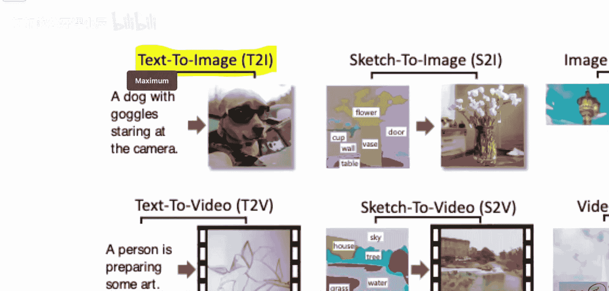
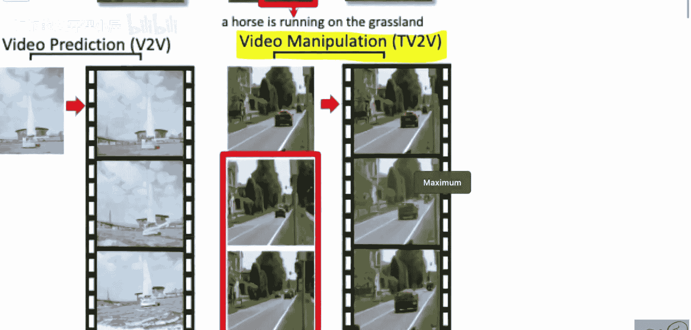
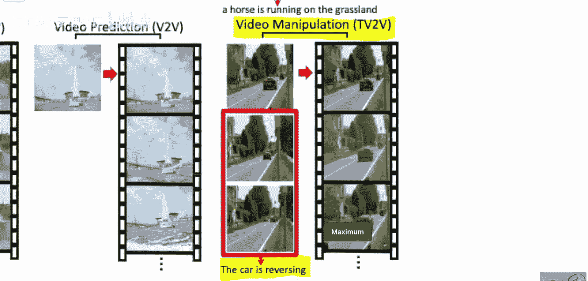
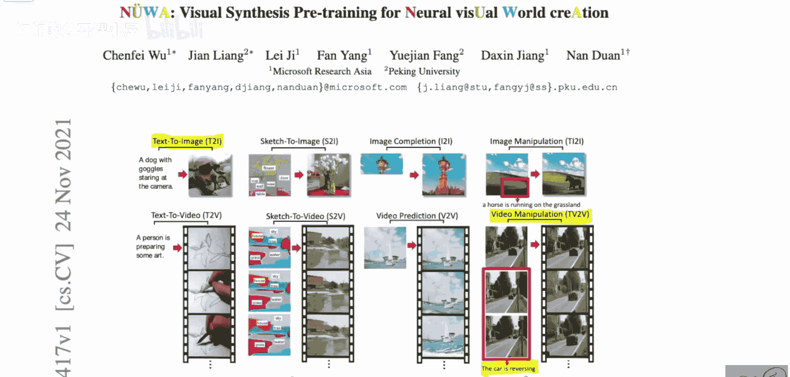
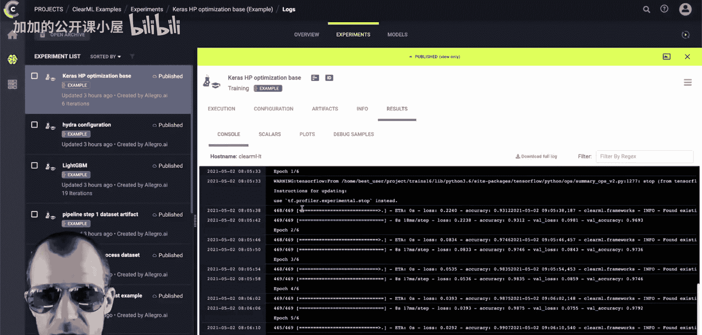
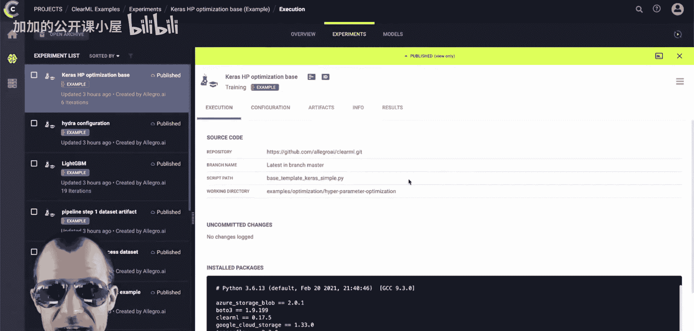
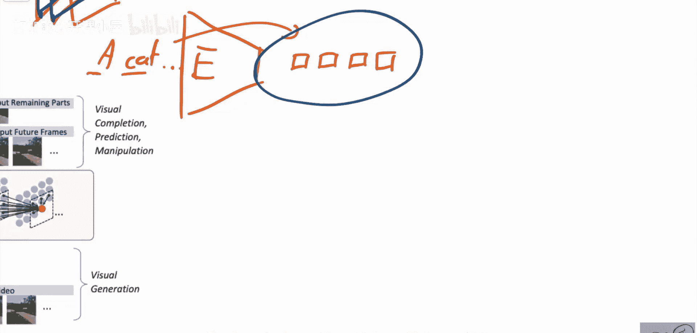

# YannicKilcher【中英⚡AI经典论文领读(全203篇)(下)｜Papers Explained】 p60 P160 NÜWA：面向神经视觉世界生成的视觉合成预训练模型（机器学习研究论文解读） [BV1j8x5zJEvx_p60]

Hi there。 Today， we'll look at newa visual synthesis pretraining for neuralvisual world creation。

 This is by researchers of Microsoft Research， Asia and Peing university。

 The paper presents a model that can support a wide variety of image generation tasks。

 such as text to image where you give a piece of text， and you get an image。

 This is a dog with goggles staring at the camera。 up to something like video manipulation。

 where you want to change the frames of a video according to a piece of text。 For example。

 the car is reversing instead of the car is driving forward。 Now。

 you see there's not always text in the loop。 Sometimes it's just an image。 Sometimes it's a sketch。

 Sometimes it's just a video。 So all of these kinds of tasks are supported by this model。

 And this paper goes into how the model's architecture is done。😊。

Specifically how the a transformer architecture， essentially an attention mechanism is able to handle such large data points。

 essentially contexts not only going to images， but beyond images to multiple frames of video。 Hey。

 this video is sponsored by clear M clear M is an Mops stackack that is fully open source。

 It can do experiment tracking。 experiment orchestration deployment。 It has model and feature stores。

 It is a complete package of M tools。 Now what I want to highlight in particular here is this selfhoed tier。

 Selfhoed is a first class citizen for clear M。 Everything's open source。 Therefore。

 you can look at it， you can audit it， you can extend it however you want。

 and you can host it on your servers。 There's also a free tier that is available in the cloud。

 So you can get started with whatever you need in the cloud。 And then once you need more features。

 you can go to a more professional setup if you don't。😊。

🎼On a self If you love open source， then clear ML might be the way to go。

 It is an endto end stack from experimentation all the way to serving。 It's vertically integrated。

 makes your life a whole lot easier and it is appropriate whether you're an individual running experiments or an entire team Now one of the core pieces of clear M is of course their experiments tracker It's super easy to set up it needs like a single line of code I guess that's two lines but who cares it integrates with pretty much any tool there is and not only does it record your metrics like you're used to it also fully grabs all the console output of your experiments it grabs any artifacts that Iran might have produced and most importantly it clearly records not only your hyperpar but also the other parameters of your environment such as the path and the machine you ran it on and your dependencies Another really cool feature is that it allows you to compare different experiments for example here。

🎼Shows you what part of their configuration was different so you're able to pretty quickly figure out what made the difference in any particular run and of course you can grab a bunch of experiments together and then analyze them next to each other So now there's no excuse anymore for blaming your tools any fault in your machine learning project will be yours and yours alone if you use clearear ML isnsn't that a promise So I invite you to go over and check it out at cleareardot ML and thanks so much to clearearMl for sponsoring this video and let's get into it。

So yeah， we'll go into the paper。 We'll see how they do it。

 I do find this opening thing right here is a little bit overstated because a lot of these things aren't coming out of the same model but the model is then fine tuneuned on different things and I also find the papers a bit unclear on some of the details and if I understand correctly。

 there is no code yet that we can look at， maybe that's going to be released。

 maybe not who knows to the name Nua is you know theres thisummlaud， which we do have in German。

 but I don't believe this is a German German inspired name or any sort of Nordic language I do believe this comes from the symbol in Pion that has also is represented as anummlaud on the U it took me like so long to figure out that you have to type a V。

to get that output。 I I just couldn't spell words like new for a long time。 but now I can。

 So I do believe this is pronounced newa， but correct me if I'm wrong。 Also， many thanks to Andreas。

 who helped me prepare this paper a little bit。 gave me some inputs。 This is very much appreciated。

 follow Andreas on Twitter。 You also often posts updates for our paper discussions on Discord。

 So very helpful。 Thank you。😊，Al， let's get into it。

 So this model is something like an image G model。 If， you know。

 image G image G is essentially similar like a pixel or an N， where you have an image。

 You want to produce the image， sort of pixel by pixel left to right top to bottom。

 You produce just one pixel after another after another after another。

 And you learn this how you would learn a language model， essentially， just pixel by pixel。

 and you can support tasks like completing images where you simply give。You everything here。

 you are already set pre computed， and you simply let the model infer these pixels right here。

 or you can support things like image manipulation by simply you have a picture right here and。

Or I'd say， that's the cat。And you simply cut out part of the image。

 So you cut out this part or something。 you let the model fill it in so you could do things like in painting or something like this。

 This is supported by image G。 Now the problem with something like image G is that if you want to have this as sort of a language generation task then your context size is if you predict the pixel on the bottom right here。

 the context is like all the pixels in the rest of the image that you've already generated and if you have something like a 200 by 200 image that is 4000 previous pixels。

 Now4000 is just about No is it it's 40000 sorry about that 40000。

 that is definitely outside of the scope of every transformer that we have and beyond。OnThat。

 if we now look at video and video is essentially just a stack of images， right。

 So you have an image frame。The next frame and the next frame。

 if you look at that if you want to produce a single pixel right here。

 not only do you have to take into account all of the pixels of the image that you've generated so far。

 but also all of the pixels of the previous frames that you've generated so far And that definitely blows the context of any transformer。

 that is infeasible。 So this model here very much is about how do we make this feasible。

 the answer is going to be twofold。 First of all， we're going to encode all of the data into a common space that is kind of discrete in latent space and is way less dimensional and the second answer is going to be we're going to use local attention in order to work in this latent space and finally generate the output。

So this is an overview over the model， I do find it a little bit lacking as a picture。

 but you can see that in general we use these encoders and the encoders。

 they take care of bringing the data， whatever the data is into a common representation right here the common representation is going to be a essentially a three dimensional cube where each element is an embedding vector。

But we're going to look at that。Now。So how do we encode text， Our goal is to。

 our goal is going to be to have a latent space to have an encoder for any kind of data。

And after the encoder， the data should be in sort of a latent space。 and that latent space should be。

If possible， kind of discrete or quantized and we' going to use we're going to use some methods that already exist。

 But for text， that's pretty easy。 for text， the encoder is simply it can be the identity function。

 right， because if I have a piece of text like a cat。Whatever。If I tokenize that text。

 that is already tokens。 So right now， if we make， if we do a language modeling or any sort of language processing。

 the first step is tokenizing the text and then associating each token with an embedding vector。

 So this is going to be nice。 It's going to be a set or a sequence of tokens。

And that's exactly the representation that we want。 So for text， everything is good。

 We have a sequence of tokens。 We have a code book， usually， which is sometimes。

