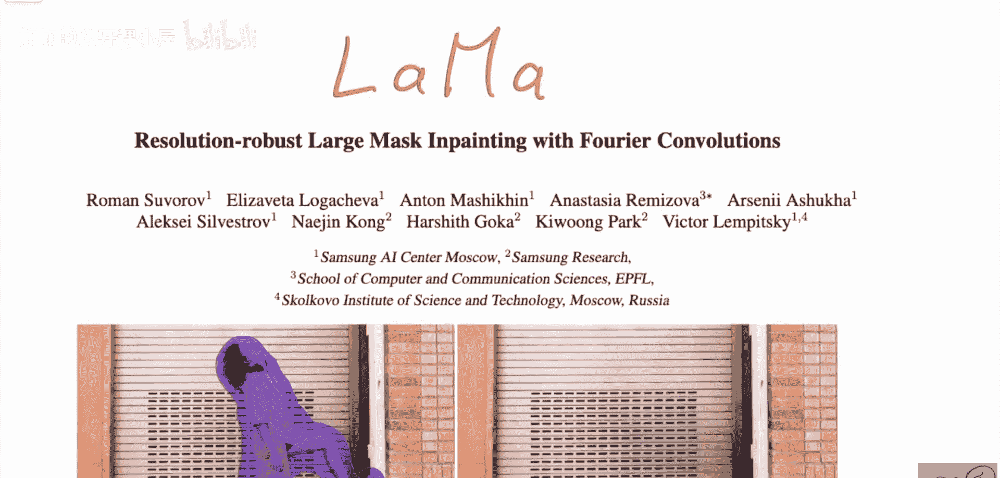
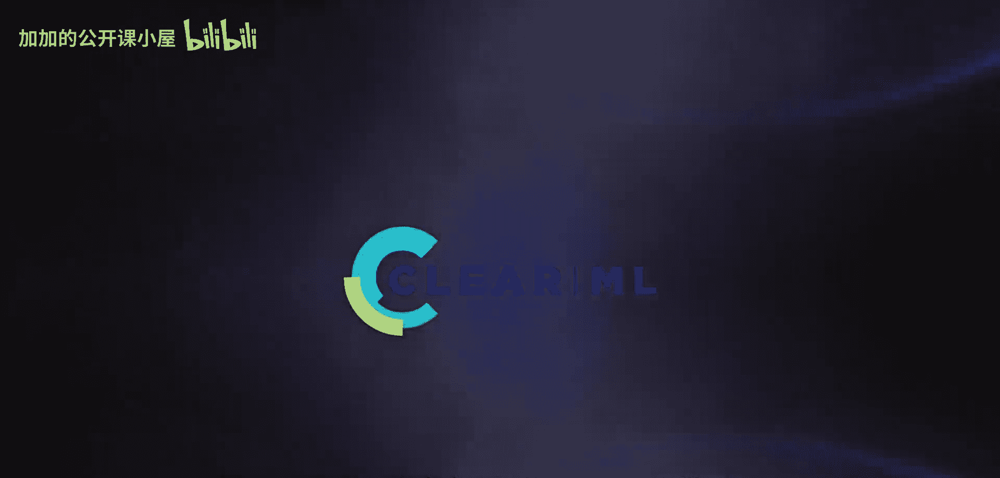
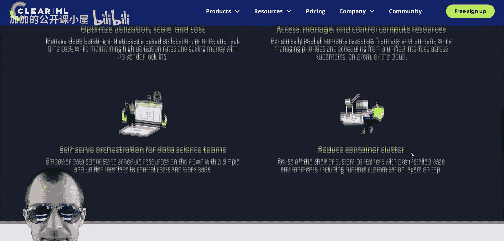
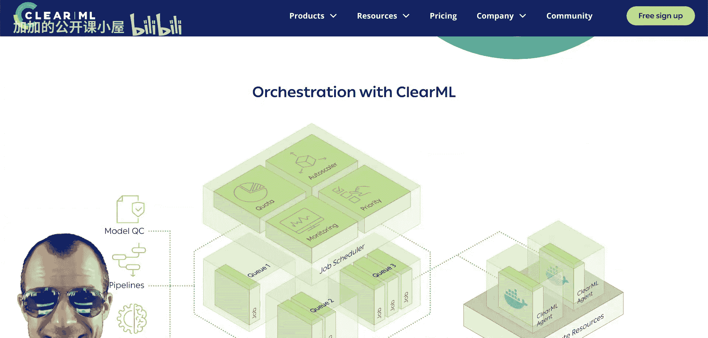
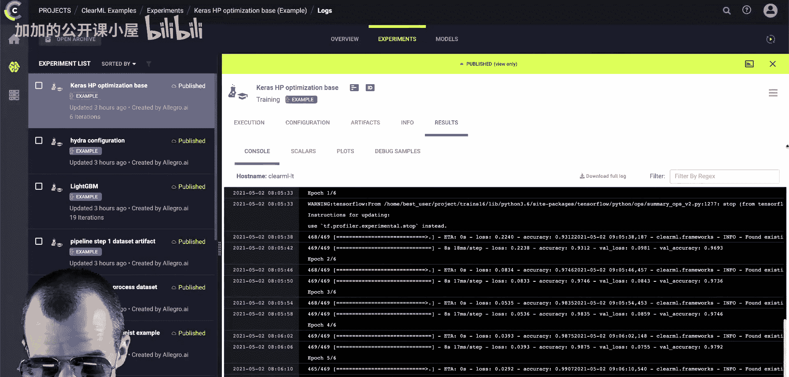
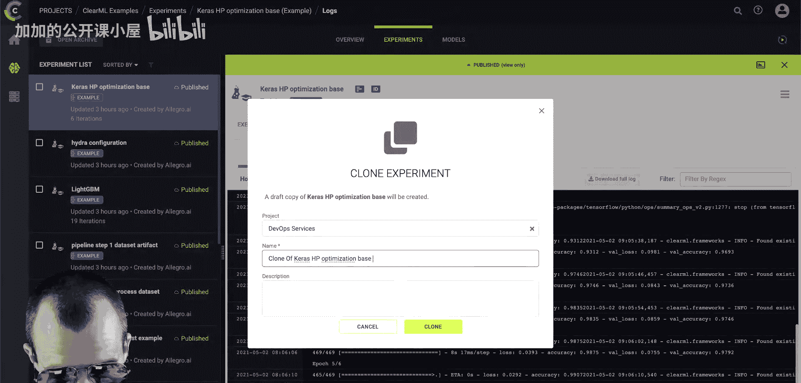
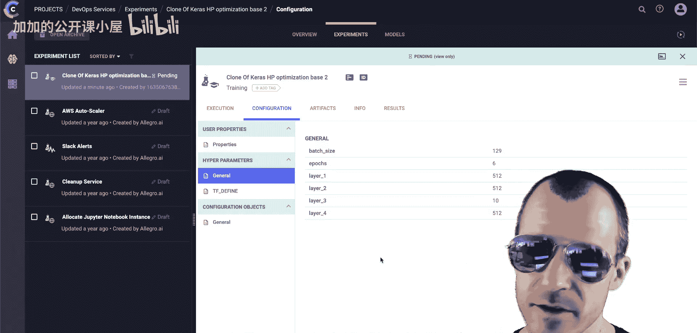
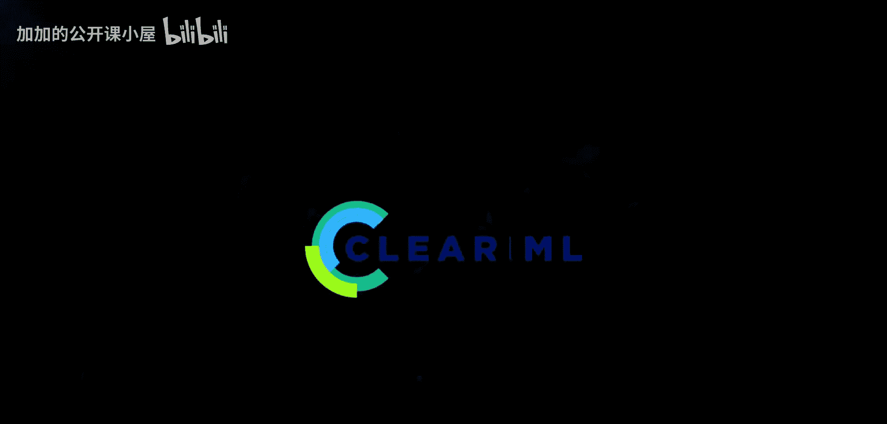
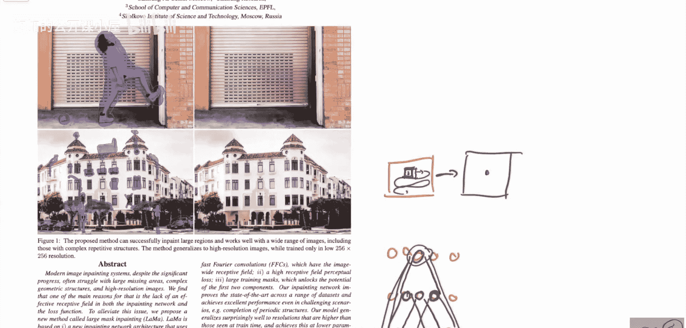

# YannicKilcher【中英⚡AI经典论文领读(全203篇)(下)｜Papers Explained】 p61 P161 分辨率鲁棒的大掩模修复与傅里叶卷积（含作者访谈） [BV1j8x5zJEvx_p61]

Hello there。 Today， we're looking at resolution robust large mask in painting with Fourier convolutions also called Lama by the Samsung AI Center。

 Samsung Research， E PF L and the Solkovo Institute of science and technology。

 This is a special paper review， because I'm only going to introduce the paper briefly maybe 1520 minutes or so。

 And then we're going to talk to the first author of the paper。 and go a lot more in depth。

 So if you like， if you like conversations with first authors。

 And the ability for me to ask dumb questions to them。 Then stay tuned for that。

 It's going to be in the second half of the video for the first half。

 though I first want to demonstrate to you what this model can do。 Hey there。

 this video is sponsored by clear M L， Clel is an M L Obt that is fully open source。

 it can do experiment tracking， orchestration， deployment， model and features stores and much more。😊。

🎼Selfhosed tier is a firstclass citizen in clear ML As I said it's fully open source。

 you can look at it， you can audit it， you can extend it。

 you can run it on your servers and if you ever come to the point where you need the extra features you can totally upgrade any time they'll gladly take your money if a free tier in the cloud which gets you going pretty far Now we talked about experiment tracking last time clear ML with two lines of code will track any experiment that you do track the metrics。

 the outputs， the environments， the dependencies and make everything superper reproducible but this time I want to talk about a second part which is the orchestration engine So the orchestration engine is responsible for packaging up your experiments including all dependencies and then distributing them on your hardware so that means you can simply submit an experiment to a particular queue and clear ML takes care of running this wherever it's needed So this is super cool because it means I can get going on my laptop run a few experiments there。

And as soon as I'm ready， a boom， I ship it to the cloud。 So here's an example。

 Look at this experiment that has already been run。 I got some output。

 But now I would like to do something different with it。 So I click here a sick clone。

 I give it a meaningful name， like2。😊。

🎼And now I've clone this experiment and this is kind of a draft experiment right now it has no results yet but what I can do I can go into my configuration into my hyperparameters and I can change around the hyperparameters so I wasn't really happy with the last experiment I feel a bigger batch size might be needed so from 128 let's go to 129 Now I'm pretty sure that's gonna make all the difference right here so I save and then I simply click on in queue I submit it and now clearml simply takes care of running that experiment for me as you might guess you can have different cues some for GPU load some for longrun tasks。

 some high priority as you're used to from any scheduler this can also be used in an automated fashion meaning that you can use this for automated hyperparameter search and you can even do things such as scheduled or triggered tasks For example if you want to trigger a training run every day on new incoming data that's totally doable Now orchestration is just one part of clear。

🎼I've shown you experiment tracking last time and there are many more features to their product if this sounds interesting to you if you're an open source fan go check them out and thanks so much to ClaM for sponsoring this video let's get into it。

You can already see it a little bit in figure1 right here。 The model is able to take a picture。

 You draw a mask on it。 So this is the blue area right here。

 and the model would autocompte the picture。 So the model doesn't see the mask。

 The model simply sees what is unmked than the model is asked to complete that missing area。

 As you can see it fills that area in very， very cleanly。 and especially if you look right here。

 This regular structure of these door holes or whatever that is is preserved even across very large areas。

 This is very， very cool。 This is very difficult to do with these inpa systems。 In fact。

 there is a project website right here。 all the code is available。

 they give this in a little bit more of an animated flare so you can really see the effect that these models are having and iss pretty pretty cool。

 especially take a look。😊，These repeated structures that are often in the pictures。

 so these meshes or the lines right here， these tend to be extreme。

 these tend to be especially difficult for in painting models because in painting models are usually built on convolutional neural networks and convolutions notably take into account very local context。

 whereas for these patterns you need to take into account kind of a global context that's exactly going to be the message right here。

There is an app。 There are actually a bunch of apps based on this small。 This is a thirdpart app。

 So this is not by the author， but it is an app built from these models。 There are also， as I said。

 code is available。 There's like a hugging face space。 There is a coab by the author。

 but this particular app。 Let's just take a picture right here。 It works best on natural images。

 of course， but we'll just take the channel logo right here and we'll say we'll want to erase the pi sign right here。

 Look how cool that works。 What about the paw。😊，No， okay， that that is， that is kinda disturbing。

 How about the nose。No， no， no， I don't like that。But it should be able to， yeah。

 see so it kind of completes lines if you cross them out。 So this should complete the table。

 but remove the leg。 You can see it's fairly robust even to use sort of missspecing bunch of things。

 So here I draw over the headline if you saw that and it remained the head headline remains。

 So I removed this part。 but I crossed into here a bit。 you can see the line kind of remains。

 Now it's got a bit of hair。 Yes， kill it with fire。 In any case。

 this is available for you to use if you have more sensible pictures。

 I'm sure that that will work a little bit better。 maybe there are also different versions of the model。

 So keep that in mind。 and works also on different resolutions。

 That's what it's called resolution robust large mask in painting， which is also very cool。

 So what is the core idea of this paper。 The core idea is going to be these Fourier convolutions right here。

 and these Fourier。😊，Convolutions are going to be enabling the model to take into account global context from the very beginning。

 What is the problem with a convolutional neural network。

 The problem usually is that in a convolution， if I have a picture。

A convolution on a particular point will take into account its local neighbourhood right。

 And then I sort of slide this over the image right here。

 and that will give me my representation in the next layer。

 Maybe that's going to be even of the same size。 So for a given point right here I will have a receptive field of the point in the original image plus some neighbourhood。

 Usually we work with three by three convolutions。 So all I'm going to do really is I'm going to look one pixel to the top and one pixel to the bottom。

 one pixel to the left and one pixel to the right。 And that's about it。

 I'm not going to do any more looking around。 So how does a convolutional neural network integrate information across the whole image and the answer to that is by going for multiple layers。

 So if I simply represent the pixel as a set of pixels in one dimension。

 imagine the one dimension here is is the picture。 and I'm going to need a bit more。Bace for that。

So as you can see in the first layer， from the first to the second layer。

 let's say we look at this particular point right here。

 it's going to have a receptive field of three， so it's going to look at these pictures。

 sorry at these pixels right here。In the next layer。

 if you can see that the same location is also having a receptive field of  three right here。

 However， since， for example， this。Particular pixel right here also had a receptive field of three。

 and this particular one also， as you can see from layer2 on their total receptive field of that so all the information inflow is going to be from receptive field of5。

 therefore the more layers we have the more of information。

 the more spatial information can be included for a given particular location in the output。

 But as I said， that takes a lot of layers that takes depth and especially for these in painting applications。

 What you want is kind of global information。 These masks right here， like these masks。

 they're pretty big。 for an inpa application。 So they're pretty， pretty wide。

 and if you can imagine a convolutional layer that looks at a three by three pixel neighborhood。

 that might be something right here。😊。

You know， so you're going to have a whole lot of convolutional kernels that just see the masked pixels。

 They see nothing of the outside。 They simply see a bunch of masked pixels for a whole bunch of layers。

 right， layer 2， layer 3 until like layer 4， there's like there's nothing no information at all at this position about the outside world about the world beyond the mask。

