# YannicKilcher【中英⚡AI经典论文领读(全203篇)(下)｜Papers Explained】 p62 P162 GLIDE：基于文本引导扩散模型的逼真图像生成与编辑 [BV1j8x5zJEvx_p62]

Hello there。 Today， we'll look at glide towards photorealistic image generation and editing with textguidd diffusion models by Alex Nicole Prafola Darrial Adiromeash and others of open AI。

 This paper on high level well I'll just show you what you can do。

 I'm sure you've all seen this paper in one way or another。

 It is another paper that generates images given a piece of text。

 but this time it's not again or anything like this or a VQ VE。 This time it is a diffusion model。

 This is a different class of models and will go into what they are and how they work。

 but essentially you can see right here that the model that turns out of this。 and of course。

 this being openaiI they train this on a massive scale and this model is really big。

 but what comes out of it is very， very， very much better than， for example， Dli， which I'll always。

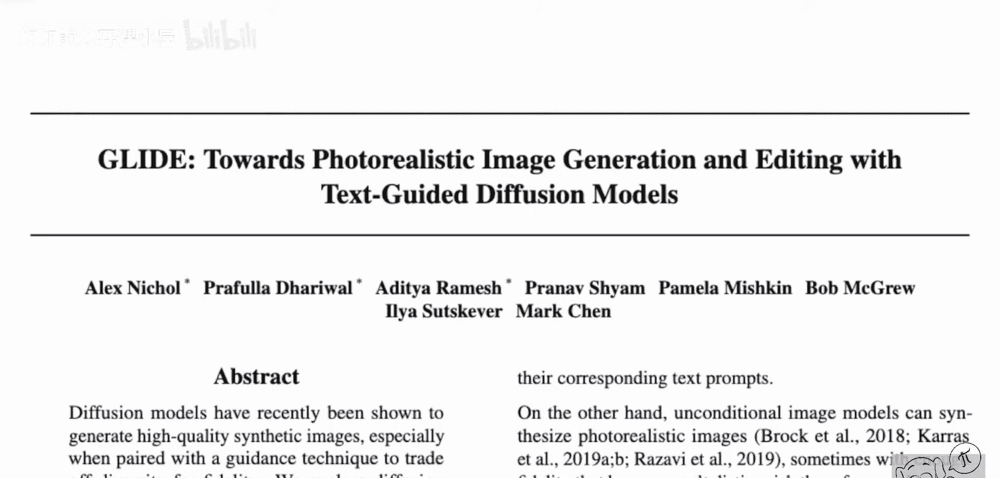

had this kind of blurriiness to it， you can see right here， a crayon drawing of a space elevator。

 a pixel or corgi pizza， so this is trained on a big scrape of images from the internet and as you can see the outputs are pretty stunning so it gets for example。

 the shadows right here， it gets them correctly even the red on blue blending it gets different styles like the Salvador Dli style it combines different concepts。

 although maybe you know this has been seen on the internet somewhere。

 but it is able to combine different concepts， and given that these are diffusion models。

 you can actually do a bunch of more stuff with them， for example。

 in painting is immediately accessible to this model now usually in painting is accessible to diffusion models。

 however， they actually train an in painting model on top of this。

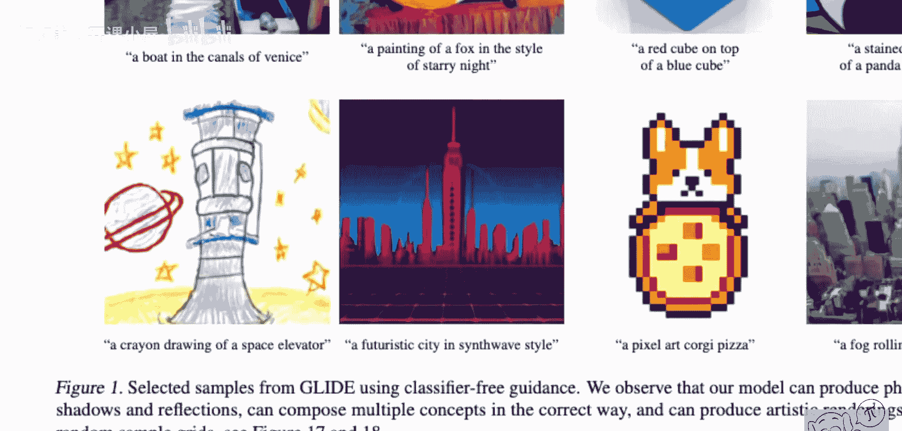

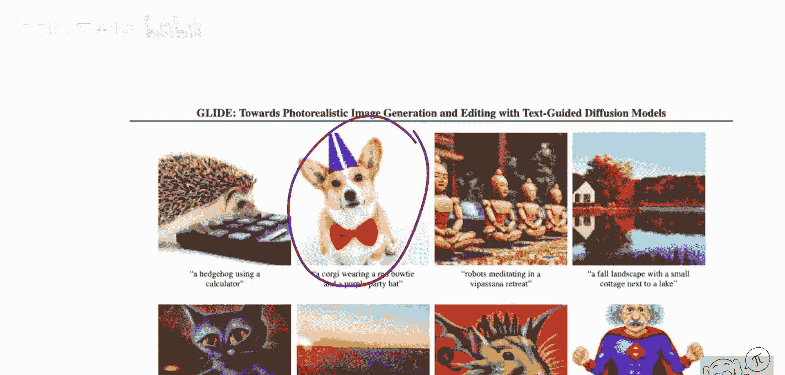

but in essence， a lot of stuff would be accessible， so this is now possible where you say， okay。

 I only want to change a part of the image like this part right here。

 you give a text saying a man wearing a white hat and the model generates the man wearing a white hat。

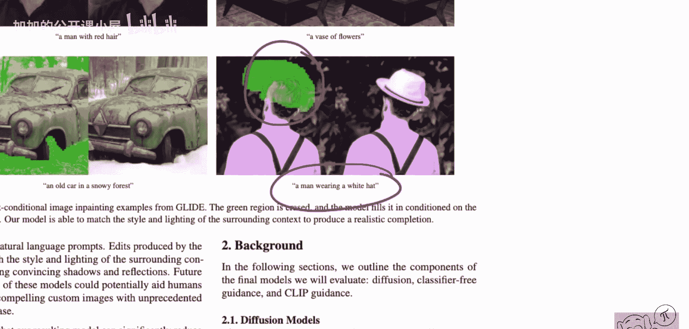

This is is very cool。 you can do things like this where you first so the pictures here are a bit confusing。

 but you first generate an image from a text prompt like a cozy living room and you get this living room and then here the user would annotate this window sort of would draw over it and will give the next text prompt and the next text prompt will be a painting of a corgi on the wall above the couch and the model it's an in so this is the inpa mode。

 the model would only be able to paint the green area so it would sort of try to conform to the text using only the green area and therefore it would make this corgi picture on the wall right here then the user goes further and says well now I'm going to paint this area right here and I'm going to issue the prompt around coffee table in front of a couch and the model will generate it and so on you can see that this enables sort of an interactive creation of this scenery at the end。

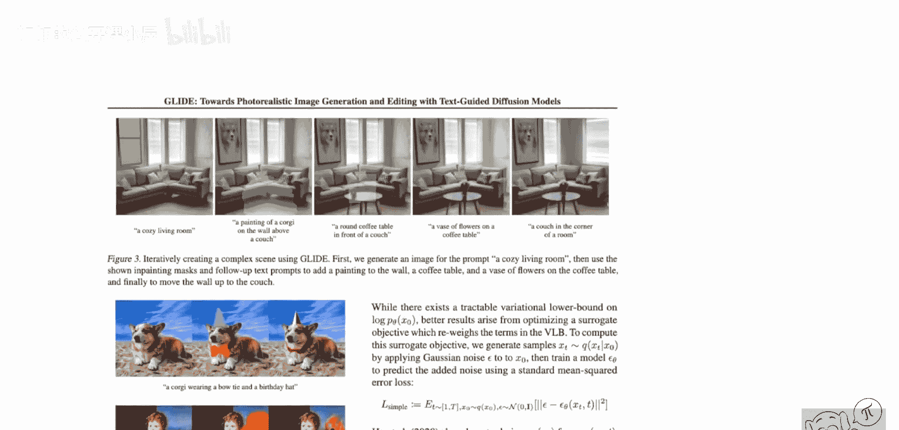

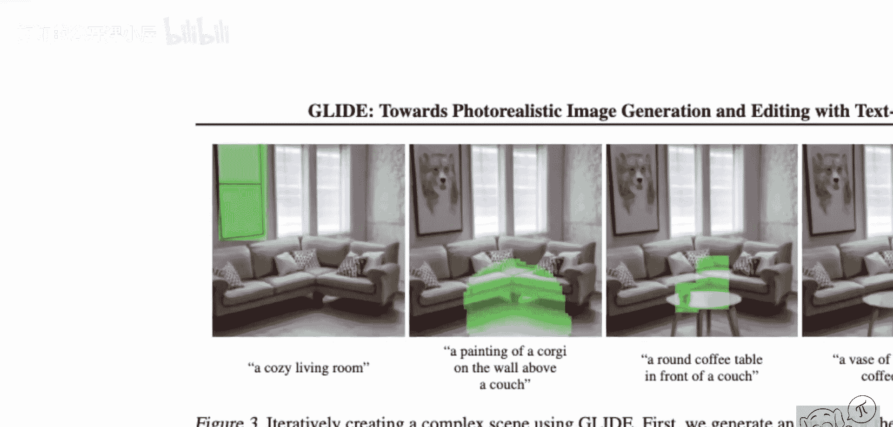

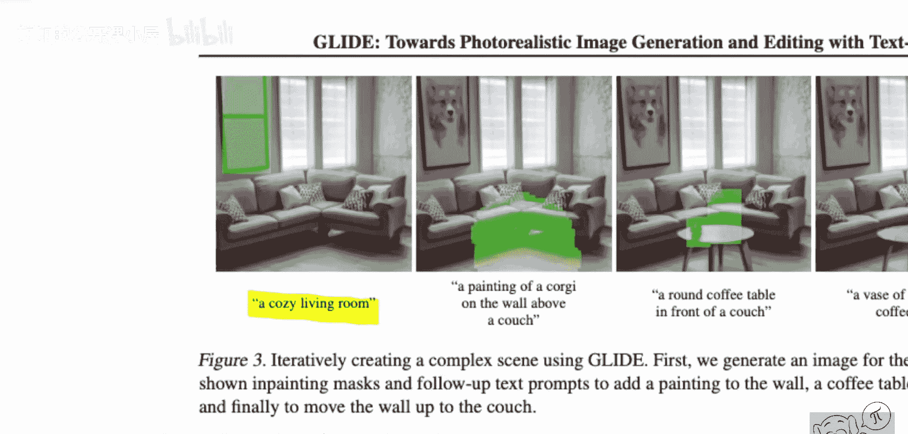

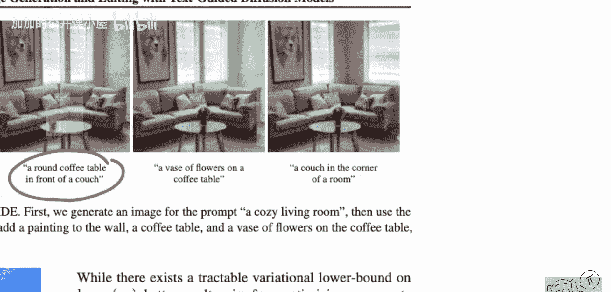

The couch。

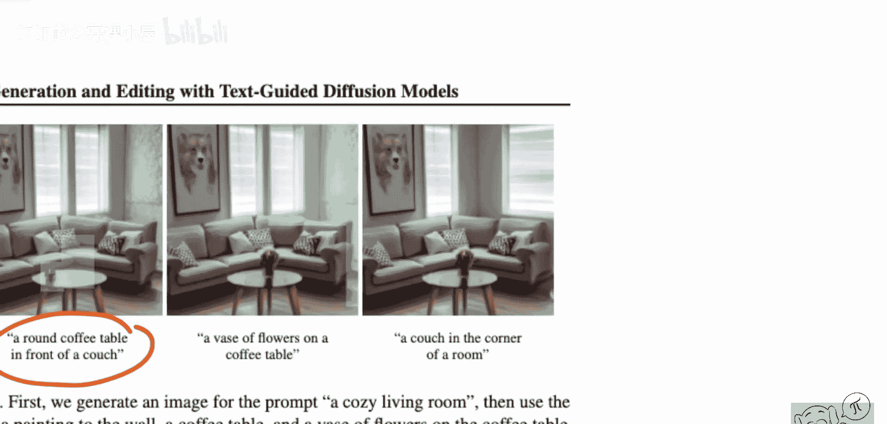

The couch in the corner of the rooms。 are changing the entire wall right here。

 You can see the back of the room has some space。 and now it's being changed to a wall。

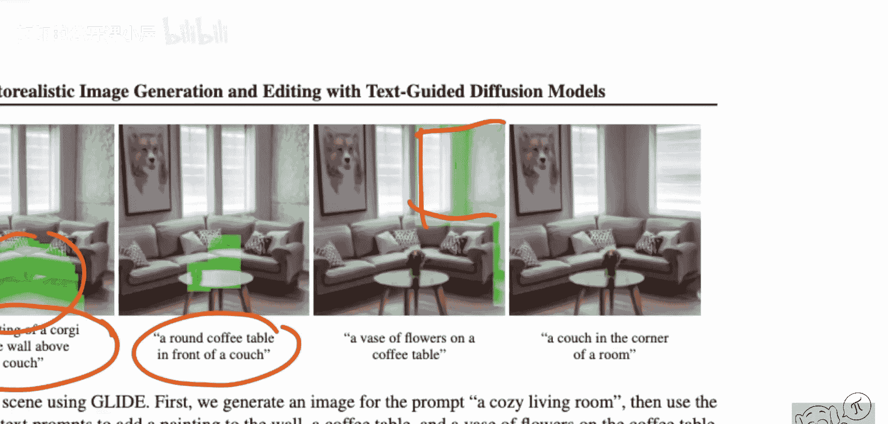

So this is the kind of stuff that's possible editing right here。

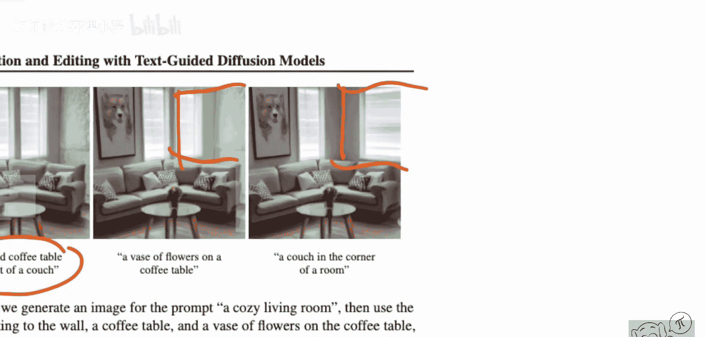

Even what's this this sort of sketch editing where you don't only mask， but along with the mask。

 you provides sort of like a sketch， as you can see right here。

 So this part here is blue and then the part here is white and that's also。

The mask that the picture receives and you can see that only one cloud in the sky today。

 it's sort of you can guide even more so you can guide with text and you can guide with sketch color and so on。

So this is a a very， very， very cool model。 You can see the quality is very， very good。 Here is。

 for example， a comparison。 These are real images from the M MS Marco data set MS Coco sorry this is a data set of pictures with associated labels so text descriptions of the picture so you have some ground truth So the ground truth here will be this one and the label is a green train coming down the tracks you can see Dli generates something neat。

 but it's sort of blurry。 it's kind of cartoonish as all the Dli pictures are if you look in this row the last one's pretty good。

 but all the other ones are sort of。😊，Elephants are more like blobs。

And we've seen this in the in the Dli paper。 it was impressive at the time。

 but this is way more impressive， and then their best model， this clip sorry。

 this glide model with classifier free guidance， you can see right here it generates like a high quality train that fits the image description。

And you can see in the entire， in the entire row right here is's pretty good at doing that。

 So there are a lot of components to this model， and we're going to explore them a little bit。

 Open AI has released in classic open AI fashion。 They've released like a small。

 very filtered version of that model because they're worried about safety。

 like anyone's going to believe them after G2。 they've just been doing this every single model。

 right， They're just like， oh no safety。 People can make deep fakes。 Oh， no。

 like no one's made a deep fake。 like G2， all the worries they were just not true。

 no one has used G2 to spread around fake news。 and no one like no one's going to use this model substantially to make very misleading pictures。

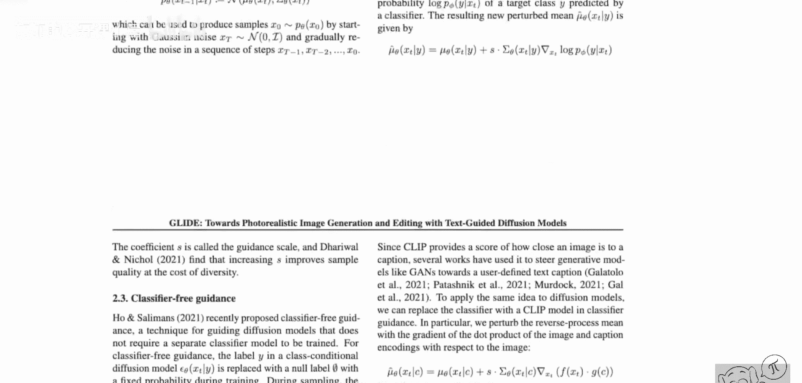

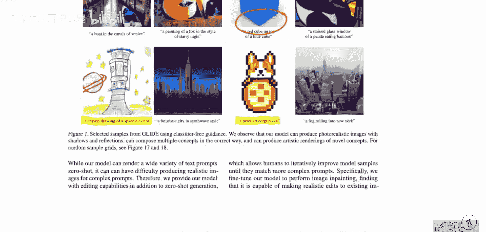

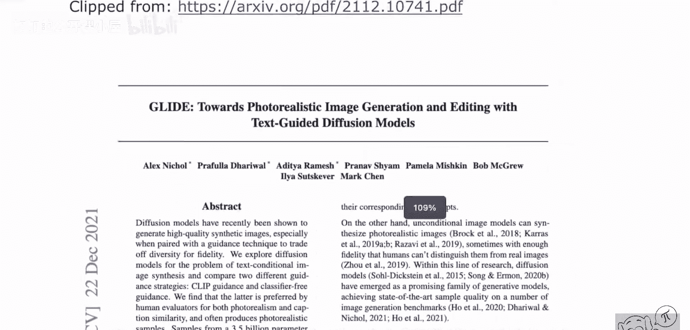

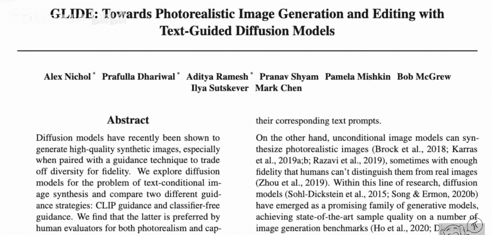

But we'll get to that as well。Alright， so what is a diffusion model。

 And that's sort of at the core of this thing right here。

 A diffusion model is a different type of generative model than maybe you're used to from like a G or a VQ Ve。

 So in a G a again is probably the closest right here。

 So again is sort of like a neural network with a bunch of layers And what you do is you sample from some sort of a distribution。

 you sample some noise right， you sample some noise， you get some noise vector。

 So here is a vector which is complete noise。 Every entry is noise you put it through the network。

 the network generates pretty picture。 and you train the model using a discriminator in this case。

 you train the model to produce pretty pictures given the noise and the noise act sort of as a source of a randomness。

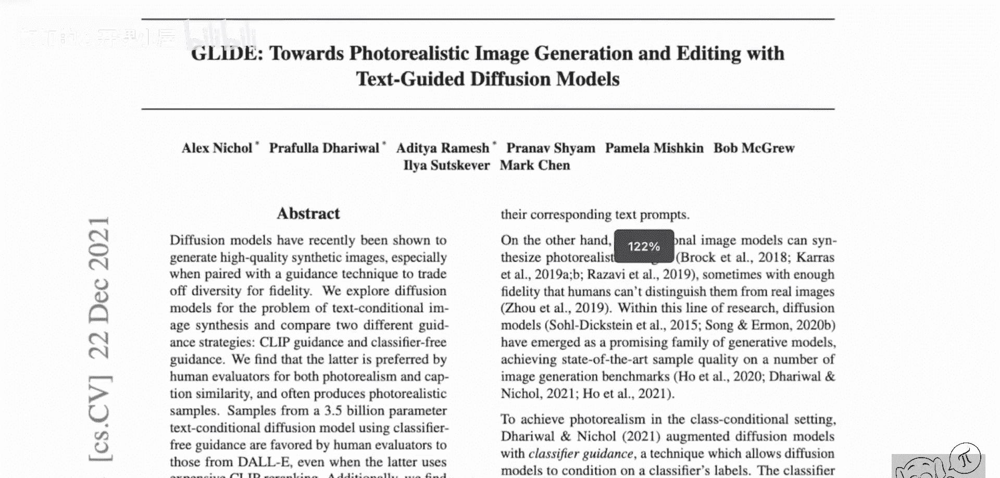

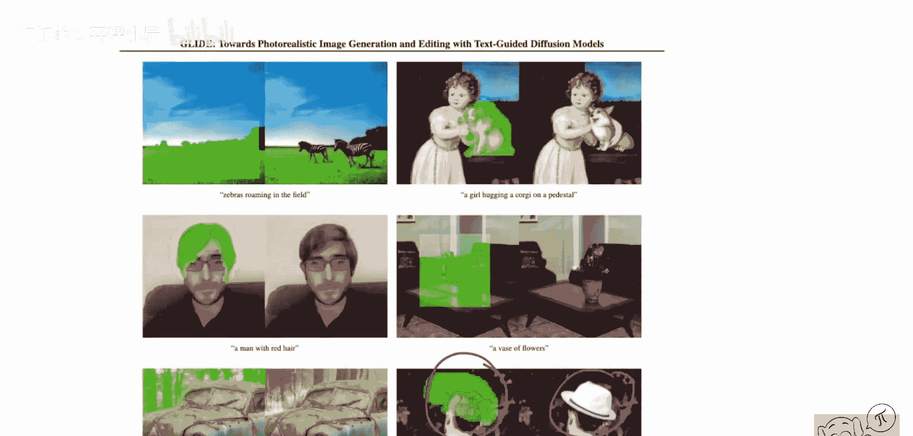

So the mapping is clear you train to map from noise to picture。Now。

 a diffusion model goes in almost like a a different direction。 So what you do is during training。

 you have a data set and you take an image。 So from， from a data set。You have a date to set。

 you take an image out of it。Let's say this is your trusty， trusty cat。And。You're going to。

You're going to put noise onto this image。 so you're going to add noise and noise。

 let's represent that with sigma。 Na， I think they do。

 they do epsilon or Eda in this in this paper right here。

 So you add that and then you get a slightly noisy version of this。

 Let's just let's just wiggle a bit wiggle， wiggle， wiggle。And you do it again。

 So through adding noise and you add lots and lots and lots of noise。 Okay。

 so every time you add a tiny， tiny bit of noise。 And that means that more and more。

 your picture is just going to be blurry and blurry and blurry。Now， if you do this for long enough。

 in the limit， you can prove that obviously if you do this infinitely many times。

 what comes out at the end is going to be。Just normally distributed。

 If your noise is normally distributed and you scale every time correctly。

 then whatever turns out is going to be normally distributed with some parameters here。

 So this right here。Is going to be a known distribution if you， if you add noise for long enough。

 if you destroy all of the information that the picture has。

 then you'll end up with sort of an entry in a known distribution。However。

 every step that you do right here is very small。 every step you just add a little bit of noise。

 so technically it's possible for a model to look at this picture right here。

 which is kind of a bit of a blurry version of the cat and predict and learn to predict the more sharp version of the cat this is foundation of many。

 many sort of dennoising models， many upsling models， super resolution models。

 what have you they do this in one step， but essentially here we say the individual step is small enough such that the model can technically learn to reconstruct it。

However， if we do it for long enough in you know going to infinity。

 the we are at a known distribution， namely the standard normal distribution and these two things together mean that。

 well， if we have trained the model to reconstruct the individual steps。

 what we can technically do is we can now go ahead。

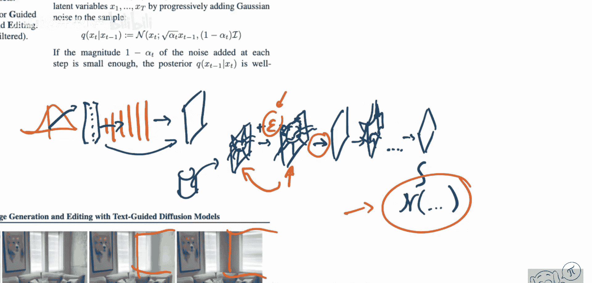