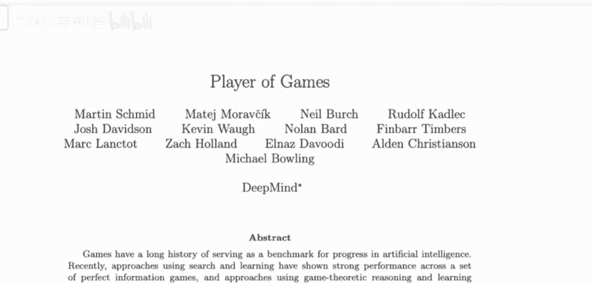
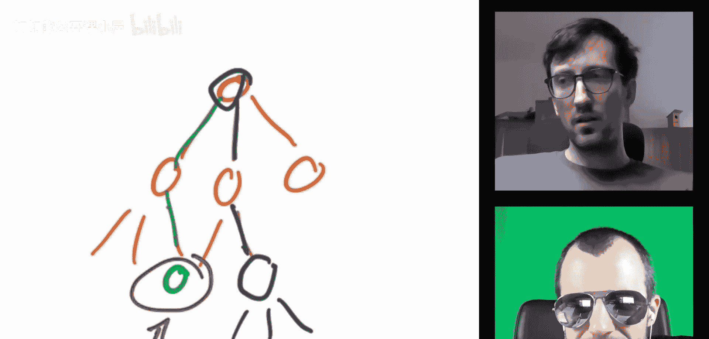

# YannicKilcher【中英⚡AI经典论文领读(全203篇)(下)｜Papers Explained】 p63 P163 游戏玩家：所有游戏，一个算法！（与作者马丁·施密德合作） [BV1j8x5zJEvx_p63]

Hello， everyone。 Today is a special day。 I'm here， as you can see， not alone， not by myself。

 as usual， I'm joined by Martin Schmidt， who is the first author of the paper called Player of games。

 This is joint work with others by deep mind。 and I have to say it it's very indepth paper。

 it presents an algorithm called player of games that is sort of a unified algorithm to play all sorts of games。

 This starts at things like chess and go， which you might know from Alpha0 but it goes beyond it goes to things like poker and Scotland Yard。

 which I found really interesting that it appears here。

 but sort of the common denominator is that these new games。 they have hidden information。

 So other than chess or go in Scotland Yard you don't know where Mr。 X is hiding in poker。

 you have no clue what cards。😊。

The other players hold so you can't just look at like the table and poker and decide what's the best thing to do because you don't know a lot of things。

 and yes， aim in Scotland Y， there have been there have been algorithms for poker right there have been algorithms for Scotland yard。

 but they were always a bit tailored to sort of the specifics of the game and player of games combines a large set of techniques and and these techniques are things like let's to search。

 So as we play the game， we do local search we sort of invest some computation at inference time to tell us what the best possible move but we don't want to search throughout all the game because these game trees。

 they just get very big。 So that's the part that comes in from Al0 a little bit。

 but then the other part with the unknown information that is。

Coming in mostly from from algorithms like counterfactual regret， minimization and so on。 But yeah。

 the counterfactual regret minimization。 if I understand these correctly， they were sort of solvers。

 like they either solved a complete game or they didn't。 You'd have to like traverse the whole game。

 And then at the end， you knew， okay， in this situation， I need to do this and so on。 And yeah， this。

 I was very excited when I saw this paper。 And then I tried to read it。 it was it was， it was。

 I have to say it was dense。 and I'm very happy to have Martin here today。

 to guide us a little bit through the paper。 So Martin welcome。 thank you very much for being here。

 Hey， I'm happy to be it。😊，Was it a sort of a good description of what I said so far about player of games Oh if you could summarize sort of the main components of this algorithm。

 so this is a single algorithm that I can train on many， many games。

 what is the set of games I can train it on。So currently we use four games。

 the games that you mentioned we have jazzess we we have Sc which I find as a very cool and fun game and we have no limit poker so it's just to show the generality of it because this is all about about the geneity that's why we two perfect and to imperfect information games so currently it should be able to handle handle most perfect and imperfect information games as it plans from scratch from selfplay just like alpha Al zero does just some limitations for games that this can handle and we can it's best to understand the limitations only after we understand a bit more about the algorithm itself so the algorithm itself is composed of many parts but the central concepts here I think and that's what people I think people。

Kin of know what alpha0 does， right it uses selfplay and it searches it searches a game tree to a certain depth right so so in these games we usually have like some sort of a state right and then we have various different actions that we could take in that state and every action leads to a next state and so on and we have various different actions we could take right here and every action leads to a next state and you can quickly see how this explodes So what what alpha0 and all these search algorithms do。

 they do this kind of limited depth search they look maybe one or two moves ahead。

 but at some point they say okay no further we can't afford to compute all of this three and that's why at a certain depth or after a certain time they say okay here we cut off and we use like a neural network to tell us how good this node is even though we're not at the end of the game where we would either win or lose。

We could still have a neural network that sort of predicts this node is very good for you or this node is very bad for you。

 and that's essentially alpha Al 0 in a nutshell。 let's say uses selfplay。

 uses this tree search at a certain depth it simply asks the neural network Now what's the problem when you have imperfect information。

 how does this change。Okay， I know that's the right question。

 unfortunately we probably going to spend quite some time to understand the intuition of it right but even for Al zero。

 it's good to step back and see where it came from it's not that Al zero introduced search for say perfect information gaps that search has been here say since 1950s like first algorithms for chsSs that combination of search and some value functions Al zero is amazing in the sense that it learns those value functions that you just described selfway and it's also really really smart about how it's going to expand it search tree it's not like it's going to always look two steps steps ahead it's very smart about building building this tree that goes deep where they needed to go deep has those components。

Whi these components are simply having some search tree that it ideally expands as it f about a policy in the search tree and then using sum value function at the end of the search tree。

Yeah that is one of one of the hallmarks of Al0， I think that for example， in go。

 you have so many actions， even at step1 right if you were to consider only like even three steps ahead or so this would just blow your computation budget but in Al0 it sort it sort of always starts from the root and then it kind of goes down one of these branches that it has already explored a little bit and in every new iteration。

 it re decideidedes which direction it should investigate and that's a combination of sort of what the neural network says。

 but also how often it's been it's explored something So it says you know like this direction its very promising but I've explored it a lot already so now I'll go I'll go a different branch or so and then at the end it always goes gets to a leaf note that it hasn't expanded yet and at that point it asks the neural network。

What's my policy or what's my value and then it prepares sort of the next iteration that it could expand it even more。

 And so over time it builds this very targeted plan so the neural networks guide the research as you say。

 that's very， very cool Now in imperfect information games is yeah， that is different， right。Yes。

 so it's somewhat different but we still wanted to have exactly what we just described this is like why Al zero works so well and we still wanted it so on high level you can think of player of games as combining combining Al0 and deept which if you were to Google deept it was it was the first AI to beat professional players in No limit poker and it already introduced some of the some of the ingredients that we will see in this paper which it introduced this notion of local search in poker and these value functions and play of games is really just putting together alpha zero in deept into a single big unified algorithm so the lets maybe started with the component that you just talked about which is value function。

And the value function， if we get to a point where we understand value function in player of games。

Say it's then you understand like 60 to 80% of the algorithm and complexity that imperfect information bringss so value function if you think about how to use it exactly as you said rather than a search and all the weight or the end the end of the game because it would be like way too long of a search。

 you just truet your search and use value function as a substitute for continued search and that's how you use it but what it really does。

 it maps some sub problem that you are thinking of。

To gain value of that subprom or something in chess or in go， it's really easy to think about。

