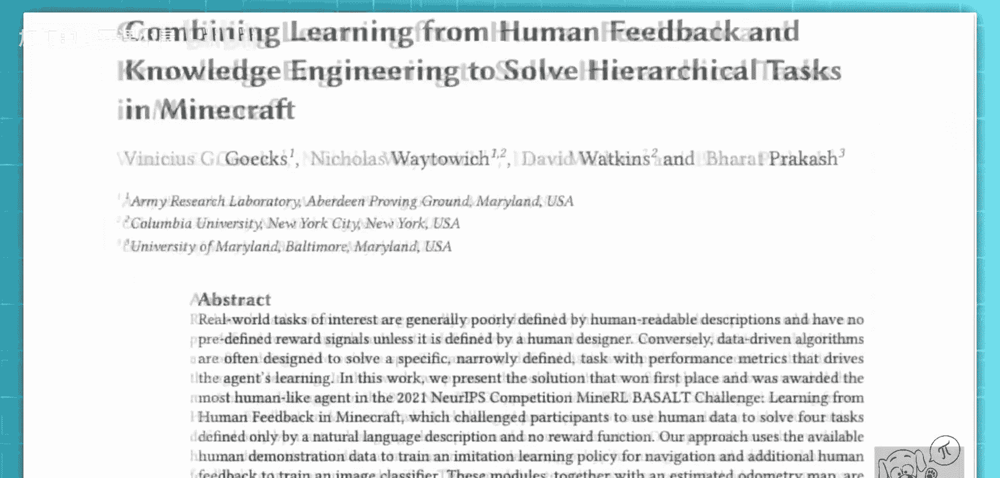
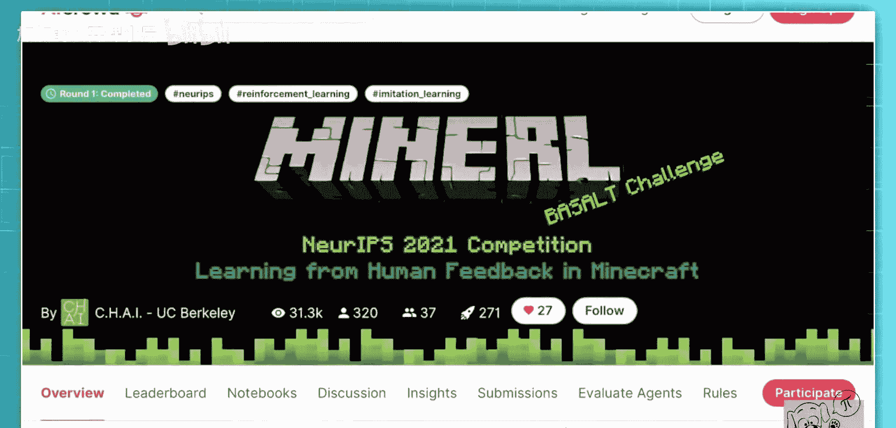
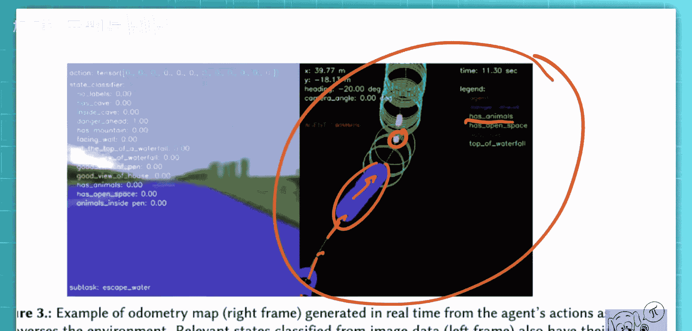

# YannicKilcher【中英⚡AI经典论文领读(全203篇)(下)｜Papers Explained】 p64 P164 这支团队赢得了Minecraft RL BASALT挑战赛！（论文解读与作者专访） [BV1j8x5zJEvx_p64]

If we just do a behavior cloning using this data， you know， won't cut it。

 like we don't have enough data。

Hello there。 Today we're going to look at this right here。

 This is an agent in Minecraft that's trying to build a waterfall。

 So the goal is to go up a mountain。 find a good spot put down some water turn around and then take a beautiful picture of the waterfall that is one of the four tasks of the Min Rl basalt competition。

 This is what we're going to talk about today and not only are we going to talk about the challenge the competition as you can see make waterfall is one of the four subtasks we're actually going to talk to the winning team to the Caairos team in just a second。

 This is just the intro I want to tell you a little bit about what's going on so that later in the interview with the authors you can follow if you don't know what Minecraft is or sort of the basics of these competitions。

 If you do feel free to skip ahead。 This is just gonna take five to10 minutes right here。

Yeah。So I'm going to just show you another one to give you a little bit of the impression of what these agents can do。

 I haven't actually looked at many of them。 I don't know what's going to happen right here。

 whether that's successful or not。 These are the actual videos that the judges saw that that were part of these competition。

 So the competition is human judged。 There's no reward function。

 It's literally you just give 10 videos to a human。

 and they're supposed to rate how good these things are how humanlike they are and so on。

 it missed the waterfall a little bit right there。 Let's see whether it can turn around。Yeah。

 it can not spot on， as you can imagine， and not spot on in any of the 10 things。

 but good enough to win this competition。 So how did this team go about this。

 If you don't know what Minecraft is Minecraft is this game it looks like you know it looks like it's from 1990 or so。

 everything is made of blocks。 but it is a really cool game。 It's a completely open world game。

 You can do anything and everything you can craft items。 all of these blocks。

 you can destroy and build up somewhere else。 you can collect items and craft new。

 better items from it。 For example， you can craft a pickaxe with which you can mine things minestone from that。

 you can build like an oven， a smelter and dismelt iron ore from that。

 you can build iron tools and so on。 This world is completely procedurally generated it。

 So there there's no the level is。😊，the same。 And that's one of the things that makes these challenges so hard。

 And the other thing is just the the sheer amount of freedom that you have right here。

 So the agent now has spent quite a bit of time looking for a good place to build the waterfall。

 It looks like it got stuck right here。 That must that that's kinda one of the failure cases。

 I imagine， or it's gonna get out。It's gonna get out。 What， whata， what a clint clitch。

 clitch play there。 It looks like here it's a good spot for waterfall。 Yes， put it down。

 walk away from it。 Turn around。 Snap picture with the sheep in it。 beautiful， so。😊。

This has actually led to a paper as well by the winning team called combiningbining Learning from Human feedback and Knowge Engineer to solveve hierarchical tasks in Minecraft。

 along with open source code that you can check out so you can retrain their agent。

 you can look at their code and you can improve it。 It's MIT licensed。

 therefore all good to go for you。So what did this team do that gave them the winning submission。

 The challenge in itself is you're given the tasks in just a short string。

 So there is not a reward function or anything like this。 The short string literally is， for example。

 the find cave。 It' the agent should search for a cave and terminate the episode when it is inside one。

 That is the entire description of the task。 As I said， no reward functions。 you do get 40 to 80。

 I believe， play through 40 to 80 human demonstrations for each task。

 not all of them completing the task， though， and a bit of a code base， and that's it。

This team came up with the following solution。 They built at the core。

 They built what they call a state machine， but I want to start somewhere else。

 I want to start from how they used the human demonstrations。

 So they had human demonstrations of humans solving this task。

 and then they trained a navigation policy。 This is trained via behavior cloning。

 So you try to make an agent that just kind of clones the the human movements。

 They did cut out all of the sort of interacting with the environment things from the human demonstrations such that it was just only navigation going from point A to point B。

 This is a policy that they can activate at any time So as you can see right here。

 this gives rise to to one of what they call learned or engineered subtasks。

 So they have a stack of these subtask。 One of them is this navigation subtask that is obviously learned。

Other ones that are just hard coded。 for example， when it's time to actually place the waterfall at a point when when you think you're at a good point to build a waterfall。

 this movement of stacking up the blocks and then putting the waterfall on top。

 That is a hard coded policy。 So these subtasks are hard coded， partially and partially learned。

 and they're controlled by this state machine。On top of that state machine。

 which we're going to get to in a minute， the state machine itself is controlled by this state classifier。

 so the state classifier is a thing that they came up with。They take pictures from the game。

 frames from the game， and they collect additional human labelbeled data where for each picture。

 they let the humans label， for example， is this inside a cave， which you can see right here。

 that's inside a cave if you play Minecraft you you'd know， is there danger ahead。

 which means kind of a large body of water that you should avoid or something like this。

 Do you have animals， which is relevant for some of the tasks， So they build up the state classifier。

 which is also learned and that state classifier is now going to control this state machine。

 I'm not sure if they actually have it somewhere for one of the tasks in the paper。

 they do have it in the accompanying presentation。The state machine controls what the age of which sub policy is active at any given point。

 Let's see。 it's not here。Well， I can maybe maybe I can I can draw it a little bit you're going to see in the presentation so you start and then you。

 for example， if it's the make waterfall task， you go you get to a point where you want to ask。

 is there a good spot to place the waterfall is a good spot in sort of the view of the agent if no。

 then you go to the exploreer sub policy。And if， yes。Then you go to the。Go there。 The go there。

 sub policy is activated。 These are these subpoli that we saw or either learned or hard coded。

 For example， the explore one， you can imagine， maybe it's just sort of walking around until the state classs classifier tells you that there is actually a good spot。

 So what makes the decision between no and yes， that is exactly this state classifier。

 this trained state classifier at some point， it will tell you。

 now you found a good spot and then you can switch policy。 So from there， if after the go there。

 you get to another decision point and the decision point might be like are you in front of of a big wall。

 If yes， use the jump policy。 if no， use the walk policy or something like this。 So as you can see。

 the state machine itself is hard coded。 So the humans came up with what。

Do we need to do to complete the tasks， But the individual steps。

 they can be either learned or hardcoded policies。 And that's how they go through fulfilling these tasks。

 they use the state classifier to always tell them what specific subtask here should be activated at any given point。

 controlled by the state machine。 And you know， with that， they finish the task。

 One additional thing that they sometimes need is this estimated autoometry。

 This is where they just look at the actions they've performed so far。

 And they build this overhead map of the agent。 as you as the agent walks through the environment。

 they're able to sort of remember things。 For example， this here is has animals。 So they remember。

 they're gonna to remember locations of animals of bodies of water and so on。

 And that allows them later if on in the later stages if they。To go back to something。

 they can efficiently find it again， for example， in the waterfall subtusask。

