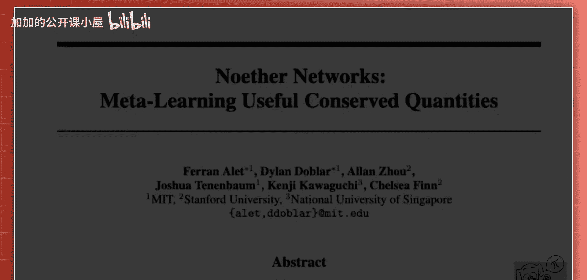
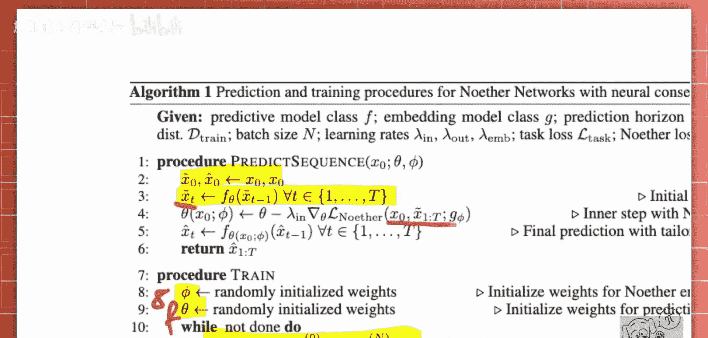

# YannicKilcher【中英⚡AI经典论文领读(全203篇)(下)｜Papers Explained】 p65 P165 诺特网络：元学习有用的守恒量（无作者署名） [BV1j8x5zJEvx_p65]

But the intuition is that knowing these five coned quantities is going to tell me a bit about what my prediction should be and so it's kind of free information that I get to know。

Hello there Today we'll look at new networks， Me learningning useful conserved quantities by Farron Ollet and Dylan Doublar and others。

 This is another one of the with the authors' installations videos。

 whatever where I just discuss the paper briefly right now and then we'll jump into an interview with one of the first authors with Farron and we'll go through the paper together and I think Farron can explain this so much better than I can and I'm also able to ask some of my dumb questions So this was a lot of fun and I definitely invite you to stick around if you already know a little bit what the papers about feel free to skip ahead If you don't know what the papers about the paper essentially deals with neural networks that predict dynamical systems and in these dynamical systems very often there are these conserved quantities that are part of it。

 for example in a physical system energy。

conserved momentum is conserved and things like this。 and under this constraint。

 you can build in this constraint into the predictive neural network so that the neural network does a better job。

 and they build thesenerter networks in order to dynamically learn these conserved quantities and then adjust at runtime during forward propagation tailor the loss to conserve these quantities。

 And I think that's really cool。 it's different and yeah， that's what I like about it。

 So pretty brief introduction。 this paper obviously is named afternerer's theorem which essentially they say here loosely states the following for every continuous symmetry property of a dynamical system there is a corresponding quantity whose value is conserved in time。

 for example。They say a system of planets interacting via gravity。

 the system is translation invariant in all three cardinal directions。

 Nurous theorem asserts that there must be a conserved quantity for each of these symmetries in this case。

 linear momentum is conserved。 So the symmetry in space as a translations is accompanied by a conserved quantity。

 which is linear momentum。 Now we don't always obviously know these quantities and theyre not always super explicit and they're not always exact。

 So what we are going to be dealing with here is predictions of dynamical systems。

 and the example here is the prediction of a video of like a physical interaction。

 So this is a thing here on an inclined plane。 It sort of slides down and then collides with this other thing right here and the goal is to predict the next frames of this video。

 Now we could just build a neural network to predict。These things frame by frame by frame。

 and that would。Go certainly well if we had a lot of data， however， if we don't have a lot of data。

 what we need to do is we need to build in inductive biases and the inductive biases。

 what people usually do is they build in these symmetries directly， for example。

 they build in the physical laws， they know how the world works。

 and they say you know whether I translate it to the left or to the right it doesn't really matter and so on。

 but building in these symmetries and I think we know this from geometric deep learning。

 building in these symmetries is very powerful but it can also be be cumbersome because you have to define them beforehand。

This paper goes ahead and says， you know what's a lot easier than building in symmetries directly is building in a constraint to conserve a given quantity。

 and that is a lot easier and theres a potential that you can actually learn it from data and with natureuters theorem we know that the two things are equivalent。

 So if a system conserves a quantity， it essentially encodes a symmetry in the system。

 So what do we do This is the very high levelve overview over these networks。

 we take So this entire thing here is one forward propagation。We take the original frame。

We put it through a forward predicting neural network， which is this f theta right here。

 This is a network that simply forward predicts frames as we I said initially。

 so we forward predict forward predict forward predict。

 This gives us an initial set of outputs right here。

 these xtil and now these are going to be pretty pretty bad not pretty bad。

 but if we don't have a lot of data to learn from these we don't expect them to be particularly good and that's the regime we are here。

What we do then is we're trying to adjust this F thing right here in the moment。

 So during the forward propagation， we're going to update our predicting neural network by this neutral loss。

 So we're going to do an update a temporary update to the weights of the F network and we're going to do this into direction of this neutral loss。

 So you can see here we have these networks G lying around。 Now G is always the same network。

 So what we're going to do is we're going to feed each frame that we predicted through G。And。

G always being the same network， it will output the same thing。 and now obviously if you know。

 given given that how I made this introduction， you might already have guessed that G is the part that predicts the quantity to be preserved。

So what we want to do is we want to put all these things through G， and then we want to。

These will give us a bunch of outputs right G here and here and here and here will output some things and the things can either be a number or an entire vector。

 an embedding vector， so essentially G takes this thing right here。

 it actually takes two consecutive frames and embeds it into some space。And now ideally。

 all these Gs would output the same thing， which would mean that we have conserved some quantity and therefore encoded some symmetry。

 however， initially these G's are not going to output the same thing。

 so we are going to attempt to change the F function such that the Gs output more the same thing。

 there is a loss involved right here。This is the ne loss they call it and it is defined down here so you can see all this really is is it's either defined in one of two ways。

 either you take the difference between the G function of the initial frame and the frame at time point T or you calculate the difference or you calculate the difference between consecutive frames in either way since you sum across all the frames。

 this means that all the outputs of the G network should approximately be the same。Now。

 what do you do with this information again， we're we're still doing one forward propagation。

So what do you do with this information， you calculate this nuuter loss。

 which is one we just described and then sorry for skipping around so much。

You're going to do one update step， so these are the parameters of the F network。

 We're going to do one update step into the direction of the gradient and it's the direction of the gradient with respect to the parameters of the F network So this is the forward predicting network。

 So essentially we are saying how do I need to update my forward predicting network。Such that。

 such that the frames that it outputs， the frames that it predicts in the future make it such that the G functions of all of these frames are more similar to each other or more similar to the G function of that first frame。

So we're going to in time update the F function right here。 and after that。

 we're going to forward forward propagate again with this new F function and thereby obtain our final prediction。

 This is one this is like an inner optimization that we do during forward propagation。

 I find this to be pretty cool。 Now they just do they just do one gradient step obviously， otherwise。

 you know， you could do a lot of things and you could like program in at and addgrad。

 not only one like gradient step， which is one SGD step essentially。

 but even with one step that is good enough。😊，So again。

 they here is the entire training procedure in an algorithm， you can see that。Let's start down here。

 They start with randomly initialized weights。 These weights here are for the G network。

 These weights are for the F network。 They sample batches for each batch。 They predict the sequence。

 Now， the sequence prediction is this entire thing we just looked at。 So the sequence prediction is。

I'm going to start at the initial frames， I'm going to use the the F， the original f。

 the one I currently have unconditional， let's say， to forward predict all of the frames once。

 then I'm going to put all of these predictions here into，😊。

