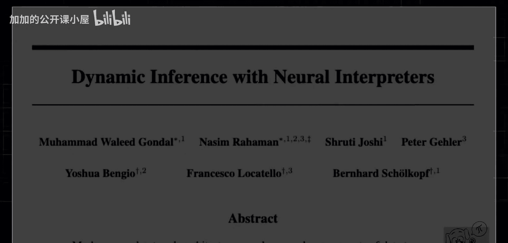
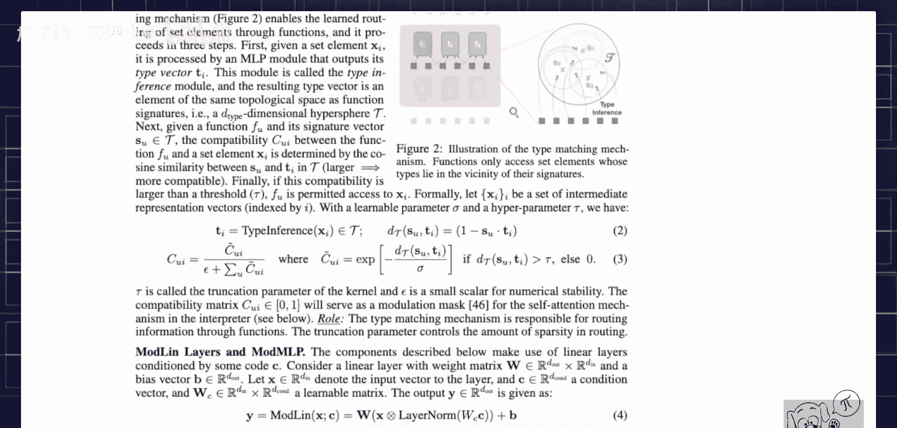

# YannicKilcher【中英⚡AI经典论文领读(全203篇)(下)｜Papers Explained】 p66 P166 动态推理与神经解释器（附作者访谈） [BV1j8x5zJEvx_p66]

How do you prevent？All the signatures from collapsing on each other， right。

 because that's a very nice way to cheat right， I mean， and you know what neural networks like to do。

 right， they like to cheat。😊。

Hi there。 Today， we'll look at dynamic inference with neural interpreters by Willid Gndal。

 Nassim Rahman and others。 So this is， again， a paper where I will interview the authors of the paper。

 In fact， we had three of them。 the two first authors and Francesco locateello as well。

 So that's going to happen in I want to say 10 minutes or so if you already feel comfortable with this paper。

 you please skip ahead to the interview part。 It is by far the best part of this video。

 I will give a very brief introduction to this paper by myself right now。

 So everyone knows what's going on。 will' go over the architecture again in the interview just because I want to get it from the authors as well。

 So briefly this paper takes a new look at how we build neural networks。 specifically。

 it supposes this architecture called neural interpreters。

 And these neural interpreters as the title says they're able to do some。😊。

Think that the authors call dynamic inference。 I want to jump right into this。

 What is a neural interpreter。 Now， what we're going to see in this model is a lot of things。

 a lot of maybe things that are familiar are going to be rephrased in sort of a new terminology and that is because the thinking that leads to this model is different。

 The thinking is something like well， if I process data I'm going to do so in a series of abstract let's say functions。

 a series of abstract functional modular components。

 and what I do is I compose these modular components in my head or in the computer when I program it in order to achieve a certain goal and we're trying to replicate this in a neural model。

 this is going to look a lot like a transformer model。

 but it has a few intricacies that make it particularly suitable to this to this。

Formulation and this model here it's not going to be like the next state of the art model on imagenet or anything like this。

 but what it is going to be able to do is going to be able to generalize to unseen data。

 especially in terms of data that needs some sort of a logic processing abstract reasoning or anything like this。

 it's going to be able to to do this。 and it's going to be able to handle things like distribution shifts or just very little training data much better than a regular model that I just train on a training set。

 Of course， this model is trained on a training set as well。 But you know what I mean。

 So we're going to focus on models that abstractly work a little bit like transformers in that the input is going to be some sequence of tokens like a set of tokens。

 In this case， it's a set of visual tokens， which are going to be converted to visual embeddings。

 but you can imagine any。Of tokenbased input， such as text or little snippets of sound or anything like this。

 Whatever you would do to a transformer。 Currently， that's the same input that this model gets。

 The model is made up of this series of scripts， what they call scripts And these scripts are nothing more than just blocks of computation。

 a regular transformer also has blocks of computation。 This model does as well。 Nothing special here。

 However， inside of a script。 Now the differences start。

 So inside of a script where a regular transformer will still will essentially only have what you see on the right here。

 it will have a stack of attention layers and multilayer perceptron layers interleaved with each other。

 This script right here。 it modularizes this into what is called functions。

 So each function by itself， For example， here， you see F3 consists of。A bunch of these layers。

 Yet there is also F2。 and F2 will consist of different ones of these layers。 In fact。

 they do share some parameters， but we'll get to that in a minute。 So F1， F2 and F 3。

 They are all independent functions， independent from each other。

 and any token can be routed to these functions independently。

 So the idea is that we take the tokens， and the tokens are routed to either one or more or multiple of these functions。

 but not all of them。 The goal here is sparsity。 So each token is routed to a few functions。

 Each function takes as input all the tokens that are routed to it。

 It internally runs these layers right here。 And then it outputs the tokens again。

And what happens then again is special in that in a transformer。

 we would just go on to the next layer with the next set of parameterized functions。 However。

 in this case， we apply the same layer again， you can see here at the top and the bottom are the same。

 So we do the same thing with the output。 We again evaluated。 We route it two different functions。

 So the same token can first pass maybe through functions 1 and2。

 and then the output is combined from them。 And then in the next step， we apply the same layer again。

 and maybe then the token is routed somewhere else。

 maybe then the token is again routed to function 2。

 but now also to function 3 instead of function 1。 So this is supposed to represent this。

 first of all， modularity in that we have different functions。

 but also composability in that we repeatedly apply the same layer。

 So weights the computation is shared。 This is essentially。

Recurrent layer right here and you can imagine that there's not only two applications， in fact。

 I think they go up to eight applications of the same function within one script block yet the functions they modular their independent from each other and between each recurrent step a routing table is computed anew note that this is not the same routing as happens in the attention layer。

 the attention layer here is part of this so this attention layer here would be for example right here it would actually be a part of a function So the attention layer would only consider tokens that have initially been routed to function 3 So now the question is how does this routing work and I also said a little bit that code is shared or weights are shared between the functions I want to tackle the second thing first the way this is implemented and we come to this all in the interview in more detail。

And I think what I understood is not necessary。 what I'm telling right now， what I'm going to tell。

 namely that these function 1， function 2 in function 3， they do share some of their parameters。

 but not all of them。 In fact， the authors here imagine a scheme where each function has a global set of parameters。

 let's call them W， And then so function gets W， which is a global set of parameters。

 it gets the input X right， which is the token that is currently being processed， and it also gets C。

 which is the code of the function。 So this this here， the authors call the code。

And the idea is that this thing right here that's shared across all the functions。

 there are parameters that are shared， and then there are parameters that are just individual to each function the idea is as I said。

 the C is the code and this W right here， you can see as the interpreter。

Inpreter so this is in analogy to you have sort of an interpreter like the Python interpreter that is able that has code by itself right Python is written in well C Python is written in C。

 so there is shared code among all Python programs。

 but then obviously there is also individual code for each Python program。

They see these functions in the same way。 They have a set of learnable parameters that are across all the functions。

 which are kind of global interpreter parameters， and then there are local parameters。

 which they call C， which they call code， which are also learnable parameters， they're nothing else。

 but they're just localized to each function， and that's what makes one function different from another。

 Every function here has learnable parameters with the code。Whi is individual teach function。

 as I said， is not necessary。 Like you could just imagine that these be completely independent neural modules。

 they will have independent attention weights， They will have independent multilayer perceptron weights。

 this will still be the same model， but it's just in sort of an homage to this thinking of of dynamic computation that the authors here building this weight sharing scheme。

 So the second thing each function learns by itself its what they call and like an S variable。

 I think believe it is S。 And this is what determines which token is routed where。

 This is a little bit like in the attention mechanism。

 every token exposes a key and every token exposes a query， and then keys and queries are routed。

