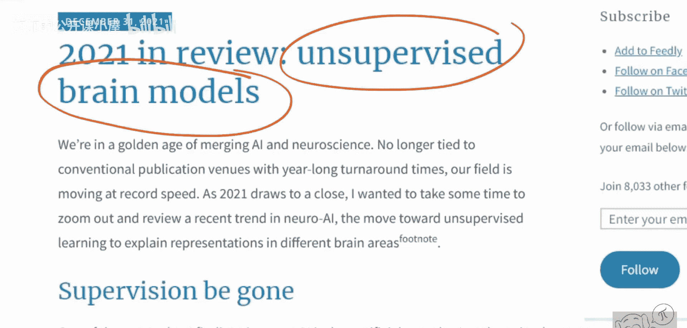
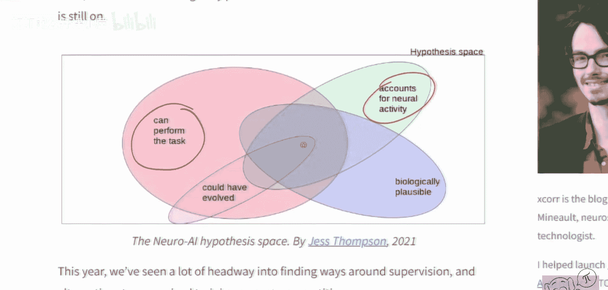
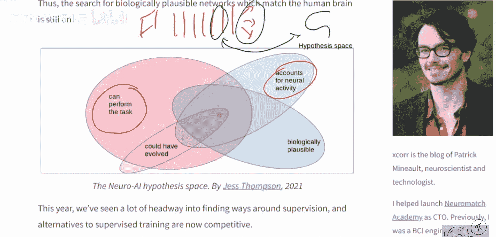
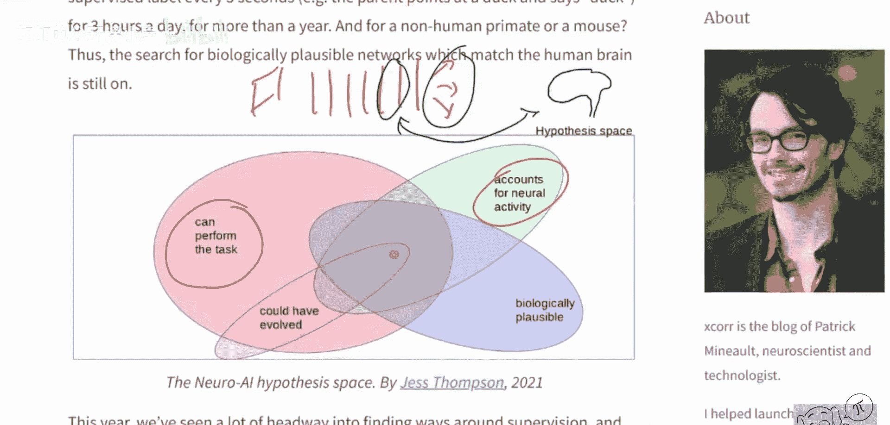
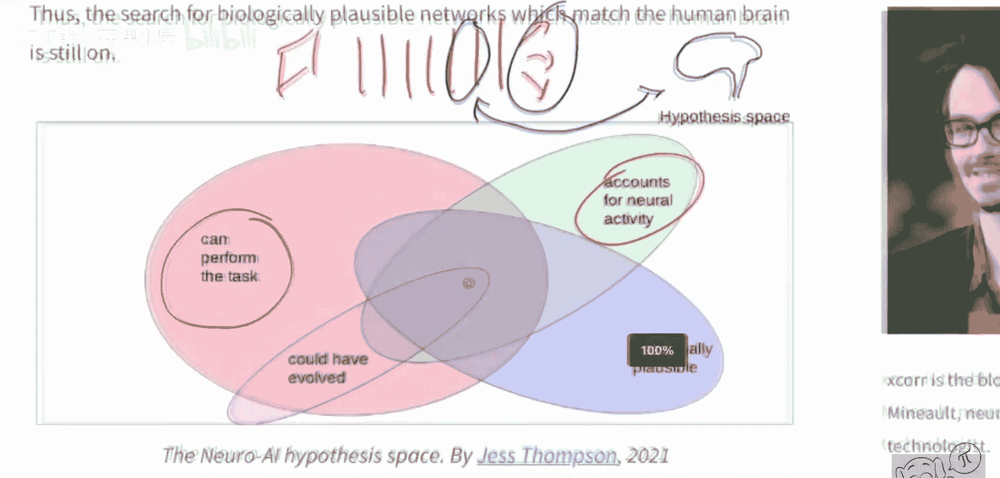
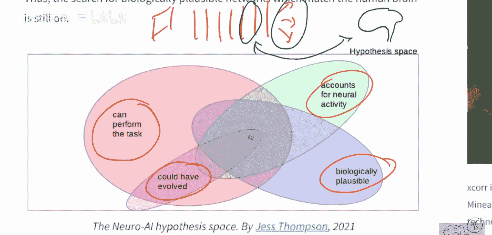
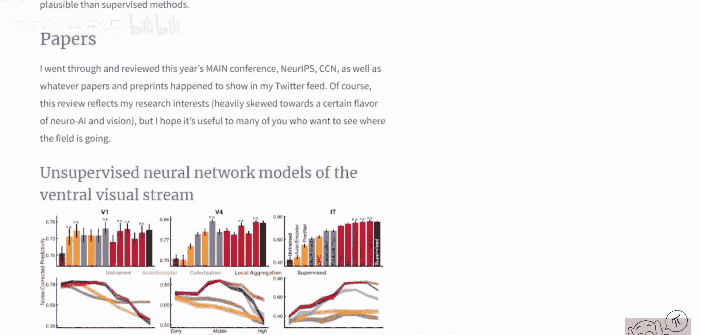
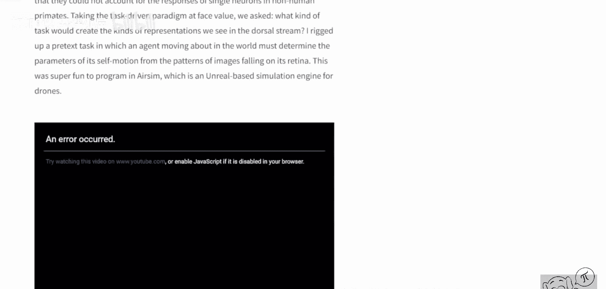

# YannicKilcher【中英⚡AI经典论文领读(全203篇)(下)｜Papers Explained】 p68 P168 无监督大脑模型——深度学习如何启发神经科学？（与Patrick Mineault合作） [BV1j8x5zJEvx_p68]

Hello there。 Today I'm interviewing Patrick Minno， who has a PhD from McGill and did a postdoc at UCLA。

 He's an independent scientist and a neuro data scientist。

 his interests are neuroscience and the connection to machine learning。

 He has an awesome blog called Xcore， which I guess is pronounced crosscorre， but who knows。

 So please check out Patrick's blog。 He also worked at Google for a while seeing how people interact with webp pages and was a brain computer Inter engineer at Facebook reality labs。

 He also has launched the neuromatch amy， which is sort of an intro and amy where you learn in a summer school about computational neuroscience。

 This runs every year and you can take part if you want。

 We're gonna touch on that a little bit in the interview， I just wanted to take it away beforehand。

 So I'm going to give a little introductiontro。About what we'll talk about and then we'll jump into the interview We're going to talk about mainly about this blog post right here。

 the 2021 in review unsupervised brain model。 The main focus here is on unsupervised models and how what they have to do with the brain。

 So a big question in neuroscience is how does the brain work。

 I guess it's the main question in neuroscience and so people are developing the hypo like hypotheses of how the brain works and deep learning turns out to be quite an interesting tool for neuroscientists because in deep learning we get some inspiration from neuroscience。

 but essentially we build model that end to end can learn some task to perform some tasks So this would be this one right here Now the question is is what deep models do the same or different than what brains do given that they solve the same task。

Like let's say both recognize objects on images。 do they do the same thing or do they do something completely different So neuroscientists。

 they wonder you know how does the brain learn stuff。

 is it the same as neural network does the neural network now also during the injury have to stop saying neural network because it's ambiguous in this context So does a deep network。

 a computer， a humanmade deep network， does it account for neural activity which means that or the signals in the deep network。

 the same or related to the signals that we see in the brain and this turns out to be very important tool for neuralscientists what they want to see is that let's say the intermediate representations in the neural network like you have some kind of picture it goes into a neural network。

 there's layer layer layer layer and then there's a classification head the classification head might not be that interesting but what is interesting is like some intermediate representation here。

We figure out that that explains， which means we can correlated with things that are in the brain。

 and I'm going to draw like a very bad brain right here if we can correlate this with things that are found in the brain signals like from FMRI from electrodes that we put into people's heads then that is an indication that what these deep networks are doing have something like there ist an effect that is similar and that could help us understand the brain。

 So the holy grail by in neuroscience would be something that can perform the same task as humans that does account for neural activity that is biologically plausible as you might know there is still a debate of whether something like backpro is implementable in the brain in one way or another or if we need an entirely different mechanism in the brain and lastly。

 something that could conceivably also。

Have evolved， and maybe we'd even have some evidence of how it evolved over time。

 So we're going talk about these models right here， specifically selfsupervised models。

 selfsupervised models here is a slide by Laque or models that don't need labels to train and what you usually do is you block out part of something you know and then try to predict that from the parts that you do know。

 For example， if it is an image again， you'd block out some part of the image。

 and then from the rest of the image， you'd try to predict that part that is a selfsupervised method theres also contrastive methods which are self-supervised。

 which means that you'd have an image and you make two different views of it， for example。

 by cropping the image in different places and then you try to train a model that can tell that these two things actually belong together come from the same image and that they are apart from。

I'm going to draw inverted arrows right here。 they are apart from like a third image that has nothing to do with this image these are contrastive methods and it turns out that if we build models that learn in self-supervised in contrastive ways and especially in multimodal ways that we end up with models that can explain brain activity fairly well so we're going to jump into the papers right here in the interview pretty quickly but if you keep watching the interview Patrick goes also into more like highlevel explanations of neuroscience in general。

 it is a bit my fault that I immediately it was like so what does this paper say but I promise you if you keep listening throughout the interview there are great insights into the entire field of neuroscience into what are open questions into where can people go to where can people go to learn about this and if you even want to research this if you're in deep learning right now and you're interested in neuroscience。

This Patrick says it's a wide open field， there's lots of papers to be published and the conferences are especially something like Nips are pretty receptive to papers that connect deep learning with neuroscience or in general try to explain neuroscience neuroscience things So as I said we're gonna jump into the interview now don't want to spend too much more time because we're very detailed in the interview check out Patrick's blog and all his other endeavors and I wish you a lot of fun bye。

🎼。

Hello everyone today here with me I' have Patrick Minno who is a neuroscientist slash blogger slash anything else that you might imagine in between deep learning and the human brain welcome Patrick to the channel for this bit of a special episode I guess thanks it's great to be here。

I got I got sort of knowledge of you through your article 2021 in review onsupervised Bra models。

 you wrote down what happened in the last year in terms of the connection of deep learning and how to let's say how to explain the brain what is your what is your background in this area。

 how did you come to be in this in between space between neuroscience and AI Yeah absolutely so actually originally studied physics and you know after I'm my undergrad I figured you know maybe I don't want to do string theory for the rest of my life like that sounds it sounds like some of the questions that to ask like interesting questions you need to really be pretty advanced but I think in neuroscience there's some questions that are pretty right for the picking and that are obvious for even somebody that's。

Pretty far outside the field so for instance， what is sleep。

 what does it do that's like a pretty easy question that's very hard to answer so I went to do a PhD in computational neuroscience at McGill。

And one of the fields of my study was really that intersection of neuroscience and artificial intelligence now when I started my PhD which was in 2008。

 deep learning really wasn't a thing I guess like some of the original papers by Benjiio and and Jeffrey Hinton had been。

They were out， but the big event， I think。Presenting deep learning to the world and saying like this is really this is a big deal was I at 2012 right as you know。

 so that was during my PhD so at the the very start of my。Of my PhD presentation and my PhD defense。

 I would say something like， look， you know you have neurons in infremporal cortex which is one part of the visual stream and they're able to do visual recognition and I would present examples of these neurons and their invariant and tilt to things like lighting rotation scale et ce。

 we don't know how to make a computer that does that but if I gave this presentation just six months or a year later。

 I would never have been able to say that because people have been like you you could just you even Alexnet would be able to do that so that's a little bit my story my introduction to neuro ice I was there like during that transition towards deep learning and in fact at the end of my PhD was I was working on deep learning to try and explain some of the brain areas that I cared about。

as are the areas of the dorsal stream and those are like really brain areas that really care about motion。

And so I was poking around with what was， I'm going to date myself。

