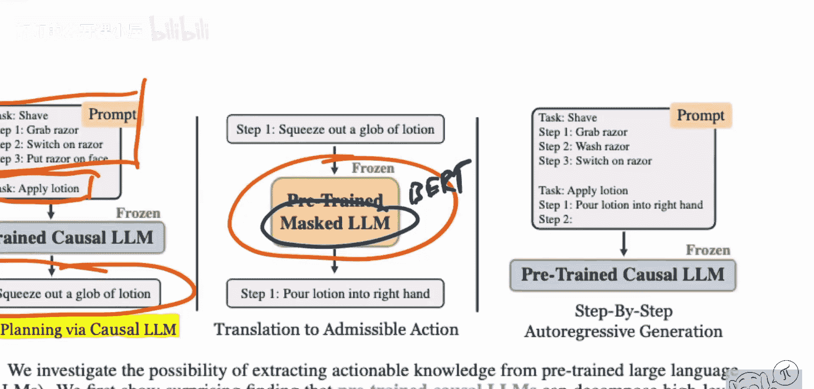

# YannicKilcher【中英⚡AI经典论文领读(全203篇)(下)｜Papers Explained】 p69 P169 语言模型作为零样本规划器：为具身代理提取可操作知识（+作者） [BV1j8x5zJEvx_p69]

Hello there。 Today we're looking at language models as zeroshot planners extracting actionable knowledge for embodied agents And I'm going to interview the first author Wen Long Huang in a few minutes。

 So first， there's an explanation of the paper 1015 minutes or so I'm going try to keep to it。

 And then we jump into the interview where we can discuss this paper at length On a high level。

 this paper asks， can we use the knowledge that is inherent in large language models like G3 or surprisingly open AIs codex in order to do planning in what they call embodied agents。

Ultimately， it's going to be this environment right here。 I don't even know what。

 it's the virtual home environment。 And it's about virtual home。

 you have to fulfill some tasks like brush your teeth。

 Then the model has to come up with a sequence of steps that are admissible by the environment。

 So there's a level of admissibility of action。 predefined actions that are admissible。

 The model has to come up。

With these actions in order to fulfill the task， the model is then rated based on executability and correctness of their plans。

 and it turns out that the larger the models get as you can see right here。

 the less executable the plans become which means that the actions they generate aren't admissible by the environment。

 Probably because the models are more， let's say powerful。

 they can express themselves in more ways they have different ideas of how to reach goals。 However。

 the correctness。 this is human evaluated of these models rise as they grow larger。

 So this gives you an indication that the large models seem to have quite a lot of knowledge。

 and we have to say these aren not trained。 the entire paper just works。

 except for one baseline evaluation just works with pretrained models。

 they are not fine-tuned at all on this environment right here。

 So what this paper does is it says well， given that the larger the models get the more correct their plans are。

 Can we do something。To fix the issue with the executability to that。

 they develop these translation procedure right here。

 These are three specific improvements they do to the models in order to get their executability up。

 you can see they sacrifice like a little bit of the correctness。

 but they do make the plans largely executable in the environment。

 and therefore procedures like this could be applied in many different ways。

 it's not only about the virtual home environment and so on。

 it's essentially anywhere where you bring together the knowledge that is inherent in large language models with some sort of a domainspec language or a grammar or anything like this。

 like where you have to transfer that knowledge into a new domain。

 but you don't want to train a model to do so。 So we're going to see how they do it really briefly。

 First of all， the environment itself， As I already said， is this now this is visualized。

 although they never work you know actually in 3D just a small correction here because I messed this up。

 there are actually two versions of the virtual。Environment。

 one is a Python version that focuses on the textual interaction with the environment。

 The other one is implemented in unity and actually does work in 3D。

 The developers of the environment mostly focus on the unity environment because it's more real。

 but as of yet， that has a subset of the actions available that the Python environment has and the authors of the paper use the python environment and the data that comes along with that。

 We're gonna go into this more in the interview。 Stay tuned。

 They simply grab the data set of possible tasks。 Some tasks you can see right here。

 a task could be throw away paper and other tasks could be brush teeth and there there be a sequence of steps。

 This environment is made by humans So the tasks are made by humans and then other humans have to come up with the steps that are admiss admissible actions in this environment。

 there are I believe a number of objects that are defined。 They're predefined。 Yeah。

 so there are a number of objects。 for example， living room。Television so and so on。

 And there are a number of verbs。 So walk， find switch on and so on。

 And not every verb object combination is possible。 Some verbs have two objects and so on。

 But essentially you combine the predefined verbs and the predefined objects and then the state of the world changes。

 So the world keeps track of states。 there are certain preconditions， for example。

 you can probably only sit on the sofa。 if you are in the vicinity of it。

 So you need to first find the sofa。 you can only switch on the television similarly。

 if you have first founded the television or walked to the television or something like this。

 if the television is in the living room， you first need to go to the living room and so on。

 So there's a hidden kind of a state。 but all of this is constructed。

 And we talk about this in the interview。 like what's the appropriate granularity of actions like this。

 And isn't this a major issue。 but it is made all with the humans in the loop。 So the data。

supposedposed to be kind of the most natural expression of these tasks as split into steps that a human would come up with。

 So this is the grammar of the environment and the language models they don't they don't know about this grammar。

 They're just language models。 So what they do is they take something like G3 and they make a prompt now the prompt as you might know in G3。

 you have to give a prompt。 So the prompt could just be like here's the task you know blah， blah。

 blah， brush your teeth。 then what's step1。Right and then G3 will probably it will probably even generate step 2 and 3 and 4。

 but it will probably not be according to these actions in these templates。

 you can help this a little bit by putting a prompt up here So the prompt they use is one I believe one specific plan so they have already like task up here some task and then some number of steps so that the model kind of knows what is expected。

 We also talk about this in the interview and this could potentially be improved by multiple multiple prompts and so on。

 but in the baseline they have one particular prompt and then one of the improvements is actually to select a more optimal prompt。

 this is the basic setup。 you have a goal in this environment with a fixed grammar and you task you input this right here to your language model and the language model will spit out the plan。

 Now what do you do with the plan， The plan you score like how good is the plan and they have two。

Different scorings available。 One is executability and executability is just like it's essentially parsability by the environment。

 So in executability， you ask yourself， can it be correct parsed。

 which means that is the syntax according to the syntax of the environment and they do have a little translation procedure like a little heuristic translation procedure for the baseline in place so that the language model probably can't get it exactly right。

 but they do sort of translate to the closest action there。

 but also one of the improvements is related to this And then also does it satisfy the common sense constraints of the environment and these would be programmed in like for example。

 you can only pour yourself a glass of milk if you first open the fridge and and grab the milk。

 This can be measured directly what cannot be measured that well is correctness So these models that would come up with plans and independent of whether they're executable or not they could be correct right。

That's where they ask humans so they use human evaluations。

 they conduct human evaluations in order to score the correctness of whatever these models output so they give it to a human ask the human does this look like a sensible plan in order to brush your teeth and the human would either say yes or no when they do like ablations and so on。

 they also use like longest common subsequences between two programs and so on in order to not spend ginormous amounts of money on humans but essentially the correctness metric is a human metric it's also interesting because you thought you could just execute like the plan in the environment and that give you like does it succeed or not。

 but they say correctly that for a task like make breakfast there's not really a defined end condition that you could programming to the environment to give a reward so it's more accurate to ask humans whether a plan is correct As you might have guessed this environment is very humancentric it's made by humans with humans in the loop and so on。

It's supposed to really be sort of a representation of human tasks and human plans to human tasks。

 Alright， so now we're going into the improvements。

 There are three distinct improvements they make So if they just do this。

 if they just do what we've described so far， then the graph up here results excluding the two models on the right。

 You can see the larger the models get the higher their correctness。

 but the worse their executability So now the thought is can we change that。

 Can we raise the executability。And so this is the baseline right here。

 zero shot planning via causal large language model， you put in a task。

As a prompt and along with like the format you expect， which is this one right here。

 which is some other task from the data set， then you use the pretrained language model like GT3 or something and that will give you a plan and that's it So the next thing they do is they do what they call a translation model So they introduce a second model which is also pre-trained and this is it's not trained on translation It's just trained on masked large language modeling So think of this like this is just Bt In fact I believe they use sentence Bt just pretrained on English language and what they do is they make a big vocabulary of all the admissible actions。

