# YannicKilcher【中英⚡AI经典论文领读(全203篇)(下)｜Papers Explained】 p70 P170 超Transformer：用于监督与半监督少样本学习的模型生成（无作者信息） [BV1j8x5zJEvx_p70]

Hello， today， we're going to look at hypertransformer。 This is a model for few shot learning。

 where you get new data that you haven't seen before with potentially new class labels。

 So this model takes in a set of data points and corresponding class labels and its output is the weights of a convolutional neural network that can then be used to classify those data points and corresponding test data points。

 This is very useful because it decouples the model that does the meta learning or the few shot learning。

 It decouples the size of that model from the size of the model that then does the actual inference on the data。

 which means that I can have a big model doing all the meta learning things and end up with a very。

 very lean connet that I can deploy anywhere。 It's very useful if this needs to be deployed on mobile phones。

 It's very useful if there are privacy considerations， federated learning anything like this。

 So the hypertransformer， It doesn't classify data itself。 It actually produces a。😊。

Model that classifies data， which is very cool in itself。

 So the models are quite performant by itself。 They're not super good。 like they're not the best。

 but they're good enough。 And potentially they could even be used as a starting point to then refine and and do some more training。

 So this is what we're going to look at today。 This research is by Andre Schmoov。

 Mark Sandler and Mark Vladirrov。 And I'm going to interview Andre in a bit here on the channel。

 He joined me and we had a nice conversation about the paper。

 So please let me know if you like styles like this。

 I feel it's a big boost to have the authors on with these paper reviews。

 but you need to tell me how to make the best use of their time how to need to make the best use of your time。

 The viewers time， because I don't want to make these videos like more long than they have to be。

 but also want to give you the opportunity to sort of pick and choose。

 Some people prefer just my explanations。 Some people prefer the interviews。😊。

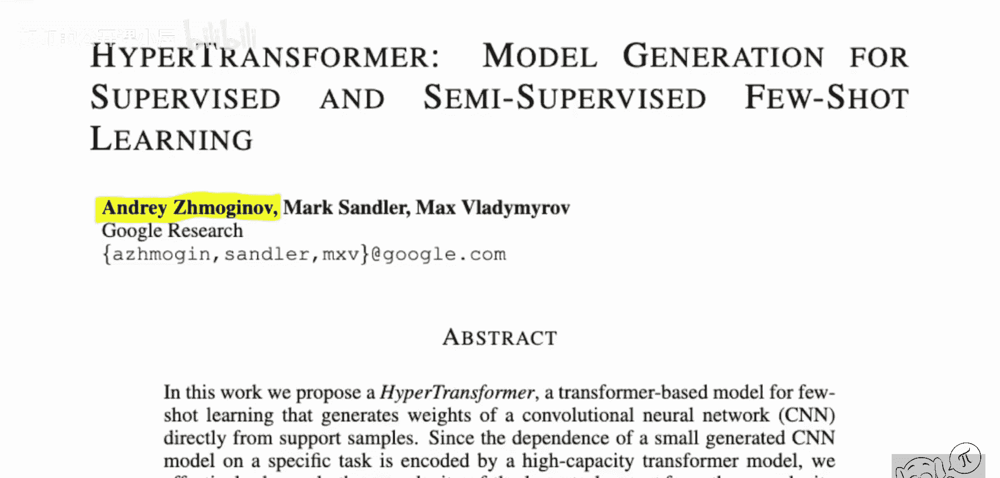

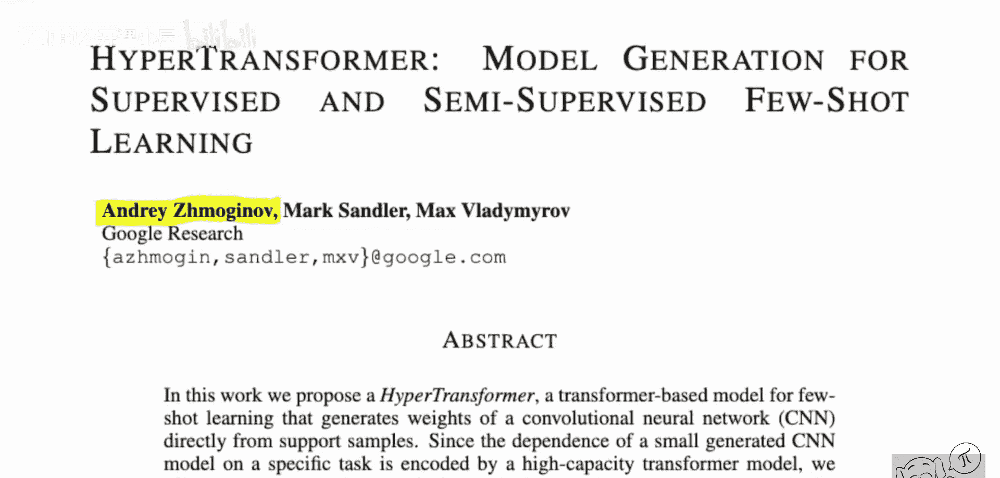

And I view it as like a bit of a buffet。 But please let me know in the comments how you would like a paper explanation with an author to be structured the best because it's。

 you know， ultimately it needs to be good for anyone watching。 All right， let's dive in。

 the interview is gonna be a market。 there's chapter annotations down in the bar here， you just look。

 if you want to skip to the interview， feel free。 So the hyper transformformer is a model。

 And it says it says it in the name。 It's a hyper transformformer or I mean。

 you could you could also have called it like meta transformformer or something like this。

 It is a model that in itself produces weight。 And what is it useful for It's useful for few shot learning。

 and this is one of the things I appreciate about this paper。

 which I only really realized after I've done the interview is that in just the framing of the problem itself is very special such that the model is quite good at it。

 which is maybe a lesson for all。😊。

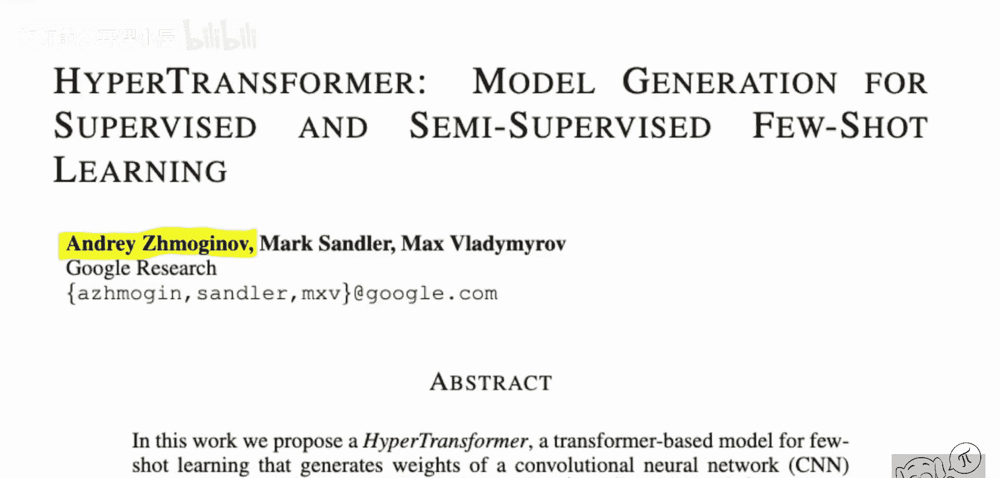

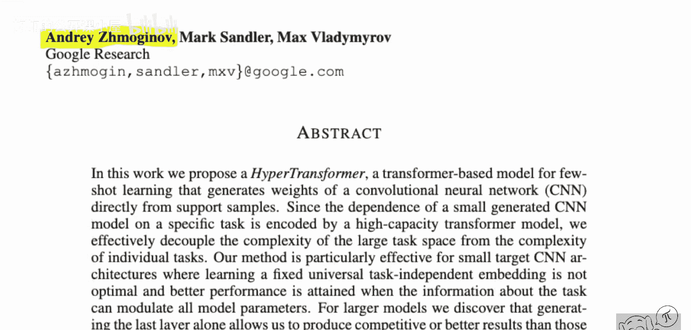

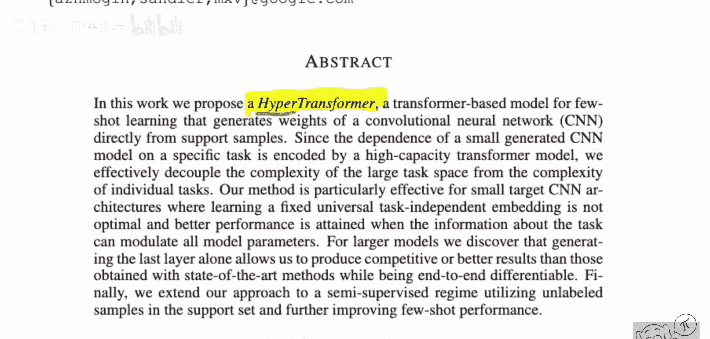

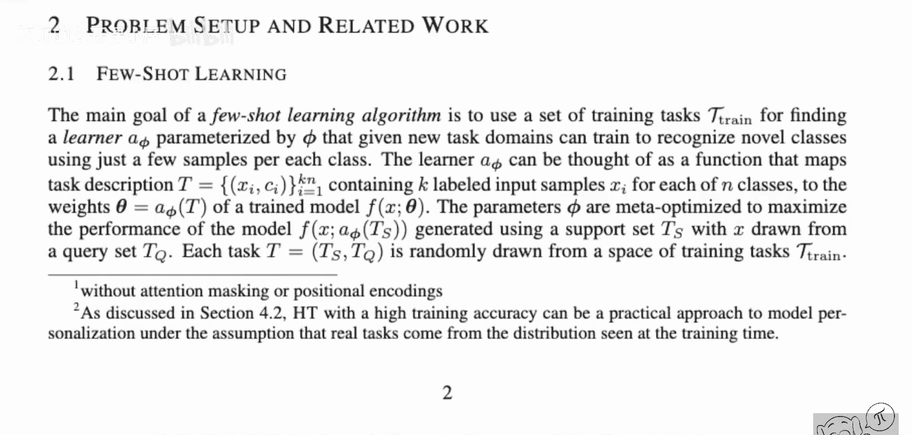

Of us in research to already look for the good problem。

So what we're going to end up with is we're going to end up with a few short learning setting。

 in few shot learning， you want to build a model， like let's call it model M or just some sort of an algorithm doesn't even have to be a model and that model M will get just a few data points。

 let's say these are images like okay get in this case，4 might be some more than4。

 But a couple of dozen images or something like this。

 So not a giant amount of images with their corresponding label。

 So let's call let's give each one a y like each one a label。 And I want to take this data set。

 I want to input in into this box， and the box should come up with ideally a model。

 So the box doesn't have to be a model， but let's call this like a neural network over here which should then be performant on the data that on the distribution that this small amount of data has come from。

 The challenges are obvious。 You only have very little data to do this。

 the second challenge is that these labels might。

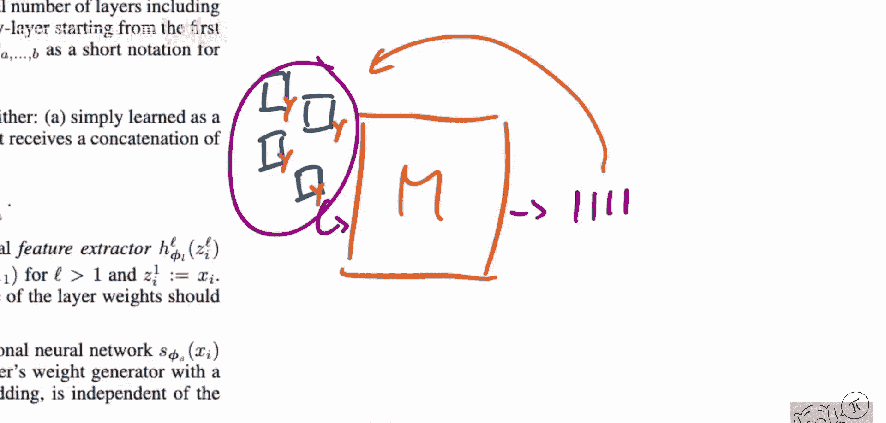

Come from classes that you've never seen before。 right， there might be new classes。

 So this is the general task of few short learning。

 The advantage is that very often the task isn't completely new。

 So the task isn't like a complete surprise， but the task itself。

 This is what it's called a task right here。 The task itself comes from a distribution of tasks。

 which means that you have kind of like a data set。

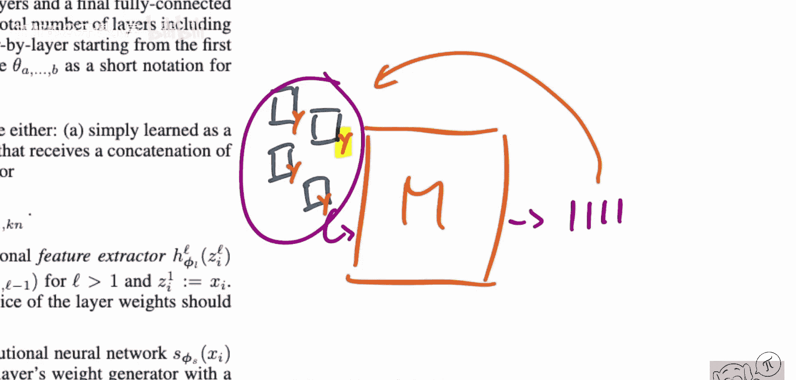

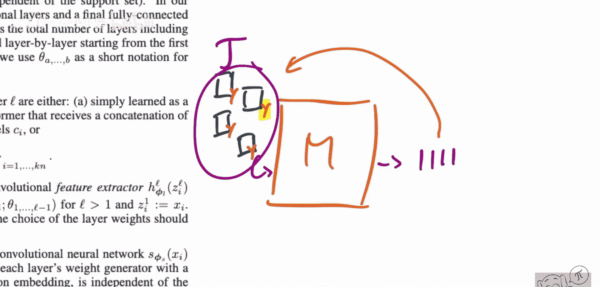

That have many such tasks here。 So here is a task， right。

 This is a data set with some train and test samples， each one having their labels。

 And then so this is a task。 And then there might be another task and another task and another task。

 So consider this sort of like a machine learning problem except the data points our entire task。

 So you want to build a model that takes in such a task and gives you a good classifier for that particular task。

 Now， the question is， obviously， how you do that。 what most people do， or not most people。

 What has been popular previously。 And I've made a video for example， for I mammal。 So I mammal。

 I think it it's written like this L。 There's an L here。

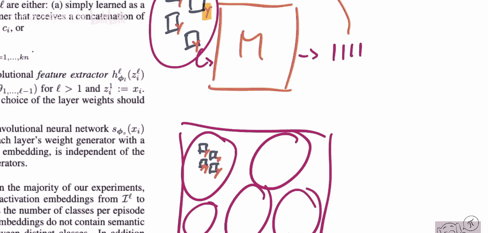

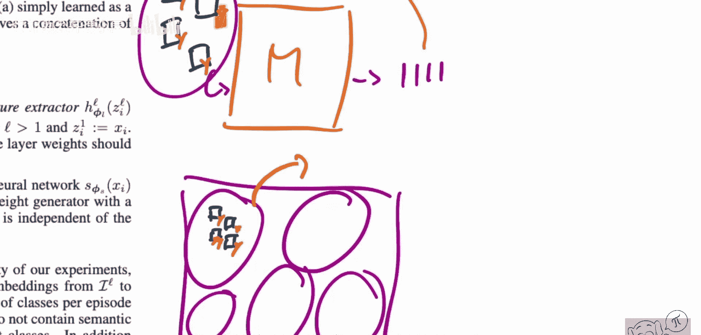

This is a technique about meta learning。 So what you would do is you would train one big model。

 You train a big model。

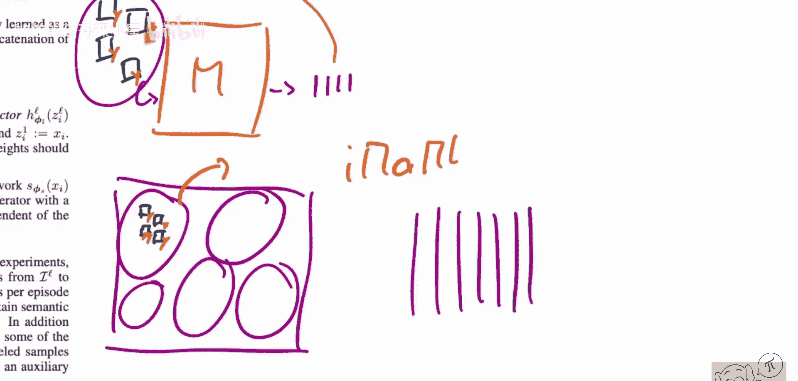

And you train it with each of you sort of train it with each of the tasks。

 And what you do is you want to end up with a model that is kind of like a common initialization for all the models。

 So when you get a new task。 you want to take this model。

 and you want to fine tune it for a couple of steps for that particular task and if you get another task。

 you want take the common initialization。 you want to fine- tune it for that particular task。

 So for each task， youd end up with the same model with this model right here。

 but fine tuneuned for that particular task。 This is what we do。

 it's very popular if you think of things like Bt or so this is essentially what we do we get to a common initialization and then we finetuned that。

 except methods like Immal explicitly train that initialization for the purpose of then being fine- tuneuned to a few short learning task。

 So potentially having new labels or potentially the same labels。

 the problem is obvious the models are the same。

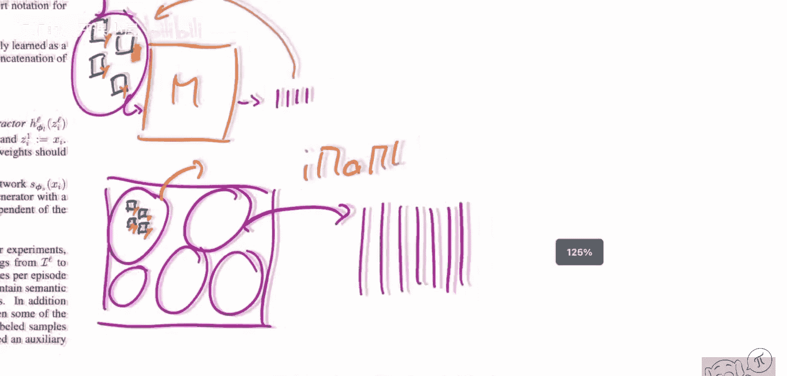

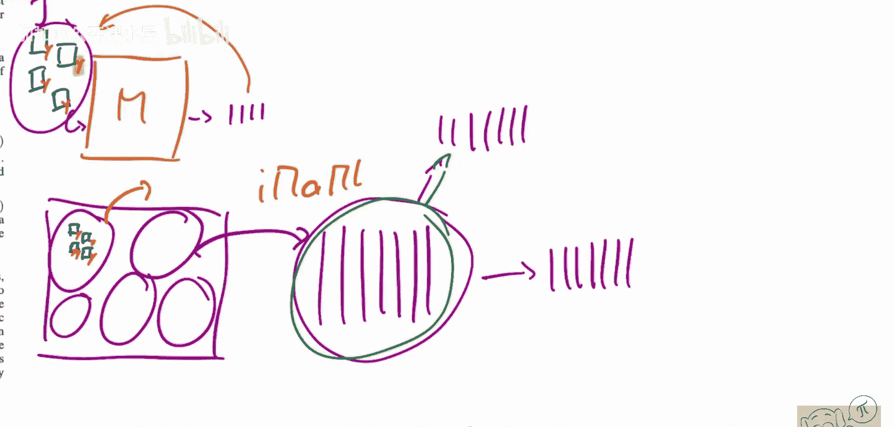

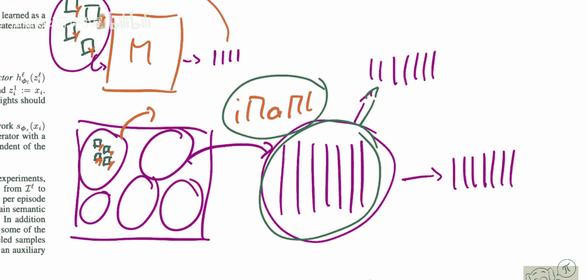

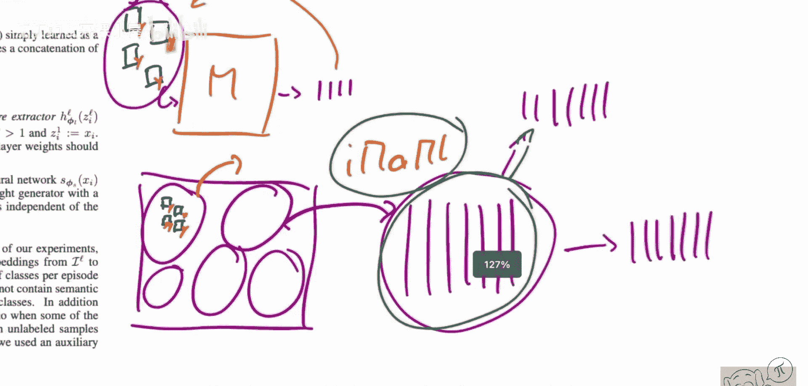

And this model right here。 they're the same like architecture。

 It's just one is a fine tuneed version of the other。

 And there's the question right for is that appropriate for the task， Like。

 is this model right here appropriate for this task。 Maybe you can say， well， maybe not。

 it's just a few data points in general， if I have few data points I might want a small lean model。

 though it doesn't like blow up， it doesn't overfit。

 Also maybe you know where do I use few shot learning。 Well。

 probably I use it when I need to have a model for every user like you have your photos library。

 The photos library has a couple of dozen pictures in it。

 now you want to train a classifier on it And your classifier is gonna be different from the next user's classifier and so on。

 So there's no common classifier it can be personalized And also there。

 this needs to like run on your mobile phone if that's the case。

 And then you don't want like this giant model。 So we want a lean model， However。

 if you look at the model in the middle。

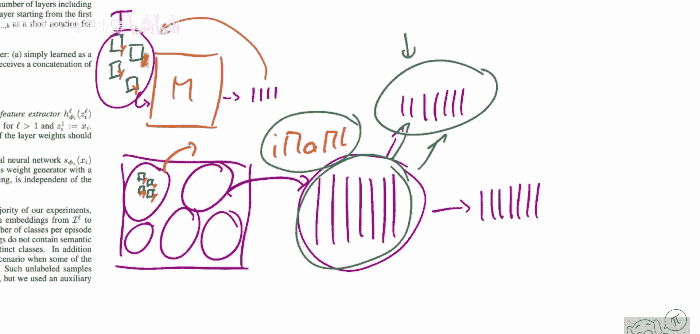

Right here， like this one。 Of course， this needs to be big。

 It needs to like cover all of the different tasks that could be。 and then some more。

 like it needs to train on a distribution of task to be able to classify tasks that it hasn't even seen before。

 So that one needs to be giant ideally as big as it can get to absorb all the information So there you have the dichotomy and the weakness with the approach of having the same model being fine tuneuned down the road。

 And that's why the hypertransformer does a different thing。 The hypertransformer says， well。

 I have a big model right here。 And that model will produce the weights of the small model。

 So we won't fine tune anything。 We will simply forward propagate the task through the model。

 And then that model will spit out the weights。 And we're gonna to do it in in kind of a smart way。

 because I believe this has been tried before。 I think even I have tried it before。

 and it usually doesn't work and has particular reasons why。😊。

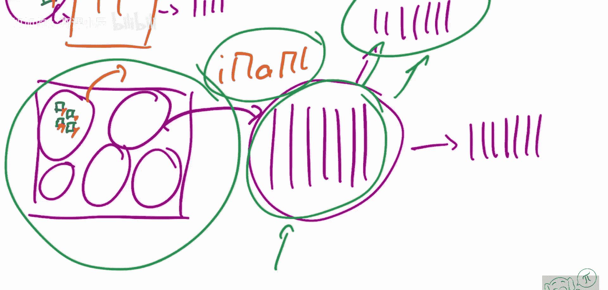

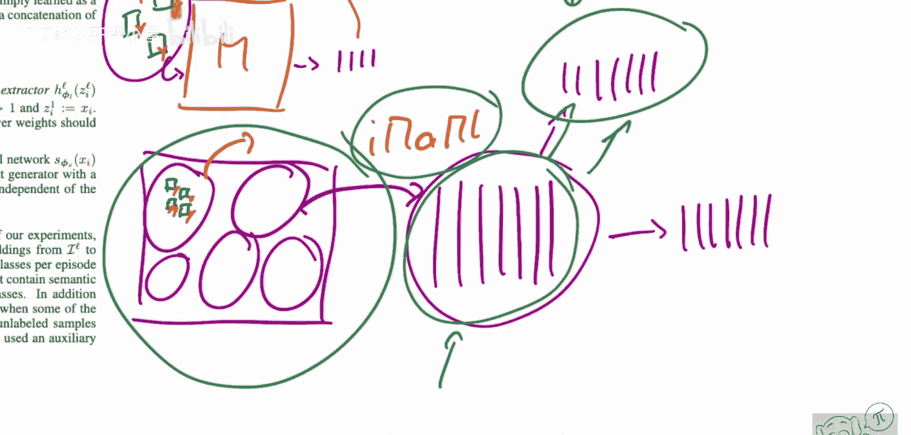

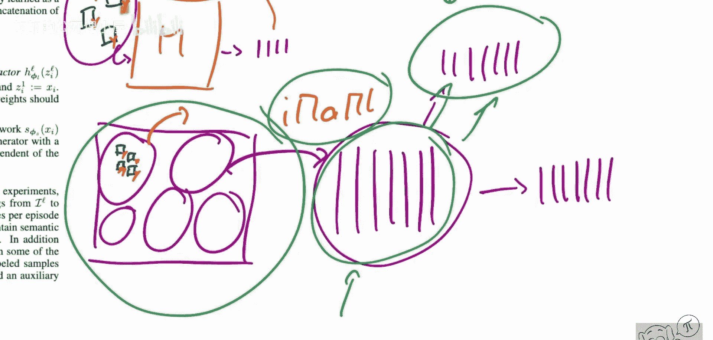

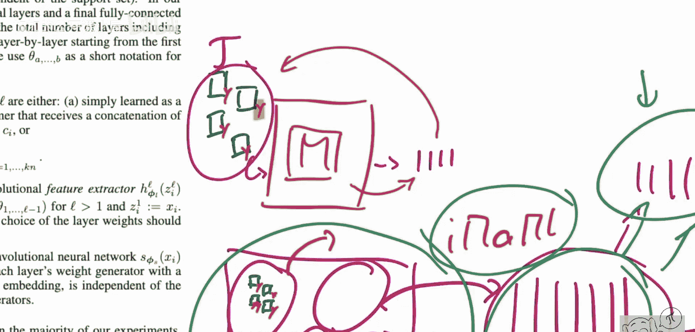

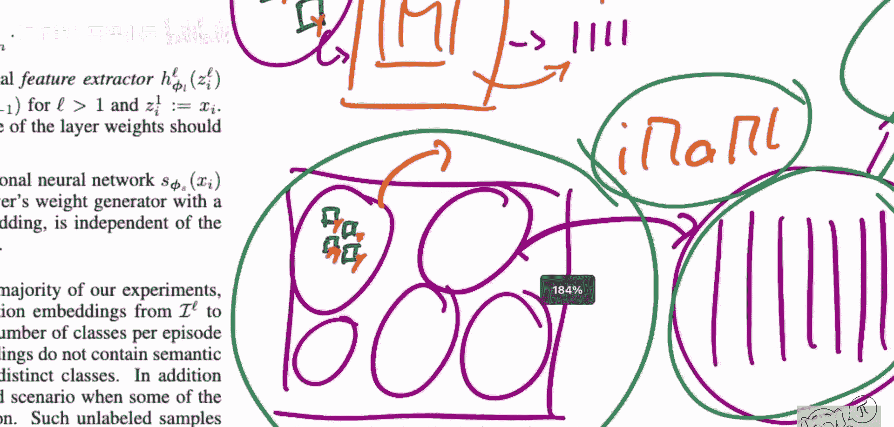

Doesn't work among other things， neural networks are quite bad at hitting exact numbers。

 They're good at classifying。 But when it comes to like regressing on numbers， they're quite bad。

 also， there are errors that build up and so on。 We'll get into that。 However， what I said before。

 the framing of the task。 Now， few shop learning can be characterized in a few different ways。

 Sometimes often it is also said， well， we have like a big data set available big data like imagenet or so on。

 And we use that to pretrain the big model right here。

 And we use that to sort of prepare the model for few shop learning。 this is particularly not。

 I'm sure you could somehow get it in there。 But in this particular thing。

 the model needs to be able。 It's a transformer needs to be able to take all of these samples into its input。

 So into its context window。 And therefore， it's almost like the model is limited to an upper bound of number of data points。

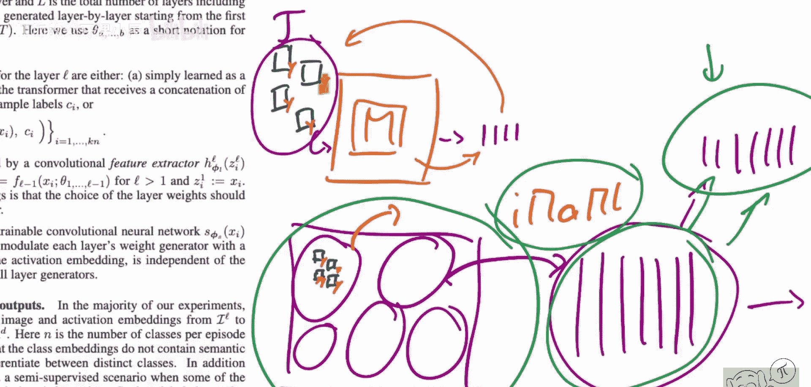

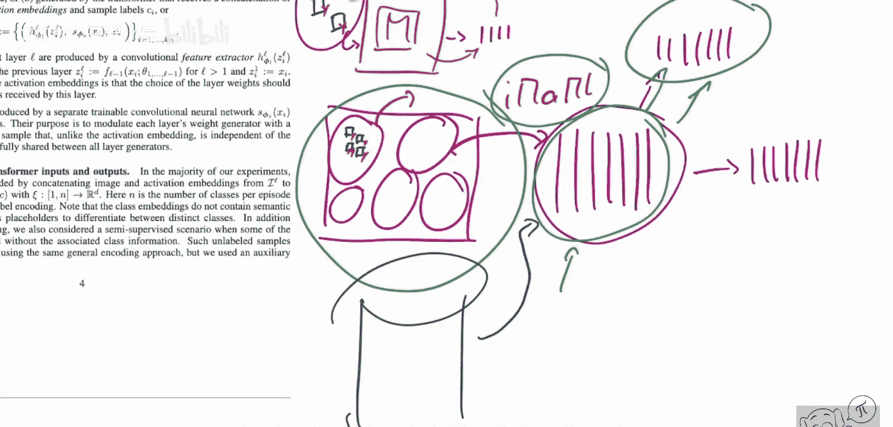

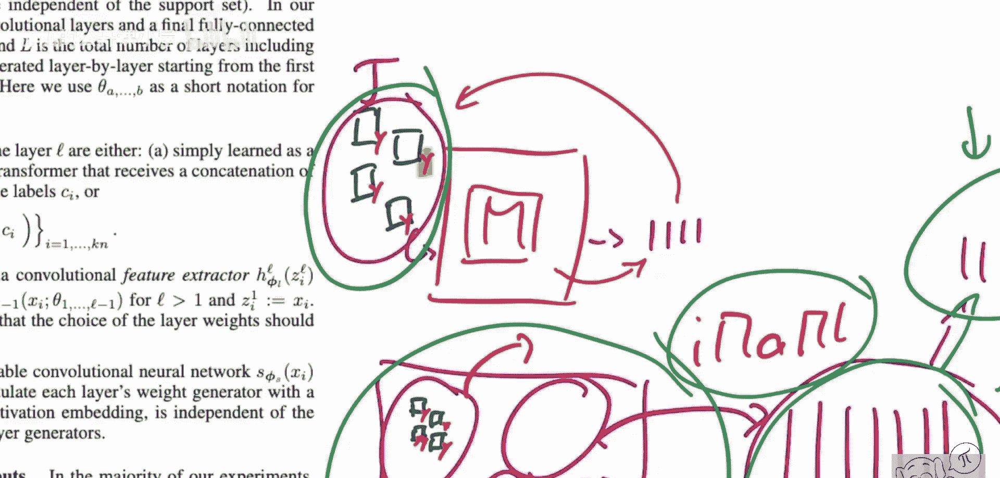

That it can it can input。 So the framing of the task itself。

 like few shot learning means you have these tasks and every task has few samples and so on。

 you know， differentiate from the framing where few shot or meta learning means that you want to you wantna you get a big data set and then you want to fine tune it on many small dataset sets that distinction is a smart one。

 if you write a research paper right it is it is if you say， well。

 we're actually in this situation And here the model makes perfect sense， right。

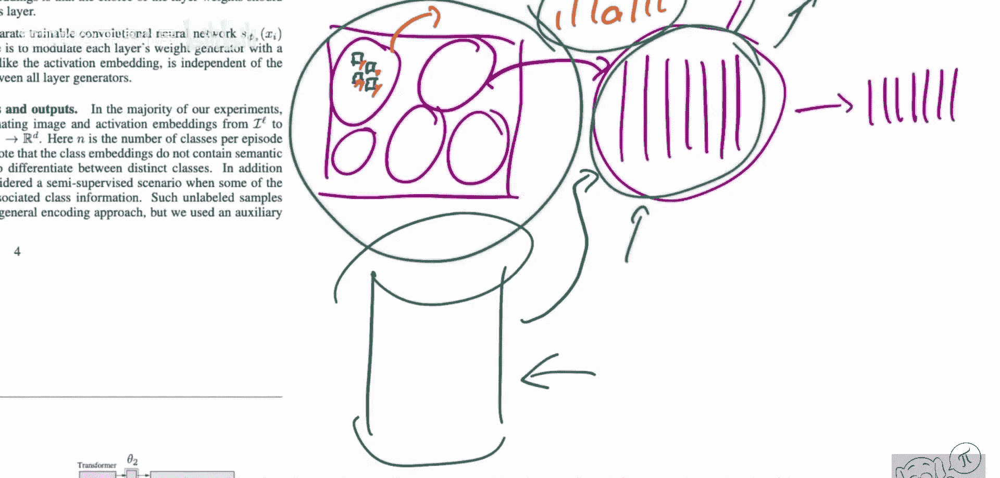

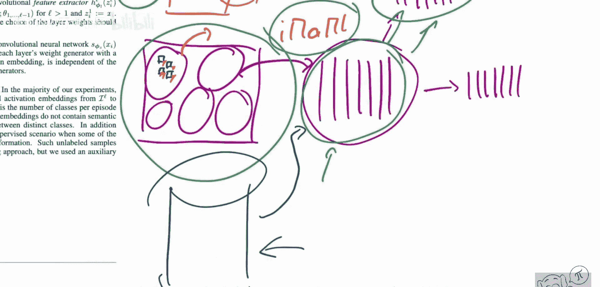

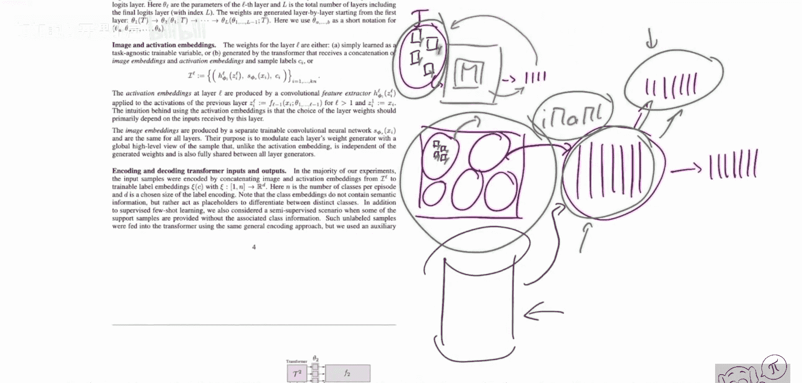

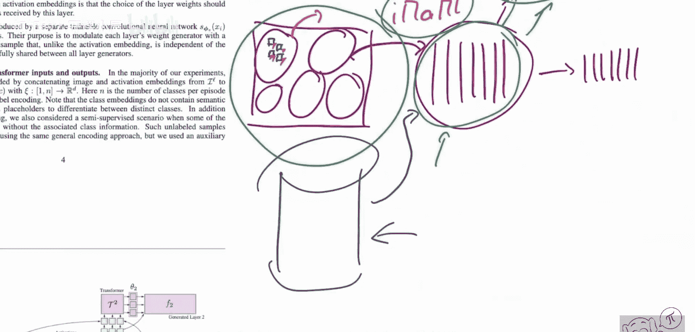