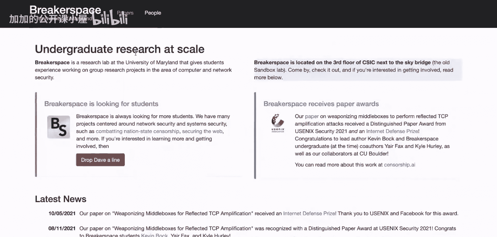
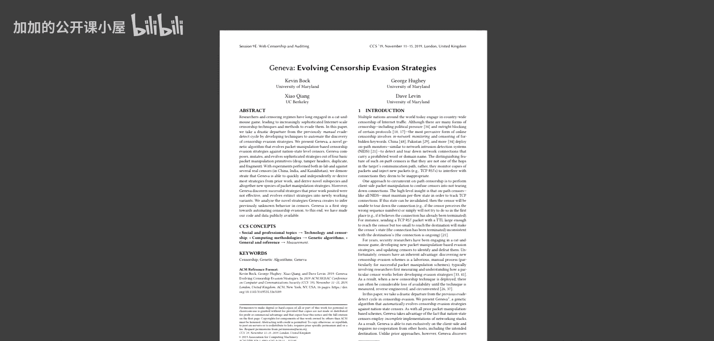

# YannicKilcher【中英⚡AI经典论文领读(全203篇)(下)｜Papers Explained】 p71 P171 对抗审查的人工智能：遗传算法、日内瓦计划、机器学习在安全领域的应用及更多！ [BV1j8x5zJEvx_p71]

🎼Hello there Today I'm talking to Kevin Bach， who is a cybersecurity expert and one of the main people involved in the Geneva Project。

 Geneva is a genetic algorithm that evades censorship by nation states。

 So in real time Geneva can evolve to the ever more present danger of censorship by really big entities such as governments all of this is done through an evolutionary search over a program grammar。

 and in this interview， we're going to touch on a whole range of topics。

 including Geneva how it works， what it does， why people research it and what it has done so far in the world。

 but also the broader topics of security and its connections to AI。

 how people can get started in this field and what the main questions and problems are in this space Further Geneva comes out of a project at the University of Maryland called Ber space which is a sort of lab that includes undergraduates in security research which is a really cool project。

🎼I think highlighting this would be helpful to some people maybe you're at the university you don't know this exists go there。

 take part All right， without further ado， I want to give over to the interview and have fun。🎼。

Al right everyone， I have with me today here Kevin Bach。

 who is a PhD student at the University of Maryland。

 a cybersecurity researcher and a member of Breaker Space。

 which is a pretty cool project at the University of Maryland。

 He also has been in the news a little bit with a project that's called Geneva。

 which uses genetic algorithms to evade censorship by nation states and I think that's pretty cool so Kevin welcome to the show and thanks for being here。

Thank you。 Thank you for having me。 I'm excited to be here。 So the， the goal of today。

 it's a little bit different because I'm a total new about security。

 Most of the audience of this channel is not is into machine learning。

 Maybe some know about security。 some know about。😊。

The the censorship apparatus that's in place around the world and what people do about it。

 I think most won't。 So today I'll be asking mostly newobish questions and we'll have you here to guide us through everything to guide us through like what's happening in this world So maybe you first can start off a little bit。

 How did you get into like how did you get to the place where you are。

 what's kind of the the main things in security right now that draw you to it。

So I think security and the censorship space also is in this really cool this really cool time where AI and ML techniques have been exploding in all these other fields and they're just over the last few years really breaking into security and we're still figuring out all the different applications where you can apply these techniques in security there's new techniques and new applications it is that people are discovering all the time from better ways to detect spam and better ways to identify。

 hey this domain is malicious or AIbased scanners for that binary you downloaded。

 that's probably malware， things like that， so security field is still discovering all sorts of new ways you can apply these techniques and that was one of my motivations initially actually of bringing this censorship because this project was really the entire field of censorship's first foray into using AI and ML like techniques。

And if you talk about censorship， what do you mean exactly by that？Yes。

 there's so many forms of censorship in effect around the world today。

 I mean everything from political pressure to self-censorship to taking down put like there's so many different types so I'm going to scope this discussion down a little bit just the type of censorship that we study in this lab and that's this type of automated censorship that happens in the network performed by nation state so what would mean by this if you're a user in certain regimes around the world。

 let's say in Iran or something and you try and make a request as that request as that web traffic crosses through the border of the country it is scanned parsed and inspected by some machines that physically reside in the network called middle boxes called because they're in the middle of the network and these middlebox examine your request and they say is this something we should allow or not and if the answer is no they either inject traffic it take down your connection or they drop your connection or they do something to disrupt what's going on and you'll notice everything I just said there there's no human in the loop there's no like human。

review or anything like this it's a purely automated run by these middle boxes or firewalls deployed by these nations that just like automatically inspect internet traffic as they go by。

So that's really the scope what we've been studying here naive question， why。

 why can't I just encrypt my traffic and then like every traffic looks the same towards the outside。

Yeah that's a great question so why can't we just encrypt everything people's been trying so there's like a couple different approaches to this you're like well let's just use HBS right encryptryed we're good unfortunately HBS has a small privacy leakage when you first set up an HBS connection and that very first initial' called a handshake and that first back and forth。

You as the client， as a part of the protocol， you have to announce the domain you're talking to and that announcement happens unencrypted。

 so if you're making a HBS Hinshake to Wikipedia in the very first packet you send。

 it's going to include the word Wikipedia。And that's called the server name In field。

 you indicate to the server what the name of the server you're trying to talk to。

 and unfortunately sensors just read that fields and then they take down your connection if you talk to a forbidden domain。

So HtPS， unfortunately not close， but not quite finishing the job Now I will say there have been just a quick sidebar。

 there have been some advancements in HB to try and fix this。

 There's a recent proposal to encrypt that feels it's called encrypted SI in China just starteding censoring that last year so you can try encrypt things but these sensors are often just hostile to the idea of just letting letting their citizens just encrypt all their traffic I guess it's a little bit like if everyone encrypt like with HtPS nowadays everyone does it so you can't conceivably block Https you know just just because you don't like some traffic but if there's a new type of encryption you can it's probably only the people that have something to hide that use that type of encryption so is like is a strategy that the rest of the world as fast as possible would use these techniques to kind of make that approach unusable。

That's exactly that's exactly right and the broader topic you're actually discovering and saying out loud here is this idea of collateral damage of can we make a protocol or something so popular and use so diversely that if a sensor were to try and block it。

 it would cause areparable harm to like good services。

 there's some meaningful cost to performing that censorship so just like you've identified HB that's everywhere。

 they can't just shut down all HB but rolling out a new encryption method for HB that's not very widely deployed they can nip that in the bud and prevent its rollout so there's this kind of this interesting race in a game between developers and these sensors that's still being played out。

Now， let's， let's talk about more， let's say naive approaches。 What is the。

The development of the field， like what has been tried before and what has been， let's say。

 thwarted or what's the cat and mouse game looked like in the past。

 I imagine different things like there's tour。 There is， you know。

 all all kinds of things There is probably things that everyone installs on their end。

 like VPNs and tunnels and so on。 Like what's， what's been the general development over the years。

Yeah， so the researchers and sensors have been playing this cad mass game two decades now and it's kind of evolved and has's been playing out in multiple fronts so you're exactly right Tor has been a huge frontal network if you will we've developed tor and continue to advance it unfortunately though there are some limitations just the tourr protocol and sensors can enumerate the tour entry points basically and just block you so once you get into tourR you're generally great but they try and lock you out and there's been all sorts of techniques people have proposed like maybe I can disguise my traffic to look like Skype and then the sensor's like well you didn't disguise it quite well enough blocked there's a whole interesting field of defeating censorship or subfield I should say called packet packet manipulationbased censorship and this is this idea where all our communication is happening via packets and if you just tweak those packets and just the right way you could cause the sensor to miss you and。

That's also been something that's played out in this cat and mouse game where researchers will study these sensor systems and then they'll find a loophole and they'll deploy it and use it and then the sensor's like oh I'll fix that and then we're back to score zero so this game has really been continuing to play I'll call one thing out real quickly about VPNs with a lot of people particularly those who have been to China like I've been able to use a VPN and it's been okay。

VPNs in many places work in many places they don't。

 there's a country in the news recently because they were in the news because they rolled out a new law that forced their citizens to swear on the Qan that they would not use a VPN in order to get internet access installed in their homes it's just like a crazy sentence to say it aloud but in China for example。

 these VPNs many of them work most of the time but what researchers have noticed is that around the time politically sensitive events are happening or political。

 such is elections， things like this， a lot of VPNs will just mysterious stop working and then after the event they'll mysterious start working again。

