# YannicKilcher【中英⚡AI经典论文领读(全203篇)(下)｜Papers Explained】 p72 P172 CM3：一个基于因果掩码的多模态互联网模型（作者访谈解析） [BV1j8x5zJEvx_p72]

Today we'll talk about C3， which is a model that directly ingests websites， learns the HTML。

 It uses a novel objective that does left toright language modeling。

 but with a twist that essentially allows it to incorporate bidirectional information into the language modeling it incorporates text structure images。

 hyperlinks and with clever prompting， it can do almost anything。

 It can do what Dli does generating images from text， it can caption images。

 it can do text summarization， it can do entitylinking and it can do much more I like this paper because of the idea of incorporating the structure of HTML and also the new objective is very cool so we're briefly going to go over what the paper is and does and how it works and then we're going to jump into an interview with Arman who joined me in talking about this paper is a very informative interview and I suggest that you。

Give it a listen。 So this is just going to be a short introduction。 Again。

 I have to rely on you to tell me how I make the best use of authors coming on。

 because I think it's so cool。 I want to talk to them about the paper。

 and I want to get the most information out there for you that is possible。

 So please tell me short intros， long intros， how to structure it and all leave a comment down if you like videos like this。

 leave a like as well。 if you leave it this like， you know that's kind of useless now on YouTube。

 But you know， feel free。 I'm still gonna see it。😊，So C3。

 a causal masked multimodal model of the internet by researchers at metata。

 I'm gonna guess this is now So this model is it's a family of models actually and a family of causally masked generative models trained over a large corpus of structured multimodal documents that can contain both text and image tokens。

 in fact much more so what this model does it's a language model and the language model ingests HTMLm a cleaned up version of HTML。

 but still HTML， if you don't know what HTML is HTML is essentially the language your websites are written in and it consists of tags。

 so for example one tag is a div tag that is it has it I think it had a meaning at some point but right now it just serves as kind of a container tags。

 So div might be something like a container and you close it by saying。

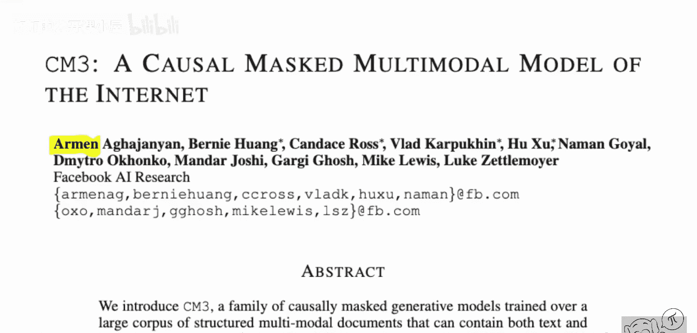

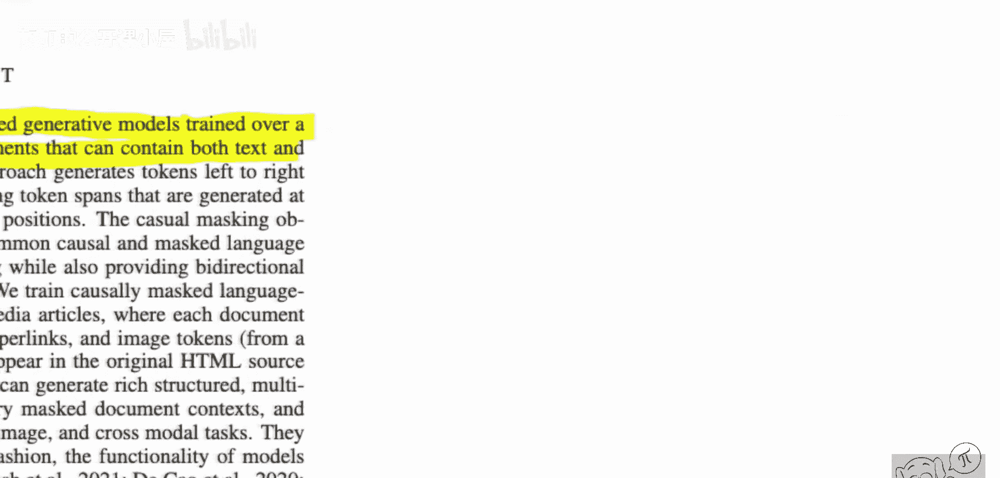

Div。Anything in between is the content of that div Other popular elements are for example。

 a paragraph， so inside a paragraph you can have some text， hello。

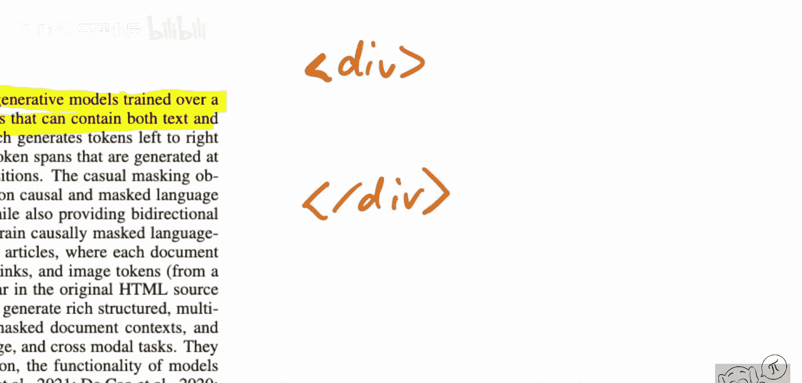

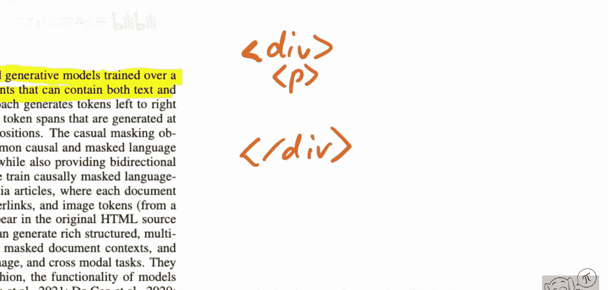

There。And then what you can also have is hyperlinks so hyperlinks start with an atag so you can see these tags can be nested。

 these tags can have attributes so the Atac can have an attribute like an Hf。

 so that is a URL so www dot something and so on so it can have URLs it can also have URLs within the document then there is the text of the link now we close the Atag oops then we may continue the paragraph or we may close the paragraph。

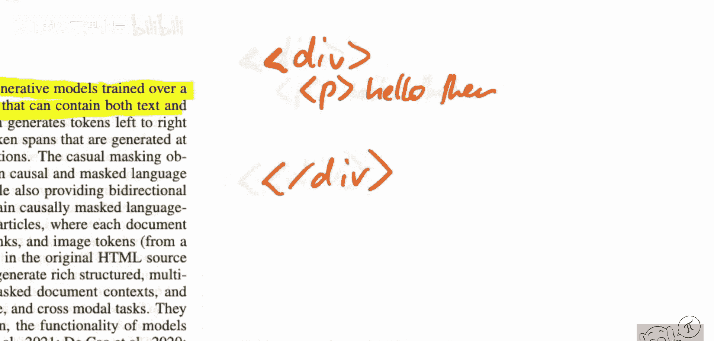

A forward slash。 And the last thing that we're also going to need in these documents right here are images。

 So there can also be images。 and I I'm going to write this over here。 After all。

 whitespace doesn't matter in HTML。 So images can have a so-called source。

 the two most important attributes are the source And the source is it's usually usually it's a URL。

 It can be a base 64 blob， but usually it's also a URL like I don't know， like inger。Girl dot com。

Slash something something dot jpeEC。So the browser would actually go and fetch that image and display it at this position。

 and also an important thing is the alt text， which you put there for screen readers and other sort of assistive technology that cannot directly make use of the image to see what's in the image。

So you can already see here that there's a lot of information in HTML。

 Now previous work what they would have done is if it's a language model， for example， G3。

 they would simply only take the text bits of that they would take for example here hello there they would probably also take the text of the link right here and that would be it they would scrape the websites for the containing text to do language modeling other model such as Dli D I've made a video about Dli if you don't know what it is。

 but essentially a model that you put in text then it gives you an image and the reverse of that is sort of clip not the reverse but clip is a model where that says whether or not an image or piece of text go together well and the reverse of Dli would be like a captioning model you put in an image and you get a text describing that all of that you can get by also scraping the internet and always taking the following two things。

 you take the alt text of an image tag。And you take that source image and these are pairs of images and text that go together right。

 so you can train。 This is kind of like weak supervision。 There are some problems with that。

 but it's weak supervision。 Likewise， there are other tasks if you are， for example。

 doing entity linking or entity。Entity disambiguation or something。

 What you would do is you would go to Wikipedia and on Wikipedia。

 you would always take the text of a link and the link itself。

 if it points to another Wikipedia article。 And you know in this case here it says like Romans were captured by Alexander the Great。

 Alexander the Great would be a thing you could click on and then that link would sort of tell you what entity that is。

 it would lead to the Wikipedia page of Alexander the Great。

 So people have parsed websites for a long time in various ways to achieve different tasks to collect data for different tasks。

 However， there is this new direction。 And it's not the first paper that does this。

 but is is the first that I've come across and the previous work is also by largely the same authors。

 So I'm just going to give them credit for some at least some of this the novel idea here is that why don't we use the entire structure of HTML directly。

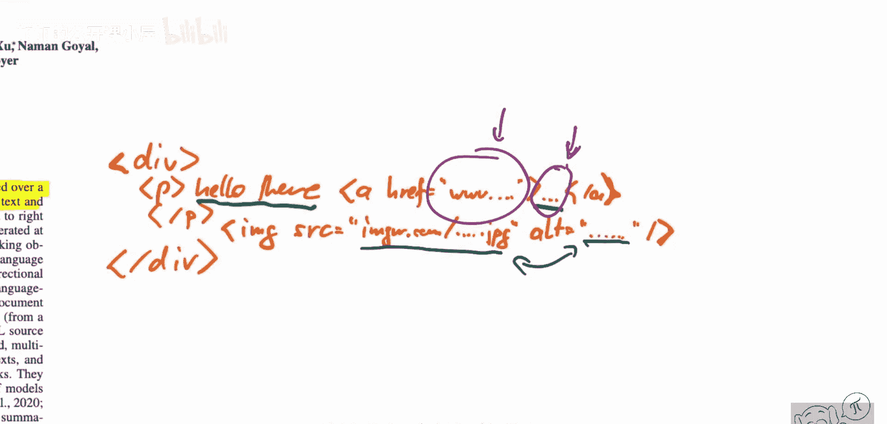

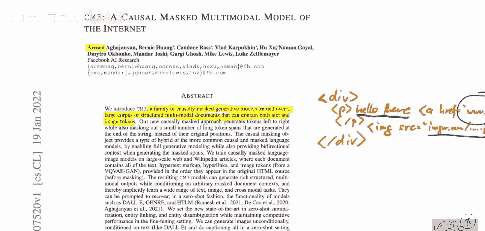

In instead of just scraping subset of them now again。

 they do clean the HTML because a lot of HTML is kind of like visual elements。

 the cascading style sheet and so on， they're definitely would be information there but it is a good step to say hey the whole thing you know the entire thing here。

 the structure that is actually super duper important it has so much structure that we would throw away otherwise。

 for example， the image right here you know it could be not only described by the alt text it could also be described by like the surrounding text like this stuff right here。

 of course if there's an image on a website reasonable to assume that the surrounding text might also have to do something with it right it is reasonable to assume that in order to disambiguate this entity right here you might want to take a look at the text around it you might want to take a look at the image is around it and so on So if we had。

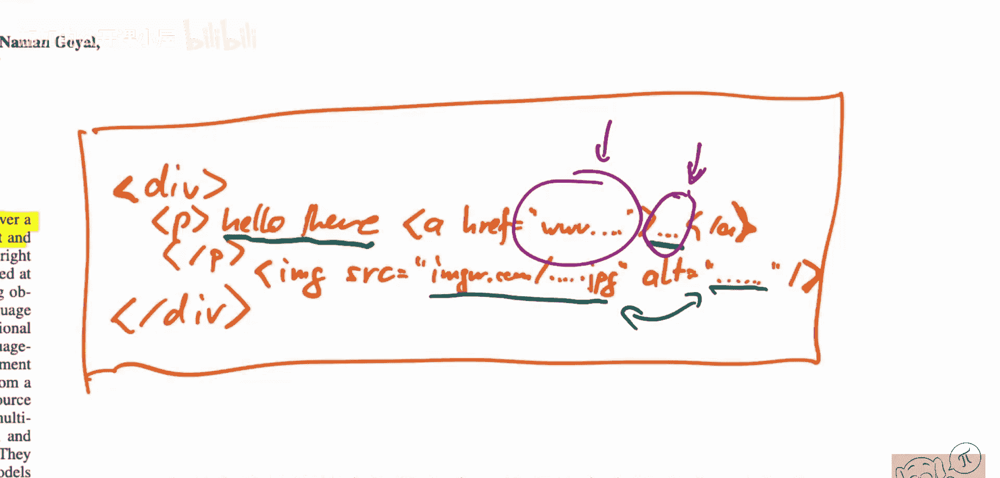

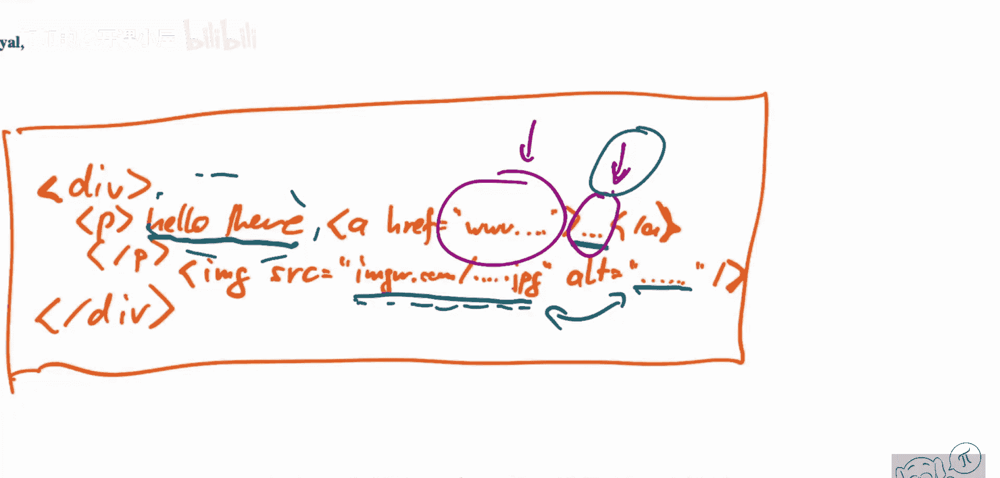

Model that could directly learn the structure of HTML。

 we could exploit all the work that went into creating that HTML。

 which is essentially what frontend programmers and website programmers do all day this is human ingenuity that goes into creating these structures even if it's a framework that there is something someone that has to come up with you know what are the elements how is the structure and that is that is really good data and exploiting that data to me when I saw this it made perfect sense to say you know we should just keep the HTML and just learn the language model over the HTML。

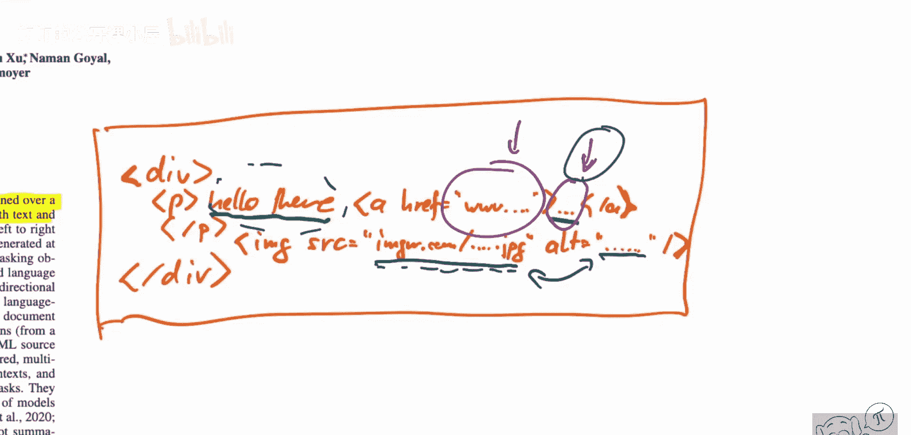

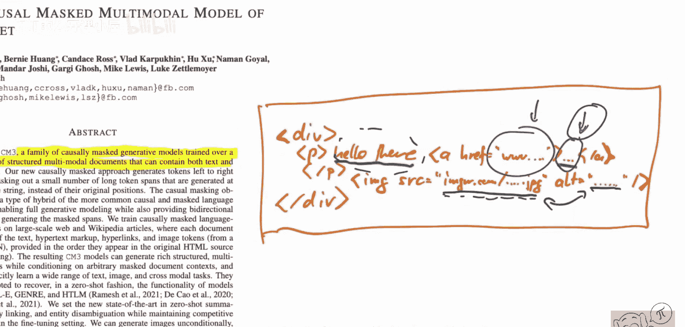

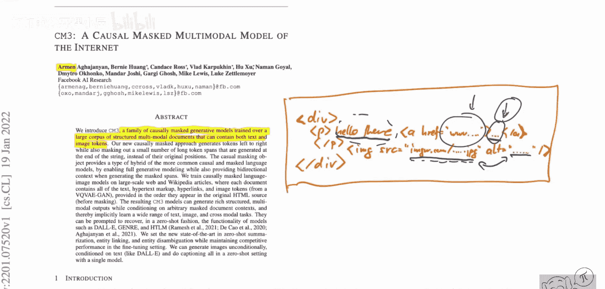

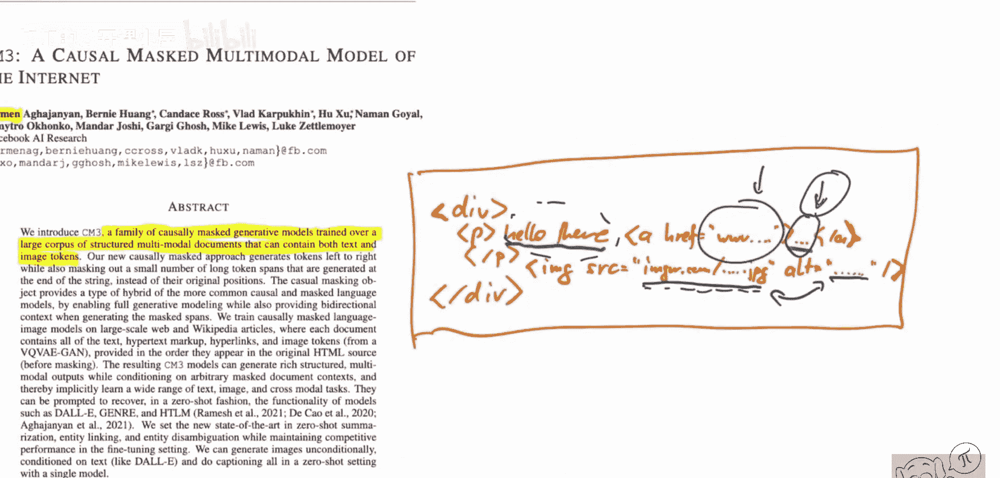

So what can you do if you have such a language model Well， if I have trained such a language model。

 I can maybe you know start a paragraph， start a paragraph。

 I put like a piece of text right here and then I just start an image tag and I say source equals and then I'll let the model generate whatever is here now there is is there is a trick right here I can't of obviously put a URL I actually have to put the image itself there。

 but if the model is good enough it will look at this it will generate an appropriate image or know if I could do the same thing by simply having an image tag。

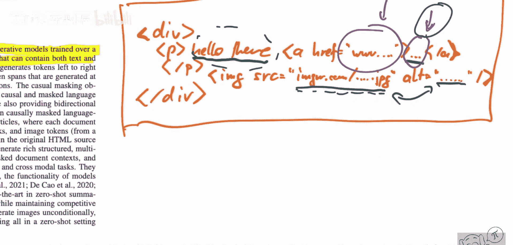

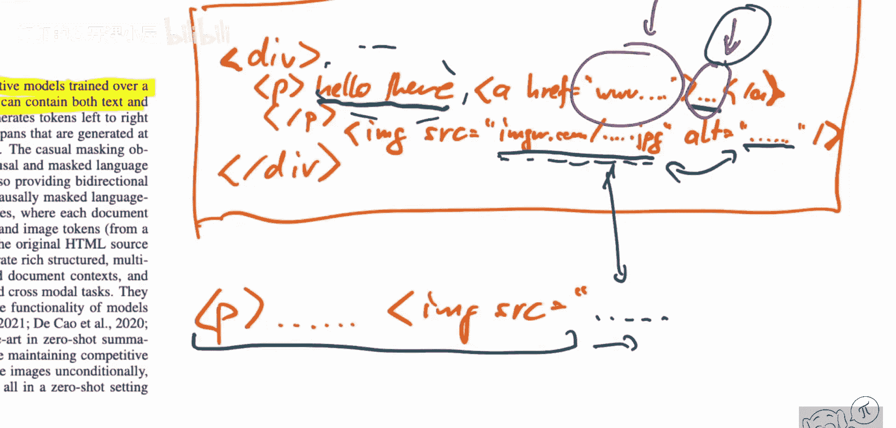

And first generating the alt first putting the alt text。

 I put something here that I want and then source and I say equals and then I let the model continue。

 it will generate me an image， I can reverse that， I can put the image first and then say please generate me the alt text。

 I can put an entity and say please generate me the link to the entity and so on so you can see how powerful this is。

 we can do many， many different tasks if we have a model like this。

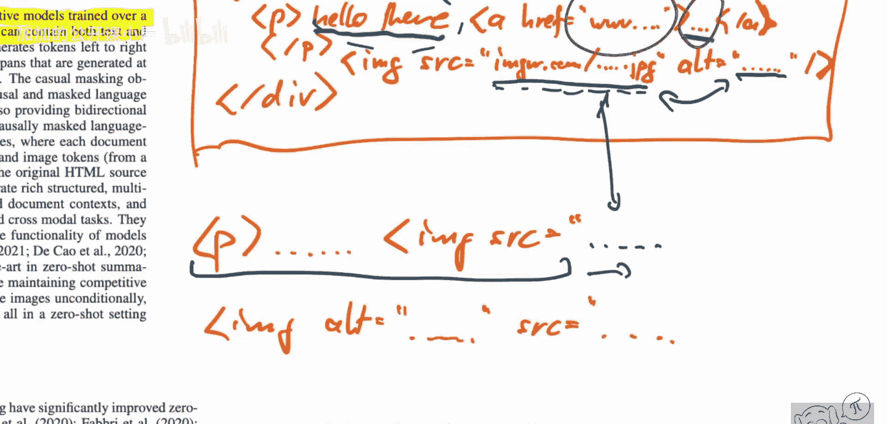

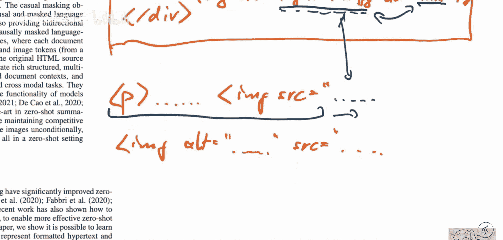

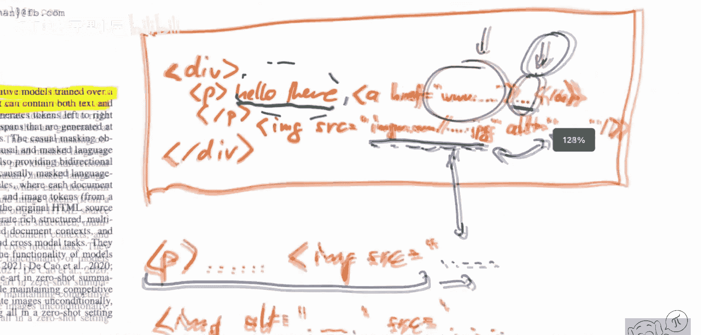

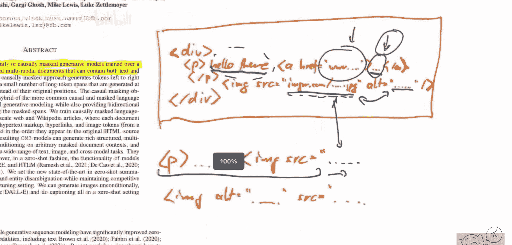

This is one thing that this paper does， and I said it's inspired by previous work， however。

 it pushes it a bit further。

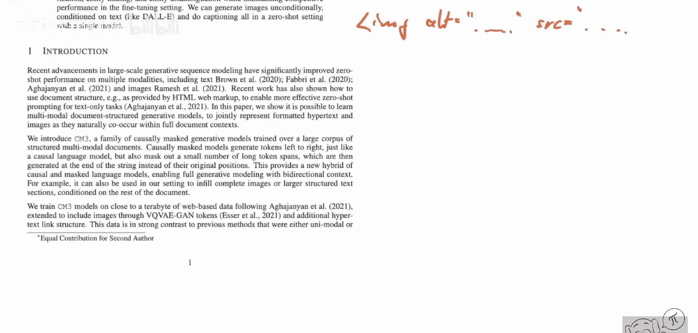

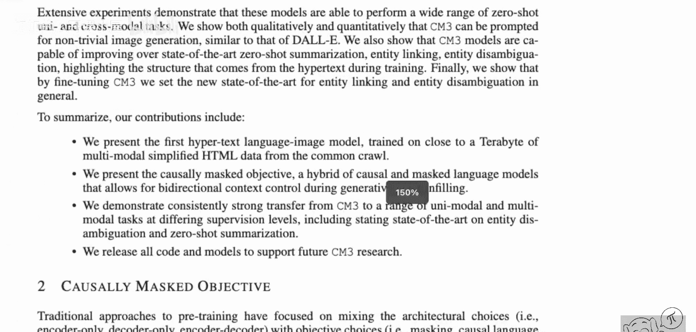

So first we have to discuss this and then we have to discuss the novel objective which makes it even more powerful the only thing to discuss right here actually is how do they treat images because language modeling is fine I can just have an appropriate tokenizer for HTML which needs to be I guess a little bit of a different tokenizer than for a regular text because you have to handle these tags correctly。

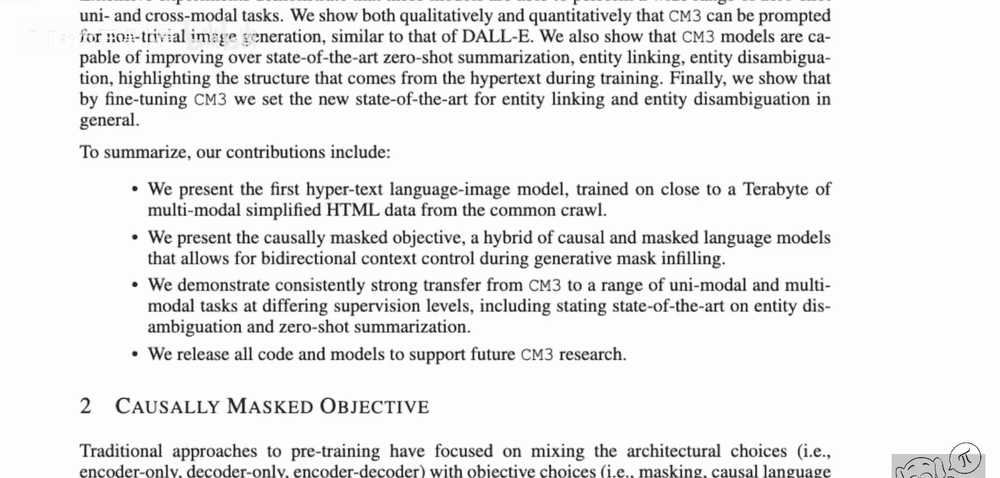

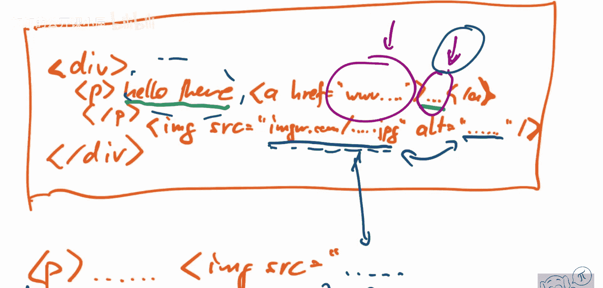