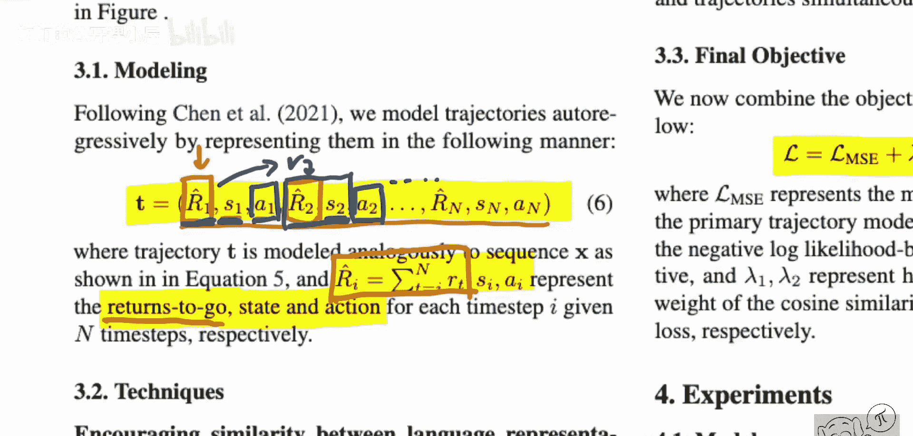

# YannicKilcher【中英⚡AI经典论文领读(全203篇)(下)｜Papers Explained】 p73 P173 维基百科能否助力离线强化学习？（论文详解） [BV1j8x5zJEvx_p73]

Can Wikipedia help offline reinforcement learning。 This is the title of the paper that we're going to look at today。

 This paper is borderline preposterous in the results that it presents。

 Lan model pretraining helps reinforcement learning， which is crazy。

 The two domains have almost nothing in common with each other。 And yet。

 there seems to be some transfer from language to reinforcement learning。

 And this is not just about pretraining on any old task。 The authors here have tried various things。

 and there seems to be something special about language。 So here is how the video looks。

 This video right here， is a paper review。 It presents me going through the paper together with you explaining the paper。

 explaining what I think about the paper。 What kind of questions I have and so on。 After this video。

 you'll have a good understanding of what the paper contains what its main claims are。

 maybe also what I think its weaknesses are in the next video， which will be released to mor。 I will。

😊，interviewterview the authors of this paper， which is very cool。

 The authors will have seen my review and are directly able to respond to criticisms to any questions that are raised there。

 And this is so valuable。 We're able to directly dive in and get you the best possible insight into the behind the scene stuff and into the research process about this paper。

 I invitete you to watch both videos， although feel free to choose whichever one you like most。

 As always， let me know what you think in the comments， leave a like if you do and I'll see around。

 bye。😊，🎼Hello。

Hello there。 Today we're going to look at can Wikipedia help offline reinforcement learning by Michelle Reid Uro Yamada and Shixiang Shang Gu This paper is a special paper because it very counterintuly trains a language model So it pretrains a transformer to do language modeling。

 for example Wikipedia text modeling as you can see right here。

 language goes in it does next word prediction like you're used to from a language model like GT to GT3 and so on and then it takes that transformer and fine tunes it to trajectory modeling。

 This is a special subfield of offline reinforcement learning where decision transformers have recently been introduced So in offline reinforcement learning。

 you have some data set of trajectories and then you try to do reinforcement learning just given on that dataset turns out that if you pretrain something。

On language and then fine tune it on these trajectories that will turn out to be a much better model。

 like a much more performant model for getting you good reward at the end than if you just train this trajectory model here from scratch which is very counterintuitive because it means that somehow the language modeling task like the language model pretraining has a beneficial effect on the reinforcement learning task that comes later to note that the reinforcement learning task has nothing to do with language and even more special。

 they also try a bunch of other things， most notably they try to pretrain the image G model and that does not result in good performance。

 So it's not just the fact that you have pretrained on something and it is really。

 very special result So we're going dive into the paper right here。 the setup is fairly simple。

And then there is a series of experiments that try to investigate this phenomenon。

So they say that the offline reinforcement learning， as I said。

 has been seen as a sequence to sequence model and I've already preannotated some stuff right here。

 let me know how you like that I thought I'd do it in this way so I have the green that is the current one and the yellow is from the previous my previous escapates on this paper。

So they go into offline reinforcement learning and that is being framed as simply supervised learning to fit return augmented trajectories in an offline data what do they mean they mean the setup of the decision transformer I've made a video on the decision transformer if you want to look at that you can go after you watch this video but so the decision transformer has says well see you are an agent somehow there is an environment there is some interaction between the agent and the environment and in offline reinforcement learning。

 we usually have a data of this So someone else has performed this and they've distilled all the episodes into this into this dataset and their goal is to learn just from the data we can't actually interact with the environment So in the data。

 there are a number of trajectories trajectories of the agent interacting with the environment there's always some sort of。

a state coming back from the environment or an observation。

 if you will the agent always gives some sort of an action back and then there is a reward and a next state coming from the environment and so on so that is naturally a sequence and the sequence is there is a state then there is an action then there is a reward and a new state then there is an action again and then there is a reward and a new state so this is a sequence and since I have a data set of these sequences I might as well throw that into a big transformer to do sequence modeling now this has its own problems which I've all discussed in the decision transformer video for example if the transformer has a context length of four it cannot conceivably like look back further than that which is a classic problem in reinforcement learning how to look back and forward infinite times the decision transformer has the limited context window it has。

Sort of the caveats of language modeling。 however， it we understand language modeling very well and therefore we are quite able to do that。

 There is one model that they do what they do is they transform the rewards right here。

 they don't let the model model the rewards。 they let it model that rewards to go。

 We're going to see that in just a bit。 This here is interesting。 what they say is that。

We look at whether Transer based pretrained language models are able to be adapted to standard offline reinforcement learning tasks that have no relations to language and I've already told you that this is going to work out fairly well and that's the special message of this paper。

Yeah， so they show consistent performance gains and significantly faster convergence by faster convergence。

 they mean that a convergence point like a non-improving the loss anymore is reached after much many fewer steps then if you were to train from scratch which makes sense for pretraining if it's in the same domain。

 but given that the pretraining is a completely different domain then the fine tuning that is still you know just a special thing。

 So here is how we're going to frame the problem and if you've watched the decision transformer video this should be familiar to you we model a episode as a sequence in the following matter。

 this is almost as we've seen it except the reward right here。

 they are not individual rewards but they are this thing right here。

 the sum of all the rewards at this and the next steps which。They call the returnsturn to go。So this。

 for example， says from here until the end of the episode， I'm going to gather 50 reward。

 Now maybe you're in this state and you made an action that gave you a reward of one。

 So then this here would be 49 So you'd say， well from here on out I'm going make 49 reward and so on So the benefit of this is that at inference time you can just put like a really high reward right here So that inference time you would always you would model these things you would get from the environment So you'd start out with like just a big reward right here whatever the maximum you've observed plus 10% or something to just encourage your model to go very high and you plug the state in here that the environment has given you and you let the model produce this one So it's important that at training time we do sequence modeling really model the sequence of returns and state and action as a。

GPT like next token prediction， however， at inference time。

 we obviously only predict the action and the environment is going to give us these two things or the environment is going to give us the reward and then we simply subtract the reward from the previous returns to go and we plug that in here and then we plug in the state we got from the environment。

 We let the model predict the next action right here and so on。

 So this is very cool because much like something like upside down reinforcement learning。

 This is conditioned on it like a desired reward。 This also has advantages and disadvantages。

 but the advantages we can control the reward we want at inference time。

 So we don't always have to go for a high super high reward， but we can。😊。

Yeah， so this is the the。