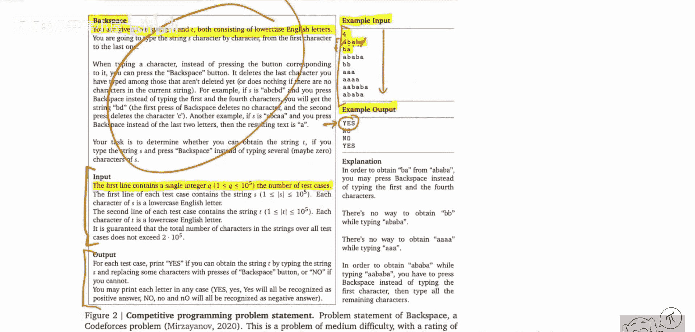

# YannicKilcher【中英⚡AI经典论文领读(全203篇)(下)｜Papers Explained】 p74 P174 AlphaCode：竞赛级代码生成（论文述评） [BV1j8x5zJEvx_p74]

🎼。

Alpha code is a system by deep mind that does automated competitive programming。

 You're able to give the system a lead code style problem in natural language。

 and it will come up with code by itself that solves the problem。

 It does this by using a combination of language modeling， sampling。

 filtering and clustering before it finally decides on the solutions that is going to try out to submit to the server。

 What is mind blowing is that this system was able to perform in human competitions。

 and be about as good as the average programmer in these competitions。

 which is crazy because previous systems were nowhere near human level。 So here's how it goes。

 This video right here is a comprehensive paper review。

 where I will go through the paper with you and explain to you the most important parts of the paper。

 What's in there and what I think is good and what I think is bad。 After this video。

 you'll have a good understanding of the paper。😊，And of how the system works and what its potential weaknesses are。

 However， in the next video released tomorrow， I will interview the authors of Al code。

 which is huge privilege。 And I'll be able to ask them anything I want And they will have seen my paper review and they'll be directly able to respond to any criticism that I've raised there to any questions that I had。

 And to whatever I did wrong in my paper review。 On top of that。

 you're able to get a behind the scenes look into their work。 Even at places like Deepmin。

 things go wrong， things don't work out。 They've had results that they thought were too good to be true。

 And they turned out not to be true。 and many more things on top of that。

 we talk about how the project came to be。 and also how they've dealt with media reception。

 because this paper has made big waves。 So I absolutely invite you to watch both this video and the interview part because they're very much complementary。

 Let me know how I can improve。😊，Vide for you， if you like， leave a like。

 tell someone to subscribe and I'll see you around bye。

Hello there Today we're going to look at competition level code generation with Al code。

 This is by researchers of Deepmind and present a novel system that can take part in competitive programming challenges these are challenges where you as a user you'd register and then you'd be given lead code style problems to solve and these aren't easy problems。

 These aren't just solving some or writing down some SQl statement These are legitimate difficult programming challenges where you need to think of algorithms and solutions to problems and so on So having a system that can actually take part and compete against humans is very remarkable they've submitted the system to 10 of these challenges and as you can see the orange lines here is Al code relation to other humans they perform about as well as a median human would like an average middle of the road。

Programr， if you will。 So this is pretty remarkable。

 especially since the baseline systems so far had been no sort of in the third or fourth perile not very good。

 So this represents a significant boost and today we're going to find out how they did it。

 But first here is what such a problem might look like。 So this is one problem。

 This is one data point in this in this data set or one such challenge that you have to solve。

 you can see it starts with a description。 So the title is backspace。

 It starts with a description you're given two strings S and T both consisting of lowercase English letters yadada ya。

What you should note right here is that the description is in natural language。

 It's made for humans and therefore it's just natural that it is in natural language。

 There is no other form。 there is no machine readable form right here。

 This is it this is what the algorithm alpha code Cs and gets as an input。

 there's also a description of the input again in natural language there is description of the output and there is also this part right here。

 This is an important part。 it consists of a bunch of example inputs and outputs。

 So here is an example input for example there are four problems in this problem set。

 all of this would be described in the input section So the input section here says the first line is a single integer。

 the number of test cases and so on。 so that's the four then we have this is a problem So this is S and this is T of the first problem The goal is to type S and strategic。

Strategically type the backspace button instead of the letter at S to go from S to T。So in this case。

 we start with S， so the first letter is a， but we choose to type the backspace button。

 which would not type A and would delete what we have， but we have nothing。Yeah。

 then we would type B， sorry about that， and we would type B。Then we would type A。

 then we would type B， and instead of the last A we again type the backspace button which would delete the letter before it。

 and we'd end up with B A， therefore we got from S to T and therefore we output the word yes。

 so we are tasked with writing an algorithm that automatically determines whether it's possible to go from S to T in any of these test cases。

And output the corresponding answer This is challenging by itself。

 but you only get the problem right if you can do it for all the test cases and the way these problems are evaluated is that on the test server。

 they have a whole bunch more of these test cases and including checking all the corner cases like very long inputs。

 no input at all， only inputs containing the letter A for some reason you expected a B to be there and they test all the edge cases and you need to be correct in all of them in order to get the points。

This is extremely challenging even for a human。 The output that you're supposed to give is an algorithm like this。

 You can see it's not an easy thing。 It's not just a snippet， It's a full blownown algorithm。

 It contains input so you read you read the inputs。

 even that program and algorithm to come up with that piece of code is already challenging by itself to firstly read that first the first line。

 and then read as many inputs， then you need to build lists and reverse lists。

 and you go into a while loop where you pop off things of list， depending on comparisons。

 and in the end， you output the correct thing， depending on whether that list is zero or empty or not empty。

 So as you can see， this is a challenging a challenging task。 And this is just one data point。

 The next data point isn't going to be another variant。

On two strings and typing the backspace button， the next data point is going to be a completely different problem。

Like searching for shortest paths in some graph or something with denominators of numbers or numerators or。

 or something like this。 right， it is， it is very diverse set of problems and very challenging even for humans。

 And the fact that an algorithm can tackle it is very remarkable。 So how do they do it。

That's that's our question today if you guessed that it has something to do with large language models then and transformers and so on。

 then yes， you know kudos， you got it but there is a lot more to it and this is really an engineering effort and I think we should appreciate just you know how far you can push a system to get continuous improvements。

😊，What they do first， though， is they collect a data set。

They do train on a open source code from Github that is the pretraining dataset set this is very similar to OpenAI's codex model。

 so openAIs codeX model is trained on code from Github and it can simply do next token prediction on code and I have to say I've tried codex and I'm pretty happy with its suggestions is very good but it can give me like longer snippets than an autocomple but it cannot like solve any kind of problems like this it can just continue code in any case they collect this pretraining data set they have whatever 700 gigabytes of code that they train on and they run their regular language modeling objective on that piece of code then they fine tune on an appropriate dataset set of code contests。

So this is a mixture data set that they scrape from multiple websites， for example， code forces。

 description to code， codeNe， these are papers， previous papers or competition settings that they have collected these。

Data sets from and the data sets again， this here is one data point。

