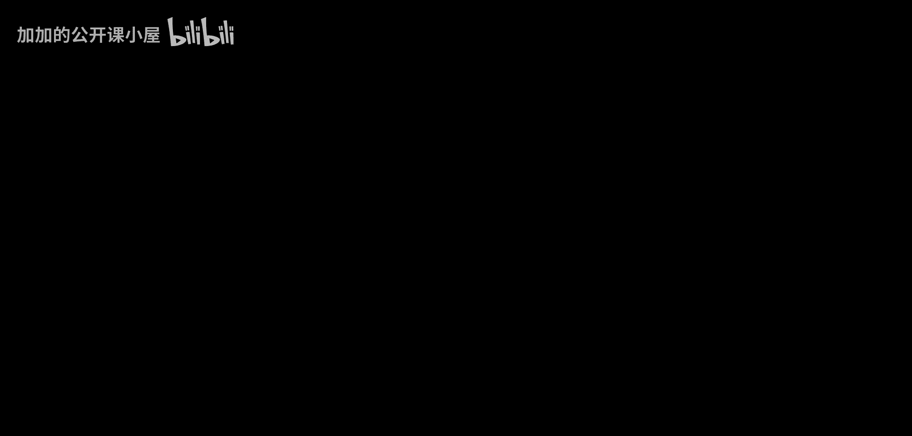
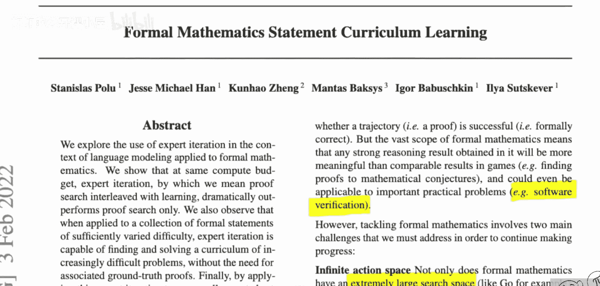
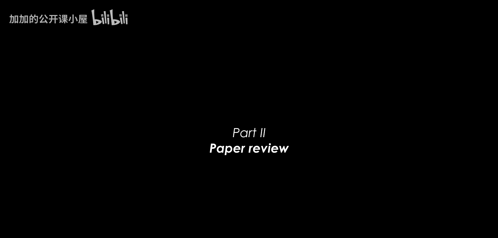
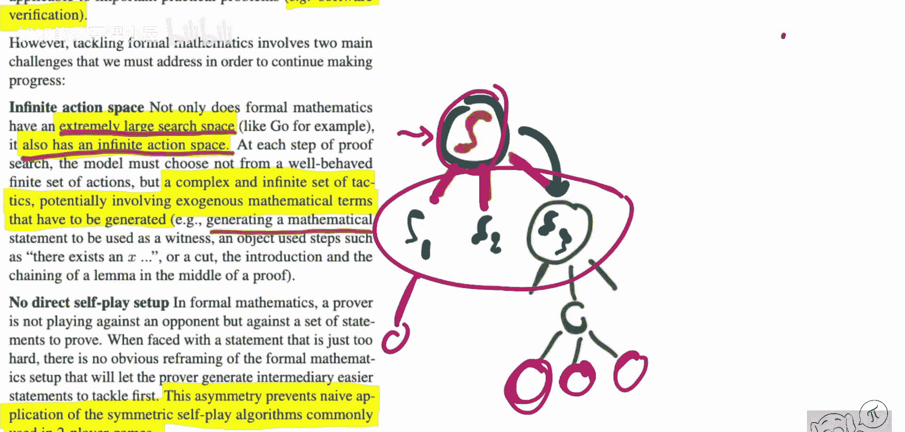

# YannicKilcher【中英⚡AI经典论文领读(全203篇)(下)｜Papers Explained】 p75 P175 OpenAI攻克数学难题——形式化数学语句课程学习（论文详解） [BV1j8x5zJEvx_p75]

🎼。

Can AI do math。 And I don't mean two plus2。 I mean， pure mathematics。

 The paper we're going to look at today is called formal mathematics statement curriculum learning and presents an automated system to prove mathematical theorems in a symbolic fashion。

 What's even more crazy is that this system was able to solve two problems of the international mathematical Olympiad。

 which is a contest that real gifted high school students get to take part in。

 This system is way beyond previous systems that have attempted anything like this。

 because formal mathematics and automated mathematics that uses algorithms to prove things lags a lot behind the informal mathematics that you might know。

 A lot of previous techniques relied on proof searching。

 essentially barut forcing their way to approve guided by some heuristics。

 And this paper improves on that drastically。 It uses language models to guide the proof search。

 and it uses a technique called expert iteration to build itself automatic。😊。

A curriculum of harder and harder statements to prove。 Now。

 the implications of this are cool for math， but it goes way beyond math。

 This is essentially symbolic reasoning。 It's a model teaching itself to learn more and more。

 And that's exciting for many fields of AI。 So here is how it goes。

 this video right here is a paper review。 a comprehensive review of me going through the paper。

 explaining to you what is in the paper， what its main contributions are what I think are the weaknesses and strengths of the paper and much more。

 After this video， you should have a good understanding of what is in the paper。 Otherwise。

 I haven't done my job In the next video released tomorrow。

 I'll be interviewing the first author of this paper， which is a huge privilege。

 Because if you watch this video， you'll see that I have many open questions。

 I'm a newob at formal mathematics。 And I suppose many people are。 And therefore。

 even though the paper is written really well。 I had a lot of questions。 I even had some。😊。

Criticisms and all of that was answered when I spoke to the author。 So if you watch tomorrow's video。

 you'll get an insight into the behind the scenes of this research， how it came about what worked。

 what did and how problems were solved during the research process and much more。

 The author I'm interviewing has actually seen my paper review and is directly able to answer to any questions that I raised there。

 Please let me know how you like these formats in the comments。 If you do like the video。

 Please leave a like。 Tell someone to subscribe and Ill see around bye。😊。

Hello there Today we're looking at formal mathematics statement curriculum learning by researchers of OpenaiI EPF and Cambridge this paper presents or applies the technique of expert iteration to the domain of proving formal mathematics statements this is not enough yet they also bring language modeling into the picture so you have a proof searcher in this paper or a proof search procedure that is guided by language models to focus to search for mathematics proofs and then the expert iteration procedure makes the system better and better and better by always incorporating new statements that it has been able to prove into its training set and so the domain or the difficulty of statements that it is able to prove expands iteration by iteration the culmination of this is that theyre able to solve two problems。

I believe of the IMO of the International Mathematics Olympiad which is a difficult math challenge for high school students and this has implications beyond just math。

 so this can be applied anywhere where agents need to reason over some sort of symbolic structure and you know this is wide ranging。

 this could be agents acting in the real world this could be reinforcement learning things。

 this could be I don't know assistance for clinical trials and what not essentially anywhere where such a more formal system。

 more logical type of reasoning is required so we're going to look into this paper and what they do this builds on a bit of other work but I think it can be it can be looked at in isolation。

So they claim right here in the introduction that deep learning has been very good at sort of many tasks like you know language modeling。

 there's vision image generation， however they say it has not yet enjoyed a comparable success in tasks that require extensive planning and symbolic reasoning and the domain of mathematics proofs is a good domain because it has these challenges but also you don't exactly rely on external data that much like you can you can prove things in mathematics。

 kind of by yourself in the basement or in this case you can verify a proof pretty quickly so the challenges in this domain are it has an extremely large search space and then infinite action space when you prove a statement in mathematics。

 there are many things you could potentially do like infinitely many things it's not only。

about manipulating the symbols that are there often you need to introduce new symbols they they。

 for example， they say you could generate a witness like there exists an x that fulfills some things where X was never symbol before so you have like infinite things at your disposal Now the question is how do you prove a statement。

Maybe we'll just a little bit go into how these mathematics proving things work if you really do them formally。

 so in their types of system， they have some kind of statement to be proven so I'm going to call that statement S that is a formal statement that just is essentially is the formalization the exact writing down of something like a theorem as you would find it in a textbook。

 but instead of using words and language it uses like defined syntax in in a predefined system So how to prove the system in order to prove the system。

 what you need to do is you need to build up a tree So you need to decompose the system in some way into multiple substate and the way you do this is as you would do as a human you know you'd have some sort of a proof and then you say okay in order to prove that I need the following three things to be。

True so these would be the three things like this is a substatement one， a substatement 2。

 a substatement 3 and generally the derivation from such like from this to this。

 I believe that's called a tactic so you can apply tactics to sort of reformulate things into its subs it into its sub things I'm speaking very informally right here because as you might guess I'm also a nub in this domain and I hope the the interview will tell us a little bit more about how these things work。

 but as far as I understand you want to decompose these things into substatements and then the substatements again。

 you can decomposeing to stuff and this is a context tree grammar So this a substatement like this should be provable by itself independently of the other substatements and you build this tree for as long as you want until the leaves right here or either the。

sortt of the preconditions for the theorem So a theorem could be you know for any two rational numbers。

 So if the leaf right here says you know this is a rational number then we're done because that's a precondition for the theorem also if it's like some sort of a lemma that I already know or if it's like a fundamental how do you how do you call them an axiom if it's a fundamental axiom I also stop So I'm going to build up this proof tree until every single leaf is either something that I already know or something that I can assume to be true and then I have proven the I've proven the original statement because the tree represents the proof Now how to build the tree that is the question right I could I could derive many different sub oops I could derive many different substatements from the from the top statement the fact that I derive these particular ones that then leaf。

Me to approve that is the magic of proving things in mathematics。

 That's what mathematicians do for a job。 And you can already see that this is not an easy。

 an easy thing。 You might think of something like alpha alpha0 alphago， and that is a good guess。

 but whereas alphago has defined actions。 So all of these things that alphago could do are pretty defined。

 like how it could expand the tree。 not in the case of mathematical proofs。

 there are there is a complex and infinite set of tactics。

 potentially involving exogenous mathematical terms that have to be generated。😊。

So quite a challenging domain。The other one， so there is the infinite action space。

 which is one of the tragedies problems and the other problem is this no direct selfplay setup So whereas in something like alpha0。

 I can train with selfplay in mathematics proving there is no adversary I cannot have a two。

