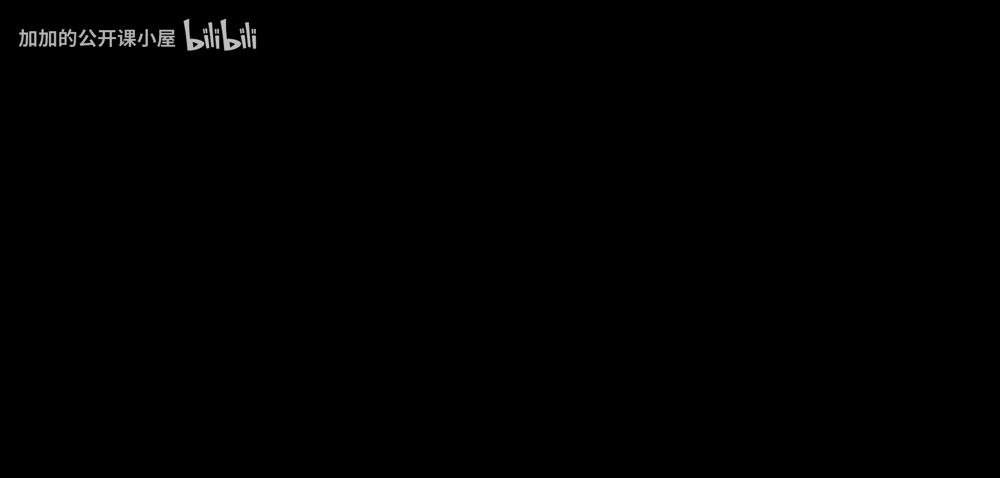
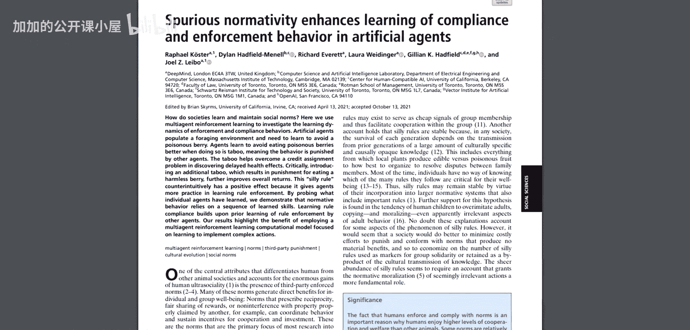
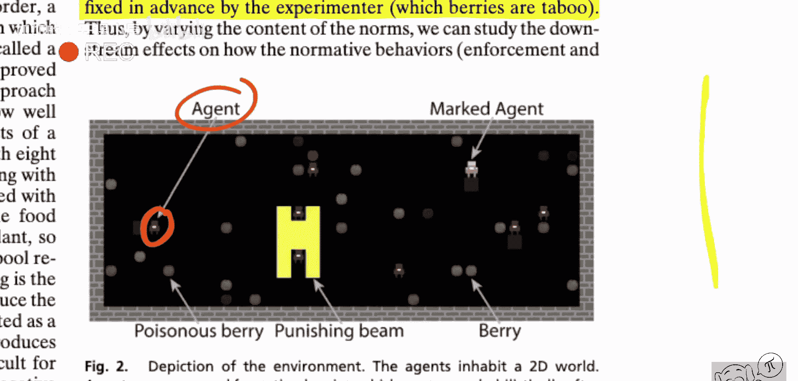
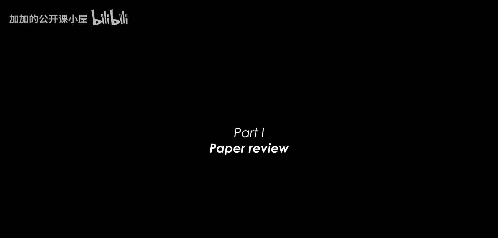
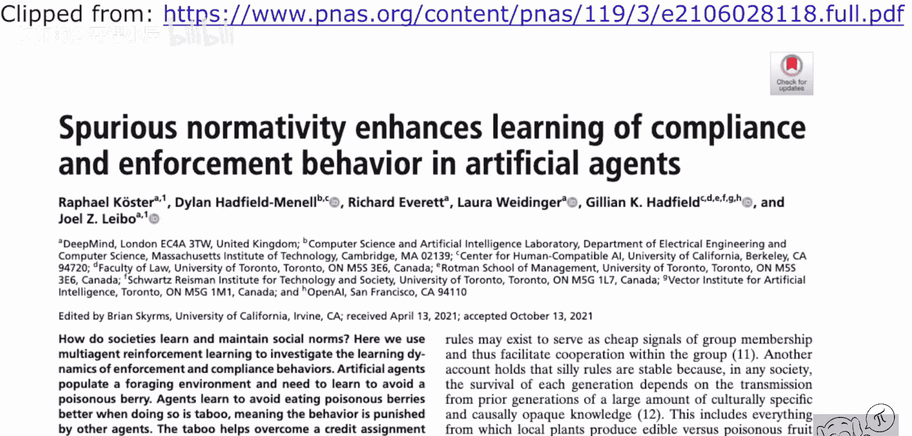

# YannicKilcher【中英⚡AI经典论文领读(全203篇)(下)｜Papers Explained】 p76 P176 虚假规范性增强人工代理中合规与执行行为的学习能力 [BV1j8x5zJEvx_p76]

🎼。

Why do social norms exist and why are some of them really。

 really meaningful and why do some of them make no sense at all， Like。

 why am I not allowed to wear this hat right here to a funeral。Okay， it might upset some people。

 But why there is no benefit。 There is no direct welfare impact to society with me wearing this or not wearing this or wearing something else on my head。

 This is a question that we're going to investigate with today's paper。 And yes。

 that has no inherent relationship with machine learning。 But as you'll see。

 we can tackle this question or at least a part of the question。

 we can give some evidence as to why these what's called silly rules might exist。

 using machine learning， specifically deep reinforcement learning。 So in this paper。

 people from different areas of expertise came together to say。

 can we build a computational model of society， can we build a little world of agents。

 have them do some behavior， give them some rewards for certain things。

 And then we just observe what they do。 And by observing。

 we can make some conclusions about this could be an explanation for a societal phenomenon that we see。

 So I like this paper because it's interdisciplinary。 it uses。

Reinforcement learning， specifically multiageent reinforcement learning in order to answer questions about society。

 and it is a little bit out of the box， which I like。 So the video is structured。

 I first do a review of the paper by myself。 And then I'm going to talk to the authors about the paper。

 This is one of the last videos where I recorded the interview before I did the review。

 But for this paper， it was actually super helpful because I'm a new at this field。

 I don't know what I'm talking about when it comes to society and research in sociological questions。

 So it was very helpful to have the authors talk to me about the paper。

 but we don't just talk about the paper。 we talk about many， many more things。

 and I highly invite you to watch the interview because it's really interesting we talk about norms and societal systems of norms and hypotheses and what you have to pay attention to when you do research like this and what worked and what didn't and what it means。

 So please let me know if you like papers like this that are maybe a bit more。😊。

from what we usually do。 And if you do， then please let me know what other kinds of papers and what other areas exist。

 where M L and specifically reinforcement learning or any kind of machine learning are used to investigate questions in other fields。

 Allright， I'm going to leave it at that。 And now I'll just do like a quick green screenshot because I know people who are gonna make emojis out of my face with this hat on so。

Yeah。And that's that cheers。Hello there。 Today， we're going to look at spurious normativity enhances learning of compliance and enforcement behavior in artificial agents by Raphael Custer Dlllan Hadtfield Manll。

 Richard Everett Laura Whitinger Giillian K。 Hadtfield and Joel Z。 Libo。

 This paper presents a computational model， like a reinforcement learning approach to research society。

 to research the phenomenon of what they call silly rules。 So the question is。

 our society has a bunch of norms of what you should do and shouldn't do。

 And these norms are known by the people and they are enforced by the people。

 You are being shamed if you don't follow the norms。 A lot of those norms are really good。

 like wash your hands after you use the toilet。 But there are a lot of norms that are also just arbitrary like what kind of hairstyle is good and bad or acceptable or not acceptable。

 What words are rude and things like this。

And these are called silly rules。 And the question is， why do these exist Now。

 this is not a question of machine learning。 However。

 this paper applies deep reinforcement learning in order to give some evidence to why these rules can exist。

 So I like the mixture here of sort of using reinforcement learning as a tool to investigate these mechanisms by using a computational model。

 you can break down a lot of things usually if this were a psychology paper people would go into a lab。

 they would recruit people and then they would try to design an experiment around these norms and so on。

 And that' that's cool and all。 But if you use a computational model。

 you can answer different questions。 you can control for different variables and so on。

 So is very attractive to use。😊。

Reinforcement learning for that。 So we're going to look at what this paper says right here。

 not as much into the RL part because that is fairly straightforward。

 but just what it does and what it says。 and I'd like just to show you maybe a little bit because I thought it was pretty cool that this is yet another application of machine learning and specifically reinforcement learning that enables progress in a different field。

 So I hope you you enjoy this。 yeah， they they introduce the paper by saying there are a lot of norms。

 something that differentiates human from other animal society is this presence。

 is this presence of norms。 and some of many of these norms。

 say generate direct benefits for individual and group well-being。 like you know， reciprocity。

 sharing of rewards， what you should eat， what you shouldn't eat and so on。😊，Very often。

 these rules have some sort of a， some sort of a benefit to society。 they say， but however。

 the normative landscape is also populated by many norms that appear essentially arbitrary and without direct material consequences。

 And we're not necessarily fighting about this， like people can always say， well。

 but this rule may have some， some use。 but let's just。For now。

 let's assume that there exist norms that really could be different and it would make not a difference in total welfare。

Or at least the direct difference， right， The paper here argues that there is an indirect difference。

 The paper argues that by introducing these silly rules。

 the indirect benefits are that agents learn the enforcement behavior of the rules more clearly and therefore are better at enforcing the important rules。

 But we'll get to that in just a second。 So here are some of the examples of silly rules that they mention men are expected to wear pants。

 not skirts， which in some societies is the case in others isn't， right。

 there words or hand gestures that should not be used in polite company。

 there are rules about how one's style of hair or what one wears on one's head and so on。

 So they call these silly rules。 Sil rules means essentially a norm， that is in society is is very。

 you know， taken seriously， but is essentially arbitrary。They say they're meaningful and enforced。

But they have no direct first order impact on welfare。 So why do they exist。

 There are some hypotheses。 They list some here， They say， for example。

 silly rules may remain stable by virtue of their incorporation into larger normative systems that also include important rules。

 which essentially means that the silly rules， they make sense。

 if they are part of a bigger system that also contains the important。

 which means the the useful rules。 And so the hypothesis here is that the addition of the silly rules into a society。

 some helps the society to comply more broadly or more or more or better or more accurately with the important rules。

 So the addition might be some might be a benefit in the total in the total。Total benefit。

 like a total setup of the system。In this paper， they say we describe a mechanism through which silly rules can benefit a society。

Our argument is based on the dynamics of learning in a group that lacks a prior knowledge of which of the rules are truly important。

So they there is a group， there's a society， there are a bunch of norms already present and a priori no one can tell which ones of those are important and which ones aren't because if they could tell they could just say。

 well that one is not important， which is what's happening kind of with the scientific method right。

 we know that some things aren't as important and with time people stop doing them。

 but initially you know there's no way of knowing。And that's what they investigate It's important that they say they describe a mechanism right they don't necessarily say this is how society works because society is way more complex。

 but they do describe one possibility， one mechanism。

 one reason why they could why these silly rules could exist and they show that this mechanism if you implement this in a mini society will lead to a total welfare benefit。

Their， their explanation is the following。 The skills involved in third party norm enforcement readily transfer from norm to norm。

 While the skills involved in compliance are norm specific。

 What that means is essentially for every norm， you have to learn。

