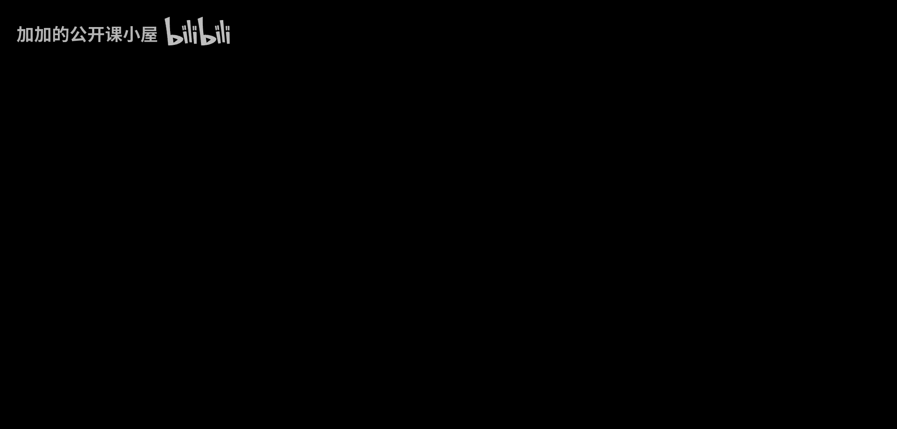
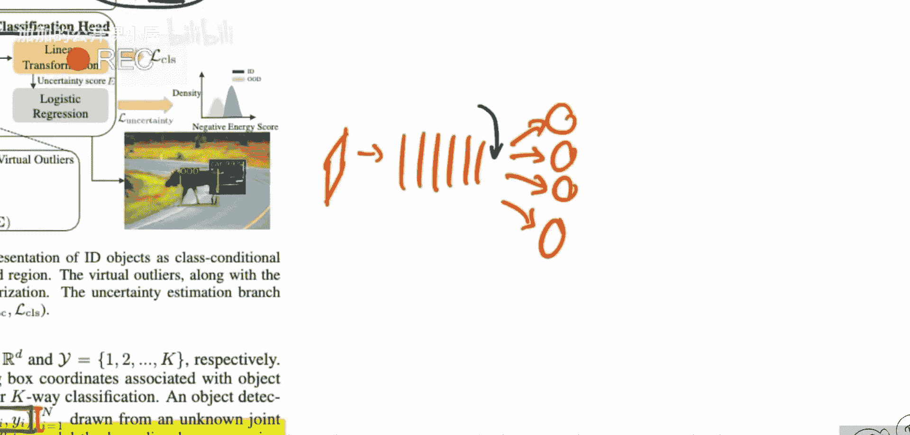
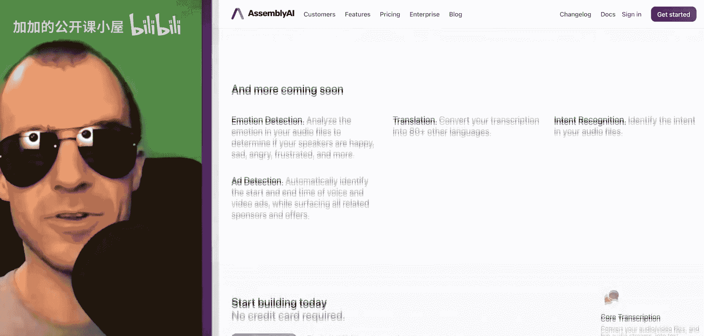
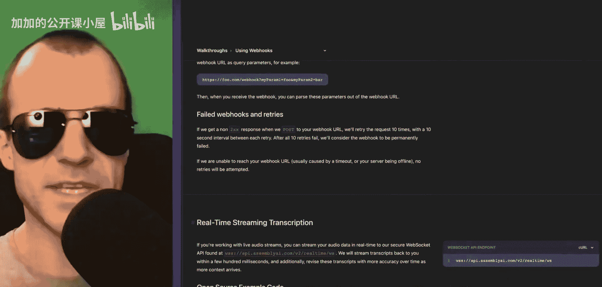
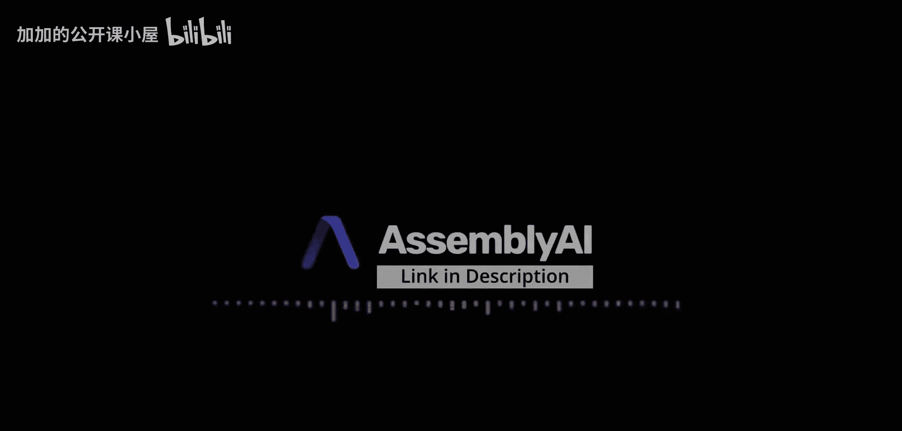
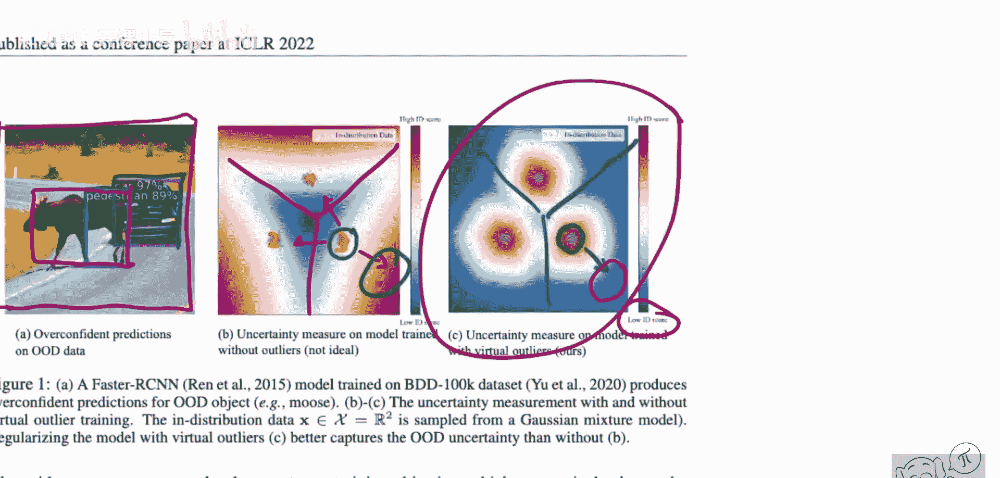

# YannicKilcher【中英⚡AI经典论文领读(全203篇)(下)｜Papers Explained】 p77 P177 VOS：通过虚拟异常合成学习未知内容（论文详解） [BV1j8x5zJEvx_p77]

🎼。

Outliers， we all know them。 We all hate them。 How can these data points just be out of distribution。

 not in the training data， things that we haven't seen before， things that we don't even expect。

 Well they suck。 So today， we're going to look at what you can do about it。Specifically。

 we're going to look at the paper， learning what you don't know by virtual outlier synthesis。

 This paper presents a technique to generate what it calls virtual outliers。

 which are synthetic data points that are out of distribution。

 The core idea is that rather than trying to come up with data space out of distribution samples。

 This paper comes up with latent space out of distribution samples。

 which is much easier and much more useful。 They're then designing a loss that pushes down the energy of the model。

 wherever the outliers are and pushes up the energy wherever the data is。

 This paper is really interesting because it presented very successful results on a multitude of bench。

So definitely this technique looks like it works。 However， when I read the paper。

 I was quite critical。 I had a lot of criticisms I had a lot of open questions。

 and that's why I've invited the authors for an interview to the channel。

 So this video right here is a comprehensive paper review。

 I'll explain in detail what is in the paper。 What the method does， what its contributions are。

 what its experimental results look like， what is good about it and what I think is bad about it。

 Then in the next video， release tomorrow。 I'll interview the authors of the paper。

 The authors will have seen my review and therefore are able to respond to any criticism and any questions that I had。

 So be sure to check out the interview part as well， because it was really。

 really cool to get all my questions answered。 As always。

 let me know how I can improve these videos by leaving a comment。

 leave a like if you do like and I'll see around bye bye。😊。

🎼Do you have audio of someone talking， Do you want that transcribed， Boy。

 do I have the product for you， Assembly AI builds accurate speeched text As。

 which means that developers can use these Apis to automatically transcribe and understand audio and video data in just a few lines of code。

 And this works in the traditional way where you upload audio， and you get back the transcription。

 But they can also do this real time。 So you get a web socket to their neural network powered backend。

 And in real time。 It gives you back text for your speech。 That's insane。 But this is not all。

 They have a ton of features on top of that。 For example， they can do summarization。

 They can do topic detection。 They can do bad word detection， content moderation。 in your audio。

 And I have to say， this is really good。 In fact， I have uploaded this video right here to their Apis。

 And the text you see on screen is the raw output of。😊。

🎼That model。 So judge yourself how good it is。 Well actually try some mass Swiss German words on it。

 It is an English model， but we'll just give it a shot。shley Gal half has Oh， well， isn't that great。

 So give them a try。 They even have a basic free tier。 their documentation is super extensive。

 They give you walkthroughs and examples of all the parameters that you can send。

 They have a great blog where they describe different feature sets and different ways of applying their technology。

 And yeah， it's a really cool thing。 Now， I've only scratched the surface right here。

 They do much more。 They have features upon features on this。

 but is best you check them out yourself。 So thank you very much to assembly AI for sponsoring this video is really great。

 Please check them out。 A link is in the description。 and I wish you a lot of fun。😊。

🎼，うん。

Hello there。 Today， we'll look at VOS learning what you don't know by virtual outlier synthesis by Shiing du Zoing Wang Muai and Y Xuan Li。

 This paper presents a model that can do out of distribution detection in object detection networks。

 but not only in object detection。 They show it on object detection。

 but it is a general framework for detecting outof distribution data at inference time。

 If this really works， this could mean a lot for especially for a safety critical applications networks that are deployed as a classifier or a detector somewhere。

 and they would be able to recognize accurately， when they are presented with something they didn't learn at training time。

 like some out of distribution class in this particular case on the left here。

 you see an image which is an object detection network at inference time。

 It has correctly recognized the car on the righthand side。However。

 it thinks that the moose here is a pedestrian。 It doesn't even classify all of the moose。

 but it recognizes there is an object and the class pedestrian。

 probably because it't hasn't seen mooses me。 What's the plural of moose in any case it hasn't seen a moose or multiple me at training time。

 and therefore it cannot classify it， and very often these networks make very。

 very high confidence predictions for classes that they haven't seen This paper tackles this and proposes this technique called virtual outlier synthesis to which will get to in a second As I said。

 it's a general framework， They demonstrate on object detection， which is a particularly hard task。

 but this could also be applied to image classification。

 they do make the point that if you have an image like this。

 and you haven't seen the moose class during training。

 most of the image will still be in distribution。Like this will not be a particularly out of distribution image except for that small part with the moose however。

 if you do object detection， then the object itself here is out of distribution and maybe that makes actually their tasks as researchers a bit more easy because they are less often in these ambiguous cases where like half the data point is out of distribution In any case they mention here they that the networks that we currently have they often struggle to handle the unknowns。

And they assign high posterior probability for out of distribution test inputs。 Now。

 why might that be a if you train a typical classifier。

 the classifier will just attempt to separate classes from each other。

 You see this here in the middle。 This is a projection of the last layer of a neural network right before the classifier layer。

 So right before the softm。 So the last the class layer。

 all it can do is it can lay linear decision boundaries。

Essential through the through the distribution of， of data points。

So the what the model does is it sees three classes right here。 So this is class 1。 This is class 2。

 This is class 3。 And what it needs to do is linearly separate them。 So it says， well， okay。

 I'm gonna this is not an ideal color for this。 I'm going to just put my decision boundaries like this。

 And now I've essentially separated the classes because all that is important to a class loss is that you know。

 points in class 3 are away from points in class 1 and away from points in class 2。

 So that also means that the more， away from classes 1 and 2， I go。 the better。

 like the more likely it is to be class 3， because all I've ever seen at training is。😊。

Lays is samples from class 3。 and my entire objective was just to to make it to push it away or distinguish it。

 Discriminate it from class 1 and class 2。 So obviously， if I go more into the direction of class 3。

 the network will become will output a more and more confident number about this being class 3。

 even though as you can see， the data is all in this region right here， and out there。

 there is no data。 yet the network is still very， very confident red here means quite confident。

 an ideal situation。 would be if the network was very confident where the training data is right here。

 However， again， we have the decision boundaries like this。 However， if you go further out。

 it will say something like wait a minute， even though this is not class 1， for sure。

 and not class 2， for sure。 It's most likely class 3， but still。

 I haven't seen any training data around that。area so I'm also going to be to just output low a low probability or a low confidence score。

 I'm going to say it's class 3， but I'm going to assign it a low confidence because I haven't seen actual training data in that vicinity。

Now， this all seems intuitive and makes sense and so on。

 mostly that is because low dimensionality and high dimensionality data is very different and can deceive if you look at it in this in the kind of a very simple projection like this。

 you as a human， you see this data and you go like， of course， that makes total sense。 However。

 this becomes very different if you look at high high dimensional data note that there is a reason why our classifiers do the thing on the left because the thing on the right essentially amounts to like a probabilistic model of the data distribution。

 right， the thing on the right。

