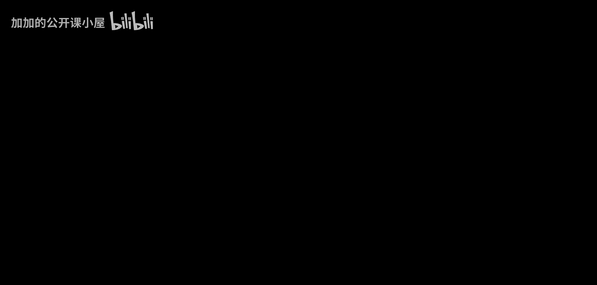
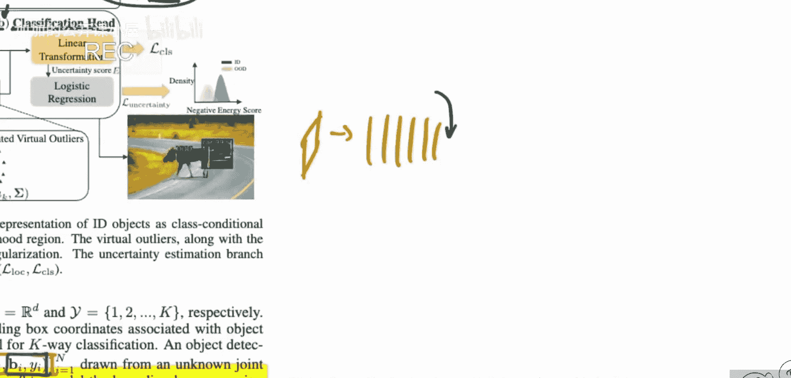
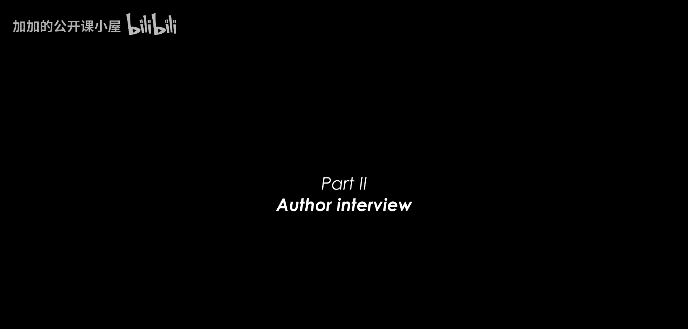
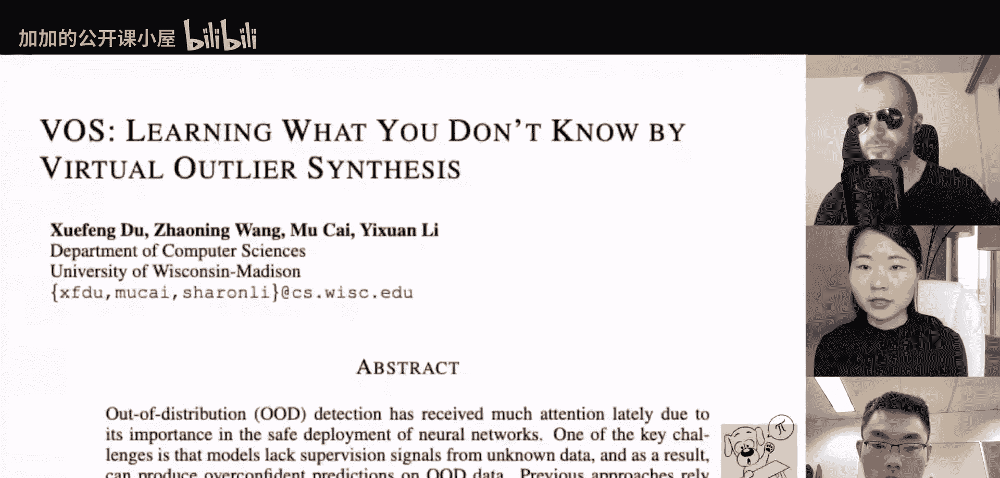

# YannicKilcher【中英⚡AI经典论文领读(全203篇)(下)｜Papers Explained】 p78 P178 作者专访——VOS：通过虚拟异常合成学习未知内容 [BV1j8x5zJEvx_p78]

🎼。

Hello there。 This is an interview with the authors of the paper learning what you don't know by virtual outlier synthesis。

 This paper presents a method to create what it calls virtual outliers。

 which are synthetic outof distribution data points in the latent space of the model。

 And then it trains that model to successfully recognize these points as out of distribution。

 The paper performs very well on a wide variety of benchmarks。

 and I have actually made a comprehensive paper review in the last video about this paper。

 If you haven't checked that out。 Please do because I'll go over the paper。

 I'll explain everything that's in it。 And the authors that I'm interviewing today。

 have seen that review。 So we all start from a common level and they're directly able to respond to my criticisms。

 which is really， really cool。 So in this interview， we go over a lot of topics。

 but mainly I get my questions answered。 and we get a bit of a look at the behind the scenes of the research。

 how the research came about what the authors were interested。😊。

In how they solved problems that came up in between and much more。

 I hope you like these paper reviews， plus interview things。

 Let me know how I can improve these videos for you by leaving a comment。

 Like if you do like the video， subscribe or tell someone to subscribe， and I'll see you around。

 bye bye。Hi， everyone。 Today， I'm here with Sharon Lee and Shufeng Du。

 who are authors on the virtual outlier synthesis paper and are joining me today discussing well。

 the paper and as well as my attempt at an explanation of it。 Sharon Sufeng， welcome to the channel。

 Thank you for having us。😊。

thank you。 It's very cool to have you here。 So you have made this paper， it has gathered， I think。

 a fair bit of attention in the community because outlier detection。

 obviously is a big big challenge especially for security critical applications and not only do you do outlier detection in classification where we usually see it but in like sort of the more challenging task of object detection So my first question would be how did you even how did you come up with this because it is not an obvious idea let's say to even tackle this problem like what made made you tackle the problem in the first place Yeah thank you for the question I'd be happy to share I guess from a little bit behind a scene on the research story how it got started and by the way we're really。

😊，encouraged to see the you know the interest from the community about our work and so you know personally I really I am driven to solve problems that are real。

 meaning that has some connection to the real world and just like you said。

 I think out of distribution detection is one of those problems that really matter a lot in deploying machine learning models in the real world。

And so you know sometimes when we were getting closer to those you know more realistic scenarios。

 that also means problems are getting harder and more complex and this actually takes a trajectory to get there it's actually reflected。

 I think in how the field of you know OOD detection has evolved and unfolded over the years and so if you look at some of the early research you know we've done including some of the researchers have done in the space a very common you way to evaluate how good the algorithms are are based on the benchmark which is you know now seems quite artificial like if you train a model on Cy 10 and then you evaluate against data sets such as Street view housing number or SVN and so the seeminglyly simple。

Task actually took a while for the research community to make make progress on and I think over the years we've definitely done much you know better job developing algorithms to reduce the false positive rate and so that's why sort of you know we think it's you know we're at a better time to start tackling some of the harder questions on the object detection side and why object detection is very interesting and important because that directly has you know a better connection for example。

 if you think about self-driving cars none of those images are。Simple as Cypher 10。

 which has a single object well centered around in the scene， right， In the real world。

 we are going to encounter inputs that have。Multiple objects in the scene and some of those are in distribution which means they have been exposed to the model during the training time and some of those are not quite and so I was you know really glad when kind of should go and join the lab as well to start tackling some of the the questions so that's you know when we started the project earlier actually last year already last spring semester that's when we started。

So you you you were already in the space of outlier detection。

 let's say in the in the broad space of solving these types of problems。 And then you yeah。

 how but what made you， what made you decide object detection。

 That's it Did you did you run across the problem or is this just a natural continuation of the classification data set that's another great question。

 So you know why object detection So one of the。Like you said。

 I think one of the typical you know scenario when we think about where allieder detection or out distribution detection algorithms are being used in the real world is some of the high stake scenarios like safety critical ones。

 for example， in self driving。And that is kind of built on these object detection models where not only we have to perform classification。

 but at the same time being able to you know localize where the where the objects are so I think in terms of motivation that just seems like a very natural you know application focus to to start with and of course。

 we have been， like I said， we have been in this the space for working on the problem I think since a couple years ago and most of the work we've done in the space are on image classification and so in terms of solution I also wanted to share a little bit how we arrive at this virtual ally census so you know I think the first motivation is pretty straightforward we wanted to kind of go beyond。

Image level OD detection to have this finer grain uncertainty estimates that tells us at the object level。

 whether things are in distribution or OD。 And I think figure1 in the paper is kind of a perfect illustration for why we need object level uncertainty。

 right， So as you explained quite eloquently in your video that， you know。

 this car is something the model has observed， which is in distribution object， right。

 whereas this moves here， is something that was not exposed to the model during training。

 And so this picture。

Kind of highlights the complexity that an image can contain at the same time。

 both in distribution and OD object。 And therefore， we can't just derive an image level， You know。

 uncertainty measurement。 We have to， you know， go finer grain at the object level。

 And so that was the first。You know， first。I would say the higher level motivation on the object detection side and then on the solution side。

 I want to share a little bit on how we arrive at the virtual Alllier census。

 so the idea of the algorithmic idea of this paper is largely inspired by one of our previous papers on energy based OD detection。

 which was published at Ns in 2020 and so。In that paper， we focused on image classification setting。

 but from a learning。Algorithm perspective。We propose this called energy regularized learning。

 which in a nutshell is trying to， oh I see your camp there just walking by so in a nutshell。

 that learning frameworkC tries to kind of tackle the problem of classification by not only minimizing the risks on the in distribution data set。

But at the same time， we are introducing a regularizer and this regularizer has very similar spirit as what we're using here in this paper。

 and so this regularizer is trying to kind of minimizing the the risk or trying to pushing the energy surface to be as distinguishable between known distribution versus unknown distribution and so for the image classification setting。

 we use this。So we we use this technique or data set of outy exposure。

 which relies on an external different data set right that's not overlapping with the indi data set so that's what。

