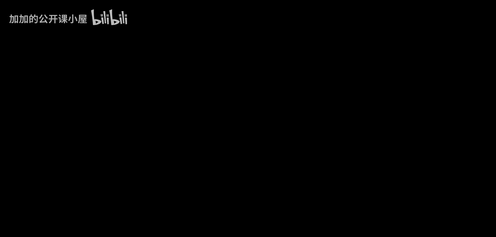
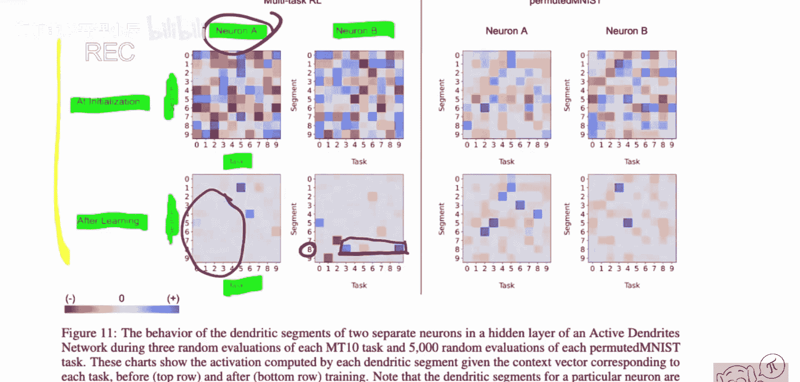
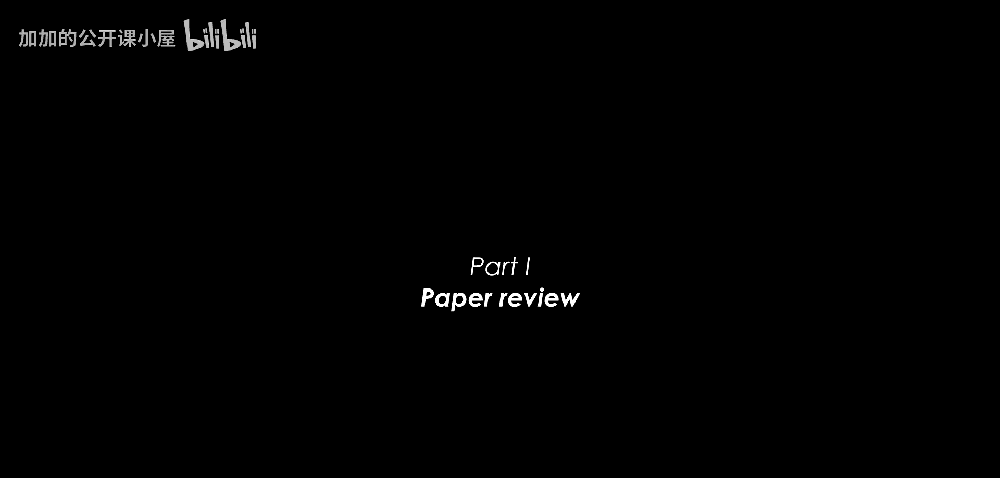
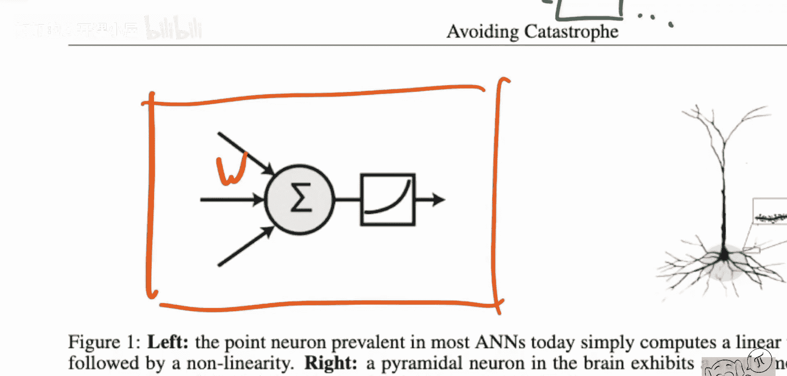

# YannicKilcher【中英⚡AI经典论文领读(全203篇)(下)｜Papers Explained】 p79 P179 避免灾难：主动树突在动态环境中实现多任务学习（综述） [BV1j8x5zJEvx_p79]

🎼。

Hello， this is a comprehensive paper review on a paper called Avoing catastrophe Act dendrites。

 enable multitask learning in dynamic environments。 This is a very cool paper。

 because it combines ideas that come from biology， which are active dendrites。

 and ideas that come from deep learning， namely the problems that we face in multitask learning and in continuous learning。

 Catastrophic forgetting is one of the main problems of these areas and the method of active dendrites directly inspired by biology can really help with that。

 So this video is a comprehensive review on the method of active dendrites in deep learning as the paper describes it。

 By the end of the video， you'll have a good understanding of what is in the paper。

 In the next video that I'll publish tomorrow， there will be an interview with the authors。

 which was also super interesting。 And I definitely invite you to check out both。 As always。

 if you have any。😊。

Comments， please leave them in the comments on YouTube。

 leave a like if you do like the video and I'll see around。 Bye bye。Hello there。

 Today we're going to look at avoiding catastrophe。

 Act dendrites enable multitask learning in dynamic environments。 This is by researchers of Nementa。

 Cornell and Stanford。 So this paper proposes to bring some of what has been lost in translation from real biological neurons to deep learning neurons to bring some of that back into the deep learning neurons specifically the concept of what they call active dendrites and also a bit of sparsity that is to be found in biological neurons So they bring these back into deep learning neural networks and it turns out that that is pretty useful to combat something known as catastrophic forgetting thus the title of the paper avoiding catastrophe So catastrophic forgetting is a phenomenon where in multitask learning or continual learning a network has to learn many things at once and then these things interfere with one another。

It turns out that our methods of training neural networks using back propagation aren't really good at that。

 So either they don't learn any of the tasks because they conflict with each other or in continual learning they do this catastrophic forgetting where as soon as a new task comes in。

 they completely forget about the old task。 So many solutions obviously have been proposed and this right here isn't like is not entirely ultra novel。

 but it is interesting， it ties together biology and sort of practical applied deep learning and it does have some connections to。

 for example， modern transformer architectures and so on。

 So Id also be interested to hear what you think how this stuff is all connected So they start out saying that a artificial neural networks。

 they call these A andNs。 So whenever in this paper A andNs means sort of the deep learning neural networks we have to be a bit careful when we talk about。

That involve biology because neural networks is an ambiguous term there like the neural networks is an ambiguous term because it appears in both domains。

 So they they claim they fail dramatically when learning multiple tasks。

 a phenomenon known as catastrophic forgetting and I already said catastrophic forgett it essentially means that you can't learn many things at once。

 So it says learning multiple sequential tasks can lead to significant interference between tasks。

 they look at two different， they look at two different tasks right here。

 one is multitask reinforcement learning and the other one is continual learning So in multitask reinforcement learning。

 it's essentially reinforcement learning with multiple tasks。

 So you're some sort of an agent and you're in some sort of environment and you have this basic loop of sending an action and getting back some kind of observation and reward。

 however， however， there are multi there are many tasks in this environment。

 So maybe you see it and maybe you don't。That's a part of the definition of the problem。

 I think in this particular environment you also get back kind of an indicator of which let's call that T。

 the task indicator。 So which task you currently supposed to fulfill。

 So the same environment has many tasks and then obviously your reward is going to be dependent on which task is currently active。

 So youre going to give the agent a mixture。 So every new episode。

 the agent tackles the task is different and therefore if the agent just does the same thing as in the last episode it might get a completely different reward because the task is different So that is multitask reinforcement learning and it turns out that and this papers have established this before and I think we haven made a video on some of them that if you look at the gradients they often conflict with one another So learning one task would pull weight in some direction and learning another task would pull it sort in a different direction and there are。

That try to make these gradients as like orthogonal as possible or project them somehow into a task specific subspace。

 But as it stands， conflicting ingredients gradients can arise in these multitask settings。

 and therefore， the classic way of training neural networks with back propagation to update all the weights at the same time just isn't very conducive。

 Even worse in continual learning。 So here we're not necessarily in reinforcement learning anymore。

 although we could be。So this is， this is simply continual learning where you present a neural network。

 So have a neural network。 The neural network is able to， you know， take whatever picture。

 Let's say it's a picture classification and give you some sort of a class label for that picture。

 and now you have different tasks。 So you have task one， task one。😊。

Might be classify you know classify cats from dogs then task two might be classify， I don't know。

 cows from beavers task and so on。 So there is also a bit of a specification gap。

 some of these continual learning benchmarks they will always have the same classes。

 but different data sets， some will have different classes。

 some will have new classes and so on in this particular case we're looking at permuted mist。

 which is sort of the Mist data set So you know there is whatever picture and there is some sort of handwritten digit in here and the permuted Ms data set is simply that every task that you consider。

 So task one would have a permutation applied to all the pixels in in this picture。

 but always the same permutation and then task two would apply sort of a different permutation permutation1 permutation2 so it's kind of a different task。

 It's the same classes you're still classifying digits。20 to9。

 but the permutation is different therefore it's like you have to to learn a new task if you don't have some sort of built in symmetry prior in your neural network Obviously this we're not going to use conv nets right here because conv nets would make no sense if your pixels are permuted we're simply going to use feet4 networks。

 the goal isn't to get state of the art， the goal is to show the difference between what if we use regular neural networks and you can imagine right here。

If I train on task1 right here， taskask one has some kind of a permutation in the pixels I'm able。

 you know these neural networks they're able to learn that because if they're feet4 networks。

 they don't care about neighborhood anyway so they are able to you know we train we train these weights right here to completion and then I activate task2 right after task one I stop giving the network data from task1 and I start giving in data from task2 So also different permutation I also label my images give it to task2 now I'm going to train these weights。

 I continue training these weights and there is some effect when we talk about large language model pretraining in that whatever you pretrain on that kind of stays around So any fine tuning in large language models isn't going to completely erase the pretraining so so actually matters what you pretrain although this is not the same right here first of all。

 we're dealing with。Way smaller networks。 and these way smaller networks。

 they're able to be kind of overwritten mostly。 And also we're dealing with classification tasks right here and not some sort of language modeling task。

 So yeah， these， these the weights， they will just be overwritten to the point where task one is forgotten。

 It's nowhere。 So we've， again， if we draw up some sort of a weight。😊。

Task one would pull it in this direction that would be the gradient so the weight would slowly update by update going this direction。

 and then all of a sudden we activate task2， which would pull it in this direction。

 So the weight would then travel into this direction and essentially forget about task one。

 So it is nowhere near where it should be for task one。 As I said。

 there are some methods of solving this with orthogonal projections and so on。 but as a basic rule。

Our deep networks aren't very good at that So what do we do about it。

 this paper's idea is that since our deep networks use a model of the neuron that looks very much like the thing on the left so you have your input weights which are commonly known as the weight matrix or the weights of the layer。

 this is just one row or column， I guess well， it depends on how you specify the layer。

 but these are just all the input weights。

