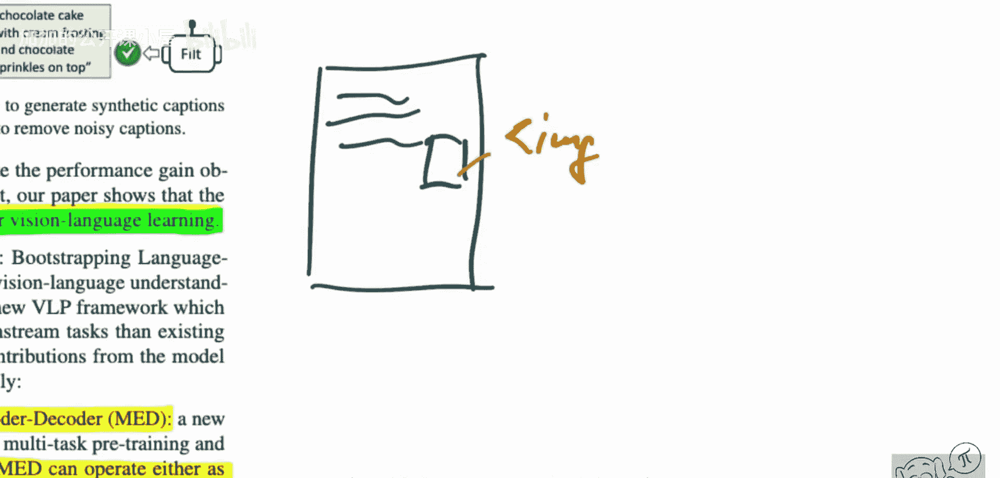

# YannicKilcher【中英⚡AI经典论文领读(全203篇)(下)｜Papers Explained】 p80 P180 BLIP：引导语言-图像预训练，实现统一视觉-语言理解与生成 [BV1j8x5zJEvx_p80]

🎼。

Hey， all， this is a comprehensive paper review of the paper on Blip。

 This is a model and a technique for bootstrapping one's own dataset set in vision and language pretraining。

 which is pretty cool。 So the video is a comprehensive review。

 We'll dive into the paper We'll see what the paper is about。 I'll explain you what's in it。

 And by the end of the video， you should have a good understanding of what's in the paper in the next video。

 which I'm going release tomorrow， there's gonna be an interview with the authors of the paper。

 So also be sure to check that out， because that answers a few very。

 very interesting questions that I had while reading the paper itself。 So I wish you a lot of fun。

 Let me know what you think in the comments and I'll see around。 by bye。😊，🎼Hey there。

 This video is sponsored by Zeta Alpha， which is a new neural discovery and recommendation engine for papers。

 Yes， for scientific papers， for trends in research and code in AI。

 Their goal is to become your research assistant than streamline how you organize。

 share and stay up to date on the latest R And D。 This is really cool because the flood of papers in machine learning is shear overwhelming in recent months。

 Zeta Alpha uses neural embeddingbased search and can give you the best recommendation of research that matches your interest and that you don't want to miss。

 And what better way than to just try it out。 So first I start off searching for today's paper。

 which is the blip paper。 And this is really cool， because not only do I get the paper。

 I also get the Github code implementation and I can directly see the impact on social media that this paper has。

 This is much better than something like Google Scholar。

 which would just give me a few links to the paper itself。 I can now save。😊。

🎼This paper under a tagging category that I'm just gonna to invent right now and I can use Zeta alphapha to find similar research here I'm gonna limit my search to the last three months so I make sure that I don't miss anything that has recently been going on that I should know about when reviewing this paper Now I also like a bunch of those other papers So I'm gonna save them as well to the same category Once I have a bunch of papers in my category I can use again。

 Zeta alpha's recommendation engine to give me more suggested papers to add to the same category based on what I have already in there and I can also share this entire category with my teammates because everything Zeta alphapha does is not only for individuals but also for teams This is really powerful and can dramatically accelerate your discovery of new and relevant research Now this doesn't only work for category that you defined once you interact with the search engine Zeta alphapha is gonna to be able to give you a list a feed。

🎼Of recommendations from archive， from conferences， from blogs， from Github and much more。

 This saves you a ton of time and lets you stay up to date with whatever is happening。

 If you're at all into Emily research， this is hyper relevantle for you。

 And I definitely invite you to check it out。 Now they do have a free tier。

 But I got you a great deal。 If you go over there right now and use codeonic。

 you'll get 20% off a personal assistant subscription。 Again。

 go to Zeta Al dot com use codeonic for 20% off right now。

 Thanks again so much to Zeta alpha for sponsoring today's video。 And now let's get into it。😊，C呀。

Hello there。 Today， We'll look at blip bootstrarapping language image pretraining for unified vision language understanding and generation by Jinan Li Dong Xili timinging Xg。

 Stephen Hoi， Yeah， that's it of Salesforce research。 So this paper proposes two things。

 One is a new architecture。 And I want to say a new conglomeration of existing things。

 So an arrangement of modules for multitask pretraining。

 This model will take in an image text pair and perform multiple tasks on it， it has multiple losses。

 and therefore ends up being able to do multiple things。 Now， that being said。

 this is a pretraining methods。 So the idea is that for any of these modules， you'll take them。

 you recompose them downstream and you fine tune them on a task。

 Although they do have some zero shot results。 So this is one thing。

 and this could be really cool if this alone turns out to be。😊。

Successful because it leads the path to a future where we have much more dynamic compositions of models and where we would pre train these models with a lot of different tasks in。

 in one thing， rather than pre training them on， on just a single task， like language modelling。😊。

The other thing is a bootstrapping method for the data。

 and these two things are not necessarily disconnected。

 although I do lament the fact that it's two things in one paper a little bit。

 but there's a bootstrapping method for these image text dataset set that includes training captioners and filters。

 which means that this there is a part that learns to synthetically generate data。

 and then there is a part that learns to distinguish good from bad data。

 and that allows them to collect lots and lots of data from the internet and filter out bad badly poorly labeled images。

 which there exists a lot on the Internet and also allows them to augment the data by labeling images themselves。

So this is also really interesting， and it feeds really well back into their model because their model is uniquely capable of doing this being the multitask model that it is。

 So we're going go through the architecture through the data bootstrapping method。

 and keep in mind that I think， you know， if this catches on。

 this could be there could be recipes in here for future research that leads us to a much more dynamic world。

 where we compose these modules， much like we compose different modules。

 low level modules and deep learning。 We could compose these higher level modules and losses and do lots more multitask pretraining。

 maybe even dynamically configured。 But let's dive in。😊，So vision language pre training， they say。

 as recently， recently been， you know the the hit， for example， if you think of something like clip。

 I mean， that's not even pretrain， but there are lots of architectures that do vision language pretrain。

 meaning they take pairs of images and text。 So you'll have like some sort of an image and you'll have like some sort of text that goes with it。

 and you'll try to come up with a system that connects the two in any way。

 They say the major the existing methods have two major limitations。 So first of all。

The what they call the model perspective， they say they are either the existing methods are either encoder based or an encoder decor architecture。

 So in an encoder based set up， what you would do， as you would take in both of these things。

 and you would try to come up with probably a number that represents how well they fit together。

 So are they good together or not， This is the clip architecture， essentially。

So in encoder based models， they criticize that encoderbase are less straightforward to directly transfer to text generation tasks。

 So its not it's not simple to take clip and actually make it produce something。 Remember。

 if we have to， if you have to produce an actual image with clip we need to do this diffusion。

 clip guided diffusion or clip guidedgans， Vqgans。 So it's really cumbersome to make clip generate an image。

 and it's probably even more cumbersome to make it generate text because is not trained on that。

 So they criticize on these methods。 It's not easy to make them do generation tasks whereas encoder decoder models have not been successfully adopted for image text retrieval tasks。

 So an encoder decoder model is where you would take the image probably and then make it produce the text。

 So you train it as a language model to auto aggressivelygressively produce the cap。And。

That's really neat for producing captions， but you cannot necessarily do this task up here very easily with such a model。

 you will， you will be able to do some things， but they're not necessarily successful because the task is really a different task。

So both approaches for doing this currently are not ideal。The other thing is the data perspective。

 they criticize that these models are pretrained on image text pairs that are essentially scraped from the Internet。

 So collected from the Internet。 and they say noisy web text is suboptimal for vision language learning。

 We've known for a long time that there is a tradeoff between scale of data and quality of data。

 and ideally you'd have both。 however， if you scrape from the Internet。

 So let's say you scrape websites and there is like some text and there is an image somewhere。

 and the image will have alt text and that's what's usually used as the label in these systems。

 So if you don't know in the HTML。 if you have an image tag。

's how that's how the browser knows it's an image， you have the image tag。

 you have to source attribute， which leads it。

