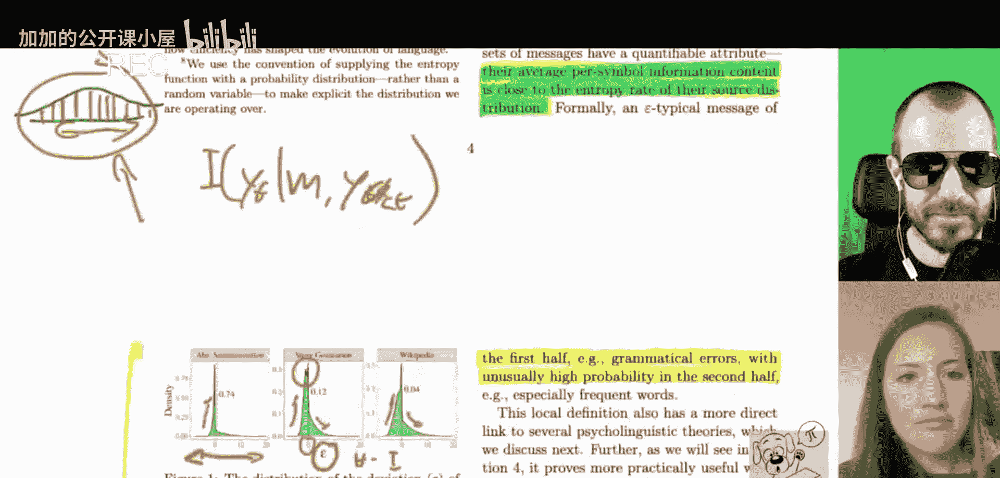
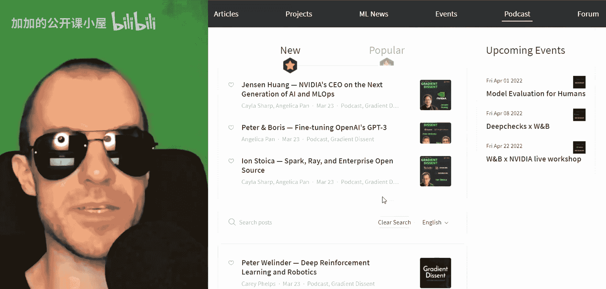
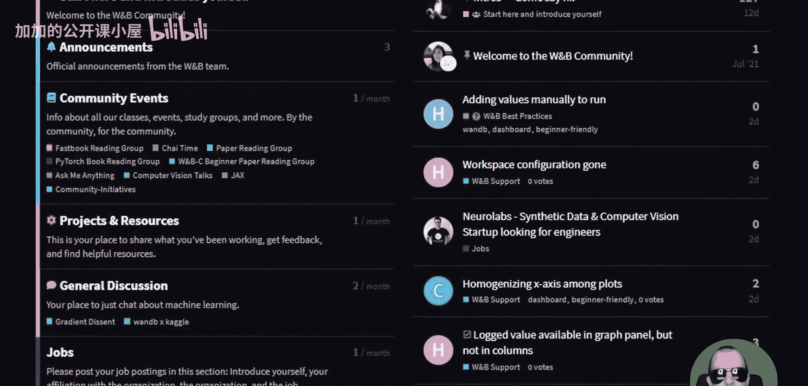
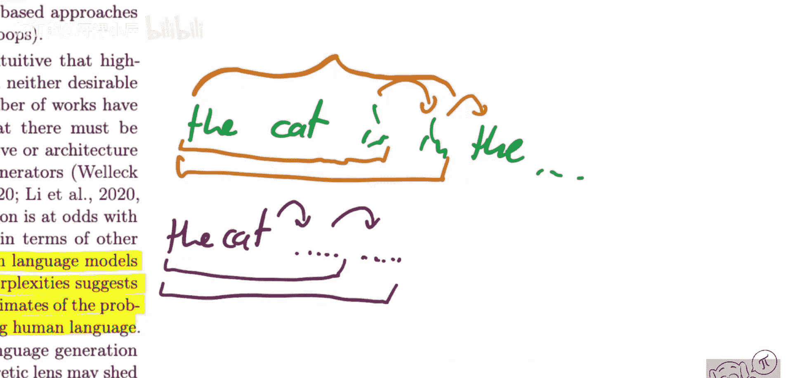

# YannicKilcher【中英⚡AI经典论文领读(全203篇)(下)｜Papers Explained】 p81 P181 典型解码用于自然语言生成（让语言模型输出更接近人类表达！） [BV1j8x5zJEvx_p81]

Pay special attention to this paper。 It is not a paper by goul or deep mind or meta or anything like this。

 Yet， I believe it is a really important paper。 It discusses typical sampling。

 which is a new decoding strategy of how we sample from language models。

 We usually train language models with a maximum likelihood objective that put a lot of weight on very likely words And when we use these models to produce language we either explicitly or implicitly reproduce that。

 we make these models sample very highly likely strings which are boring and not human like。

 It's not what we do。 I don't say things that are just highly likely because I actually want to say something interesting。

 And that means that every now and then， I should utter something That's less likely。

 I should speak a word or a sentence that you didn't expect。

 because that's what transmits information。

Typical sampling does exactly that and does it in a principled fashion。

 This video right here is a description。 A review of the paper and the next video is going to be an interview with Claomister。

 The first author of the paper。 Both videos， but especially the interview are superduper interesting。

 I would definitely invite you to check them both out。

 And I would definitely invite you to try out typical sampling， it is in hogging face。

 And whenever your objective is to sample something that is very， you know high quality。

 but also diverse and interesting and not just bland high likelihood text。

 Then that is your method for you。 I believe that we do need new sampling strategies。

 and this one is very promising。 Check it out。 leave a like and see， Hi。

 let me quickly tell you about fully connected。 which is curated space for the applied M L community。

 It features articles。😊。

🎼Reports， news events and anything you could want。 especially the project page acts as a little bit of a product hunt for M。

 So feel free to add your own project right here。 It's curated by weights and biases but I know what you're thinking。

 Yeah another company blog， whatever about their products。

 but this is not at all about weights and biases。 it features some of their stuff of course but it is generally a really good resource to get good information on what's currently happening in deep learning。

 They have great articles and tutorials like there's one on solving Wordle with reinforcement learning。

 which is pretty cool。 There's one explaining group normalization in pytorrch and theres one that explains to you how to run Yolo V5 object detection on Windows So as you can see they have all kinds of stuff and the list of already existing articles is long。

 If you still don't believe me that it's not all weights and biases。 In fact。

 you can submit a post there you can click。

🎼The button write a post it will be reviewed by them and then published So one of the coolest M startups currently is going to push your content how great is that Now if you are just a luer like me then head over there and because it's user submitted but curated so you get the best of both worlds beside articles they also have events which usually means their webinars about various topics you can look at webinars but you can also subscribe to get updates on new ones they also host their podcast gradient Descent and the current episode is actually with Jensen Hu CEO ofvidia pretty big hit and lastly it includes the good old weights andes community forums where you can get all kinds of help on weights andes products and beyond weights and biases to all kinds of things machine learning related So again fully connected it just got a major redesign check it out go over there for awesome articles and news there's new stuff all the time Thank you so much。

🎼ToW some biases for sponsoring this video。 They've been a great sponsor。 so please check them out。

 That's one D V dot AI slash fully dash connected。 Now， let's get into the video。 See yeah。😊。

Hello there。 Today， We'll look at typical decoding for natural language generation by Clarameister Teaiago Pimentel。

 John Wier and Ryan Coterall。 This paper suggests a new way of decoding of producing text from a large language model or a small language model。

 It doesn't matter。 We don't discriminate here。 In any case， usually currently。

 you might have heard of things like beam search。 you might have heard of things like nucleus sampling and top K sampling。

 These things are all right。 And interestingly enough。

 These stochastic methods like nucleus and top K sampling are better than the methods that try to find the most likely things such as beam search or greedy decoding。

 However， it's still not satisfactory。 large language and small language models。

 They often produce text that is boring。 just kind of bland when you actually use them。

 even though they have amazing perplexities on text。😊。

Paper tackles this。 It proposes that when humans generate text。

 they don't just produce the most likely text。 They will actually trade off likelihood with information content or or the transmission of information to another human。

 And that trade off can be captured in the frameworks of information theory。

 and we can we can generate， or we can suppose a decoding scheme， which they call typical decoding。

 typical sampling， which exactly encapsulates that notion of balancing interestingness or information with likelihood。

 And when they test it， that actually results in in better results。

 This could be really crucial because it doesn't require any change to how we train language models。

 In fact， we can take off the shelf train language models and simply use this new decoding strategy out of the box and it applies across now across domains。

 Now I have long。Said that we need that probably our decoding methods。

 our sampling methods may be inadequate， depending on what we do with those language models。

 for example。Alpha code samples a whole bunch of programs in order to solve a problem。 Now， we again。

 we don't like there is value in diversity。 If you sample a whole bunch， and then after that。

 use like a filter to narrow it down。 So I think depending on what you want to do。

 maximum likelihood sampling is very appropriate， This paper， for example。

 mentions natural or or machine translation。 because in machine translation。

 you really want kind of the the best translation for a given input。 However， in other frameworks。

 such as alpha code。 But also such as a storytelling。

 This paper mentions summarization may be as well， you want to we want to trade off some of this maximum likelihood for some more diversity or for some more interestingness or for some more information content。

 And that's what this paper does。 So we'll dive into it。 if you like content like this， as always。

 leave。Like， and don't be shy to let me know in the comments what you think。

 I'm not exact I'm not entirely sold on what this paper does。

 I do agree we need better or we need a different decoding strategies， but I do have my， you know。

 reservations about this exact one。So let's dive into the paper。

 The paper first complains about the exact thing I complain about。

 namely saying that language models currently they have extremely low perplexities on on corpora from many domains。

 Yet， when used to generate text， their performance is far from perfect。 And by that， they mean。Yeah。

 they， they produce text that is undesirable， E G， generic or de degenerate， Wait， yes。

So either generic or degenerate or just， as we have said， boring bland。 you know。

 And that comes from the fact that a lot of these things。

 they try to find the maximal probability string。 So they think， you know。

 I'm going sample from the probability distribution， and I want to sample what is the most likely。

 because that's how we train these models， right， So let's do a short excursion。

 if you are unaware of how language models are trained， They're usually trained。

 you have a sentence like the cat is。In something， the house。And it goes on。

 So what you do is you input a part of the text， and then you let the model predict the next token。

 and then you input that part， and you let the model predict the next token。 Now， in training。

 this is all good and fine。 But at inference time， what you do is you provide a prefix， for example。

The cat。And then you have to decode here。 you have to decode a word what's next。

 And then you feed that whatever you decode it into the the language model and you decode the next word。

 And I think that's where part of the problem comes from。 because during training， naturally。

 what is here is given by the data set。 So every new step that you take。

 if there is something unlikely if there is a certain diversity to the to the input that's captured by the training data。

 However， in decoding， you sort of make your own data as you go along here。

 And if you just always focus on finding very likely next tokens。

