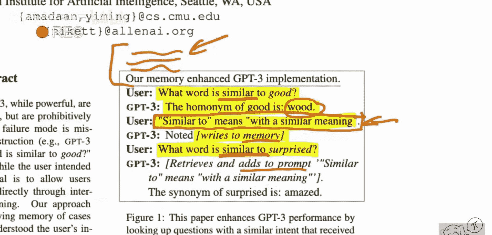
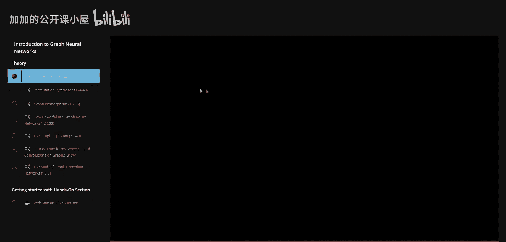
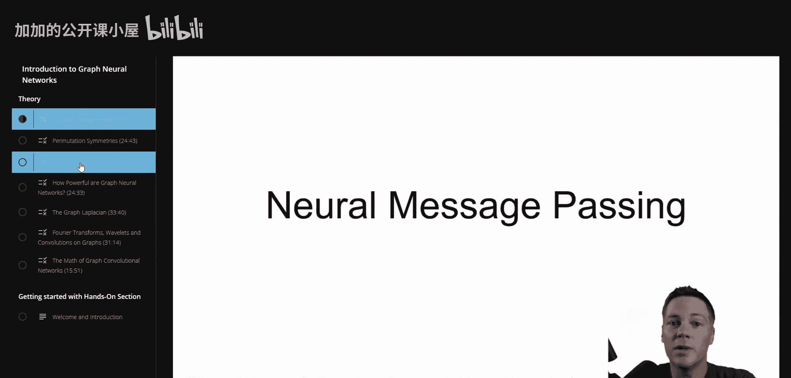
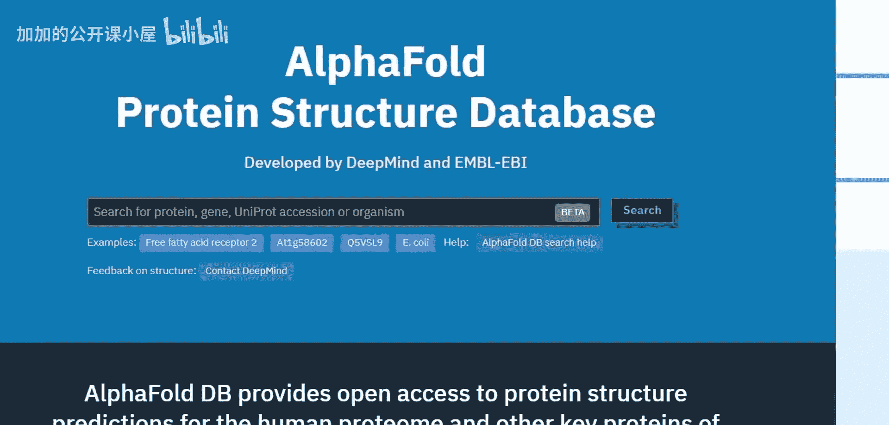
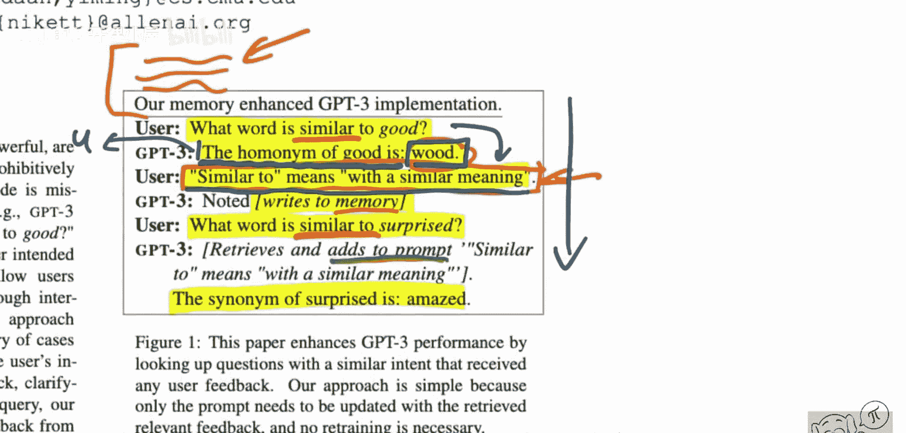

# YannicKilcher【中英⚡AI经典论文领读(全203篇)(下)｜Papers Explained】 p82 P182 部署后通过记忆辅助提示编辑改进GPT-3（机器学习论文解读） [BV1j8x5zJEvx_p82]

Hello， this is a comprehensive paper review on the paper called memory assisted prompt editing to improve G3 after deployment。

 as the title says， this paper is really cool because it is able to improve these large language models after they're deployed。

 So this video right here is a comprehensive review on the paper。 after you've watched the video。

 You'll have a good idea of what the method does， what it is and what the paper describes。

 The next video released tomorrow will be an interview with the authors of the paper。

 And that is also really cool， and I definitely learned a lot from that as well。

 So I invite you to check out both and I'll see around。 have fun。 Hey there。

 today's sponsor is the course on introduction to graph neural networks。

 This is a course by my friend Zach Jost， who is an expert in graphraph neural networks。

 He's backed all his knowledge into one course that will educate you on both the theoretical and handson practical。

😊。

🎼Back on graphph neural networks。 Graph neural networks are really important。

 They're definitely one of the most interesting areas in deep learning right now。

 They've also powered a lot of recent advances in scientific breakthroughs。

 such as Al fold protein structure predictions or better traffic predictions。 If you use my link。

 you'll get a 15% discount on the course。 Enment is open right now and lasts until April 1 or until spaces run out。

 All right， let's get into the video now。 See。😊。

Hello there。 Today， we're looking at memory assisted prompt editing to improve G3 after deployment by Amman Madan。

 Niottanon and others。 So this paper proposes a method to improve G3 in an interactive mode in a user feedback mode。

 Here is a little sample of how that could look like。 So the user would pose a question to G 3。

 For example， what word is similar to good。 And this is not displayed here。 but in advance of that。

 there would be like an entire prompt like you would be used to for prompting G 3。

 If you don't know about G3， I've made a video on G 3 extensively describing how that works and how to construct these prompts right here。

 So that G 3 gives you what you want， supposedly， because it doesn't always work。 For example， here。

 The user asks what word is similar to good。 in G3。He says the homominm of good is wood。

 which is kinda true， but the user doesn't is not specified clearly what similar means。

 The user here had a different intent， which then the user specifies。

 the user says similar to means with a similar meaning。

So the user didn't mean a word that sounded like good， which is wood。 The word。

 The user meant a word that is kind of like a synonym instead of a homoonym。So。In this new system。

 this thing right here would be called feedback。 and the user would be able to give this feedback to G3。

 and then G 3 would write that to memory。 Now It's not actually G 3。

 It's sort of like a plugin that the paper develops。 And then the user， the next time the user asks。

 for example， what word is similar to Sur。 the system will remember that the last time the user asked the question like that。

 like similar too。 You know， what word is similar to another word。

The system will go back to the memory。 retrieveve the feedback right here。

 Put it into the prompt and then guides G P T 3 to actually to actually answer in the correct way。

 So G P T3 here says the synonym of Sur is amazed。😊，So multiple things to see right here。

 First of all， they plug in the system that the paper here proposes can be added to any pre trained language model。

 and the language model itself doesn't have to be changed。

 which is really important for something like G P 3， because that's too big to， to change。

 I guess you can fine tune it。 But you'd need a lot more data than just two or three examples。

The other thing is that it is interactive。 So this is an interactive user session where the user can specify not only clarifications for things that are clearly wrong。

 but also maybe personal preferences。 So this is goes beyond what this paper shows this paper is mostly about either factual accuracy。

 like accuracy of the task or figuring out user intent from ambiguous meanings。

 This could easily be used to personalize interaction with G 3 for particular users by interactly letting them improve the system。

 And this is kind of like what you know， Nories think of AIs。

 like a system that learns from the two or three times that I give it feedback and then gets better over time。

 So this is pretty cool。 And lastly， what was I gonna to say， I don't。 I don't remember anymore more。

😊，But we're going to look at how this works and， you know， what's good about it， what's bad about it。

 And yeah， that's， that's about it。So。Here is the proposed before and after of the system。

 If the user with no memory asks GP3， the user gives an X， As we said， it's。

 it's always prefixed with some sort of a prompt that guides G3 into giving the correct answer structure or type of answer if we're going to look at some of these prompts in just a second。

And G T 3 will give some sort of an answer。 Now， this might be good or bad， as you may have seen。

 it can turn out not the in the best way。So in their memory enhanced G 3 example。

 the user would give a question X。 Now， let's disregard the memory for now。

 Let's just go directly to G3， which is what happens in the very first iteration of this interaction。

 So G P 3 now has a prompt in front of it as well。 But a prompt that the authors here designed such that G 3 doesn't only give the answer to the question。

 But also you， the understanding of what the user meant。 So up here， you can see that。

By G P T3 answers， the homoonym of good is wood， right， G P T 3 doesn't just answer wood。

 which would be the answer。 But also this first part right here， which is this understanding。

 So the authors construct this sort of meta prompt that they give。

 and that instruct G P T 3 not only to， to give the answer。

 but also to give the understanding like a clear。A clear output of what it understood。

 The user can then take that and decide if that's what the user wanted or not。

So if the user is happy， then all is good。 If the user is not happy。

 the user can give feedback to G3。 The user gives feedback in kind in natural language。

 just like types it up like， no， I didn't mean this。 I meant this other thing。

 and you have to type it up in a bit of a special way， you have to type it up。 you can't just say no。

 I guess you can。 but it's is best。 if you right， like similar to means with a similar meaning。

 So you clarify your original question right here。 And by doing that， you commit it to the memory。

Now， obviously。What you could do is you could simply add that clarification to the prompt。

 go back to G 3 and actually let it answer correctly， which would work。

 But we're not only about this prompt。 The idea here is that this feedback will help guide G P3 in all subsequent prompts。

 because the user is likely going to express themselves in the same way， GP 3， if it misunderstood。

 is likely going to misunderstand in the same way。 So this memory serves as a bit of a generalizable correction mechanism that learns from few items of feedback。

 So lets let's look what happens the second time around。

 So the second time the user again has a question X。 We then go first to the memory。

 and we see or X prime。 Let's call that X prime。 We see。

 is there anything in the memory that is similar to X prime， meaning that is there any。

Question before that has been submitted to G3 in the current session doesn't need to be in the same prompt or anything just in the current user session。

 that has been misunderstood。So do we have an instance that is close to X prime where feedback was given。

 That would be part of the memory。 And this is being done with either semantic similarity or So you take some sort of of a language model or some sort of a sequence model。

 for example， a transformer。 you look at the embeddings of the sentences you compare them via cosine similarity。

 You can also do word overlap or something like this。

 But what you want to do is you want to retrieve those instances of feedback。

And then you want to add that feedback to the prompt。In the very case， in the case that you。

 So this is hidden here。 This is hidden， It just says and add。

