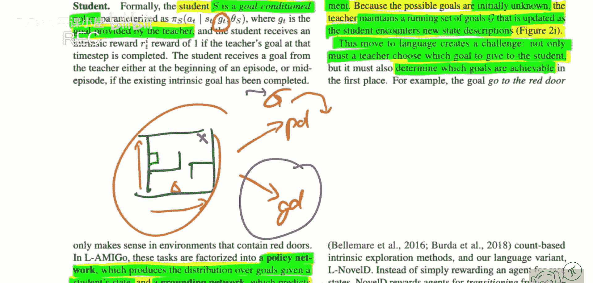
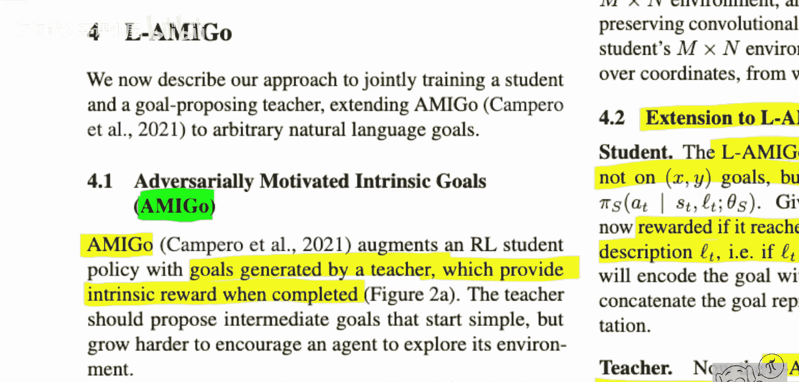

# YannicKilcher【中英⚡AI经典论文领读(全203篇)(下)｜Papers Explained】 p83 P183 利用语言抽象提升内在探索能力（机器学习论文解读） [BV1j8x5zJEvx_p83]

🎼。

Hi there。 This is a comprehensive paper review on the paper improving intrinsic exploration with language abstractions。

 This is a very cool paper because it combines a language and the information that is in language with reinforcement learning is specifically the problem of exploration。

 I don't want to tell you too much more right now， because we're gonna dive into the paper in just a bit。

 So this video will explain in detail what is in the paper， how the method works， what they're doing。

 So by the end of this video， you should have a really good idea of what's in the paper。

 in the next video published tomorrow， there's going to be an interview with the authors of the paper。

 which is very， very cool。 It's super valuable And I was very happy to to host this interview。

 So I hope you draw some value out of either one of these videos， hopefully， both as always。

 thank you very much for watching。 Thanks to everyone who likes and comments and supports in any way is really cool to be able to do。

😊。

These things。 and I'll see you around， bye bye。Hi there。 Today。

 we're looking at improving intrinsic exploration with language abstractions by researchers of Stanford University。

 University of Washington， Meta AI and University College， London。

 this paper on a high level uses language to facilitate intrinsic exploration。

 That is when in the face of a very sparse environment。

 a reinforcement learning agent has to come up with its own goals in order to make progress。

 So the intrinsic exploration or intrinsic motivation refers to the fact that there's an additional reward that we give to the agent just for attaining。

 let's say， new states， novel things in the environment。

 And it turns out that that's not super du easy because not all new things are equal and especially let's say there is a random component in the environment。

 then you know， that's going to be new every time。 yet it might not be interesting。

 So how you go about this is quite a challenge。 It's clear that。

We need something like this in Sprse Sprse rewards environment but how exactly to do it is still still challenging This paper adds language to the mix and argues that language descriptions could be one such source of novel of indicators of novel states so we're gonna go through the paper let me know what you think in the comments definitely and yeah let's dive in so。

They say they want to solve these complex， long horizon task with sparse rewards。

 and as I already said， that is not really a picnic for reinforcement learning agents。

 usually those need very tight very dense rewards in order to work。

 and that's why we give these intrinsic rewards for exploration。And that is is encouraging the agent。

 even in the absence of rewards， to go out and explore things and do new things。

 and we hope that through the exploration at some point it will learn the skills or it will encounter something that will that will actually give true reward。

So。They correctly claim there is a design choice on how to measure exploration and an implicit。

 like a common answer that the agent should be rewarded for attaining novel states in the environment。

 but that is， as we already said， quite difficult to actually implement。 For example。

 states can look cosmetically different， but have the same underlying semantics and thus not be truly novel。

So the two fundamental challenges for intrinsic exploration they list here is first。

 how can we reward true progress in the environment over meaningless exploration Second。

 how can we tell when a state is not just superficially but semantically novel and that's where they add in language they say。

 well if we had language describing the states then certainly for example。

 here we have language that describes the state here the language descriptions as in what direction indicating that you can go in a couple of directions or do something in a couple of directions you see here a crystal wand that means theres something to pick up so when you don't have this message that might be an indication that the state is meaningfully different。

 namely it doesn't have the crystal wand So as you can see these author。

Imagine that if we had a language description of the environment。

 that could give us an indication of when something is novel and when something is just the same。

 but looks a little bit different。They say language obviously has strong priors over the features and behaviors needed for meaningful interaction and skill acquisition。

 And that's just a matter of fact that language has been developed to communicate things that are useful to humans。

 And they also say correctly that you can describe with language very particular things such as move left or very abstract things like acquire the amulet and defeat the wizard。

 although one of the abstraction here comes from the end。

 but still defeat the wizard is very very abstract thing。Now。As we already said。

 what they're going to do here is they're going to look at these environments at these reinforcement learning environments。

 So there's minigrid on the left and in minigrid， I believe the agent here you're that's the the red triangle and the agent is supposed to。

 I think go to the keys， get the keys， open the doors and eventually get the final reward that is somewhere on the map。

 These are procedurally generated So they always kind of looks different and that's one challenge because。

If you have to make sequences of actions like go over here， get that key。

 go to the door and then go further and get the reward。

 That is a sequence of actions that is unlikely to happen by by chance， right。

 to stumble over the key and to stumble over the door and to stumble over the reward。 You know。

 the amount of times you're going try randomly until that's the case is is staggering。 And therefore。

 something like Q learning， which just requires on random exploration。

 is going to almost certainly fail right here。 But this is one of the environments。

 which is a challenging environment that they pick up。 And that has these language descriptions。

 Or I think in this one， they add the language descriptions。 But in any case。

 this is not about language models or anything like this。 They assume that they have a function。

 which they call L。The language annotator that takes in a state takes in and gives you the description。

 And they just assume they have an oracle that does that。 So for the environments， they do test。

 they actually have that and。So in Minha here， this is even part of the game right in Minha。

 you will always get a message like this to every step that you do in almost most of them。

 most of these states have such a description available So again there is dysfunction L。

 which in this case is just the game engine， it takes in a state and it gives you back the description。

So if you， you could guess here that we might learn this language descriptor right。

 we might even initialize it with a language model。

 we can use something like clip or something like this。 This is certainly in the future work。

 they list this， but not here here we assume we have this oracle Now。

 what can we do once we have such a language description。 Well， we can use it for exploration。

So there is a little bit of math and math right here which we're going to skip essentially this just discusses that yeah they have this annotator L that produces these natural language descriptions and they add an intrinsic reward to this and now we're going to look at what the intrinsic reward is。

😊，So they're going to take two different in like two different algorithms that are already made for intrinsic motivation and they're going to augment them with language。

 The reasoning behind it is that those two algorithms the one is called amigo。

 the other one we'll get to in a second， they're already kind of state of the art in this domain。

 so what they say is if we add language to those and we can get a better result then that kind of shows the usefulness of language of the language descriptions。

So we're going to look at these algorithms briefly。 remember， these algorithms aren't by this paper。

 This paper is how to add language to them。So Amigo， the adversarally motivated intrinsic goals。

 trains a student and a teacher， so there is a teacher that generates goals and then the student is just a goal conditioned policy the goal is。

 as we said provided by the teacher so the student is the real reinforcement learner but the student is simply conditioned on some goal that's provided by the teacher is not it doesn't try to solve the actual problem。

 it solves the goal that the teacher gives it I mean it probably gets reward when it accidentally also fulfills the true reward goal。

 but it does get intrinsic reward when it fulfills the goal set by the teacher。

