# YannicKilcher【中英⚡AI经典论文领读(全203篇)(下)｜Papers Explained】 p85 P185 ACCEL：基于遗憾的环境设计演进课程（论文评述） [BV1j8x5zJEvx_p85]

Check this out。What you're seeing here is a bunch of agents that have all never seen this level before。

 This level is， in fact， procedurally generated， and the agents must somehow overcome the obstacles right here。

 you can see theirs stumps， There's gaps， the green one is performing pretty well right here。

 coincidedentally， the green one is also what we're going to look at in today's paper。

 The idea here is， as I said， these agents have never seen these environments。

 and the environments are procedurally generated every time I hit reset here。

 a different environment is created。 And also notably on the right side right here。

 I have these sliders， which with which I can control the different properties of the procedurally generated environments。

 such as how wide the gaps are， how many steps to the stairs there are。 And as I modify these。

 you can see the environments， they get more and more challenging as I slide these things to the right hand side。

 Now， they get super challenging at some point。 And the question is， how do we。

Train an agent using reinforcement learning in order to be able to solve these challenging environments。

 because it's pretty clear that if I want an agent to solve an environment like this。 And remember。

 it's a procedurally generated environment。 So I can't just train it on the same environment over and over and over again until it gets it。

 If I want to train an agent to solve the family of environments that are very hard here。

 It's almost impossible to do so using from scratch reinforcement learning because there's just never any success of any of the agents like they never finish an episode。

 they never get good reward。 They always stumble at the first obstacle and。

So what's the what's the way we I still want the green one to actually make this come on， green one。

 come on。It's not going make it right。 So the idea is that what we want to do is we want to develop a curriculum。

 So a curriculum means that we're going to use this ability to create levels of different difficulties to guide the agent to learn more no。

 to learn more and more difficult environments。 So we're going to start with very easy environments。

 very flat environments， not many gaps in them， not many stairs in them。

 So fairly easy environments like this。 And we user reinforce learning and try to teach the agent。

 just to solve this level。 Now， most of them will do a fairly good job at that level。😊。

As you can see， not too much of a problem。 some stumble， some don't。 but， you know， this is solvable。

 And then we will progressively， as the agent gets better and better。

 increase the difficulties of the level and。Using that， using that difficulty increase over time。

 there is a chance that the agents they learn more and more and more what it in they learn more and more to go and solve these levels。

 So from scratch learning of the difficult environment environment might not be possible。 however。

 there is a chance if we design a curriculum in the correct sequence of difficulties for the agents to learn。

 This is not unlike humans learn in you may have heard of this what you want to do is train in the zone of proximal development or something like this。

 which which essentially means that you want to。

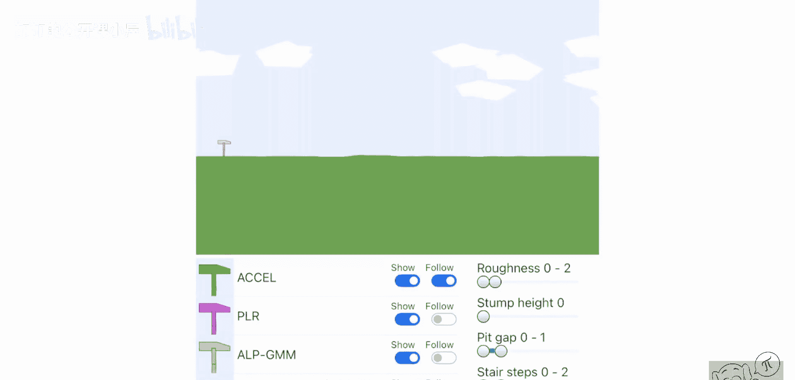

Always challenge yourself just outside of your current abilities。

 and that's how you maximize your progress in learning。

 That's the same idea that we have here with these evolving curricula over time。

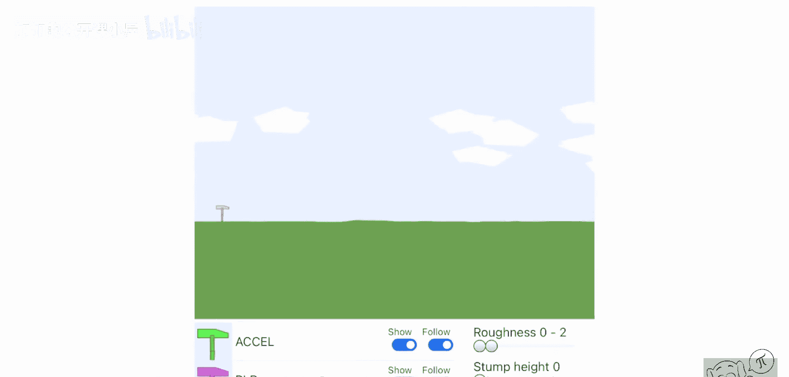

So the paper we're going to look at is called evolvinglving curricula with regret-based Enron design by Jack Parker Holder and Minki Jang and others。

 mainly by MeaiI， but there's a bunch of collaborations with UC UC Berkeley University of Oxford and yeah I guess that's it so this paper combines recent developments in regret-based algorithms that go about making a curriculum and evolution which is another way that people go about this so the paper proposes to train a single agent。

 not a family of agents， a single agent that is generally capable of solving all kinds of difficulties in levels and to do that via an automated curriculum that is given by a teacher algorithm the teacher algorithm itself is not learn the teacher algorithm is actually defined by like this schematic right here and。

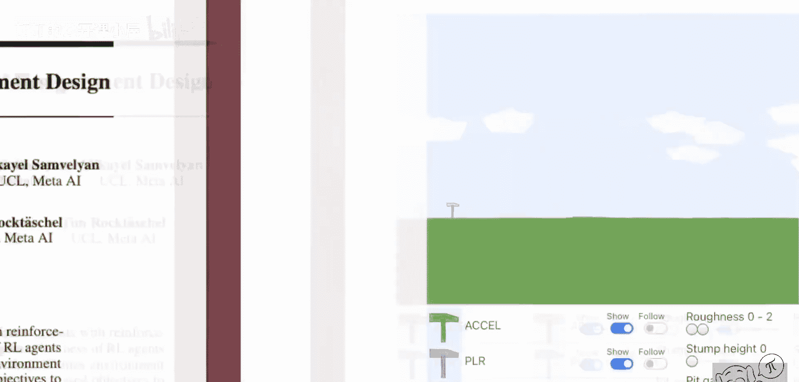

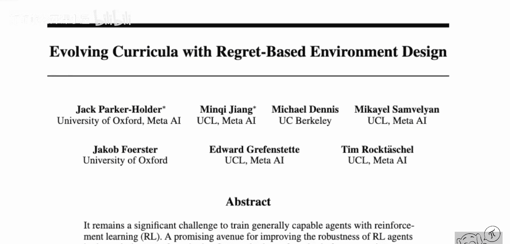

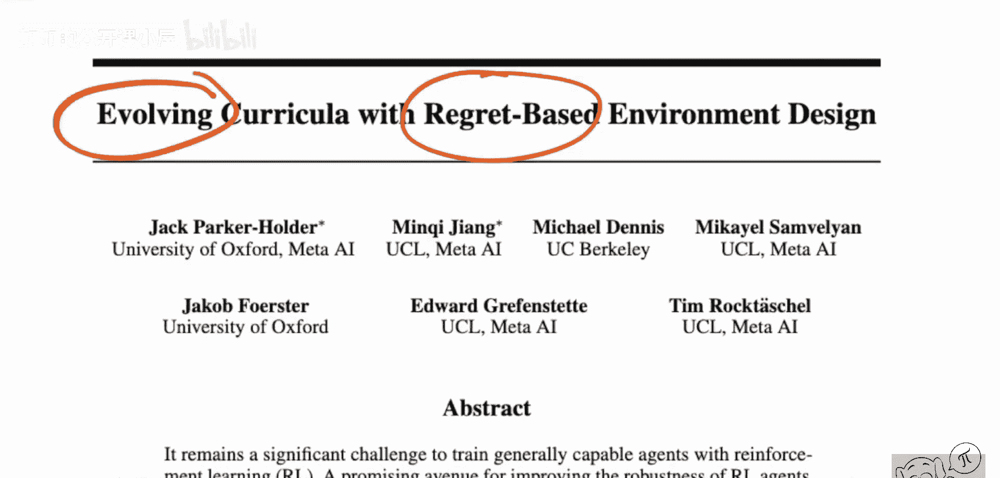

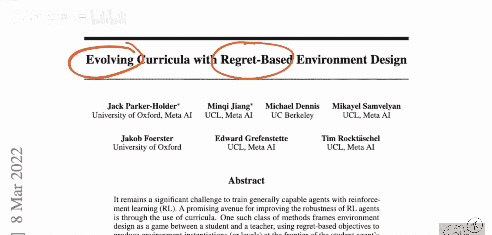

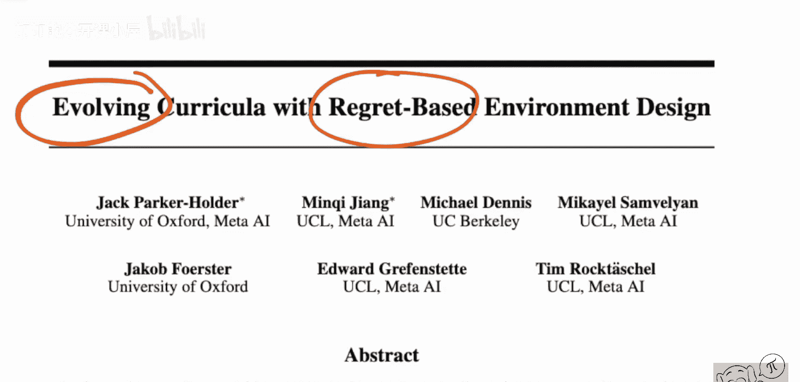

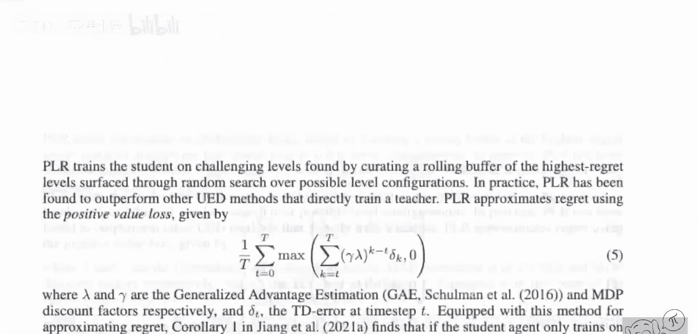

OfThis is regret based， which makes it independent of kind of domain specific heuristics。

 so the goal of this algorithm right here is to have a general algorithm to design these curricula without being reliant on essentially creating a new heuristics for all of the different tasks it needs to solve。

So we're going to look at it， here's a brief overview over the algorithm itself， how does it do it。

 how does it get an agent to learn step by step and the most difficult question is you know how fast do you increase with the difficulties of your levels because if you increase not fast enough that you're essentially stuck in learning if you increase the difficulty too fast you have the same problem again in that the agent will not be capable of keeping up。

So what you want to do is you want to have some sort of a level generator and that is what we just saw before in in this web demo。

 by the way， you can go look try out this web demo for yourself at Ael agent orkitadoio obviously I'll link it in the description to this video but you want to have some sort of a level generator which is essentially the thing that I have here on the right。

 I want to have the ability to create different levels。

 This doesn't need to be parameterized like it is here。 for example。

 in this maze world that they portray right here。 All I have is an empty room。

 and then I have the ability to place blocks in it。

 So every pixel can either be a wall or not a wall and that's it。 that's a generator。

 the generator can just place blocks and that's it。

 There's no need for for some sort of a slider here that controls the difficulty。

 that's going be done completely automatically。 you'll as you'll see。

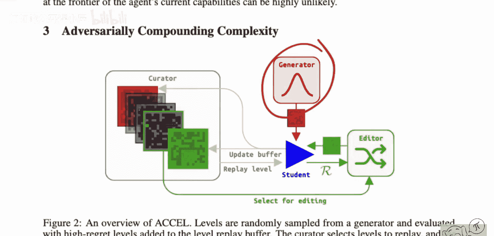

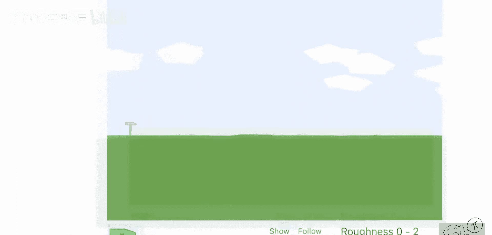

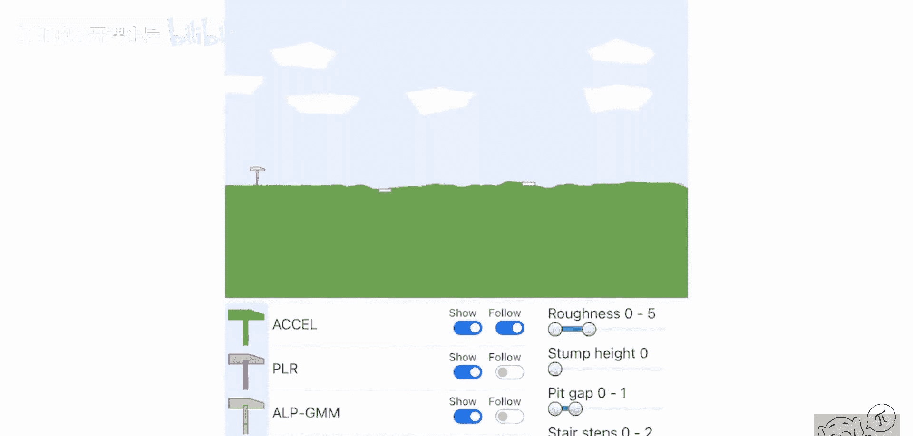

So。😊，Once we have the generator， we could already build some sort of an curriculum algorithm right。

 we could just sample different levels from the generator and then just train the agent on all of them。

 however that wouldn't amount to a much of a curriculum as it would probably generate easy and hard levels all throughout each other and the agent would be able to solve the easy levels maybe a little bit and then maybe a bit of the harder levels。

 but if you don't sequence this correctly， that there's a big chance that you're going to fail。

 mostly because。As the level design space gets higher and higher。

 most levels are either going to fall in the too easy or way too hard section。

 and not a lot are going to be in that zone of proximal development。

 and therefore you don't have much of a learning signal。

 So we need to somehow filter and and and curate these levels that we generate。

So we have a generator and the generator simply gives us the starting bunch of levels and I believe'm。

You can also go to the generator within the algorithm and so on。

 but imagine the generator gives us just a bunch of starting levels。

 This is one of these starting levels。 I'm to take a different color right here otherwise you won't see。

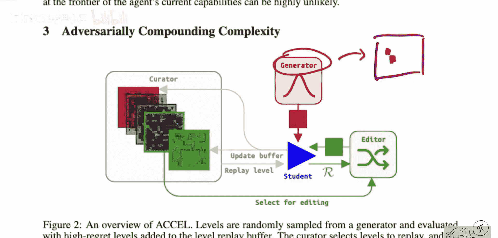

That's even worse， Thank you。

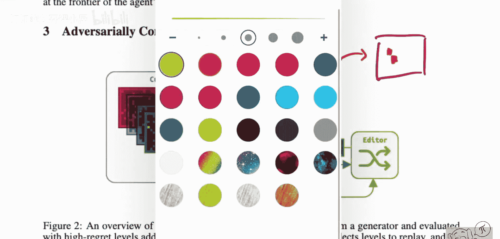

So the generator gives us a bunch of starting levels and these go to the student again the student here that's a single agent that is not a family of agents。

 the evolutionary methods here are not with regard to the student but to the levels themselves so there's one student that trains on all the different levels so what we do is we simply evaluate we ask we let the student run on this level and we see how well it does we're going to measure its regret so the regret of a student we're going to get to that measure it's essentially an estimate of how far the student is away from the optimal policy on that particular level and what we want to do is we want to strictly select for levels that have high regret。

So levels where the student is far away from the optimal policy。

 because those are the levels where the student can still learn something。

And if we do that correctly， then this automatically sequences these levels in the sequence of difficulties such that they're always just at the edge of what the student can do。

And you'll see how that works in a bit。 So we want to measure their regret and we have this。

 we have the buffer right here， the buffer。Is where all the levels that we currently think are interesting to for the student to learn at reside。

 This buffer is managed by the curator that the curator is essentially just。

 it's just a bucket of levels that。That we think are interesting What we then do is we can replay those levels so we can actually train the student on the levels。

 but we also if we just train the students on these levels， that's not much of an interesting thing。

 so we also need a way to update that buffer and the way we update the buffer。

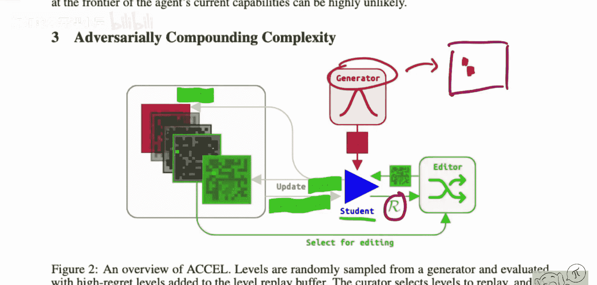