# YannicKilcher【中英⚡AI经典论文领读(全203篇)(下)｜Papers Explained】 p86 P186 按我所能行事，而非按我所说：将语言基础建立在机器人可供性中（SayCan论文解析） [BV1j8x5zJEvx_p86]

Hi there。 Check out this video。 So the there's a coke can。 And there's a spill， a coke spill。

 So the instructor here says I spilled my Coke on the table。

 How would you throw it away and bring me something to help clean。

 So the robot here forms a plan as it goes about it。 First， it says I would find a coke can。

 then second， I would pick up the coke can。 You can see it has done it。 third。

 I would go to the trash can Four， I would put down the coke can。

 Not that he puts down the coke can next to the trash can， not in the trash can。

 Because the robot is environmentally friendly and wants to preserve the can for the recycling bin for cans。

 And you know， it doesn't belong in the trash。 Good little robot。 So next。

 it says I will find a sponge。 I will pick up the sponge and then， Will it clean the Coke。😊。

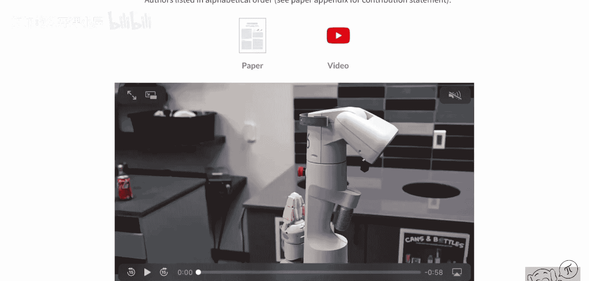

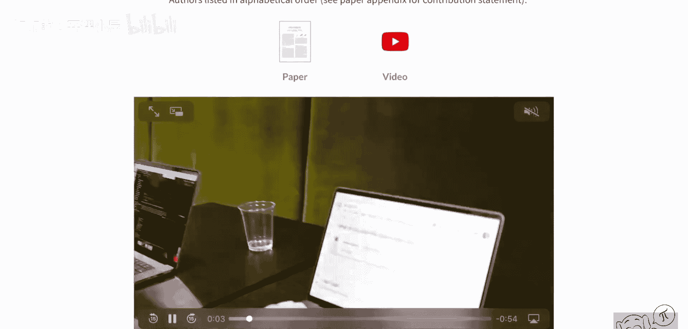

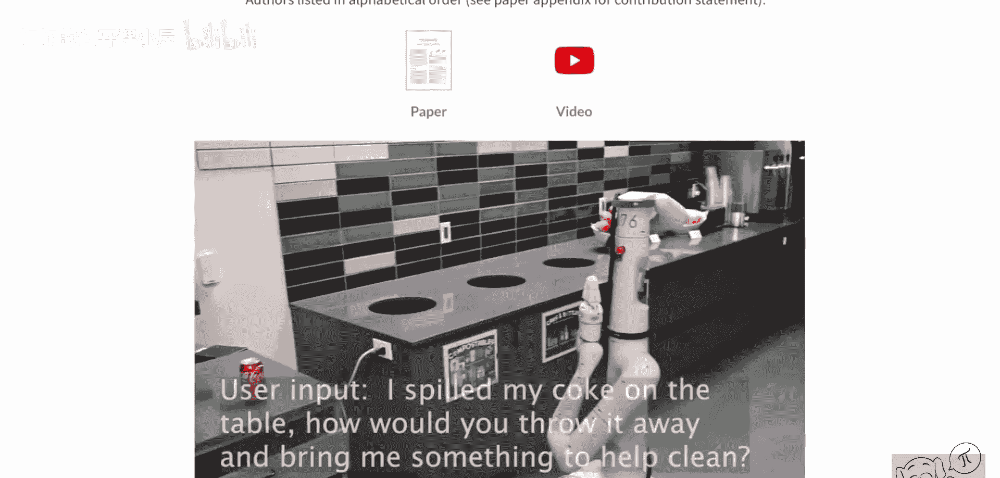

No， it will not clean up the spill。 It will actually give the sponge to the human to clean up the spill。

 because that's how the future is gonna be the robots。 They're not gonna take our， you know， people。

 people always think the robots will take our dirty jobs。 They'll。

 they'll take all the like the these tasks like cleaning and doing things。 No na。

 na They'll abuse us。 The humans to do that。 They'll just throw down our stuff。

 They'll throw down the spongge be like here human。 clean up your own mess。

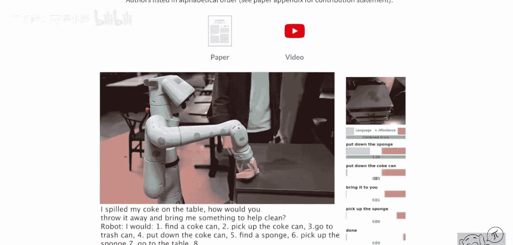

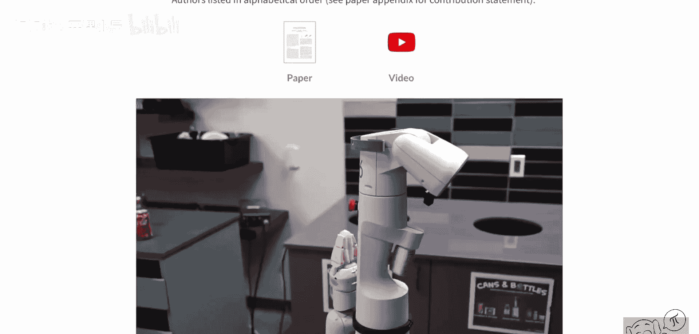

Well， that's if that's a future that you look forward to do。 then join me in today's paper。

 We're going to look at do， as I can， not， as I say。

 grounding language in robotic affordances by researchers at robotics at Google and everyday robots。

 So as you saw in this video， what happened here is that from a simple instruction that the instructor gave this essentially this I spilled a coke can。

 you know， please help me find something to clean and throw it away。 The robot formed a plan。

 The plan， you can see at the very end here。 You can see it developing in the bottom。

 at the very end， you can see the full plan。 I'm not sure if I can make this。😊。

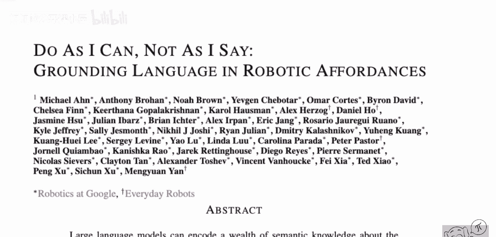

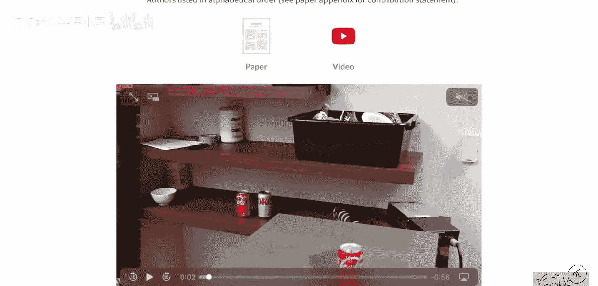

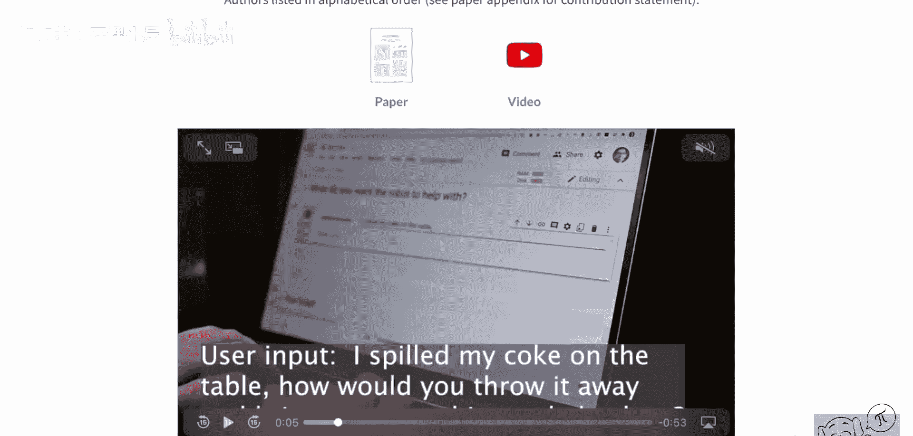

Bottom thing go away。 In essence， it makes a plan like it。 It always plans the next step。

 or at least it determines what the next step should be。 And then it actually also does it。

 So this is a good example of grounded a grounded language model。

 or also an example of embodied intelligence。 This work connects large language models。

 and the knowledge that are that is inherent to large language models with the skills of robots that act in the real world。

 which really cool and usually these two things are quite disjoint But this could be really powerful。

😊。

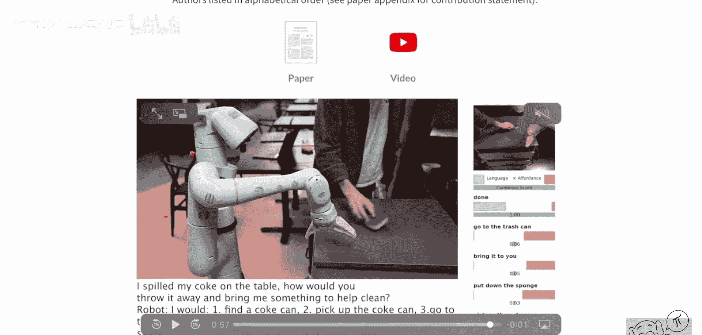

So' going to look at this paper。 I also have already recorded an interview with the authors this for time reasons。

 we did it the other way around this time。 So I don't want to take away too much on the paper review right here。

 I'll tell you what the method is about how it works。

 And I'll leave the rest to the authors who are extremely competent。 and I learned。

 I learned like I learned a lot in the interview。 I hope you will too。 In any case。

 the interview will be out to morrow if you're watching this the day it comes out。

 which obviously you do。🎼How do you find new papers， Frankly， machine learning has become unbearable。

 There are thousands of new papers each month。 And to keep the overview， we need good tools。

 Today's sponsor is Zeta alphapha， which is a search and recommendation engines for papers。

 This is really powerful。 For example， here， I've searched for today's paper。

 say can you can immediately see that not only do I get the paper itself。

 but I also get an aggregation of all the social media mentions of this paper。

 It doesn't stop there with one click。 I can find related papers。

 This are not only papers that are cited， but these are semantically similar papers。

 This is powered by neural search， which is really cool。 I can further now add this paper to my tags。

 And what that will do is it will build categories of papers。

 and then serve me recommendations that semantically fit those categories。 This is really powerful。

Essentially， this is a newsfeed of papers that is personalized to you specifically。 Just recently，😊。

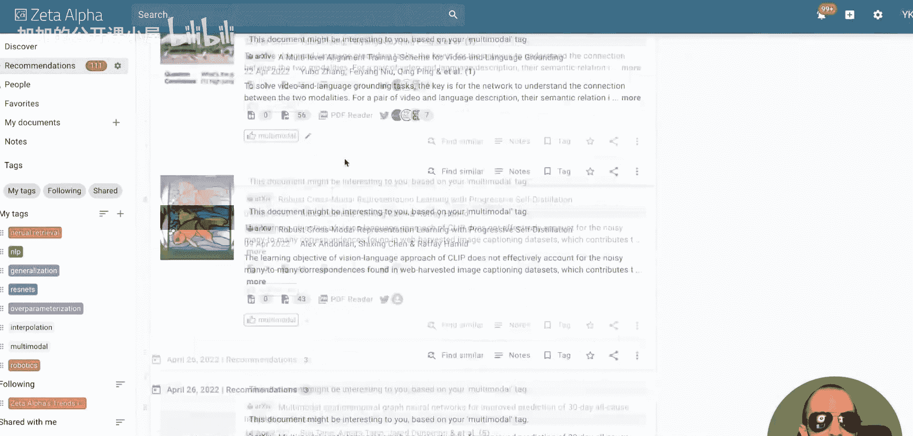

🎼Alpha has released their own PDF reader This is really strong right out of the gate not only does it let you read the paper you know。

 but also it shows the important information about a paper and it lets you take notes Now what I find by far the coolest thing is that you can actually use one of these notes to search for other papers so whenever you find something within a paper that seems interesting you can use that particular piece of text and go search for other papers that might deal with the same topic Sign up now to Zta Al there is a free tier and the pro tier is actually free for students for academics but in case you are not one of these the promoco Yek will get you 20% of the pro subscription。

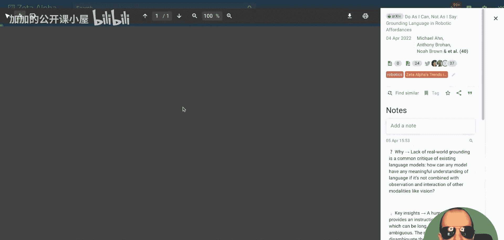

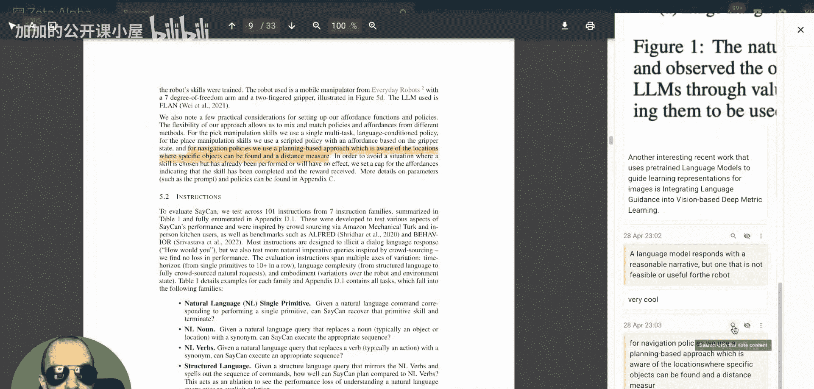

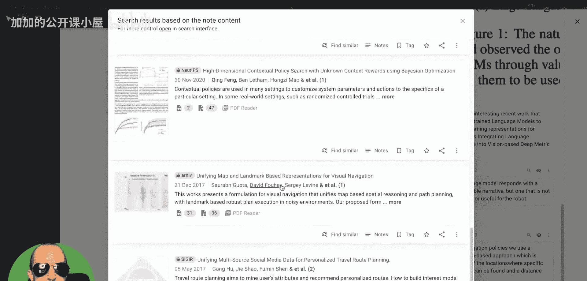

The authors here state that if you try to ask a language model to clean a spill。

 as they just did in the video。So if you ask a language model to clean a spill。

 it might result in a reasonable narrative， as we've all come to know the large language models like GP3 or so they give very convincing outputs。

 So when you ask them， how would you clean up a spill。

 They'll give you a reasonable plan to clean up a skill。

 But the authors say may not be applicable to a particular agent such as a robot that needs to perform this task in a particular environment。

 They have a bunch of examples right here， So I spilled my drink， How can you help is up here。

 GP3 would say something like you could try using a vacuum cleaner。 GP3 has no idea of a。

 whether there is a vacuum cleaner in this environment or B。

 whether the robot or whatever agent is capable of executing that action。

 So is capable of handling a vacuum cleaner， because its not is not the easiest thing to use。

 You have to go get it， plug it in and so on。Moving parts， similarly， models like Lambda and flan。

 of course， they're made for different things， but still。

 they will pay no attention to what is actually possible in the environment。 Now。

 you can get around this a little bit by prompting by prompt engineering telling the model what's possible in the current world。

 but it， it will only get you so far。 So we need something else。 We need something better than this。

 And that's where this system comes in。So they say what they want to do， they provide。

 they want to provide a real world grounding by means of pretrained skills。

 And this leads to a situation where you only consider actions that are both feasible and contextually appropriate。

 So these two things need to be brought together。 the language model supplies the high level semantic knowledge about the task and the robot itself or the policy in the robot provides the feasibility of the of the tasks to be executed。

 So the two things are brought together， contextually appropriate from contextually appropriate from the language model side and feasibility from the robot side。

So how are they going to do this， They're going to combine， as I said。

 large language models with policy or value functions。 let's say value functions。

 And then they execute a policy。There's a bit more explanation right here。

 but I think I've said many things already。 We'll get to the。 We'll get to the meat right here。

They say， let's say we have a robot。The robot might be， or in this case。

 is equipped with a repertoire of learned skills for basic atomic behaviors。

 These skills are capable of low level perception and control。

 So one of these atomic behaviors is for example， if you remember from the video。Pick up something。

 I pick up the Coke can。 That's an atomic behavior。

 You can teach the robot to pick up a coke can in isolation。 It can do it many times。

 You can train some imitation learning or reinforcement learning。

 or you can even hard code that particular policy。 It doesn't matter。

 What matters is that you can train it in。Sorry， in isolation， It is an atomic action。

And these atomic actions can then be chained together to form a sequence of actions and execute a plan。

So the atomic actions are going to be supplied by the robot。

 and then the sequencing of the atomic actions is going to be determined by the language model。

They say if we can simply make the large language model aware of the available and feasible repertoire of skills。

 this can provide it with an awareness of both the agent's capabilities and the current state of the environment。

So if they have a large language model， many people use large language models to sample。

 which means that they input， they would input something like， you know， I， I capitalized， I spilled。

A drink。Dot dot， dot， And then they would let the language model generate stuff right here。

 And then they would try to interpret this stuff。 We've seen this in other paper。

 and there are situations where it can work， especially if you put like some reasonable prompt in front of it。

 but the approaches have been largely to just let the model。

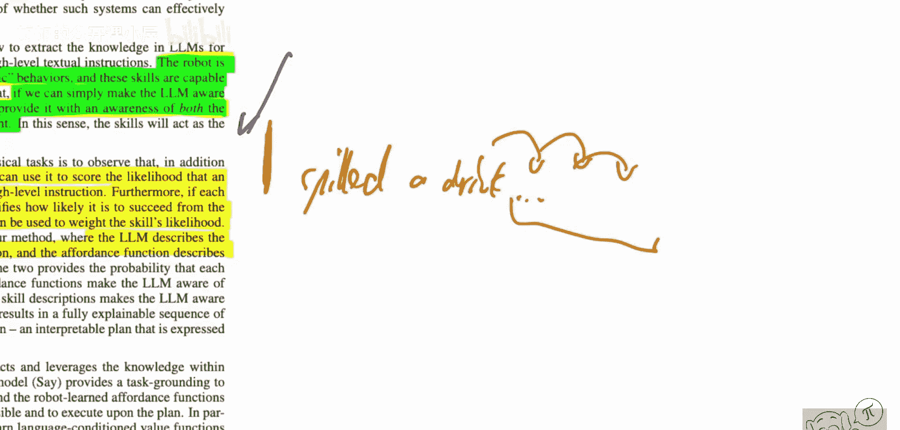